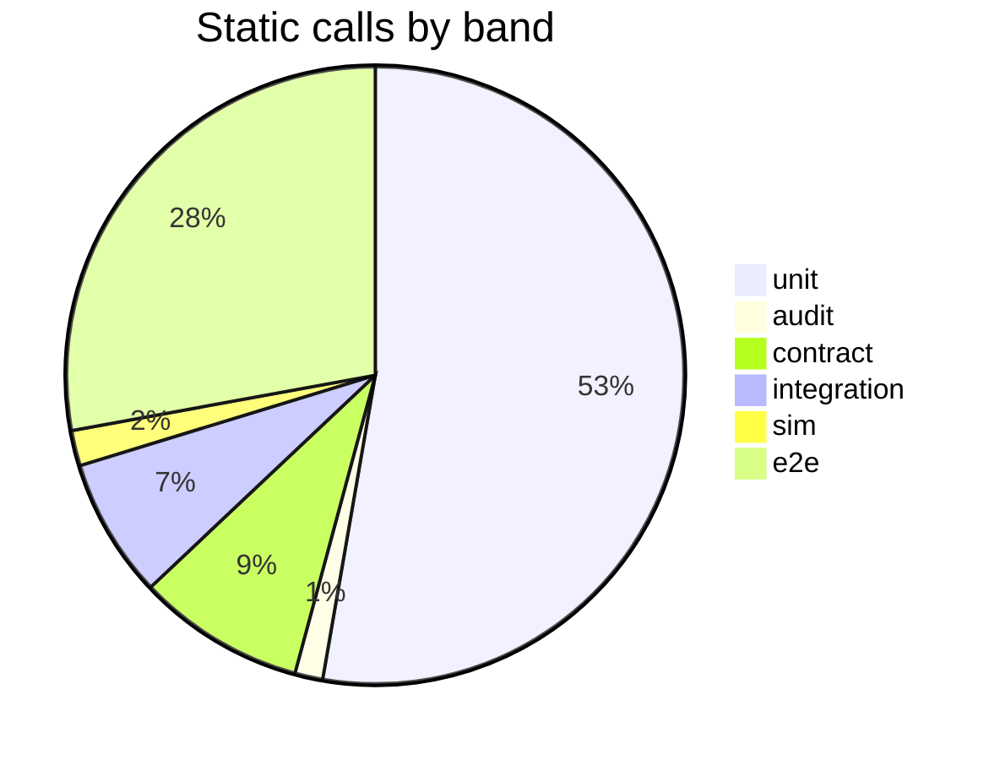
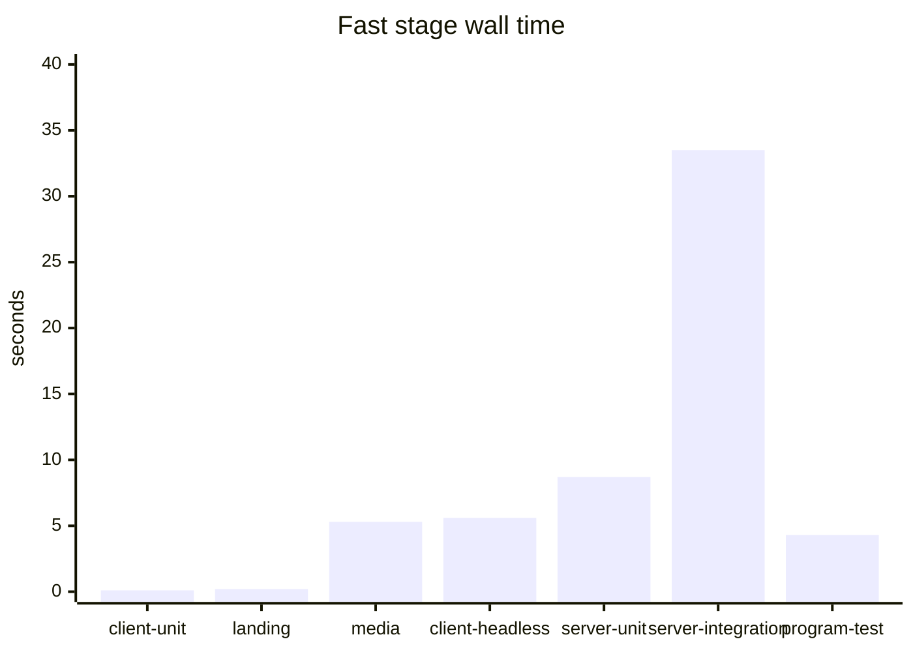
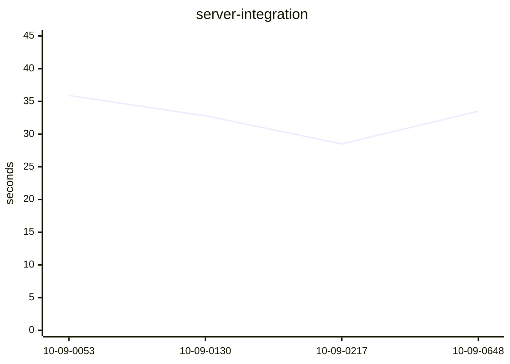

# freightchain

Freight Chain: a browser truck-driving game with a Solana-paid lobby. Vanilla ES modules and three.js in the client, a NestJS API, and an Anchor escrow program. The map for coding agents is [`AGENTS.md`](AGENTS.md) (and [`CLAUDE.md`](CLAUDE.md), which imports it).

Local run: `npm run db:up && npm run server:dev` → http://localhost:3000

## Repository

Every directory at the repo root. `.git` is the only one left out.

- `.claude/` – project skills for coding agents. One folder per skill (`SKILL.md`, plus a script when the skill runs something). The index is [Skills](#skills).
- `client/` – the game and the site pages: lobby, admin, and the model viewer (`viewer.html`). Vanilla ES modules + three.js, no build step. The API serves it in dev; production puts the game on `ride.<apex>` and the lobby on the apex.
- `deploy/` – semi-automatic deploy to our own server (Docker, host nginx, certbot). `npm run deploy` (see [`deploy/README.md`](deploy/README.md)). Ships `git archive HEAD`, so commit first.
- `design/` – art that is not the running app. `design/icons/` holds the app-icon candidates (SVG + 1024 px PNG; `build-app-icons.mjs` writes the shipped set into `client/`). `design/youtube-banner/` builds the channel banners (`banner.html`, `node design/youtube-banner/build.mjs`).
- `docs/` – plans and explainers: the hackathon plan, backend architecture, [statistics](docs/statistics.md), [verified play](docs/verified-play-next-steps.md), [product analytics](docs/analytics/index.html), [replays and donations](docs/replay-and-donations/index.html), escrow status, and the pool-program spec. The public escrow explainer is the whitepaper, chapter 05.
- `landing/` – the `/` page and the whitepaper (`whitepaper.html`, host `whitepaper.<apex>`). Its own Vite project: wallet sign-in, live pool and boards, dash cards drawn by the game's cockpit code. No three.js.
- `media/` – promo clips and sound. `media/video/` captures real gameplay to mp4 (≤ 15 s) and gif (≤ 20 MB). `media/audio/` is the chiptune synth (music, engine, effects) and also builds the game's own sounds in `client/audio/sfx/`. `media/out/` holds the finished intro and the sound library. See [Promo videos](#promo-videos).
- `programs/` – `programs/freightchain-pools`, the Anchor escrow: one program, many prize pools, each pool its own vault. The spec is [`programs/freightchain-pools/README.md`](programs/freightchain-pools/README.md). `npm run program:build`, `npm run program:test`, and `npm run program:verify` (the pinned verifiable build). Written and tested; not deployed.
- `server/` – NestJS + Prisma + PostgreSQL API ([`docs/backend-architecture.md`](docs/backend-architecture.md)): layers, HTTP rules, race-safety, and the test pyramid.

Also at the root, as files: `package.json` (the `npm run` scripts), `docker-compose.yml` (local PostgreSQL on 127.0.0.1:15433; PostHog is not set here), `AGENTS.md` and `CLAUDE.md`, `technical_design_document.html` (the production-target spec; this prototype does not meet it yet), `.gitignore`, and `.dockerignore`.

## Skills

Skills live in `.claude/skills/<name>/`. A coding agent reads that folder's `SKILL.md` before the work. The same command is what you run yourself. The read-only skills never deploy and never write to production.

| Skill | What it is for | Run |
| --- | --- | --- |
| `game-audio` | 8-bit music, sound effects, the engine bed, the reusable sound store, or sound on a clip | `npm run media:store` · `npm run media:game-sfx` · `npm run media -- media/specs/<name>.json --remux` |
| `gameplay-balance` | Tune how the truck drives: gearbox and torque, launch and stall, steering and weight, brakes, engine heat, cold-engine wear, battery, strain, road holes, traffic, off-road, the speed governor, and how long a shift takes to complete | `cd client && npm run check` · `cd client && node tools/e2e-chrome.mjs` |
| `gameplay-video` | A promo mp4 (≤ 15 s) and gif (≤ 20 MB) from real gameplay, with landing-styled captions | `npm run media -- media/specs/<name>.json` |
| `live-board-test` | Who is online, which rides are on the road, a closed tab leaving at once, and the replay history | `bash .claude/skills/live-board-test/run.sh` |
| `localnet-e2e` | Real ticket buys, refunds, payouts, and the pool crank on a local Solana validator; ten riders paid by the program; a 100 % program coverage gate | `npm run test:localnet` |
| `analytics-review` | Three passes over the landing, whitepaper, lobby, and the online ride: new controls get events, removed ones lose them, and the explainer stays in step. Each pass writes `docs/analytics/updates/<n>.html`. Does not call PostHog | `node .claude/skills/analytics-review/inventory.mjs` |
| `posthog-prod` | Product analytics on production: the boot line, one public probe, the flush log. Read-only | `bash .claude/skills/posthog-prod/check.sh` |
| `posthog-test` | Local analytics smoke: the relay, and one batch accepted by the EU ingest | `bash .claude/skills/posthog-test/smoke.sh` |
| `prod-db` | Production PostgreSQL, read-only: players, rides, verdicts, payments, the review queue | `npm run ops -- query list` · `npm run ops -- query wallet <address>` · `npm run ops -- sql "SELECT …"` |
| `prod-logs` | Production logs, read-only: the app, Postgres, and nginx | `npm run ops -- logs --since 30m` · `npm run ops -- logs --errors` |
| `program-check` | The escrow program: reproducible build against the pinned hash, tests on that `.so`, clippy, audit | `npm run program:verify` |
| `replay-test` | Live watch page, replays, and the `LIVE_*` flags, with a driver and a spectator in Chrome | `bash .claude/skills/replay-test/run.sh` |
| `ride-audit` | Is this stream honest? A ride loaded from the database (local or production, read-only): the road and its holes rebuilt from the seed, every batch re-hashed, every sample and input measured again, judged afresh and compared with the verdict on record | `bash .claude/skills/ride-audit/run.sh <ride id>` · `… <ride id> --prod` · `… --latest 20 --prod` |
| `ride-investigate` | One player or one ride on production: the database rows and the matching log lines | `npm run ops -- query ride <id>` (or `query wallet <address>`), then the logs named in the skill |
| `run-tests` | The whole local suite: lint and unit tests, PostgreSQL, then real-Chrome end-to-end. There is no CI | `npm run check`, then `npm run server:integration`, then `bash .claude/skills/run-tests/e2e.sh` |
| `stats-reconcile` | Check and repair the statistics (rides, time, km, crashes, stream donations – per rider and global) by recomputing them from the rides; production read-only | `bash .claude/skills/stats-reconcile/run.sh [--fix]` · `--prod` |
| `test-census` | Count the tests by pyramid layer, grade test coverage per feature, user flow, controller and route (static attribution, line + branch coverage, the routes each browser suite hits), name gaps, and rewrite the Tests block below and docs/test-coverage.md | `npm run test:census` · `npm run test:census -- features` · `npm run test:census -- coverage` · `npm run test:census -- run` · `npm run test:census -- readme` |
| `trip-design` | The road per ride tier – the free run and the 1 h / 4 h / 8 h shifts: bends, traffic, roadside, whether it ends by itself at the line, its length and finish distance – measured with the real game modules and looked at in Chrome | `node .claude/skills/trip-design/measure.mjs` · `node .claude/skills/trip-design/shots.mjs` |
| `level-check` | Each free level (EASY / CROSSROADS / HARD) is what it promises and passable by a human: the road each level's shift covers (junctions, forks, lanes, bends, sinkhole traps), then a human-paced driver on the real truck with ASSIST off on many seeds × all routes – finish rate, hull, vehicles hit, against the level's limits | `node .claude/skills/level-check/check.mjs` |
| `verified-play-test` | The anti-bot / anti-cheat end to end, positive and negative: a person and a bot in Chrome (dispatch prompts answered / ignored), API-level bots with hand-built recordings (every verdict code), the upload protocol, the admin's signed decisions, the profile in Chrome, retention + the CLI's bulk re-judge | `bash .claude/skills/verified-play-test/run.sh` |
| `storybook-models` | Review and fix a mesh in the model viewer (`client/viewer.html`), or add or update a 3D object the game draws | `node .claude/skills/storybook-models/shot.mjs` · `node .claude/skills/storybook-models/shot.mjs <id>` |

A new, renamed, or removed skill updates this table in the same change. The rule is [`AGENTS.md`](AGENTS.md) → "Maps stay current".

## Verified play, admin, observing production

- **Verified play**: on online rides the game records every key press and a 10 Hz sample of the truck (`client/js/telemetry.js`) and uploads hash-chained batches; after a completed shift the server checks that recording – complete, untampered, consistent with the ride, human-timed – and marks it `verified` / `flagged` / `rejected`. It also holds the recording against **the server's own road**: the road and its sinkholes are a pure function of the ride seed and its trip, the server rebuilds them (`server/src/domain/road`) and hands the game that obstacle plan (`GET /api/watch/:id/road`); a truck that drives through planned holes without the damage the game takes there – a game with the holes taken out – is rejected (`obstacle-ignored`), and so is one that stays off the road longer than the game allows or gains speed without gas. Replays draw the server's holes and mark every one driven through untouched (NO IMPACT). Audit any stream from the database: the `ride-audit` skill. Nothing is re-simulated. Only verified paid shifts rank, unless `VERDICT_ENFORCE=false` (shadow mode). Details: `AGENTS.md` → "Verified play".
- **Admin page**: `https://admin.<apex>` (locally `/admin.html`) behind HTTP basic auth (`DEPLOY_ADMIN_USER` / `DEPLOY_ADMIN_PASSWORD`), its own wallet sign-in for `ADMIN_WALLETS` (a 2 h admin session) and a wallet signature on every change – overview, the review queue of flagged rides (accept / reject, audited), rides, sign-ins, the server's recent logs, the audit log.
- **Production, read-only**: `npm run ops -- logs --since 30m` · `ops -- logs --errors` · `ops -- query list` / `ops -- query wallet <address>` · `ops -- sql "SELECT …"` (a read-only transaction) · `ops -- ps`. See `deploy/README.md`.

## Live streams: replays and donations

- **Statistics**: total rides, time driven, kilometres, crashes (car ⇄ car, car ⇄ building) and donations during streams are kept as running totals per rider and for the whole game – the landing's DRIVEN, ALL TIME, the lobby profile's DRIVING RECORD, `GET /api/stats` (+ `GET /api/stats/daily`: one row per UTC day) – free and paid rides are counted apart, per rider and in total. Cached in Redis (`REDIS_URL`; production: a password-protected `redis` service on an internal-only compose network, no published port). Every started ride that ends counts, completed or not. How it works: [docs/statistics.md](docs/statistics.md). Check / repair: `bash .claude/skills/stats-reconcile/run.sh`; test: `bash .claude/skills/run-tests/e2e.sh stats`.
- **Who is online, what is on the road, what can be replayed**: the landing's chip and the lobby's header say `N online · M on the road`; LIVE NOW / the lobby's LIVE tab list every ride on the air with how many watch it (sort, route filter, ▶ WATCH or WATCH A RANDOM ONE to join); the lobby's REPLAYS tab and the landing's RECENT RIDES list every ride that ended – a ride whose tab vanished is ended automatically after `HB_TIMEOUT_MS` (150 s) and shows as *signal lost* – with ▶ REPLAY while its recording is kept. API: `GET /api/live`, `GET /api/replays`. Test: `bash .claude/skills/live-board-test/run.sh`; fill a dev server with fake rides: `node server/scripts/sim-rides.mjs --base http://localhost:3000 --drive 3 --abandon 1 --visitors 5`.

- **Watch any ride**: `play.html?watch=<rideId>` – linked from the landing's ticker and LIVE NOW board and the lobby's Live tab. No video: the page rebuilds the driver's road from the ride's seed + route and replays the verified-play recording (10 Hz samples, uploaded every 15 s), so a live view runs ~25 s behind; a finished ride plays as a replay with a timeline and 1× / 4× / 16× (as long as its recording is kept, 90 days).
- **Chat and donations** (signed in with a Solana wallet, not on your own ride, only while it is on the road): chat lines show on a CB panel in the driver's cab (the driver folds it with K and can mute any spectator). Donations: a tip, NIGHT / DAY (the driver's clock jumps), or POTHOLES / TRENCH / SINKHOLE (a hole in the driver's lane ~1 km ahead, warning sign first) – the driver's game reports where it put each hole, so every replay has it in the same place. One game effect per ride per 20 s. Replays also show the traffic (recorded at 2 Hz).
- **Feature flags** (server env, `docs/configuration.md`): `LIVE_CHAT` (all | free | off), `LIVE_DONATIONS` (on | off), `LIVE_FREE_DONATIONS` (on = mock, nothing charged · off = each donation is a real devnet SOL transfer from the spectator to the driver, verified on chain), `LIVE_EFFECTS` (all | free | off); `free` = only on free test rides. Production defaults: chat everywhere, donations paid on chain, effects only on free rides.
- How it all works, the rules, the API and the limits: [docs/replay-and-donations/index.html](docs/replay-and-donations/index.html). Test it end to end: `bash .claude/skills/replay-test/run.sh` (the `replay-test` skill).

## Product analytics

How the loop is measured — every event, the nine funnels, what the server owns, what the browser may say — is [docs/analytics/index.html](docs/analytics/index.html). Capture is on this checkout. The private EU board is [project 297915 / dashboard 1006663](https://eu.posthog.com/project/297915/dashboard/1006663) and stays empty until tiles exist; events show in Activity. Ingest is `https://eu.i.posthog.com`. The project token stays in the gitignored env files; the tracked examples keep `POSTHOG_KEY` empty. A token alone does not send: `POSTHOG_ENABLED` must be `1` or `true`, and `POSTHOG_DISABLED=1` still wins. Local `server/.env` pins `POSTHOG_ENABLED=0`, and the local compose file does not run the API, so `npm run server:dev` does not send. Production `deploy/.env` sets `POSTHOG_ENABLED=1`, and the live site sends once this image is what production runs. Local smoke is `posthog-test`. The production check is `posthog-prod`. Lining the landing, whitepaper, lobby, and online ride up with those events is `analytics-review`: three local passes, each saved under `docs/analytics/updates/`. That review does not send a batch and does not edit a PostHog dashboard.

**Page speed** is one Trends insight, not five. Event `web_vital`, aggregation **Total count**, break down by the event property `metric` and then `rating`, chart type the bar chart of the whole date range. Name it Page speed. Leave it off dashboard 1006663, and leave PostHog's own Web Vitals page alone (that reads `$web_vitals` from `posthog-js`, which this site does not load). Each bar is a pair such as `LCP / good`. `good` is fine, `needs-improvement` is slow, `poor` is something a visitor will notice. If `good` is the taller bar, most visits are fine. A third breakdown, `surface`, says whether it was the landing, the whitepaper, or the lobby. Open it after a change to one of those pages. It says nothing about a ride.

- **TTFB, Time to First Byte.** How long until the page's HTML starts to arrive. A poor value means the wait happens before anything can draw.
- **FCP, First Contentful Paint.** When the first text or image appears.
- **LCP, Largest Contentful Paint.** When the main thing appears: the hero on the landing, the article on the whitepaper, the lobby itself. This is the one people feel as "the page is slow."
- **INP, Interaction to Next Paint.** How long a click or a key takes to show a response. It is only recorded after someone actually does that, and it is sent when they leave. An empty INP bar is normal.
- **CLS, Cumulative Layout Shift.** How much the page jumps after it has appeared. This one is not a time. `0` means nothing moved. In the raw `value`, `100` means a score of `0.1`.

## Tests

There is no CI. Run the suites locally (the `run-tests` skill). What each skill is for, and the command to run it, is in [Skills](#skills). The counts, gaps, and last runs below are written by the `test-census` skill.

<!-- test-census:start -->

Counted 2026-10-09 23:44 UTC by `test-census`. Static cases are `it` / `test` / `#[test]` call sites. A recorded run is what that command executed.

### Charts

Static calls by band. A slice is `it` / `test` / `#[test]` plus `check()`. The table below is the same count.



Newest wall time for each fast stage, in seconds. Each bar is that stage's own clock.



`server-integration` wall time across the kept runs, oldest first.



### Pyramid

| Band | Layer | Files | Cases | `check()` | Runs in |
| --- | --- | ---: | ---: | ---: | --- |
| unit | Server domain | 39 | 261 | 0 | `npm run server:test` |
| unit | Server CQRS handlers | 81 | 284 | 0 | `npm run server:test` |
| unit | Server services | 16 | 73 | 0 | `npm run server:test` |
| unit | Server controllers | 16 | 44 | 0 | `npm run server:test` |
| unit | Server infrastructure | 47 | 201 | 0 | `npm run server:test` |
| unit | Server app, cli, support | 4 | 15 | 0 | `npm run server:test` |
| unit | Client unit | 6 | 35 | 0 | `cd client && npm run test:unit` |
| unit | Landing | 8 | 93 | 0 | `npm run landing:test` |
| unit | Media | 2 | 25 | 0 | `npm run media:check` |
| unit | Escrow program (host tests) | 8 | 51 | 0 | `npm run program:test` |
| audit | Architecture and migration SQL | 6 | 30 | 0 | `npm run server:test` |
| contract | HTTP scenarios (source) | 16 | 170 | 0 | `server:test and server:integration` |
| contract | HTTP specs, in-memory | 4 | 10 | 0 | `npm run server:test` |
| integration | Repositories on PostgreSQL | 28 | 112 | 0 | `npm run server:integration` |
| integration | Concurrency | 1 | 36 | 0 | `npm run server:integration` |
| integration | Migration drift | 1 | 2 | 0 | `npm run server:integration` |
| integration | Same HTTP scenarios on PostgreSQL | 1 | 0 | 0 | `npm run server:integration` |
| sim | Headless game playthrough | 1 | 0 | 38 | `cd client && npm run test:headless` |
| e2e | Browser and API harnesses | 19 | 0 | 572 | `bash .claude/skills/run-tests/e2e.sh` |
| | **Total** | **304** | **1442** | **610** | |

HTTP scenario cases are written once under `server/test/scenarios` and executed twice: in-memory (`npm run server:test`) and PostgreSQL (`npm run server:integration`). The PostgreSQL runner row counts the runner file. Its cases are the scenario row. `it.each` is one static call and one executed test per row.

### Browser harnesses

| Script | `check()` | Runner |
| --- | ---: | --- |
| `client/tools/e2e-chrome.mjs` | 0 | `npm --prefix client run test:e2e` |
| `client/tools/e2e-viewer.mjs` | 0 | `npm --prefix client run test:viewer` |
| `landing/tools/e2e-wallet.mjs` | 25 | `e2e.sh` |
| `server/scripts/e2e-admin.mjs` | 35 | `e2e.sh` |
| `server/scripts/e2e-browser.mjs` | 13 | `e2e.sh` |
| `server/scripts/e2e-close.mjs` | 13 | `e2e.sh` |
| `server/scripts/e2e-live-board.mjs` | 21 | `e2e.sh` |
| `server/scripts/e2e-live-flags.mjs` | 13 | `e2e.sh` |
| `server/scripts/e2e-lobby.mjs` | 77 | `e2e.sh` |
| `server/scripts/e2e-localnet-payout.mjs` | 55 | `localnet-e2e` |
| `server/scripts/e2e-localnet.mjs` | 72 | `localnet-e2e` |
| `server/scripts/e2e-promo.mjs` | 47 | `e2e.sh` |
| `server/scripts/e2e-replay.mjs` | 32 | `e2e.sh` |
| `server/scripts/e2e-road-check.mjs` | 17 | `e2e.sh` |
| `server/scripts/e2e-stats.mjs` | 38 | `e2e.sh` |
| `server/scripts/e2e-tickets-stub.mjs` | 18 | `npm --prefix server run test:tickets-stub` |
| `server/scripts/e2e-verified-deep.mjs` | 45 | `e2e.sh` |
| `server/scripts/e2e-verified-play.mjs` | 19 | `e2e.sh` |
| `server/scripts/e2e-watch.mjs` | 32 | `e2e.sh` |

### Test skills

Purpose of every skill, including these, is the [Skills](#skills) table. This list is which of them run tests, and whether this log has timed that run.

| Skill | Census stage | Newest recorded run |
| --- | --- | --- |
| `live-board-test` | `live-board` | no run recorded |
| `localnet-e2e` | `localnet` | no run recorded |
| `posthog-test` | `posthog` | no run recorded |
| `program-check` | `program-check` | no run recorded |
| `replay-test` | `replay` | no run recorded |
| `run-tests` | `e2e` | fail · 2026-10-09 12:29 UTC · 26m 54s |
| `verified-play-test` | `verified` | no run recorded |

Census skill: `test-census`. Production read-only skills: `posthog-prod`, `prod-db`, `prod-logs`, `ride-audit`, `ride-investigate`. Other skills: `analytics-review`, `game-audio`, `gameplay-balance`, `gameplay-video`, `stats-reconcile`, `storybook-models`, `trip-design`.

### Gaps

- No recorded run: `live-board`, `replay`, `verified`, `localnet`, `posthog`, `program-check`.

### Coverage by feature

Which tests reach each product feature. The map (source paths, routes, harnesses per feature, steps per flow) is `.claude/skills/test-census/features.mjs`. Routes, files and cases are counted, not judged. Every route, file and flow step: [`docs/test-coverage.md`](docs/test-coverage.md).

Static: imports, requested routes, `check()` messages · browser runs: `admin` 2026-10-09, `board` 2026-10-09, `browser` 2026-10-09, `close-split` 2026-10-09, `close` 2026-10-09, `flags` 2026-10-09, `lobby` 2026-10-09, `promo` 2026-10-09, `replay` 2026-10-09, `verified` 2026-10-09, `wallet-split` 2026-10-09, `wallet` 2026-10-09, `watch` 2026-10-09 · lines: server unit + HTTP + PostgreSQL, the headless playthrough, client / landing / media node:test at 2026-10-09 12:57 UTC.

`strong` = nothing below is missing. `fair` = one thing is. `thin` = two or more, or fewer than a quarter of its files have a test of their own and no headless check stands in. `untested` = no test reaches it.
Checked: half or more of its source files are the subject of a test of their own (waived when the headless playthrough has 5+ checks for it, or for the Rust program, whose tests are black-box);
every API route it owns is requested by at least one HTTP scenario; a browser / API harness or a test skill drives it end to end;
when browser runs are recorded and one of its harnesses is an `e2e.sh` suite, every route it owns was hit by one (localnet and the tickets stub are not recorded); when line coverage is recorded, at least 70 % of its lines and 60 % of its branches ran (over the files a test loaded).

| Feature | Grade | Files with own test | Unit cases | Routes in scenarios | Scenario cases | Race tests | Sim checks | Harnesses | Routes in recorded e2e.sh runs | Lines · branches | Missing |
| --- | --- | ---: | ---: | ---: | ---: | ---: | ---: | --- | ---: | ---: | --- |
| Sign-in + session | **fair** | 14/20 | 47 | 4/4 | 36 | 1 | — | e2e-wallet, e2e-browser, e2e-lobby, e2e-close | 3/4 | 78.8 % · 77 % (19/20 files loaded) | 1 of 4 routes never hit in a recorded browser run |
| Player account: free rides + daily refill | **strong** | 3/3 | 16 | — | — | 5 | — | e2e-lobby | — | 100 % · 83.3 % | — |
| Verified play (recording, verdict, prompts) | **strong** | 14/22 | 76 | 1/1 | 26 | 5 | 1 | e2e-verified-play, e2e-verified-deep, e2e-browser | 1/1 | 89.3 % · 87.6 % (19/22 files loaded) | — |
| The server's road (obstacle plan, road checks, ride audit) | **fair** | 5/6 | 20 | 1/1 | 4 | — | — | e2e-road-check | 0/1 | — | 1 of 1 routes never hit in a recorded browser run |
| Pay-per-ride (legacy weekly round) | **fair** | 14/18 | 70 | 4/4 | 35 | 5 | — | e2e-lobby | 1/4 | 98.7 % · 87.2 % | 3 of 4 routes never hit in a recorded browser run |
| Ride lifecycle (order, start, heartbeat, end, stale sweep) | **strong** | 15/20 | 112 | 6/6 | 68 | 5 | — | e2e-browser, e2e-close, e2e-lobby | 6/6 | 88.4 % · 87.9 % (19/20 files loaded) | — |
| Escrow: pools on sale + ticket purchase | **thin** | 28/33 | 164 | 7/8 | 8 | 4 | — | e2e-lobby, e2e-tickets-stub, e2e-localnet | 1/8 | 85.7 % · 89.5 % (32/33 files loaded) | 1 of 8 routes in no scenario; 7 of 8 routes never hit in a recorded browser run (e2e-tickets-stub, e2e-localnet not recorded) |
| Escrow: settlement (events, watcher, webhook) | **strong** | 10/13 | 47 | 2/2 | 6 | 2 | — | e2e-localnet | — | 98.6 % · 92.2 % | — |
| Escrow: refunds, payouts, crank | **strong** | 7/7 | 26 | 2/2 | 1 | — | — | e2e-localnet, e2e-tickets-stub | — | 99.4 % · 84.3 % | — |
| Escrow program (on-chain, Rust) | **strong** | 0/14 | 51 | — | — | — | — | e2e-localnet | — | — | — |
| Promo codes (admin creates, players redeem) | **strong** | 12/14 | 72 | 7/7 | 38 | 3 | — | e2e-promo, e2e-lobby, e2e-wallet | 7/7 | 74.1 % · 92.9 % | — |
| Garage + cosmetics | **fair** | 6/9 | 30 | 4/4 | 11 | — | 6 | e2e-lobby, e2e-promo, e2e-watch | 3/4 | 87.2 % · 91 % (8/9 files loaded) | 1 of 4 routes never hit in a recorded browser run |
| Statistics (rides, time, km, crashes, donations – per rider + global, cached) | **fair** | 8/9 | 37 | 2/2 | 10 | 2 | 2 | e2e-stats | 0/2 | — | 2 of 2 routes never hit in a recorded browser run |
| Live board (online, on the road, history) | **strong** | 3/5 | 11 | 2/2 | 10 | — | — | e2e-live-board, e2e-close | 2/2 | 71.6 % · 91.1 % (4/5 files loaded) | — |
| Live streams: watch + replay | **thin** | 2/5 | 14 | 1/1 | 14 | 1 | — | e2e-watch, e2e-replay | 1/1 | 17.1 % · 87.5 % | 3 of 5 files have no test of their own; 17.1 % of lines ran |
| Live streams: chat, mutes, donations, effects | **fair** | 13/16 | 40 | 7/7 | 8 | 3 | — | e2e-watch, e2e-live-flags, e2e-replay | 7/7 | 65.4 % · 91.1 % | 65.4 % of lines ran |
| Lobby: tiers, pool, leaderboard, profile | **strong** | 7/11 | 31 | 4/4 | 35 | — | — | e2e-lobby | 4/4 | 94.5 % · 91.4 % (10/11 files loaded) | — |
| Admin page (sign-in, review queue, audit) | **strong** | 18/20 | 49 | 12/12 | 13 | — | — | e2e-admin, e2e-promo, e2e-verified-play, e2e-verified-deep | 12/12 | 100 % · 85 % (19/20 files loaded) | — |
| Product analytics relay | **fair** | 5/9 | 23 | 1/1 | 5 | — | — | /posthog-test | — | 59 % · 91.6 % | 59 % of lines ran |
| Platform: HTTP contract, health, rate limits, config, logs, CLI | **strong** | 28/56 | 107 | 2/2 | 7 | — | — | e2e-browser | — | 85.7 % · 79.3 % | — |
| Game: driving sim (drivetrain, brakes, battery, climate) | **fair** | 2/10 | 5 | — | — | — | 20 | e2e-chrome, e2e-browser | — | 69.2 % · 77.6 % | 69.2 % of lines ran |
| Game: endless road, junctions, traffic | **strong** | 1/12 | 7 | — | — | — | 9 | e2e-chrome | — | 72.3 % · 93.6 % (11/12 files loaded) | — |
| Game: cockpit, scenery, routes, 3D models | **thin** | 0/71 | 0 | — | — | — | — | e2e-chrome, e2e-viewer | — | 62.5 % · 90.2 % (64/71 files loaded) | 71 of 71 files have no test of their own; 62.5 % of lines ran |
| Landing page | **strong** | 2/4 | 49 | — | — | — | — | e2e-wallet, e2e-replay, e2e-live-board | — | 100 % · 100 % (2/4 files loaded) | — |
| Whitepaper | **fair** | 2/2 | 21 | — | — | — | — | — | — | 100 % · 99 % (1/2 files loaded) | no end-to-end harness |
| Promo clips + sound | **thin** | 2/19 | 25 | — | — | — | — | /gameplay-video, /game-audio | — | 93.4 % · 90.8 % (15/19 files loaded) | 17 of 19 files have no test of their own |

### Coverage by user flow

A flow is the API steps one user journey takes. A step counts when a scenario case requests it, and (once browser runs are recorded) when the server logged it during a browser suite.

| Flow | Route steps | In scenarios | In browser runs | Reached by no test |
| --- | ---: | ---: | ---: | --- |
| First visit → sign in → lobby | 7 | 7/7 | 7/7 | — |
| Free ride, start to leaderboard | 7 | 7/7 | 7/7 | — |
| Closing the game / a page mid-ride | 2 | 2/2 | 2/2 | — |
| Buy tickets → ride a paid tier | 8 | 7/8 | 2/8 | `POST /api/tickets/orders/:id/submit` |
| A pool misses its goal → refund | 3 | 3/3 | 0/3 | — |
| A live pool pays its winners | 2 | 2/2 | 0/2 | — |
| Pay-per-ride (PAYMENT_MODE=transfer) | 6 | 6/6 | 3/6 | — |
| Watch a live ride, chat, donate | 9 | 9/9 | 9/9 | — |
| Replay a finished ride | 2 | 2/2 | 2/2 | — |
| Redeem a promo code → wear it | 6 | 6/6 | 5/6 | — |
| Admin reviews a flagged ride | 11 | 11/11 | 11/11 | — |
| Admin creates / disables a promo code | 5 | 5/5 | 5/5 | — |
| Analytics relay | 1 | 1/1 | 1/1 | — |

### Coverage by controller

The controller spec only checks dispatch to the bus. Behaviour is the handler spec and the scenarios.

| Controller | Routes | Spec cases | Routes the spec dispatches | Handlers with a spec | Routes in scenarios | Routes in browser runs | Lines |
| --- | ---: | ---: | ---: | ---: | ---: | ---: | ---: |
| `admin-promos` | 5 | 5 | 5/5 | 5/5 | 5/5 | 5/5 | 100 % |
| `admin` | 12 | 5 | 12/12 | 12/12 | 12/12 | 12/12 | 100 % |
| `auth` | 4 | 4 | 4/4 | 4/4 | 4/4 | 3/4 | 100 % |
| `chain-webhook` | 1 | 2 | 1/1 | 1/1 | 1/1 | 0/1 | 100 % |
| `chain` | 1 | 2 | 1/1 | 1/1 | 1/1 | 0/1 | 100 % |
| `economy` | 3 | 2 | 3/3 | 3/3 | 3/3 | 3/3 | 100 % |
| `garage` | 2 | 2 | 2/2 | 2/2 | 2/2 | 2/2 | 100 % |
| `pools` | 6 | 2 | 6/6 | 6/6 | 6/6 | 2/6 | 100 % |
| `promos` | 3 | 2 | 3/3 | 3/3 | 3/3 | 2/3 | 100 % |
| `tickets` | 6 | 2 | 6/6 | 6/6 | 5/6 | 0/6 | 100 % |
| `health` | 2 | 2 | 2/2 | 2/2 | 2/2 | 0/2 | 100 % |
| `live` | 9 | 1 | 9/9 | 9/9 | 9/9 | 8/9 | 100 % |
| `lobby` | 3 | 1 | 3/3 | 3/3 | 3/3 | 3/3 | 100 % |
| `rides` | 10 | 8 | 10/10 | 10/10 | 10/10 | 8/10 | 100 % |
| `stats` | 2 | 2 | 2/2 | 2/2 | 2/2 | 0/2 | — |
| `telemetry` | 1 | 2 | 1/1 | 1/1 | 1/1 | 1/1 | 100 % |

### Notes

- 3 `it.each` / `test.each` call sites. The case column counts the call. The run counts each row.
- `analyticsScenarios` is registered twice on the in-memory runner and twice on PostgreSQL, so those cases execute that many times per backend.
- `e2e-chrome.mjs`, `e2e-viewer.mjs` report failures through the shared `problems` list, so they have no `check()` calls.
- Wall time is each stage's own clock, including process startup, and is longer when other stages are using the machine. `server-unit` finishes before `server-integration` starts. `server-integration` includes `npm run db:up`.

### Recorded runs

Newest first. 30 runs kept in `.claude/skills/test-census/runs.json` (up to 12 per stage).

| When | Stage | Result | Passed | Failed | Skipped | Wall |
| --- | --- | --- | ---: | ---: | ---: | ---: |
| 2026-10-09 12:29 UTC | `e2e` | fail | 376 | 6 | 0 | 26m 54s |
| 2026-10-09 06:48 UTC | `server-integration` | pass | 295 | 0 | 0 | 33.5 s |
| 2026-10-09 06:47 UTC | `program-test` | pass | 50 | 0 | 0 | 4.3 s |
| 2026-10-09 06:47 UTC | `server-unit` | pass | 1058 | 0 | 0 | 8.7 s |
| 2026-10-09 06:47 UTC | `client-headless` | pass | 39 | 0 | 0 | 5.6 s |
| 2026-10-09 06:47 UTC | `media` | pass | 25 | 0 | 0 | 5.3 s |
| 2026-10-09 06:47 UTC | `landing` | pass | 91 | 0 | 0 | 168 ms |
| 2026-10-09 06:47 UTC | `client-unit` | pass | 14 | 0 | 0 | 121 ms |
| 2026-10-09 03:39 UTC | `landing` | pass | 91 | 0 | 0 | 2.3 s |
| 2026-10-09 02:17 UTC | `program-test` | pass | 50 | 0 | 0 | 1.8 s |
| 2026-10-09 02:17 UTC | `server-integration` | pass | 295 | 0 | 0 | 28.5 s |
| 2026-10-09 02:17 UTC | `server-unit` | pass | 1058 | 0 | 0 | 5.6 s |
| 2026-10-09 02:17 UTC | `client-headless` | pass | 39 | 0 | 0 | 2.0 s |
| 2026-10-09 02:17 UTC | `media` | pass | 25 | 0 | 0 | 2.4 s |
| 2026-10-09 02:17 UTC | `landing` | pass | 90 | 0 | 0 | 93 ms |
| 2026-10-09 02:17 UTC | `client-unit` | pass | 14 | 0 | 0 | 59 ms |
| 2026-10-09 01:31 UTC | `program-test` | pass | 50 | 0 | 0 | 2.3 s |
| 2026-10-09 01:30 UTC | `server-integration` | pass | 295 | 0 | 0 | 32.8 s |
| 2026-10-09 01:30 UTC | `server-unit` | pass | 1058 | 0 | 0 | 6.8 s |
| 2026-10-09 01:30 UTC | `client-headless` | pass | 39 | 0 | 0 | 2.3 s |
| 2026-10-09 01:30 UTC | `media` | pass | 25 | 0 | 0 | 2.5 s |
| 2026-10-09 01:30 UTC | `landing` | pass | 90 | 0 | 0 | 96 ms |
| 2026-10-09 01:30 UTC | `client-unit` | pass | 14 | 0 | 0 | 65 ms |
| 2026-10-09 00:54 UTC | `program-test` | pass | 50 | 0 | 0 | 8.2 s |

Showing 24 of 30.

Newest fast stages on record: 7 of 7, overlapped in 42.2 s. Slowest of those: `server-integration` at 33.5 s. Added up, the stage times are 57.7 s.
A run counts more than the static call sites when `it`, `test`, or `check()` sits in a loop or in `it.each`, and when a scenario function is registered more than once.
`server-unit` executed 1058. Static call sites for that stage: 1088.
`server-integration` executed 295. Static call sites for that stage: 320.
`client-headless` executed 39. Static call sites for that stage: 38.

Failures in the rows above:

- `e2e` 2026-10-09 12:29 UTC: fail. ✘ e2e: 2 suite(s) failed – server log: /tmp/fc-e2e-freightchain_e2e_6412.log

Refresh the numbers with `npm run test:census -- run`, then `npm run test:census -- readme`. Chrome, localnet, PostHog, and `program-check` are opt-in stage names and are not part of a plain `run`.

<!-- test-census:end -->

```sh
npm run check                              # client lint + bundle + headless game · landing · server build, typecheck, unit tests + architecture audits
npm run server:integration                 # PostgreSQL in Docker, its own freightchain_test database
bash .claude/skills/run-tests/e2e.sh       # real Chrome: game (VERIFIED ride), lobby, admin page, live stream, replay, live flags, live board – on a throwaway database, screenshots in the OS temp dir
bash .claude/skills/replay-test/run.sh     # only the live stream, replay and LIVE_* flag suites (driver + spectator Chromes, ~9 min)
bash .claude/skills/live-board-test/run.sh # online / on the road / the replays history, fed by the ride simulator (~2 min)
bash .claude/skills/posthog-test/smoke.sh  # PostHog locally: headless Chrome, throwaway database, EU batch must return 200
bash .claude/skills/posthog-prod/check.sh   # PostHog on production, read-only: boot line, one probe, flush log
```

## Landing

```sh
npm run install:landing                # once
npm run landing:dev                    # Vite on :5173, proxies /api and the other pages to the server on :3000
npm run landing:build                  # → landing/dist, served by the server at /  (without it, / is the placeholder client/index.html)
npm run landing:test                   # formatters, card scripts, page integrity, size budget of dist/, the whitepaper's numbers vs the code
```

The whitepaper is `landing/whitepaper.html` (open `http://localhost:5173/whitepaper.html` under `landing:dev`): a static read on driving, rides and rules, rewards, the escrow program, verified play and live streams. It posts web vitals to the API. The production host still 404s `/api/`. Its figures are asserted against the server rules by `landing/test/whitepaper.test.js`, so change both together.

- **Sign-in**: the CONNECT button asks Phantom / Solflare to sign the server's challenge; the backend verifies the signature, sets the httpOnly session cookie and the page redirects to the lobby. On the landing the same session shows the wallet and turns the button into "OPEN THE LOBBY". Check it in real Chrome with `node landing/tools/e2e-wallet.mjs` (fake wallet; single origin or split hosts – recipe in the script's header).
- **Media**: WebP only; `node landing/tools/to-webp.mjs <files>` converts, `npm --prefix landing run media` re-captures the dash and sky shots from the running game.
- **Hero video**: set `data-src` on `#hero-video` in `landing/index.html` (a muted loop in `landing/public/media/`); it loads after the page, when idle, never on phones, data-saver or reduced motion.
- **Deploy**: the Docker image builds the landing (its tests gate the build) and the server serves it with long-lived caching for the hashed assets.

## Promo videos

[`media/out/video/intro/intro.mp4`](media/out/video/intro/intro.mp4) (14.8 s, with sound: key + engine start, 8-bit music, gear / crash / transition effects) and [`intro.gif`](media/out/video/intro/intro.gif) (silent; compressed look-alikes: [`intro.min.mp4`](media/out/video/intro/intro.min.mp4), [`intro.min.gif`](media/out/video/intro/intro.min.gif), [`intro.tiny.gif`](media/out/video/intro/intro.tiny.gif) 481 kB) are made from real gameplay by the `media/` app: a JSON spec of scenes (gears, a crash, night lights, Siberian frost, Australian dust, an end card), captions in the landing's style, transitions, a Solana badge, and an `audio` block. The audio is saved as separate files too ([`media/out/audio/intro/`](media/out/audio/intro): `mix`, `music`, `sfx`, `engine` WAVs + the cue sheet) and the reusable sounds live in [`media/out/audio/_store/`](media/out/audio/_store).

```sh
npm --prefix media install                  # once (Node >= 22, Chrome; ffmpeg comes from npm)
npm run media -- media/specs/intro.json     # ~30 s on a Mac GPU → media/out/video/intro/{intro.mp4 (+ sound),intro.gif,contact.jpg,timeline.json} + the sound in media/out/audio/intro/{mix,music,sfx,engine}.wav, cues.json + intro.min.{mp4,gif} + intro.tiny.gif (≤ 500 kB)
npm run media -- media/specs/intro.json --audio-only   # only the sound: rebuild from the saved timeline and remux onto the mp4 (seconds)
npm run media:store                         # re-render the sound library media/out/audio/_store
npm --prefix media run preview              # half-size look, not committed
```

New clip: ask Claude for one (the `gameplay-video` skill turns a text description into a spec, previews it and reports duration / size), or copy `media/specs/intro.json`. Limits are enforced: total ≤ 15 s, gif file ≤ 20 MB (it shrinks, then trims). Render on a real GPU – software GL makes the road flash. Details: `AGENTS.md` → "Promo videos".
