# Freight Chain

A truck game in the browser. You sit in the cab and drive. The road does not end. The shift does, at a finish line the server set. One mistake can end it sooner.

Paid entries are SOL on Solana devnet. The program holds the money. There is no token, and this build is not mainnet.

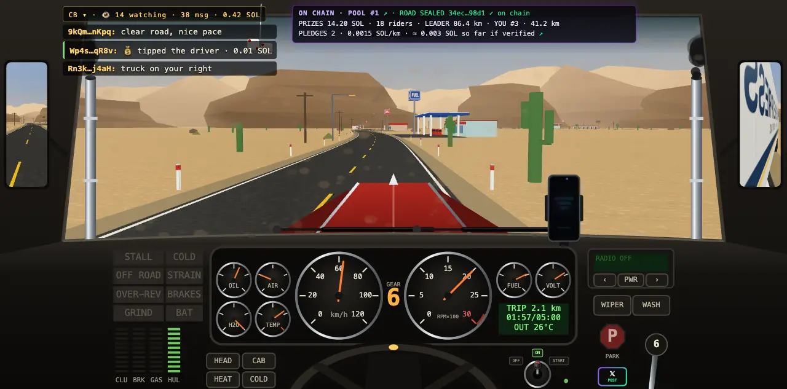

The live site is [freightchain.fun](https://freightchain.fun). The program in this repo is [`8No42h2QXb9opgp3pJfNXL2o77o288SsF8o7CwJGCA1p`](https://explorer.solana.com/address/8No42h2QXb9opgp3pJfNXL2o77o288SsF8o7CwJGCA1p?cluster=devnet) on devnet (v3, upgraded in place on 12 Oct 2026). Its config account is [`9zRUyontAnwj65WHpEazpmW1eyHb8oYfPDvxcpMrSw7F`](https://explorer.solana.com/address/9zRUyontAnwj65WHpEazpmW1eyHb8oYfPDvxcpMrSw7F?cluster=devnet), 146 bytes, read from the public devnet RPC on 13 Oct 2026. An older program, `9e7phdJz…BSvx`, is still on devnet with its pools finished. The site does not sell into it.

The entire project was built in two weeks during the hackathon, entering in the final 6 days of the submission window—the truck simulation and cockpit, the five routes, traffic, climate, the server, the lobby, the landing, the whitepaper, verified play, live watch, the admin page, the garage, promo codes, and the escrow program. Coding agents also read [`AGENTS.md`](AGENTS.md).

## Contents

- [Open the site](#open-the-site)
- [Ten minutes](#ten-minutes)
- [What is on chain](#what-is-on-chain)
- [Status](#status)
- [Limits](#limits)
- [Traction](#traction)
- [The truck](#the-truck)
- [Shifts](#shifts)
- [How a finish is checked](#how-a-finish-is-checked)
- [The road](#the-road)
- [Money](#money)
- [Sites](#sites)
- [Repository](#repository)
- [Skills](#skills)
- [Run it](#run-it)
- [Tests](#tests)

## Open the site

| Surface | URL | What you get |
| --- | --- | --- |
| Landing and lobby | [freightchain.fun](https://freightchain.fun) | The pitch, live boards, sign-in |
| Whitepaper | [whitepaper.freightchain.fun](https://whitepaper.freightchain.fun) | Rules, escrow, validation, streams, risks |
| Game | [ride.freightchain.fun/play.html](https://ride.freightchain.fun/play.html) | The truck. A ride id comes from the lobby. Bare `play.html` is a guest run |
| Ride receipt | `freightchain.fun/r/:id` | Live or finished ride, explorer link, X card. Open one from [REPLAYS](https://freightchain.fun/lobby.html#replays) |
| Model viewer | [storybook.freightchain.fun](https://storybook.freightchain.fun) | The meshes, no API |
| API | [api.freightchain.fun/api/health](https://api.freightchain.fun/api/health) | JSON under `/api/`. Anything else on that host 404s |
| Admin | [admin.freightchain.fun](https://admin.freightchain.fun) | HTTP basic auth, then a second wallet sign-in |
| Program | [Explorer, devnet](https://explorer.solana.com/address/8No42h2QXb9opgp3pJfNXL2o77o288SsF8o7CwJGCA1p?cluster=devnet) | Upgradeable. Initialized. Not audited |
| Social | [X](https://x.com/FreightChainSol) · [YouTube](https://www.youtube.com/@FreightChainGame) · [GitHub](https://github.com/recferret-bit/freightchain) | |

Landing chapters: [RIDE](https://freightchain.fun/#ride), [LOOP](https://freightchain.fun/#loop), [ECONOMY](https://freightchain.fun/#economy), [ROADMAP](https://freightchain.fun/#roadmap), [GO TO MARKET](https://freightchain.fun/#market), [ABOUT](https://freightchain.fun/#about), [FAQ](https://freightchain.fun/#faq). Whitepaper chapters for a review: [05 on chain](https://whitepaper.freightchain.fun/#onchain), [06 validation](https://whitepaper.freightchain.fun/#verify), [07 streaming](https://whitepaper.freightchain.fun/#stream), [08 limits](https://whitepaper.freightchain.fun/#risks).

## Ten minutes

One minute: open the [landing](https://freightchain.fun) and press PLAY FREE RIDE NOW. That is the guest run. No wallet, nothing recorded.

1. Read the hero. The page says devnet, and that the SOL there is not mainnet money. It also says the $5, $15 and $50 shifts are soon. That line stays until a pool of that tier is open.
2. Open the [whitepaper](https://whitepaper.freightchain.fun). Escrow is on devnet and not audited. The garage is a lobby tab: paint, wheel, gearbox, dice, needles. It does not change the handling.
3. Connect a devnet wallet (Phantom, Solflare, Backpack, or any Wallet Standard wallet). Sign-in is a message, not a transaction.
4. Start the free ride. EASY is three minutes on four lanes with two crossroads, and it ends itself at 1512 m. Tutorial and assist are free-tier only. HARD has neither.
5. Watch someone from LIVE, or open REPLAYS. The watch page draws the truck from the recording, about 25 seconds behind, on a road rebuilt from the ride seed.
6. Open the [program](https://explorer.solana.com/address/8No42h2QXb9opgp3pJfNXL2o77o288SsF8o7CwJGCA1p?cluster=devnet) and the [contract spec](docs/pool-program/index.html). When a pool is on sale, the lobby sells a ticket into it (`PAYMENT_MODE=program`) and shows a Solana Pay code for the same transaction on a phone. If the lobby says SOON, there is nothing to buy.
7. From this repo, `npm run test:localnet` runs the program on a local validator and checks the lamports. Walkthrough: [`docs/localnet-e2e/index.html`](docs/localnet-e2e/index.html).

A wallet listed in `DEMO_WALLETS` drives a paid shift `DEMO_SCALE` times shorter (default 60). The speed governor stays 28 m/s.

## What is on chain

Each row is something a reviewer can open. The limit is in the same row as the claim. The pictures are diagrams, not receipts.

  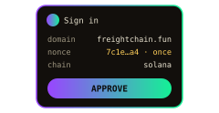  

| What | Solana piece | What it does, and what it does not | Code |
| --- | --- | --- | --- |
| Road seed | `create_pool` / `open_next_pool` read the newest SlotHashes entry and store `SHA-256(pool id as little-endian u32 ‖ slot hash ‖ slot as little-endian u64)` | No caller passes the seed. Everyone in the pool drives the road derived from that commitment. The program does not draw the road itself | [`create_pool.rs`](programs/freightchain-pools/programs/freightchain_pools/src/instructions/create_pool.rs) · [`provable-seed.ts`](server/src/domain/road/provable-seed.ts) |
| Recording root | RFC 6962 Merkle tree over the ride's 15 s batch hashes | The attestation names which recording it covers. The program does not recompute the drive | [`telemetry-merkle.ts`](server/src/domain/telemetry/telemetry-merkle.ts) |
| Prize gate | `Attestation` PDA `[attestation, pool account, driver]`: root, verified km, verified or flagged. `pay_prize` requires VERIFIED and verified km above 0 | The admin or the payout key signs it. Either key may also sign `pay_prize`. Recording does not wait for `payout_at`. Paying does. It is the server's verdict, not a proof of the physics | [`settle.rs`](programs/freightchain-pools/programs/freightchain_pools/src/instructions/settle.rs) |
| Per-km pledge | `Pledge` `[pledge, ride_id, sponsor]`. The sponsor signs `create_pledge` | A VERIFIED attestation pays `cap × min(verified km, target) / target`. FLAGGED pays 0. If paying the driver would leave that account under rent, the sponsor gets the cap back. `refund_pledge` returns the cap only when the pool is refunding, cancelled, or settled, or still active 14 days after `payout_at`, and there is no verified or flagged attestation. Neither instruction checks a review window. Both are permissionless | [`pledge.rs`](programs/freightchain-pools/programs/freightchain_pools/src/instructions/pledge.rs) |
| Sign-in | `solana:signIn` (CAIP-122), Wallet Standard | One prompt where the wallet supports it. Older wallets fall back to connect plus `signMessage`. The server checks the fields it issued and burns `nonce:<nonce>` on the first try | [`wallet.js`](client/site/wallet.js) · [`sign-in.ts`](server/src/domain/auth/sign-in.ts) |
| .sol names | SPL Name Service on mainnet, read with `@solana/web3.js` | Server cache: a hit for 24 h, a miss for 30 min. Shown on leaderboards, the profile, and `/r/:id` when a name exists | [`sns-name-service.adapter.ts`](server/src/infrastructure/sns/sns-name-service.adapter.ts) |
| Solana Pay and Actions | Transaction request plus a reference key. `/actions.json` maps `/` to one ticket and `/r/:id` to the ride | Devnet. The buyer pays the network fee. A blink buy still needs the 18+ and loss stamps, which only the site can record. Not listed in the Dialect registry, so X shows an ordinary card. [`/blink.html`](client/blink.html) renders the card on our site | [`actions`](server/src/domain/actions) · [`solana-pay.js`](client/site/solana-pay.js) |

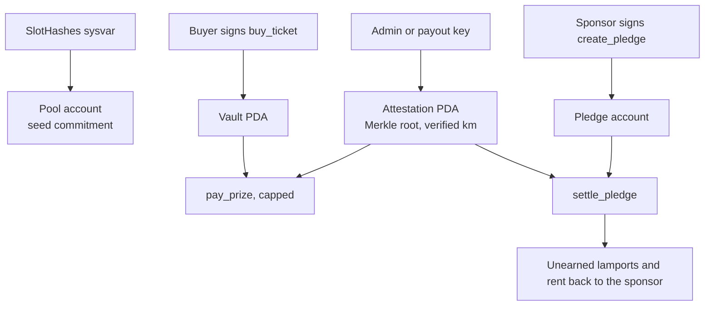

Accounts:

| Account | Seeds | Role |
| --- | --- | --- |
| Config | `["config"]` | Admin, platform treasury, fee bps, pool count, pause, payout authority |
| Pool | `["pool", id]` | Rules, counters, `seed_commitment`, `seed_slot`, `seed_slot_hash` |
| Series | `["series", tier]` | One schedule per tier. Anyone may open the next pool from it |
| Ticket | `["ticket", pool account, buyer]` | One account per buyer. Quantity stacks on it. A refund closes it. A settled ticket stays until `close_ticket` |
| Vault | `["vault", id]` | Zero-data PDA. The pool's money. Nothing is staked |
| Pledge | `["pledge", ride_id, sponsor]` | SOL per km for one driver. Closed by settle or refund |
| Attestation | `["attestation", pool account, driver]` | Admin or payout key's verdict. `pay_prize` and `settle_pledge` read it |

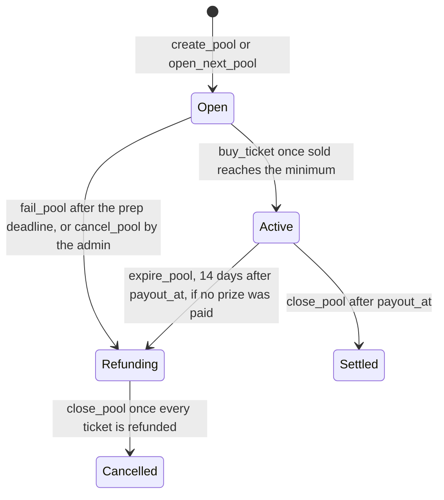

Who can move money:

| Instruction | Who signs | Limit |
| --- | --- | --- |
| `buy_ticket`, `create_pledge` | That wallet | Sale window for tickets. The server never holds the lamports |
| `fail_pool`, `expire_pool`, `refund`, `refund_pledge`, `settle_pledge` | Anyone | Only when the account state allows it. An absent operator cannot keep the money |
| `pay_prize` | Admin, or the payout key (`PAYOUT_SECRET`) | Only after `payout_at`, only to a wallet with a VERIFIED attestation, and only until `prizes_paid` would pass the prize share. The 25 / 15 / 10 ranking is server policy. The program does not enforce it. The admin can sign any amount inside the cap |
| `close_pool` before the 14-day grace | Admin or the payout key, after `payout_at` | Can close without paying prizes. The prize share then goes to the seed treasury. This protects against a lost key. It does not protect against a dishonest admin |
| Crank key | The server, for `open_next_pool`, `fail_pool`, `expire_pool`, `refund`, `close_pool` | It cannot send `pay_prize` |

The program has 21 instructions, 18 events, and 32 errors. The shared lamport table is [`vault-split.ts`](server/src/domain/economy/vault-split.ts), with the same cases in [`vault-split-cases.json`](server/test/fixtures/chain/vault-split-cases.json). Spec: [`programs/freightchain-pools/README.md`](programs/freightchain-pools/README.md) and [`docs/pool-program/index.html`](docs/pool-program/index.html). Trust the id in `declare_id!`. The program README's first paragraph can lag it.

`npm run program:verify` rebuilds in the Solana Foundation image and compares the hash to [`programs/freightchain-pools/verifiable-build.hash`](programs/freightchain-pools/verifiable-build.hash) (`47a630e8…`, Solana 4.1.2). The explorer "verified" badge is not submitted yet. `deploy` refuses an RPC whose genesis is not devnet.

Badges: 31 soulbound compressed NFTs, 8 ladders, Metaplex Bubblegum v2, minted by a key that can mint and nothing else. An hour after the unlock, and after a second check that skips a rejected ride. Transfer is refused on chain. Collection [`56ijQ5t2RFpXezbPtEuqECo5gCQiGSek2LBsp7cfMoXC`](https://explorer.solana.com/address/56ijQ5t2RFpXezbPtEuqECo5gCQiGSek2LBsp7cfMoXC?cluster=devnet), tree [`45NKrZA9rGFcKr62VY5NvM89yarFuBqtBseRK7ZSM336`](https://explorer.solana.com/address/45NKrZA9rGFcKr62VY5NvM89yarFuBqtBseRK7ZSM336?cluster=devnet). A wallet that does not speak DAS still has the mint transaction on the badge card. Detail: [`docs/agents/achievements.md`](docs/agents/achievements.md).

## Status

| Piece | In this repository | On the public site |
| --- | --- | --- |
| Driving game, five routes, three free levels, paid tiers | Yes | Free rides are live. A paid tier shows SOON until a pool of that tier is open. 4 h and 8 h have no series |
| Server-timed shifts, hash-chained recordings, verdicts | Yes. Rules version 3 | Live, shadow mode. The verdict is stored and shown. Paid boards still rank without it |
| Server-rebuilt road and hole checks | Yes | Live in the judge. [`docs/verified-play/index.html`](docs/verified-play/index.html) still prints rules v4 |
| Live watch, replays, CB chat, devnet tips | Yes | Paid rides can be watched, with chat. A running free ride cannot. Replays work after it ends. Tips are devnet transfers to the driver. Game effects are off on the public site |
| Garage, promo codes | Yes | Garage is a lobby tab: wheel, paint, gearbox, dice, needles. Nothing there changes the handling. Promo codes sit on the profile |
| Public ride receipts, X card, in-game share | Yes | Live. The driver posts from their own account |
| Sign-in with `solana:signIn`, .sol names | Yes | Live |
| Escrow, per-km pledges, attestation-gated `pay_prize` | Yes. This is program v3, not Anchor 3. The crate is Anchor 1.2 | Server is in program mode since 11 Oct 2026, still devnet. A buy exists only while a pool is open. The job can pay a verified top 20 after review. The FAQ says no prize has been paid out |
| Staking yield | No. A draft that named JitoSOL was removed before deploy. Nothing is staked | No |
| Solana Pay, Actions | Yes | Devnet. Dialect listing is not done |
| Badge cNFTs | Yes | Devnet. Mainnet waits on the same gates as the program |
| Token, mainnet, audit, captcha | No | No |

Rollback for checkout is `PAYMENT_MODE=transfer` plus a redeploy. Mainnet waits on an audit, the devnet exit list, and an explicit deploy. Trust the program id in [`lib.rs`](programs/freightchain-pools/programs/freightchain_pools/src/lib.rs) and on the explorer.

## Limits

- Devnet only. Not audited. No token. No mainnet in this build. No prize payout is claimed.
- The landing says the paid shifts are soon. Believe the lobby: SOON means no pool of that tier is open.
- The attestation is signed by the admin or the payout key. The program checks that signature, a VERIFIED status, and the prize cap. It does not check the drive.
- Verdict thresholds are first guesses. Production boards ignore the verdict until they are tuned on real rides. A prize, if one is paid, still requires a verified verdict.
- The challenge table is empty. No captcha.
- A dishonest admin, or a stolen payout key, can close a pool after `payout_at` and send the prize share to the seed treasury. The 14-day grace is about a lost key, not a hostile one.
- `close_ticket` is in the program. Nothing in the crank sends it, so settled-ticket rent stays put until someone does.
- The seed treasury is not rolled into the next pool by a job.
- The pinned build hash is not the explorer's verified badge. That badge is not submitted. A matching hash is not an audit.
- [`docs/escrow-open-items.md`](docs/escrow-open-items.md) still opens with a "not deployed" paragraph. Ignore that paragraph.
- [`docs/verified-play/index.html`](docs/verified-play/index.html) still says rules v4. The code is version 3.
- Physics are floats and a variable frame step. The server checks the recording. It does not re-play it.
- Float32 road vertices jitter past about 100 km.
- Session keys are not built. Staking is not built.

**Where to read next**

| Question | Open |
| --- | --- |
| How a player drives, and what a finish means | [Whitepaper 02–03](https://whitepaper.freightchain.fun/#drive) |
| Where the money sits | [Whitepaper 05](https://whitepaper.freightchain.fun/#onchain) · [contract spec](docs/pool-program/index.html) |
| What the server checks | [Anti-cheat](docs/anti-cheat/index.html) · [player page](docs/verified-play/index.html) |
| What a spectator sees | [Replays and donations](docs/replay-and-donations/index.html) |
| Whether the money tests pass | [Localnet walkthrough](docs/localnet-e2e/index.html) |
| How the server is put together | [backend-architecture.md](docs/backend-architecture.md) |

## Traction

PostHog Cloud EU, project 297915, HogQL, 8 Oct through 13 Oct 2026 06:15 UTC. Small on purpose: public devnet, no paid marketing. Ride events come from a handful of test accounts. Read this as "the pipeline runs", not as a user base. If PostHog and SQL ever disagree, SQL is the truth ([`docs/agents/analytics.md`](docs/agents/analytics.md)).

| Signal | Number |
| --- | --- |
| Events, 8–13 Oct | 3,819 (3,602 browser, 217 server-side after the database commit), 189 distinct ids |
| Landing visitors | 113 unique over 6 days, about 20–27 a day |
| Played the hero video | 56 of 115 landing views |
| Whitepaper readers | 11 unique |
| Shifts | 32 started, 6 completed, 7 failed, 19 abandoned |
| Wallet sign-ins | 60 `player_signed_in` events, 52 wallets. Server events are keyed by wallet, so this is not the landing's id space |
| Badges unlocked | 10 |
| Connect-wallet clicks | 4 people, 18 clicks |

Page speed on the same window: of the samples Google rates good, TTFB 89% (359), FCP 88% (330), LCP 92% (285, good samples average 0.88 s), CLS 90% (285), INP 99% (163). `hero_video_failed` fired for 17 ids and `api_request_failed` for 12. The slow tail is small and not chased yet.

<a href="docs/analytics/img/posthog-dashboard.png">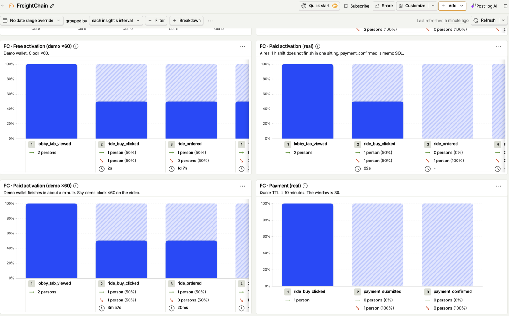</a>

The other two shots, the acquisition funnel and the insight list, are in [`docs/analytics/img/`](docs/analytics/img). Event list and identity rules: [`docs/analytics/index.html`](docs/analytics/index.html). The board screenshot is 11 Oct 2026. Demo-wallet funnels run on the ×60 clock.

## The truck

Five routes, one truck. Manual gearbox, clutch, stall, parking brake, cold engine, battery, heater, cab cooling, wipers, radio. Speed is governed at 28 m/s, about 100 km/h. A phone on the dash (N, or a click) shows the truck, the finish, a fork's other road, and the next junction.

The player does not pick the route or the start hour of a paid ride. The server derives both from the seed. Each free level has a fixed country. Its start hour still comes from the seed.

<table>
  <tr>
    <td><br>Route 66. Gentle bends.</td>
    <td>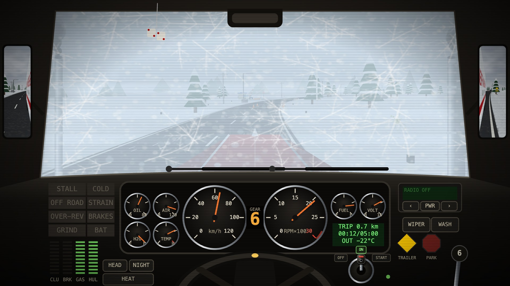<br>Trans-Siberian. Snow.</td>
    <td>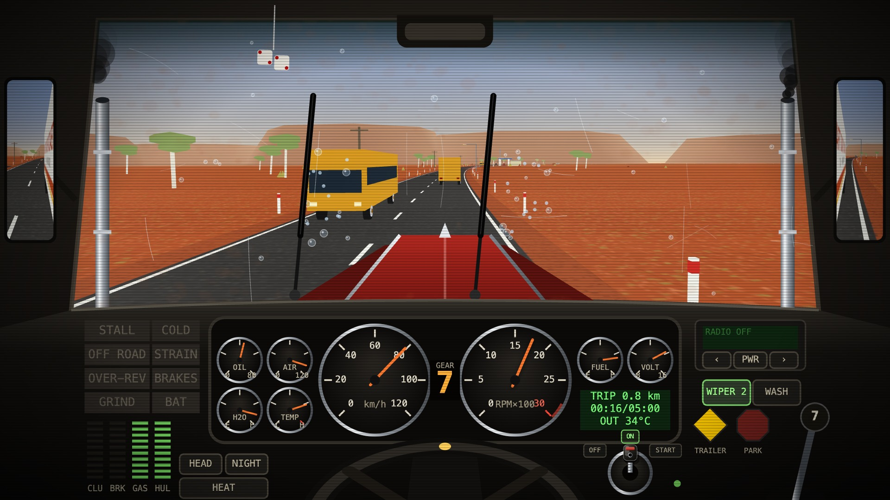<br>Stuart Highway. Almost straight.</td>
    <td>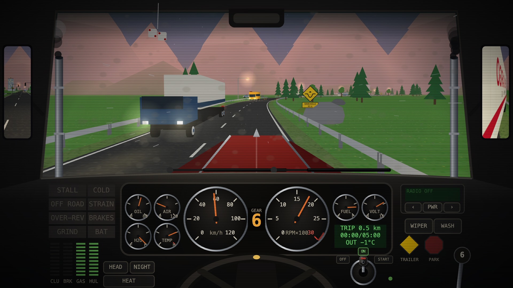<br>Brenner Pass. Tight.</td>
  </tr>
</table>

The fifth route is the Pan-American through the Atacama, long sweepers. Same builders as the game: [`client/js/themes/index.js`](client/js/themes/index.js) · [model viewer](https://storybook.freightchain.fun).


## Shifts

| Tier | Length | Finish line | Price | Road |
| --- | --- | --- | --- | --- |
| Free · EASY | 180 s | 1512 m (`k` 0.3) | 0 | Four lanes, two crossroads, bends ×3, calm traffic. First natural hole is 4 km in, past the line. Ends itself |
| Free · MEDIUM | 300 s | 3360 m (`k` 0.4) | 0 | Depot turn, three crossroads, a fork, bends ×1.35, traffic ×0.8, holes ×1.5 |
| Free · HARD | 900 s | 10 080 m (`k` 0.4) | 0 | Six crossroads, two forks, a highway run, bends ×1.6, traffic ×1.4, holes ×2. No assist, no tutorial |
| 1 hour | 3600 s | `k` 0.5 | $5 in SOL | Depot, stop line, right turn. On sale when a pool is registered. Planned minimum 20 tickets |
| 4 hour | 4 h | `k` 0.5 | $15 planned | Bends ×1.2, traffic ×1.4. Off until a pool of that tier exists |
| 8 hour | 8 h | `k` 0.5 | $50 planned | Bends ×1.4, traffic ×1.8. Same gate |

A shift completes when distance reaches `k × 28 m/s × nominal length`. There is no minimum time. The governor is what makes the line take about that long. Paid tiers use `k = 0.5`. After a paid finish the road continues until the driver ends it. A free level ends itself.

A new wallet starts with 10 free rides. The daily refill adds one at 00:00 UTC and stops at 5. A promo can sit above that cap. `play.html` with no ride id is a guest run: two minutes, one crossroads, nothing recorded, no account.

The lobby picks the free level (`POST /api/rides`, `level` 1–3). Each level has its own board. Assist, on EASY and MEDIUM only, halves hull damage and battery drain. While the verdict is enforced, a rejected recording earns no badge. It still counts as a ride that started.

Prices are quoted in USD and charged in devnet SOL at the server's rate. The $5 price and the 20-ticket minimum are the planned 1 hour series. The landing says those shifts are soon until a pool is open. A devnet series can be a shorter, cheaper test when one is registered.

Read: [`client/js/trips.js`](client/js/trips.js) · [`ride-tier.ts`](server/src/domain/rides/ride-tier.ts) · [`ride-rules.ts`](server/src/domain/rides/ride-rules.ts)

## How a finish is checked

Online rides upload every key and dash event, plus a 10 Hz sample of the truck, in SHA-256 hash-chained batches of 15 seconds. A completed shift is marked `verified`, `flagged`, or `rejected`. The server does not re-simulate the physics. Paid boards rank verified shifts only when `VERDICT_ENFORCE` is on. Production leaves it off, so the boards ignore the verdict. A prize, if the job pays one, still requires a verified verdict.

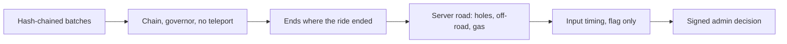

- Heartbeats carry the clock. Distance may grow at most 28 m/s × 1.2 × the gap, plus 20 m. No heartbeat for 150 seconds ends the ride.
- The server recomputes every SHA-256 on arrival. A wrong hash rejects the shift. An unhashed batch, where the browser digest failed, only flags.
- Over the governor, a step the truck cannot make, or a sample out of order: reject.
- The recording has to end near the reported distance, cover the driven time, and show gas if the truck moved.
- The holes are the server's. A wheel deep in a planned pit at speed has to cost hull. Two ignored holes reject. Long off-road rejects. Speed gained while the gas pedal is released rejects.
- Bytes, batches, and game seconds are capped by wall time.
- Hold lengths, repeated gaps, and instant releases flag the shift, and only with at least 8 presses. A coarse browser clock skips the two checks it would break.
- The heartbeat can name a prompt with a 20 second window. `CHALLENGE_KINDS` is empty, so nothing is issued.
- Every completed paid ride stays under review until the checks accept it or an admin signs ACCEPTED or REJECTED. A late upload does not overturn a signed decision.

What this does not do: it does not re-play the drive. A careful bot that plays the real game, with human-like timing, passes the automatic checks. A modified client that drives through the holes and writes the matching hull loss looks like a hit. Traffic is recorded for replays and is not judged. Spectator holes are not judged. Thresholds are first guesses. A captcha before a paid start and before a prize claim is not built. Recordings are kept 90 days. A flagged one stays while the verdict is flagged. A completed shift that was never judged is kept too.

Codes and thresholds: [`docs/anti-cheat/index.html`](docs/anti-cheat/index.html) · [`verdict-rules.ts`](server/src/domain/verdict/verdict-rules.ts).

Live watch uses the same batches, so a paid ride sits about 25 seconds behind. There are no WebSockets. A running free ride cannot be watched, chatted on, or tipped. A finished one can be replayed at 1×, 4×, and 16× while the recording is kept. A tip on a paid ride is a devnet SOL transfer from the spectator to the driver. The platform does not hold it. Game effects are off on the public site. A free ride has them forced off, and a paid ride only gets them when `LIVE_EFFECTS` is `all`. Production sets it to `free`. [`docs/replay-and-donations/index.html`](docs/replay-and-donations/index.html)

Every online shift has a public page at `/r/:id`. The composed X post links that page, or the site home after a ticket buy. `/actions.json` maps those URLs to Actions.

## The road

The drivable world is one centre-line. Distance along it is `s`. Offset across it is `d`. Lanes, junctions, and side roads are features of that line.

A ride seed feeds `mulberry32`. Segments and junctions append in one RNG order, so the layout is a function of the seed and the trip. Curvature integrates into Float64 tables, one metre a step. The tables grow as the truck approaches. There is no finish line in the geometry.

Patterns are `country`, `highway`, `arterial`, and `town`. A lane change is a 120 m taper. The player cannot turn into a side road. On MEDIUM and HARD the road forks: two roads meet again 1200 m on, mirror images, same length, same lanes, same holes. In `s` and `d` they are one road, so the server does not need to know which one was taken. The driver commits 205 m after the split. Sample column 15 records the choice.

`rollHole(chunk)` places at most one natural hole, and the only natural type is the sinkhole. Pothole, deep, cluster, and trench are holes a spectator can pay for. They are not judged. An online ride installs the server plan from `GET /api/watch/:id/road`. The local roll is the offline fallback.

[`road-drift.spec.ts`](server/test/unit/domain/road/road-drift.spec.ts) runs the game's modules beside the server port: 40 seeds, segments, junctions, and every natural hole out to 60 km. Curvature is not in that compare. The judge works in `s` and `d`.

`update(dt)` in [`physics.js`](client/js/sim/physics.js) steps the clutch, gears, stall, and steering. The engine stalls in gear with the clutch out and rpm under 450. Speed clamps at 28 m/s forward and 6 m/s in reverse. Frame `dt` is clamped to 0.05 s. A watch replay does not run this function. The verdict does not either. Float32 road vertices start to jitter past about 100 km.

Read: [`network.js`](client/js/net/network.js) · [`patterns.js`](client/js/net/patterns.js) · [`obstacles.js`](client/js/net/obstacles.js) · [`road-plan.ts`](server/src/domain/road/road-plan.ts)

## Money

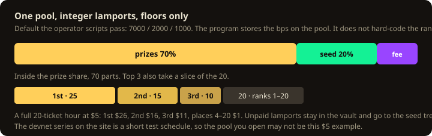

The pot is `price × tickets sold`, plus any lamports sent with `sponsor`. That instruction is a gift to the vault. A per-km pledge is a different account and is not part of this split. Prize and seed are floored from the pool's own basis points. The fee is the remainder. Inside the prize share, [`pool-payouts.ts`](server/src/domain/economy/pool-payouts.ts) pays the top 3 as 25 / 15 / 10 parts and splits 20 parts across ranks 1–20. Floors only.

The landing's ECONOMY chapter describes this split. The legacy weekly round, used when `PAYMENT_MODE=transfer`, is a different function: 50% grand, 20% top 20, 20% next seed, remainder fees ([`prize-split.ts`](server/src/domain/economy/prize-split.ts)). That round is accounted in PostgreSQL. It is not an on-chain payout. It is the rollback, not the checkout.

There is no admin button for `pay_prize`. The job sends it after the review window, once every ride in the pool is decided, and only for a verified ride. The whitepaper labels that job "DEVNET JOB · NOT AN OFFER". No prize payout is claimed in this file. The gaps around ticket rent and the seed treasury are in [Limits](#limits).

The buyer pays the network fee. There is no gas-sponsor key. A leftover `FEE_PAYER_SECRET` is ignored. The server does not hold the pool admin key. `initialize` is signed by the upgrade authority and names the admin.

Admin changes pass three gates: nginx basic auth, an admin session, then a wallet signature over the exact text of that action. The player cookie grants nothing there. Lock order for anything a wallet does to rides, tickets, payments, or pledges: player, then pool, then tickets and pledges.

## Sites

Six names, one app. [`client/js/hosts.js`](client/js/hosts.js) picks the host. On localhost every base is empty and the pages share an origin.

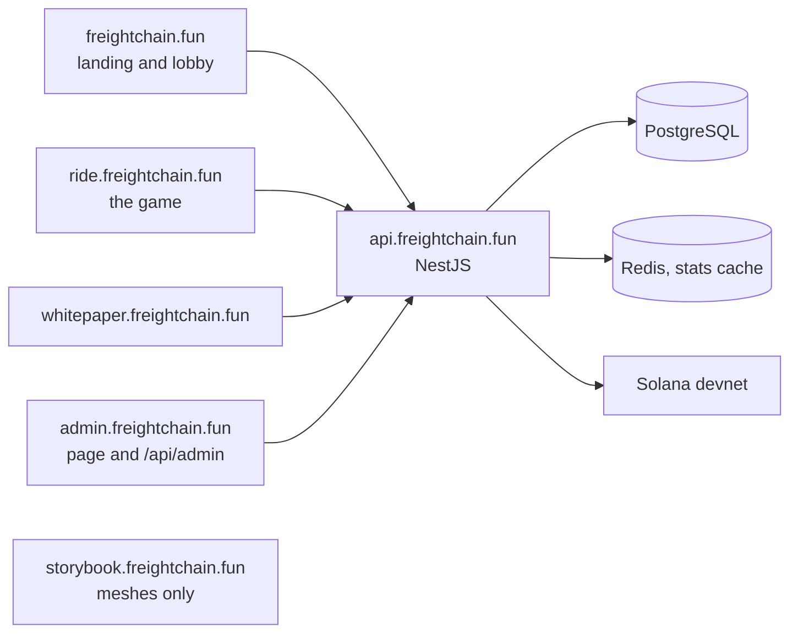

Layers point inward. Domain code does not read the clock or the environment. Time comes from `ClockPort`. Env comes from `EnvService`. A Prisma change ships with a SQL migration. [`docs/backend-architecture.md`](docs/backend-architecture.md)

- **Landing.** [`landing/`](landing/index.html). Vite. The hero video loads after the page, and never on a phone.
- **Lobby.** [`client/lobby.html`](client/lobby.html). New ride, Live, Replays, Leaderboard, Achievements, Garage, Profile. Promo codes are on the profile. `#promo` opens that tab.
- **Game.** [`client/play.html`](client/play.html). `?ride=` is an online shift. `?watch=` is a spectator. Anything else is an uncounted guest run. `file://` cannot load the modules.
- **Receipt.** [`client/r.html`](client/r.html). Server middleware injects the Open Graph and Twitter Card tags.
- **Whitepaper.** [`landing/whitepaper.html`](landing/whitepaper.html). Its numbers are asserted against the code by [`landing/test/whitepaper.test.js`](landing/test/whitepaper.test.js).
- **Admin.** Nginx basic auth, then `ADMIN_WALLETS`. On a split deploy, `/api/admin` answers only when `Host` is `admin.<apex>`.
- **Search.** Landing, whitepaper, and the game page are static HTML. Lobby, viewer, and admin are `noindex`. [`docs/agents/landing.md`](docs/agents/landing.md).

Running totals (rides, time, kilometres, crashes, donations) count every started ride that ended. Free and paid are counted apart. Reads are cached for 15 seconds. [`docs/statistics.md`](docs/statistics.md)

The intro clip is real gameplay, 14.8 seconds, with the in-game synth: [`media/out/video/intro/intro.mp4`](media/out/video/intro/intro.mp4).

## Repository

- [`.claude/`](.claude) — project skills. The index is [Skills](#skills).
- [`client/`](client) — the game, the lobby, admin, the receipt page, the model viewer. Vanilla ES modules and three.js r160. No bundler, no React.
- [`deploy/`](deploy/README.md) — Docker, nginx, certbot. `npm run deploy` ships `git archive HEAD`.
- [`design/`](design) — icons, banners, badge art.
- [`docs/`](docs) — explainers. [`docs/agents/`](docs/agents) is the detail [`AGENTS.md`](AGENTS.md) points at.
- [`landing/`](landing) — the `/` page and the whitepaper. Vite.
- [`media/`](media) — promo clips and the chiptune synth.
- [`programs/`](programs/freightchain-pools) — the Anchor program. Anchor 1.2.
- [`server/`](server) — NestJS 12, Prisma, PostgreSQL.

Also at the root: `package.json`, `docker-compose.yml` (PostgreSQL on `127.0.0.1:15433`, Redis optional), [`AGENTS.md`](AGENTS.md), [`CLAUDE.md`](CLAUDE.md).

## Skills

Skills live in `.claude/skills/<name>/`. A coding agent reads that folder's `SKILL.md` before the work. The same command is what you run yourself. The read-only skills never deploy and never write to production.

| Skill | What it is for | Run |
| --- | --- | --- |
| `game-audio` | 8-bit music, sound effects, the engine bed, the reusable sound store, or sound on a clip | `npm run media:store` · `npm run media:game-sfx` · `npm run media -- media/specs/<name>.json --remux` |
| `gameplay-balance` | Tune how the truck drives: gearbox and torque, launch and stall, steering and weight, brakes, engine heat, cold-engine wear, battery, strain, road holes, traffic, off-road, the speed governor, and how long a shift takes to complete | `cd client && npm run check` · `cd client && node tools/e2e-chrome.mjs` |
| `gameplay-video` | A promo mp4 (≤ 15 s) and gif (≤ 20 MB) from real gameplay, with landing-styled captions | `npm run media -- media/specs/<name>.json` |
| `live-board-test` | Who is online, which rides are on the road, a closed tab leaving at once, and the replay history | `bash .claude/skills/live-board-test/run.sh` |
| `localnet-e2e` | Real ticket buys, refunds, payouts, and the pool crank on a local Solana validator; ten riders paid by the program; the autonomous pool day (the crank opens the series' pools, the payout key pays after the review window); a 100 % program coverage gate | `npm run test:localnet` |
| `analytics-review` | Three passes over the landing, whitepaper, lobby, and the online ride: new controls get events, removed ones lose them, and the explainer stays in step. Each pass writes `docs/analytics/updates/<n>.html`. Does not call PostHog | `node .claude/skills/analytics-review/inventory.mjs` |
| `whitepaper-update` | Three passes on the whitepaper: claims against the code, cut duplication and AI-sounding prose, add charts and real cab frames inside the gzip budget. Does not deploy | `npm --prefix landing test` · `npm run landing:build` |
| `posthog-prod` | Product analytics on production: the boot line, one public probe, the flush log. Read-only | `bash .claude/skills/posthog-prod/check.sh` |
| `posthog-test` | Local analytics smoke: the relay, and one batch accepted by the EU ingest | `bash .claude/skills/posthog-test/smoke.sh` |
| `posthog-map` | Landing, whitepaper, lobby, and game checks, then a visual map of every event | `bash .claude/skills/posthog-map/run.sh` |
| `posthog-audit` | Compare the EU insights to the spec and list the fixes. Does not write unless you say to apply | `node .claude/skills/posthog-audit/audit.mjs` |
| `prod-db` | Production PostgreSQL, read-only: players, rides, verdicts, payments, the review queue | `npm run ops -- query list` · `npm run ops -- query wallet <address>` · `npm run ops -- sql "SELECT …"` |
| `prod-logs` | Production logs, read-only: the app, Postgres, and nginx | `npm run ops -- logs --since 30m` · `npm run ops -- logs --errors` |
| `program-check` | The escrow program: reproducible build against the pinned hash, tests on that `.so`, clippy, audit | `npm run program:verify` |
| `replay-test` | Live watch page, replays, and the `LIVE_*` flags, with a driver and a spectator in Chrome | `bash .claude/skills/replay-test/run.sh` |
| `ride-audit` | Is this stream honest? A ride loaded from the database (local or production, read-only): the road and its holes rebuilt from the seed, every batch re-hashed, every sample and input measured again, judged afresh and compared with the verdict on record | `bash .claude/skills/ride-audit/run.sh <ride id>` · `… <ride id> --prod` · `… --latest 20 --prod` |
| `ride-investigate` | One player or one ride on production: the database rows and the matching log lines | `npm run ops -- query ride <id>` (or `query wallet <address>`), then the logs named in the skill |
| `ride-review` | Which paid rides need an admin's eyes before prizes are paid: every ride UNDER REVIEW per pool, with its rank, distance and verdict reasons (incl. the pool-* marks and the ones `pool:attention` would add), each audited by `ride-audit`; local or production read-only, never changes a verdict | `bash .claude/skills/ride-review/run.sh` · `… --pool N` · `… --pool N --prod` |
| `run-tests` | The whole local suite: lint and unit tests, PostgreSQL, then real-Chrome end-to-end. There is no CI | `npm run check`, then `npm run server:integration`, then `bash .claude/skills/run-tests/e2e.sh` |
| `admin-coverage` | Check that the admin page uses every admin API (guarded, called, no dead calls, tabs match the views) and add what is missing | `node .claude/skills/admin-coverage/check.mjs` |
| `stats-reconcile` | Check and repair the statistics (rides, time, km, crashes, stream donations – per rider and global) by recomputing them from the rides; production read-only | `bash .claude/skills/stats-reconcile/run.sh [--fix]` · `--prod` |
| `test-census` | Count the tests by pyramid layer, grade test coverage per feature, user flow, controller and route (static attribution, line + branch coverage, the routes each browser suite hits), name gaps, and rewrite the Tests block below and docs/test-coverage.md | `npm run test:census` · `npm run test:census -- features` · `npm run test:census -- coverage` · `npm run test:census -- run` · `npm run test:census -- readme` |
| `level-check` | Each free level (EASY / MEDIUM / HARD) is what it promises and passable by a human: the road each level's shift covers (junctions, forks, lanes, bends, sinkhole traps), then a human-paced driver on the real truck with ASSIST off on many seeds × all routes – finish rate, hull, vehicles hit, against the level's limits | `node .claude/skills/level-check/check.mjs` |
| `trip-design` | The road per ride tier – the free run and the 1 h / 4 h / 8 h shifts: bends, traffic, roadside, whether it ends by itself at the line, its length and finish distance – measured with the real game modules and looked at in Chrome | `node .claude/skills/trip-design/measure.mjs` · `node .claude/skills/trip-design/shots.mjs` |
| `verified-play-test` | The anti-bot / anti-cheat end to end, positive and negative: a person and a bot in Chrome (dispatch prompts answered / ignored), API-level bots with hand-built recordings (every verdict code), the upload protocol, the admin's signed decisions, the profile in Chrome, retention + the CLI's bulk re-judge | `bash .claude/skills/verified-play-test/run.sh` |
| `storybook-models` | Review and fix a mesh in the model viewer (`client/viewer.html`), or add or update a 3D object the game draws | `node .claude/skills/storybook-models/shot.mjs` · `node .claude/skills/storybook-models/shot.mjs <id>` |

A new, renamed, or removed skill updates this table in the same change. The rule is [`AGENTS.md`](AGENTS.md) → "Maps stay current".


## Run it

```sh
npm run db:up && npm run db:migrate && npm run server:dev   # API and pages on :3000
npm run landing:dev                                         # Vite on :5173, proxies /api to :3000
npm run client:serve                                        # the game alone
npm run check                                               # client, landing, server unit tests, media
npm run server:integration                                  # PostgreSQL, its own freightchain_test database
npm run program:test                                        # LiteSVM, no network
npm run program:verify                                      # reproducible build against the pinned hash
npm run test:localnet                                       # the program on a local validator, lamports checked
```

`npm run check` needs `npm run install:landing` and `npm run install:media` once. The program tools need the Solana toolchain on `PATH` ([`programs/freightchain-pools/README.md`](programs/freightchain-pools/README.md)). Deploy: [`deploy/README.md`](deploy/README.md). Env keys: [`docs/configuration.md`](docs/configuration.md). There is no CI.

## Tests

The block between the markers is written by `npm run test:census -- readme`. Leave the markers alone. The numbers below were generated on 9 Oct 2026, including a failed end-to-end run that day. They are a map of the suite, not a claim that today's run is green. Refresh with `npm run test:census -- run`, then `npm run test:census -- readme`. The full map is [`docs/test-coverage.md`](docs/test-coverage.md).

<!-- test-census:start -->

Counted 2026-10-09 23:44 UTC by `test-census`. Static cases are `it` / `test` / `#[test]` call sites. A recorded run is what that command executed.

### Charts

Static calls by band. A slice is `it` / `test` / `#[test]` plus `check()`. The table below is the same count.

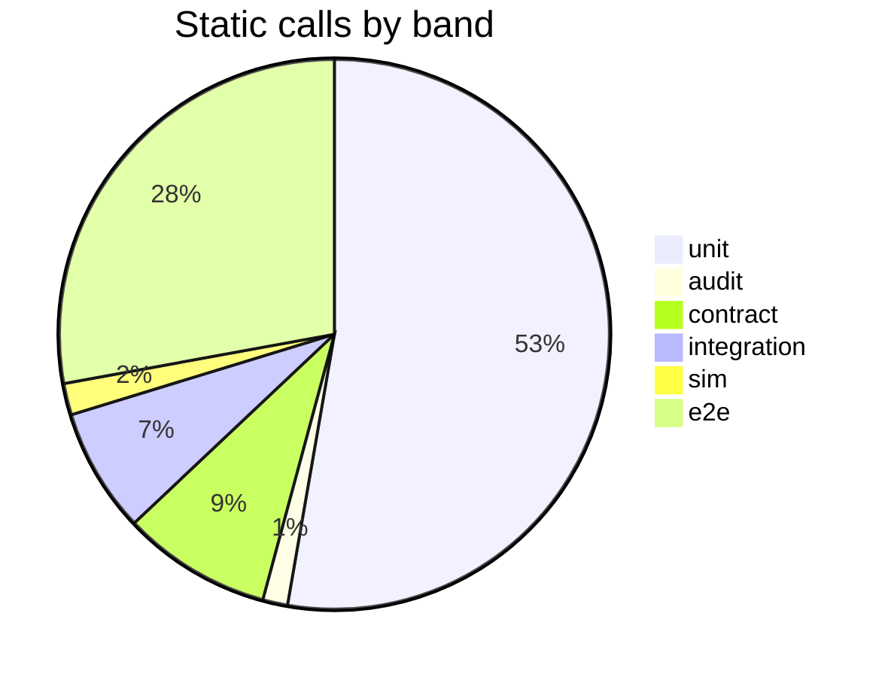

Newest wall time for each fast stage, in seconds. Each bar is that stage's own clock.

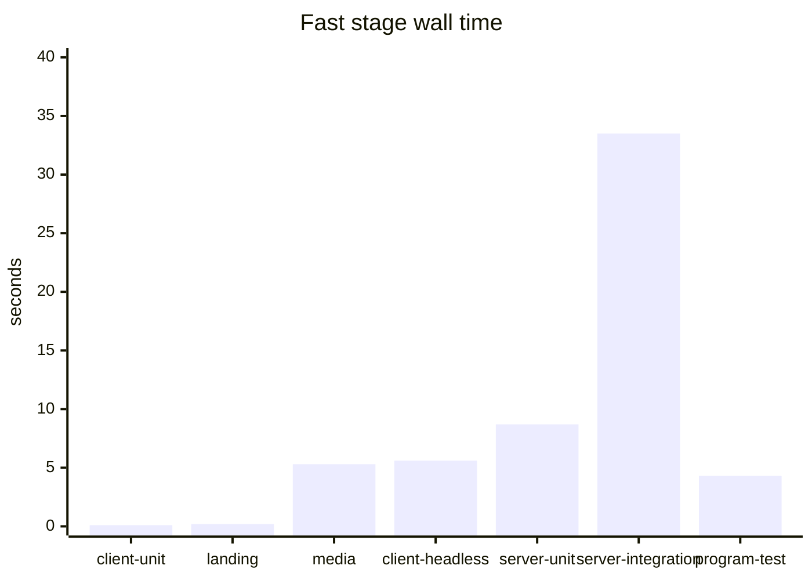

`server-integration` wall time across the kept runs, oldest first.

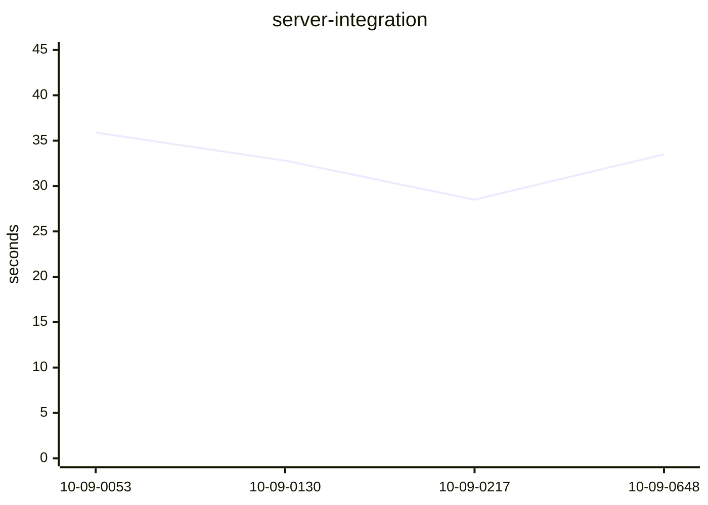

### Pyramid

| Band | Layer | Files | Cases | `check()` | Runs in |
| --- | --- | ---: | ---: | ---: | --- |
| unit | Server domain | 39 | 261 | 0 | `npm run server:test` |
| unit | Server CQRS handlers | 81 | 284 | 0 | `npm run server:test` |
| unit | Server services | 16 | 73 | 0 | `npm run server:test` |
| unit | Server controllers | 16 | 44 | 0 | `npm run server:test` |
| unit | Server infrastructure | 47 | 201 | 0 | `npm run server:test` |
| unit | Server app, cli, support | 4 | 15 | 0 | `npm run server:test` |
| unit | Client unit | 6 | 35 | 0 | `cd client && npm run test:unit` |
| unit | Landing | 9 | 101 | 0 | `npm run landing:test` |
| unit | Media | 2 | 25 | 0 | `npm run media:check` |
| unit | Escrow program (host tests) | 8 | 51 | 0 | `npm run program:test` |
| audit | Architecture and migration SQL | 6 | 30 | 0 | `npm run server:test` |
| contract | HTTP scenarios (source) | 16 | 170 | 0 | `server:test and server:integration` |
| contract | HTTP specs, in-memory | 4 | 10 | 0 | `npm run server:test` |
| integration | Repositories on PostgreSQL | 28 | 112 | 0 | `npm run server:integration` |
| integration | Concurrency | 1 | 36 | 0 | `npm run server:integration` |
| integration | Migration drift | 1 | 2 | 0 | `npm run server:integration` |
| integration | Same HTTP scenarios on PostgreSQL | 1 | 0 | 0 | `npm run server:integration` |
| sim | Headless game playthrough | 1 | 0 | 38 | `cd client && npm run test:headless` |
| e2e | Browser and API harnesses | 19 | 0 | 572 | `bash .claude/skills/run-tests/e2e.sh` |
| | **Total** | **305** | **1450** | **610** | |

HTTP scenario cases are written once under `server/test/scenarios` and executed twice: in-memory (`npm run server:test`) and PostgreSQL (`npm run server:integration`). The PostgreSQL runner row counts the runner file. Its cases are the scenario row. `it.each` is one static call and one executed test per row.

### Browser harnesses

| Script | `check()` | Runner |
| --- | ---: | --- |
| `client/tools/e2e-chrome.mjs` | 0 | `npm --prefix client run test:e2e` |
| `client/tools/e2e-viewer.mjs` | 0 | `npm --prefix client run test:viewer` |
| `landing/tools/e2e-wallet.mjs` | 25 | `e2e.sh` |
| `server/scripts/e2e-admin.mjs` | 35 | `e2e.sh` |
| `server/scripts/e2e-browser.mjs` | 13 | `e2e.sh` |
| `server/scripts/e2e-close.mjs` | 13 | `e2e.sh` |
| `server/scripts/e2e-live-board.mjs` | 21 | `e2e.sh` |
| `server/scripts/e2e-live-flags.mjs` | 13 | `e2e.sh` |
| `server/scripts/e2e-lobby.mjs` | 77 | `e2e.sh` |
| `server/scripts/e2e-localnet-payout.mjs` | 55 | `localnet-e2e` |
| `server/scripts/e2e-localnet.mjs` | 72 | `localnet-e2e` |
| `server/scripts/e2e-promo.mjs` | 47 | `e2e.sh` |
| `server/scripts/e2e-replay.mjs` | 32 | `e2e.sh` |
| `server/scripts/e2e-road-check.mjs` | 17 | `e2e.sh` |
| `server/scripts/e2e-stats.mjs` | 38 | `e2e.sh` |
| `server/scripts/e2e-tickets-stub.mjs` | 18 | `npm --prefix server run test:tickets-stub` |
| `server/scripts/e2e-verified-deep.mjs` | 45 | `e2e.sh` |
| `server/scripts/e2e-verified-play.mjs` | 19 | `e2e.sh` |
| `server/scripts/e2e-watch.mjs` | 32 | `e2e.sh` |

### Test skills

Purpose of every skill, including these, is the [Skills](#skills) table. This list is which of them run tests, and whether this log has timed that run.

| Skill | Census stage | Newest recorded run |
| --- | --- | --- |
| `live-board-test` | `live-board` | no run recorded |
| `localnet-e2e` | `localnet` | no run recorded |
| `posthog-test` | `posthog` | no run recorded |
| `program-check` | `program-check` | no run recorded |
| `replay-test` | `replay` | no run recorded |
| `run-tests` | `e2e` | fail · 2026-10-09 12:29 UTC · 26m 54s |
| `verified-play-test` | `verified` | no run recorded |

Census skill: `test-census`. Production read-only skills: `posthog-prod`, `prod-db`, `prod-logs`, `ride-audit`, `ride-investigate`. Other skills: `admin-coverage`, `analytics-review`, `game-audio`, `gameplay-balance`, `gameplay-video`, `stats-reconcile`, `storybook-models`, `trip-design`.

### Gaps

- No recorded run: `live-board`, `replay`, `verified`, `localnet`, `posthog`, `program-check`.

### Coverage by feature

Which tests reach each product feature. The map (source paths, routes, harnesses per feature, steps per flow) is `.claude/skills/test-census/features.mjs`. Routes, files and cases are counted, not judged. Every route, file and flow step: [`docs/test-coverage.md`](docs/test-coverage.md).

Static: imports, requested routes, `check()` messages · browser runs: `admin` 2026-10-09, `board` 2026-10-09, `browser` 2026-10-09, `close-split` 2026-10-09, `close` 2026-10-09, `flags` 2026-10-09, `lobby` 2026-10-09, `promo` 2026-10-09, `replay` 2026-10-09, `verified` 2026-10-09, `wallet-split` 2026-10-09, `wallet` 2026-10-09, `watch` 2026-10-09 · lines: server unit + HTTP + PostgreSQL, the headless playthrough, client / landing / media node:test at 2026-10-09 12:57 UTC.

`strong` = nothing below is missing. `fair` = one thing is. `thin` = two or more, or fewer than a quarter of its files have a test of their own and no headless check stands in. `untested` = no test reaches it.
Checked: half or more of its source files are the subject of a test of their own (waived when the headless playthrough has 5+ checks for it, or for the Rust program, whose tests are black-box);
every API route it owns is requested by at least one HTTP scenario; a browser / API harness or a test skill drives it end to end;
when browser runs are recorded and one of its harnesses is an `e2e.sh` suite, every route it owns was hit by one (localnet and the tickets stub are not recorded); when line coverage is recorded, at least 70 % of its lines and 60 % of its branches ran (over the files a test loaded).

| Feature | Grade | Files with own test | Unit cases | Routes in scenarios | Scenario cases | Race tests | Sim checks | Harnesses | Routes in recorded e2e.sh runs | Lines · branches | Missing |
| --- | --- | ---: | ---: | ---: | ---: | ---: | ---: | --- | ---: | ---: | --- |
| Sign-in + session | **fair** | 14/20 | 47 | 4/4 | 36 | 1 | — | e2e-wallet, e2e-browser, e2e-lobby, e2e-close | 3/4 | 78.8 % · 77 % (19/20 files loaded) | 1 of 4 routes never hit in a recorded browser run |
| Player account: free rides + daily refill | **strong** | 3/3 | 16 | — | — | 5 | — | e2e-lobby | — | 100 % · 83.3 % | — |
| Verified play (recording, verdict, prompts) | **strong** | 14/22 | 76 | 1/1 | 26 | 5 | 1 | e2e-verified-play, e2e-verified-deep, e2e-browser | 1/1 | 89.3 % · 87.6 % (19/22 files loaded) | — |
| The server's road (obstacle plan, road checks, ride audit) | **fair** | 5/6 | 20 | 1/1 | 4 | — | — | e2e-road-check | 0/1 | — | 1 of 1 routes never hit in a recorded browser run |
| Pay-per-ride (legacy weekly round) | **fair** | 14/18 | 70 | 4/4 | 35 | 5 | — | e2e-lobby | 1/4 | 98.7 % · 87.2 % | 3 of 4 routes never hit in a recorded browser run |
| Ride lifecycle (order, start, heartbeat, end, stale sweep) | **strong** | 15/20 | 112 | 6/6 | 68 | 5 | — | e2e-browser, e2e-close, e2e-lobby | 6/6 | 88.4 % · 87.9 % (19/20 files loaded) | — |
| Escrow: pools on sale + ticket purchase | **thin** | 28/33 | 164 | 7/8 | 8 | 4 | — | e2e-lobby, e2e-tickets-stub, e2e-localnet | 1/8 | 85.7 % · 89.5 % (32/33 files loaded) | 1 of 8 routes in no scenario; 7 of 8 routes never hit in a recorded browser run (e2e-tickets-stub, e2e-localnet not recorded) |
| Escrow: settlement (events, watcher, webhook) | **strong** | 10/13 | 47 | 2/2 | 6 | 2 | — | e2e-localnet | — | 98.6 % · 92.2 % | — |
| Escrow: refunds, payouts, crank | **strong** | 7/7 | 26 | 2/2 | 1 | — | — | e2e-localnet, e2e-tickets-stub | — | 99.4 % · 84.3 % | — |
| Escrow program (on-chain, Rust) | **strong** | 0/14 | 51 | — | — | — | — | e2e-localnet | — | — | — |
| Promo codes (admin creates, players redeem) | **strong** | 12/14 | 72 | 7/7 | 38 | 3 | — | e2e-promo, e2e-lobby, e2e-wallet | 7/7 | 74.1 % · 92.9 % | — |
| Garage + cosmetics | **fair** | 6/9 | 30 | 4/4 | 11 | — | 6 | e2e-lobby, e2e-promo, e2e-watch | 3/4 | 87.2 % · 91 % (8/9 files loaded) | 1 of 4 routes never hit in a recorded browser run |
| Statistics (rides, time, km, crashes, donations – per rider + global, cached) | **fair** | 8/9 | 37 | 2/2 | 10 | 2 | 2 | e2e-stats | 0/2 | — | 2 of 2 routes never hit in a recorded browser run |
| Live board (online, on the road, history) | **strong** | 3/5 | 11 | 2/2 | 10 | — | — | e2e-live-board, e2e-close | 2/2 | 71.6 % · 91.1 % (4/5 files loaded) | — |
| Live streams: watch + replay | **thin** | 2/5 | 14 | 1/1 | 14 | 1 | — | e2e-watch, e2e-replay | 1/1 | 17.1 % · 87.5 % | 3 of 5 files have no test of their own; 17.1 % of lines ran |
| Live streams: chat, mutes, donations, effects | **fair** | 13/16 | 40 | 7/7 | 8 | 3 | — | e2e-watch, e2e-live-flags, e2e-replay | 7/7 | 65.4 % · 91.1 % | 65.4 % of lines ran |
| Lobby: tiers, pool, leaderboard, profile | **strong** | 7/11 | 31 | 4/4 | 35 | — | — | e2e-lobby | 4/4 | 94.5 % · 91.4 % (10/11 files loaded) | — |
| Admin page (sign-in, review queue, audit) | **strong** | 18/20 | 49 | 12/12 | 13 | — | — | e2e-admin, e2e-promo, e2e-verified-play, e2e-verified-deep | 12/12 | 100 % · 85 % (19/20 files loaded) | — |
| Product analytics relay | **fair** | 5/9 | 23 | 1/1 | 5 | — | — | /posthog-test | — | 59 % · 91.6 % | 59 % of lines ran |
| Platform: HTTP contract, health, rate limits, config, logs, CLI | **strong** | 28/56 | 107 | 2/2 | 7 | — | — | e2e-browser | — | 85.7 % · 79.3 % | — |
| Game: driving sim (drivetrain, brakes, battery, climate) | **fair** | 2/10 | 5 | — | — | — | 20 | e2e-chrome, e2e-browser | — | 69.2 % · 77.6 % | 69.2 % of lines ran |
| Game: endless road, junctions, traffic | **strong** | 1/12 | 7 | — | — | — | 9 | e2e-chrome | — | 72.3 % · 93.6 % (11/12 files loaded) | — |
| Game: cockpit, scenery, routes, 3D models | **thin** | 0/71 | 0 | — | — | — | — | e2e-chrome, e2e-viewer | — | 62.5 % · 90.2 % (64/71 files loaded) | 71 of 71 files have no test of their own; 62.5 % of lines ran |
| Landing page | **strong** | 2/4 | 49 | — | — | — | — | e2e-wallet, e2e-replay, e2e-live-board | — | 100 % · 100 % (2/4 files loaded) | — |
| Whitepaper | **fair** | 2/2 | 21 | — | — | — | — | — | — | 100 % · 99 % (1/2 files loaded) | no end-to-end harness |
| Promo clips + sound | **thin** | 2/19 | 25 | — | — | — | — | /gameplay-video, /game-audio | — | 93.4 % · 90.8 % (15/19 files loaded) | 17 of 19 files have no test of their own |

### Coverage by user flow

A flow is the API steps one user journey takes. A step counts when a scenario case requests it, and (once browser runs are recorded) when the server logged it during a browser suite.

| Flow | Route steps | In scenarios | In browser runs | Reached by no test |
| --- | ---: | ---: | ---: | --- |
| First visit → sign in → lobby | 7 | 7/7 | 7/7 | — |
| Free ride, start to leaderboard | 7 | 7/7 | 7/7 | — |
| Closing the game / a page mid-ride | 2 | 2/2 | 2/2 | — |
| Buy tickets → ride a paid tier | 8 | 7/8 | 2/8 | `POST /api/tickets/orders/:id/submit` |
| A pool misses its goal → refund | 3 | 3/3 | 0/3 | — |
| A live pool pays its winners | 2 | 2/2 | 0/2 | — |
| Pay-per-ride (PAYMENT_MODE=transfer) | 6 | 6/6 | 3/6 | — |
| Watch a live ride, chat, donate | 9 | 9/9 | 9/9 | — |
| Replay a finished ride | 2 | 2/2 | 2/2 | — |
| Redeem a promo code → wear it | 6 | 6/6 | 5/6 | — |
| Admin reviews a flagged ride | 11 | 11/11 | 11/11 | — |
| Admin creates / disables a promo code | 5 | 5/5 | 5/5 | — |
| Analytics relay | 1 | 1/1 | 1/1 | — |

### Coverage by controller

The controller spec only checks dispatch to the bus. Behaviour is the handler spec and the scenarios.

| Controller | Routes | Spec cases | Routes the spec dispatches | Handlers with a spec | Routes in scenarios | Routes in browser runs | Lines |
| --- | ---: | ---: | ---: | ---: | ---: | ---: | ---: |
| `admin-promos` | 5 | 5 | 5/5 | 5/5 | 5/5 | 5/5 | 100 % |
| `admin` | 12 | 5 | 12/12 | 12/12 | 12/12 | 12/12 | 100 % |
| `auth` | 4 | 4 | 4/4 | 4/4 | 4/4 | 3/4 | 100 % |
| `chain-webhook` | 1 | 2 | 1/1 | 1/1 | 1/1 | 0/1 | 100 % |
| `chain` | 1 | 2 | 1/1 | 1/1 | 1/1 | 0/1 | 100 % |
| `economy` | 3 | 2 | 3/3 | 3/3 | 3/3 | 3/3 | 100 % |
| `garage` | 2 | 2 | 2/2 | 2/2 | 2/2 | 2/2 | 100 % |
| `pools` | 6 | 2 | 6/6 | 6/6 | 6/6 | 2/6 | 100 % |
| `promos` | 3 | 2 | 3/3 | 3/3 | 3/3 | 2/3 | 100 % |
| `tickets` | 6 | 2 | 6/6 | 6/6 | 5/6 | 0/6 | 100 % |
| `health` | 2 | 2 | 2/2 | 2/2 | 2/2 | 0/2 | 100 % |
| `live` | 9 | 1 | 9/9 | 9/9 | 9/9 | 8/9 | 100 % |
| `lobby` | 3 | 1 | 3/3 | 3/3 | 3/3 | 3/3 | 100 % |
| `rides` | 10 | 8 | 10/10 | 10/10 | 10/10 | 8/10 | 100 % |
| `stats` | 2 | 2 | 2/2 | 2/2 | 2/2 | 0/2 | — |
| `telemetry` | 1 | 2 | 1/1 | 1/1 | 1/1 | 1/1 | 100 % |

### Notes

- 3 `it.each` / `test.each` call sites. The case column counts the call. The run counts each row.
- `analyticsScenarios` is registered twice on the in-memory runner and twice on PostgreSQL, so those cases execute that many times per backend.
- `e2e-chrome.mjs`, `e2e-viewer.mjs` report failures through the shared `problems` list, so they have no `check()` calls.
- Wall time is each stage's own clock, including process startup, and is longer when other stages are using the machine. `server-unit` finishes before `server-integration` starts. `server-integration` includes `npm run db:up`.

### Recorded runs

Newest first. 30 runs kept in `.claude/skills/test-census/runs.json` (up to 12 per stage).

| When | Stage | Result | Passed | Failed | Skipped | Wall |
| --- | --- | --- | ---: | ---: | ---: | ---: |
| 2026-10-09 12:29 UTC | `e2e` | fail | 376 | 6 | 0 | 26m 54s |
| 2026-10-09 06:48 UTC | `server-integration` | pass | 295 | 0 | 0 | 33.5 s |
| 2026-10-09 06:47 UTC | `program-test` | pass | 50 | 0 | 0 | 4.3 s |
| 2026-10-09 06:47 UTC | `server-unit` | pass | 1058 | 0 | 0 | 8.7 s |
| 2026-10-09 06:47 UTC | `client-headless` | pass | 39 | 0 | 0 | 5.6 s |
| 2026-10-09 06:47 UTC | `media` | pass | 25 | 0 | 0 | 5.3 s |
| 2026-10-09 06:47 UTC | `landing` | pass | 91 | 0 | 0 | 168 ms |
| 2026-10-09 06:47 UTC | `client-unit` | pass | 14 | 0 | 0 | 121 ms |
| 2026-10-09 03:39 UTC | `landing` | pass | 91 | 0 | 0 | 2.3 s |
| 2026-10-09 02:17 UTC | `program-test` | pass | 50 | 0 | 0 | 1.8 s |
| 2026-10-09 02:17 UTC | `server-integration` | pass | 295 | 0 | 0 | 28.5 s |
| 2026-10-09 02:17 UTC | `server-unit` | pass | 1058 | 0 | 0 | 5.6 s |
| 2026-10-09 02:17 UTC | `client-headless` | pass | 39 | 0 | 0 | 2.0 s |
| 2026-10-09 02:17 UTC | `media` | pass | 25 | 0 | 0 | 2.4 s |
| 2026-10-09 02:17 UTC | `landing` | pass | 90 | 0 | 0 | 93 ms |
| 2026-10-09 02:17 UTC | `client-unit` | pass | 14 | 0 | 0 | 59 ms |
| 2026-10-09 01:31 UTC | `program-test` | pass | 50 | 0 | 0 | 2.3 s |
| 2026-10-09 01:30 UTC | `server-integration` | pass | 295 | 0 | 0 | 32.8 s |
| 2026-10-09 01:30 UTC | `server-unit` | pass | 1058 | 0 | 0 | 6.8 s |
| 2026-10-09 01:30 UTC | `client-headless` | pass | 39 | 0 | 0 | 2.3 s |
| 2026-10-09 01:30 UTC | `media` | pass | 25 | 0 | 0 | 2.5 s |
| 2026-10-09 01:30 UTC | `landing` | pass | 90 | 0 | 0 | 96 ms |
| 2026-10-09 01:30 UTC | `client-unit` | pass | 14 | 0 | 0 | 65 ms |
| 2026-10-09 00:54 UTC | `program-test` | pass | 50 | 0 | 0 | 8.2 s |

Showing 24 of 30.

Newest fast stages on record: 7 of 7, overlapped in 42.2 s. Slowest of those: `server-integration` at 33.5 s. Added up, the stage times are 57.7 s.
A run counts more than the static call sites when `it`, `test`, or `check()` sits in a loop or in `it.each`, and when a scenario function is registered more than once.
`server-unit` executed 1058. Static call sites for that stage: 1088.
`server-integration` executed 295. Static call sites for that stage: 320.
`client-headless` executed 39. Static call sites for that stage: 38.

Failures in the rows above:

- `e2e` 2026-10-09 12:29 UTC: fail. ✘ e2e: 2 suite(s) failed – server log: /tmp/fc-e2e-freightchain_e2e_6412.log

Refresh the numbers with `npm run test:census -- run`, then `npm run test:census -- readme`. Chrome, localnet, PostHog, and `program-check` are opt-in stage names and are not part of a plain `run`.

<!-- test-census:end -->
