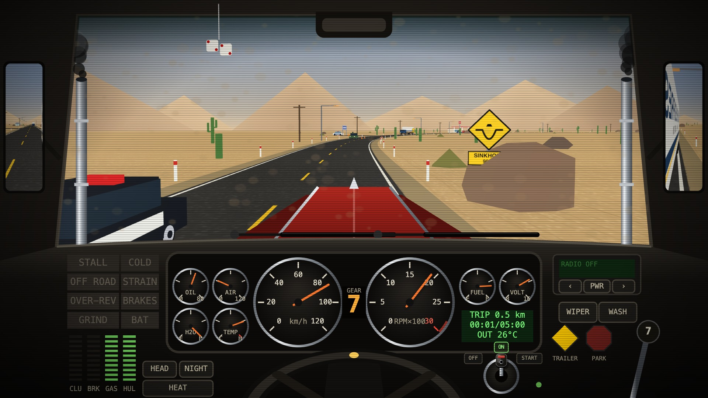
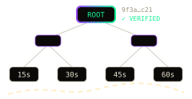
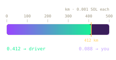
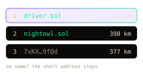
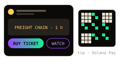
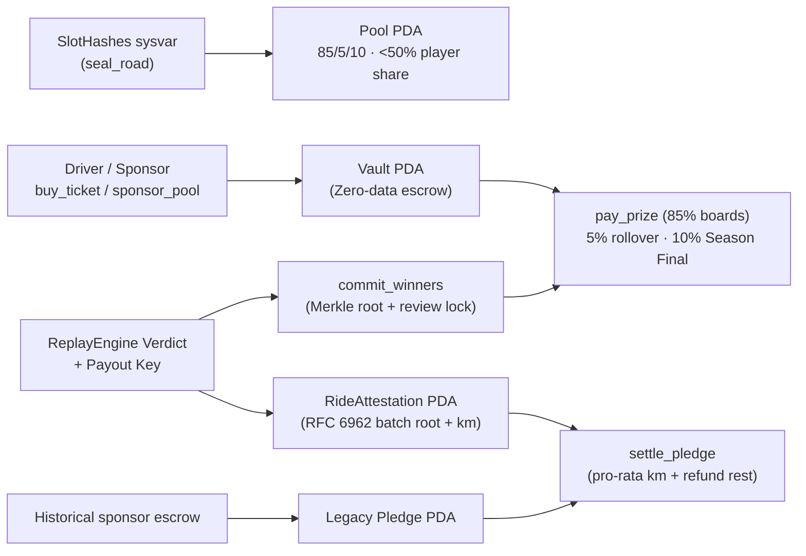
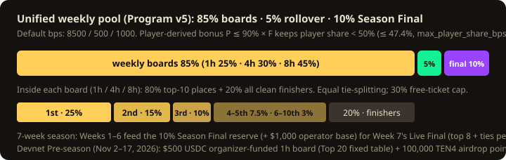
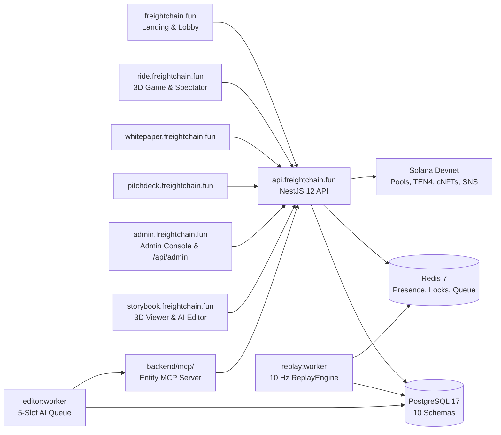

# Freight Chain

**Freight Chain** is a competitive browser truck-driving simulator inspired by *Desert Bus*, built on **Solana**. You sit in a 2D interactive cab over an endless, deterministically seeded 3D highway—operating a manual 7-speed gearbox, clutch, cold engine, battery, wipers, and CB radio with speed governed at **28 m/s (~100 km/h)**. Shifts finish only when you cross the server-set distance line; one fatal crash ends the run.

Free training is unlimited with no wallet required (`play.html` starts the real `EASY` shift immediately). Ranked skill-contest pools run on non-custodial **Anchor escrow (`freightchain_pools`)**; verified paid checkpoints mint the capped **`TEN4` token (`freightchain_honk`, 100M supply)**; achievements mint **44 soulbound Metaplex Bubblegum v2 cNFTs**; and every online run is verified by a **shared 10 Hz physics & frame-level traffic replay engine**.

- **Live Surfaces**: [freightchain.fun](https://freightchain.fun) · [Lobby](https://freightchain.fun/lobby.html) · [Play Free (`EASY`)](https://ride.freightchain.fun/play.html) · [Whitepaper](https://whitepaper.freightchain.fun) · [Interactive Pitch Deck](https://pitchdeck.freightchain.fun) · [3D Viewer & AI Editor](https://storybook.freightchain.fun) · [Blink Preview](https://freightchain.fun/blink.html) · [Docs Wiki](docs/wiki.html)
- **Local legal review**: Vite serves `/terms/`, `/privacy/` and `/rules/` with the unchanged EN/RU Pre-season draft. Owner completion of publication details remains required before deployment.
- **On-Chain (Devnet)**: Escrow [`8No42h2QXb9opgp3pJfNXL2o77o288SsF8o7CwJGCA1p`](https://explorer.solana.com/address/8No42h2QXb9opgp3pJfNXL2o77o288SsF8o7CwJGCA1p?cluster=devnet) · Config [`9zRUyontAnwj65WHpEazpmW1eyHb8oYfPDvxcpMrSw7F`](https://explorer.solana.com/address/9zRUyontAnwj65WHpEazpmW1eyHb8oYfPDvxcpMrSw7F?cluster=devnet) · cNFT Collection [`56ijQ5t2RFpXezbPtEuqECo5gCQiGSek2LBsp7cfMoXC`](https://explorer.solana.com/address/56ijQ5t2RFpXezbPtEuqECo5gCQiGSek2LBsp7cfMoXC?cluster=devnet) · Merkle Tree [`45NKrZA9rGFcKr62VY5NvM89yarFuBqtBseRK7ZSM336`](https://explorer.solana.com/address/45NKrZA9rGFcKr62VY5NvM89yarFuBqtBseRK7ZSM336?cluster=devnet)
- **Social**: [X (@FreightChainSol)](https://x.com/FreightChainSol) · [YouTube (@FreightChainGame)](https://www.youtube.com/@FreightChainGame) · [GitHub](https://github.com/recferret-bit/freightchain)


## Traction

<!-- traction:start -->

Public numbers for a reviewer, read 2026-10-28 17:10 UTC. PostHog and the public stats endpoint were each read more than once. A count the second read did not support is not in a headline.

<table><tr>
<td align="center" width="50%"><h2>35</h2><b>shifts started</b><br>6 finished · <a href="https://freightchain.fun/api/stats">api/stats</a></td>
<td align="center" width="50%"><h2>27.9 km</h2><b>driven</b><br>4 drivers · 5 crashes</td>
</tr>
<tr>
<td align="center" width="20%"><h2>313</h2><b>landing people</b><br>PostHog · 8 Oct 2026 through 2026-10-28 UTC</td>
<td align="center" width="20%"><h2>28</h2><b>whitepaper readers</b><br>PostHog · same window</td>
<td align="center" width="20%"><h2>88</h2><b>wallet sign-ins</b><br>real wallets · demo excluded</td>
<td align="center" width="20%"><h2>6</h2><b>real shifts started</b><br>29 demo starts</td>
<td align="center" width="20%"><h2>6</h2><b>shifts finished</b><br>6 demo · 0 real</td>
</tr></table>

The second row is PostHog Cloud EU, project 297915. Probe events (`surface=prod-check`) are out. Ride counts are `source=server`. Demo wallets are separate from real ones. Client `ride_completed` is not counted.

### The product

These are [`https://freightchain.fun/api/stats`](https://freightchain.fun/api/stats), read twice. Free and paid are the split of shifts started. The site and this table use this response, not a PostHog chart.

PostHog counts those 6 finished shifts as 6 demo-wallet finishes and 0 others. A demo wallet runs the paid clock at 1/60.

| | |
| --- | ---: |
| Shifts started | 35 |
| Free | 32 |
| Paid | 3 |
| Finished | 6 |
| Driven | 27.9 km |
| Time | 1 h 9 min |
| Crashes | 5 |
| Drivers | 4 |
| Stream donations | 0 |

### Analytics

Insight definitions are checked by `posthog-audit` (EU project 297915, dashboard 1006663). That skill does not change PostHog from here. Probe events (`surface=prod-check`) are not in the counts. A server ride event is `source=server`. Demo wallets are separate. Client `ride_completed` is not a metric.

Audit: 2 fixes waiting, 37 insights match the spec, 8 left off the judge board. Exit 1 means a fix is waiting. It was not applied.
Waiting: FC · Promo from an invite view; FC · Promo from a submitted code.

| Window | Landing people | Real finishes | Demo finishes | Real sign-ins |
| --- | ---: | ---: | ---: | ---: |
| 8–12 Oct 2026 (judge board) | 106 | 0 | 6 | 54 |
| 8 Oct 2026 through 2026-10-28 UTC | 313 | 0 | 6 | 88 |

Refresh with `node .claude/skills/daily-tracktion-update/update.mjs`. The raw read is `docs/insights/traction/latest.json`.

<!-- traction:end -->

> Achievement cNFT local acceptance: `npm run test:nft:localnet` (also in `test:ci:full`), using pinned public Bubblegum/MPL-Core binaries, a disposable validator and PostgreSQL. Details: [Web3 checks](docs/spec/web3_solana.md).

## Contents

- [Traction](#traction)
- [Judge Walkthrough](#judge-walkthrough)
- [The truck](#the-truck)
- [Solana & Web3 Features](#solana--web3-features)
- [What Changed Since the Colosseum Submission](#what-changed-since-the-colosseum-submission)
- [Security Audit & Remediation](#security-audit--remediation)
- [Roadmap, Pre-Season & Go-To-Market](#roadmap-pre-season--go-to-market)
- [Technology & Architecture](#technology--architecture)
- [Repository & Documentation Map](#repository--documentation-map)
- [Run It](#run-it)
- [Skills](#skills)
- [Tests](#tests)

---

## Judge Walkthrough

Built solo in two weeks during the Colosseum hackathon (entering in the final 6 days) and heavily expanded after the **12 Oct 2026** submission snapshot:

1. **Drive immediately (no wallet)**: Press **PLAY FREE RIDE NOW** on [freightchain.fun](https://freightchain.fun) (or open [ride.freightchain.fun/play.html](https://ride.freightchain.fun/play.html)) to drive the 3-minute `EASY` shift (`1,512 m` finish line) in an anonymous session.
2. **Pitch Deck & Whitepaper**: Open [pitchdeck.freightchain.fun](https://pitchdeck.freightchain.fun) (8 playable slides with 3D coin physics and mobile tilt controls) and [whitepaper.freightchain.fun](https://whitepaper.freightchain.fun).
3. **Sign In With Solana or Phone QR**: Connect any Wallet Standard wallet in the [Lobby](https://freightchain.fun/lobby.html) via 1-prompt CAIP-122 `solana:signIn`, or pair a desktop browser by scanning a single-use QR code (`/api/auth/pair`) with a phone wallet.
   - **Seeker trust** in Profile: one-time trust shortcut from authenticated mainnet SGT ownership; optional server RPC, no transaction. [Verification and transfer protection](docs/agents/server.md#seeker-genesis-token-trust).
   - **Campaign tasks** in Profile: EN/RU task progress, signed Telegram channel/group verification, X proof, and one owner-enabled Pre-season attempt, then the $500 event's public table (`GET /api/event/board`) and the admin `EVENT TOP-20` review/payout-record tab. Setup and remaining owner decisions: [campaign acceptance](docs/testing/CAMPAIGN_LOCAL.md).
4. **Live Streams, Replays & Receipts**: Watch active paid shifts ~25 seconds behind in **LIVE** or at `1× / 4× / 16×` in **REPLAYS** (road rebuilt from the ride seed, no WebSockets), chat on CB radio, tip via Solana Pay QR, or open shareable ride receipts (`/r/:id`).
5. **Run On-Chain & Anti-Cheat Suites Locally**:
   - `npm run test:localnet` — runs `freightchain_pools` on a local validator (pool creation, ticket buys, refunds, Merkle payouts, lamport checks; [walkthrough](docs/tech/localnet-e2e/index.html)).
   - `bash .claude/skills/honk-suite/run.sh` — runs the `TEN4` (`freightchain_honk`) token suite (checkpoint mint and durable retry, Convoy payment/cap recovery, LP swap, cab/stream burns, soulbound parts, Merkle distribution, vesting and allocation burns).
   - `bash .claude/skills/run-tests/e2e.sh traffic` — runs the 9-case headless Chrome anti-cheat matrix (honest runs vs. deleted cars, ignored damage, tampered frame proof).

---

## The truck

**Five routes, one physical truck.** Manual 7-speed gearbox, clutch, stall (`< 450 rpm` in gear), parking brake, cold engine, overheating, battery/alternator load, heater/AC, wipers, 11-station CB radio, and dash GPS (`N`). Speed is governed at **28 m/s (~100 km/h)**. For paid shifts, the server derives both route and start hour from the provable seed.

<table>
  <tr>
    <td><br><b>Route 66</b> · Desert bends</td>
    <td><br><b>Trans-Siberian</b> · Snow &amp; frost</td>
    <td><br><b>Stuart Highway</b> · Outback dust</td>
    <td><br><b>Brenner Pass</b> · Alpine pass</td>
  </tr>
</table>

The fifth route is the **Pan-American Highway** (Atacama sweepers). Every shift completes by distance (`completeDist = k × 28 m/s × nominal_seconds`), with no minimum time:

| Tier | Nominal | Finish Line | Entry | Mechanics & Rewards |
| --- | --- | --- | --- | --- |
| **Free · EASY** | 180 s | 1,512 m (`k=0.3`) | Free (guest ok) | 4 lanes, 2 crossroads, bends ×3, calm traffic, tutorial + assist. Auto-ends at line |
| **Free · MEDIUM** | 300 s | 3,360 m (`k=0.4`) | Free | Depot turn, 3 crossroads, 1 fork, bends ×1.35, traffic ×0.8, sinkholes ×1.5, assist optional |
| **Free · HARD** | 1,800 s | 20,160 m (`k=0.4`) | Free | 12 crossroads, 4 forks, highway run, bends ×1.6, traffic ×1.4, sinkholes ×2. No assist/tutorial |
| **1h · Sprint** (25% board) | 3,600 s | 50,400 m (`k=0.5`) | $5 SOL/USDC (or weekly AMOE) | Depot, stop line, right turn. Paid tickets mint `TEN4` at `20% / 50% / 100%` checkpoints |
| **4h · Haul** (30% board) | 4 h | 201,600 m (`k=0.5`) | $15 series / $12 S1 extra | Bends ×1.2, traffic ×1.4. Mints `TEN4` at `20% / 50% / 100%` checkpoints |
| **8h · Long Haul** (45% board) | 8 h | 403,200 m (`k=0.5`) | $50 series / $25 S1 extra | Bends ×1.4, traffic ×1.8. Mints `TEN4` at `20% / 50% / 100%` checkpoints |

- **Unlimited Free Training, Weekly AMOE & Promo Codes**: Training is free and unlimited. Every eligible wallet gets **1 weekly granted paid ticket** (AMOE, default `1h`; capped at 30% of board prizes; does not mint `TEN4`). Single-effect promo codes grant `1h / 4h / 8h` rides or pool tickets. Wallets in `DEMO_WALLETS` run paid shifts `DEMO_SCALE` (60×) shorter for testing.

---

## Solana & Web3 Features

    

| System | Solana Primitive | What It Does & Honest Boundary | Code & Spec |
| --- | --- | --- | --- |
| **1. Escrow & Skill Pools (`freightchain_pools`)** | Anchor 1.2 (`8No42h2QXb9opgp3pJfNXL2o77o288SsF8o7CwJGCA1p` devnet v3; local source v6 has 30 instructions, 28 events, 51 errors). Zero-data `Vault` PDA | Holds ticket & sponsor funds in PDA vaults; enforces `< 50%` player-derived share (`max_player_share_bps <= 4999`, default `4740`) and `85 / 5 / 10` split. Publishes 32-byte Merkle `winners_root` before a review lock (`commit_winners`, `veto_winners`), then allows permissionless `pay_prize` claims (`PrizeClaim` PDA). v6 pools activate at opening with no sales minimum; `fail_pool` is a refusing compatibility instruction. Cancellation and deadline expiry retain permissionless ticket/sponsor refunds | [`freightchain_pools`](backend/programs/freightchain_pools) · [`settle.rs`](backend/programs/freightchain_pools/src/instructions/settle.rs) · [`pool.md`](docs/spec/pool.md) |
| **2. Provable Road Seed & Telemetry Merkle Root** | `SlotHashes` sysvar (`seal_road`) + RFC 6962 Merkle tree over SHA-256 batches | `seal_road` commits `SHA-256(pool_id_le32 ‖ slot_hash ‖ slot_le64)` from a later slot after pool opening, before any ride may start. On-chain ride attestations record the RFC 6962 Merkle root of accepted batches. Driving physics are verified off-chain by `ReplayEngine` | [`road.rs`](backend/programs/freightchain_pools/src/instructions/road.rs) · [`provable-seed.ts`](backend/server/src/domain/road/provable-seed.ts) · [`telemetry-merkle.ts`](backend/server/src/domain/telemetry/telemetry-merkle.ts) |
| **3. Legacy Per-km Pledge Recovery** | `Pledge` PDA `["pledge", ride_id, sponsor]` + `RideAttestation` PDA | New `create_pledge` calls refuse `PledgesDisabled` (Decision 51). Existing escrow remains recoverable. A `VERIFIED` attestation pays `cap × min(verified_km, target) / target` and refunds the rest + rent to the sponsor (`settle_pledge`). `FLAGGED` or failed pools refund 100% (`refund_pledge`) | [`pledge.rs`](backend/programs/freightchain_pools/src/instructions/pledge.rs) |
| **4. `TEN4` Token & 9-Slot Garage (`freightchain_honk`)** | Anchor SPL token with fixed **100,000,000 `TEN4`** cap (mint authority revoked in `initialize`; `HONK` is the horn/chat verb) | **55M** ride emission across halving eras (`20% / 50% / 100%` paid checkpoints: `100 / 500 / 1,200 TEN4` in Era 1), **15M** burned LP & two-way pool, **8M** Merkle airdrop (`2,000 TEN4` cap, 90d claim + `burn_unclaimed`), **4M** Convoy referral vault (`100 / 50 TEN4` milestones M1/M2 + `burn_referral_tail`), **10M** treasury (36m linear), **8M** team (12m cliff + 24m linear). Burns: `1` stream HONK, `10` day/night, `25` weather, `65 / 260` cab cosmetics across 9 Garage slots (never pay-to-win) | [`freightchain_honk`](backend/programs/freightchain_honk) · [`tokenomics.ts`](backend/server/src/domain/honk/tokenomics.ts) · [`ten4.md`](docs/spec/ten4.md) |
| **5. 44 Soulbound Badge cNFTs** | Metaplex Bubblegum v2 · Collection [`56ijQ5…MoXC`](https://explorer.solana.com/address/56ijQ5t2RFpXezbPtEuqECo5gCQiGSek2LBsp7cfMoXC?cluster=devnet) · Tree [`45NKrZ…M336`](https://explorer.solana.com/address/45NKrZA9rGFcKr62VY5NvM89yarFuBqtBseRK7ZSM336?cluster=devnet) | 44 earnable badge tiers across 12 ladders, plus a non-earnable Top-20 placeholder. The metadata map has 31 published URIs; 13 remain unpublished. Minted by isolated outbox key (`ACHIEVEMENT_MINT_SECRET`) after a 1h delay and re-check that skips rejected rides. Non-transferable on-chain | [`achievements.ts`](backend/server/src/domain/achievements/achievements.ts) · [`web3_solana.md`](docs/spec/web3_solana.md) |
| **6. SIWS, QR Pairing, `.sol` SNS & Blinks** | CAIP-122 `solana:signIn`, Wallet Standard, SPL Name Service, Solana Pay & Actions | 1-click sign-in bound to domain + single-use nonce, or desktop sign-in via phone QR scan (`/api/auth/pair`). Mainnet `.sol` resolution (24h hit / 30m miss cache). Public devnet Blinks (`/actions.json`, `/api/actions/*`, `/blink.html`) and Solana Pay QR codes for tickets and stream tips | [`wallet.js`](frontend/client/site/wallet.js) · [`qr.js`](frontend/client/site/qr.js) · [`sns-name-service.adapter.ts`](backend/server/src/infrastructure/sns/sns-name-service.adapter.ts) · [`actions`](backend/server/src/domain/actions) |



- **PDA Account Model**: `Config ["config"]` (admin, treasuries, fee floors, `max_player_share_bps <= 4999`, payout authority) · `Series ["series", tier]` · `Pool ["pool", id]` (`seed_commitment`, `winners_root`, `vetoed`) · `Vault ["vault", id]` (zero-data SOL escrow, never staked) · `Ticket ["ticket", pool, buyer]` · `Sponsor ["sponsor", pool, sponsor]` · `Pledge ["pledge", ride_id, sponsor]` · `RideAttestation ["ride_attestation", pool, ride_id]` (v3: `["attestation", pool, driver]`) · `PrizeClaim ["prize_claim", pool, winner]`.
- **Authority Separation & Permissionless Exit**: Every player and sponsor signs and pays for their own transaction (`buy_ticket`, `sponsor`); the server never custodies user funds or holds the cold admin key. The server holds only two narrow keys: (1) a **`crank` key** for `open_next_pool`, `seal_road`, and permissionless lifecycle steps (**cannot** commit or veto winners), and (2) **`PAYOUT_SECRET`** to publish `commit_winners` and `RideAttestation`s after `ReplayEngine` verification. During the review lock, the offline cold admin can `veto_winners`. After deadlines, **any wallet** can crank `pay_prize`, `settle_pledge`, `expire_pool`, `refund`, `refund_sponsor`, and `refund_pledge`—an absent operator cannot trap funds.
- **Reproducible Builds & Shared Lamport Math**: `npm run program:verify` rebuilds inside the Solana Foundation image and checks [`backend/programs/verifiable-build.hash`](backend/programs/verifiable-build.hash) (`c32477bc…` on Solana 4.1.2; recorded devnet v3 hash `47a630e8…`). Server and Rust share exact lamport fixtures ([`vault-split.ts`](backend/server/src/domain/economy/vault-split.ts), [`vault-split-cases.json`](backend/server/test/fixtures/chain/vault-split-cases.json)).

### Unified Skill Contest Pool Math (`85 / 5 / 10` & `< 50%` Player Share)



The weekly contest pool `T = F + P + C` ([`prize-pool.ts`](backend/server/src/domain/prize/prize-pool.ts), [`prize-rules.ts`](backend/server/src/domain/prize/prize-rules.ts)) combines fixed non-player funding `F = B + S` (operator base `B` stepping `$300 → $750 → $1,500 → $3,000/wk` + external sponsors `S`), a capped bonus `P = min(40% × R_prev, $2,500, 90% × F)` from prior-week net ticket revenue `R_prev` (keeping player-derived funding **strictly `< 50%`** / `≤ 47.4%` of `F + P`, enforced on-chain by `max_player_share_bps <= 4999`), and rollover `C ≤ 25% × F`. Each week splits **85% to skill boards** (**1h** 25% · **4h** 30% · **8h** 45%; inside each board **80% Top 10** + **20% all clean finishers**, equal tie-splitting, 30% free-ticket cap), **5% next-week rollover**, and **10% to the Week 7 Live Season Final** (`$1,000` base + 6 weeks of 10% reserves for Top 8 + ties per board).

---

## What Changed Since the Colosseum Submission

Following the **12 Oct 2026** hackathon submission snapshot, seven major engineering upgrades were built and verified between **13 Oct and 19 Oct 2026**:

| Date | Post-Submission Upgrade | What Was Built & Verified |
| --- | --- | --- |
| **13–15 Oct** | **1. 12-AI Blind Security Audit & App Hardening** | 12 AI auditors across 4 vendors reviewed 6 surfaces in blind pairs (`./tests/audit/bin/audit`). All 7 High and 9 Medium findings fixed in source with PoC regression tests. Wallet Standard picker, 1-prompt `solana:signIn`, session/admin cookie isolation, pool deadlines, Anti-cheat v4, and playable 8-slide Pitch Deck shipped in Oct 15 release (`20261015-152742-16870e81`) |
| **14–17 Oct** | **2. Escrow Program v4 & v5 (`0.5.0`)** | Upgraded `freightchain_pools` from v3 (21 instructions) to v5 (**30 instructions, 28 events, 50 errors**): public Merkle `winners_root` + review lock + `veto_winners`, per-ride `RideAttestation`s, `refund_sponsor`, later-slot `seal_road`, `85 / 5 / 10` split, `< 50%` player-derived share cap (`max_player_share_bps <= 4999`), `set_pool_rules`, and `paid_tickets_enabled` (157 `#[test]`s / 163 Rust tests in `freightchain_pools` + 40 in `freightchain_honk` = 197 total `#[test]`s + localnet suites) |
| **16 Oct** | **3. Shared Simulation Kernel & Frame-Level Traffic Proof (Rules v7)** | Unified road geometry, Float64 curvature, longitudinal physics, and seeded traffic AI in [`@freightchain/shared`](frontend/client/shared). New rides (`trafficVersion=1`) record lossless per-frame traffic proof inside 2s/500-frame SHA-256 batches; `ReplayEngine` rejects removed cars, ignored hull damage, or tampered poses (verified by a 9-case headless Chrome matrix) |
| **16–17 Oct** | **4. `TEN4` Tokenomics (`freightchain_honk`), 9-Slot Garage & Convoy** | Built the capped `100M TEN4` program (6 supply buckets, halving eras, `20% / 50% / 100%` checkpoints, two-way LP pool, `8M` Merkle airdrop, `4M` Convoy vault, treasury/team vesting, cab & stream burns), expanded Garage to 9 slots, and added `?ref=` Convoy referral milestones (`100 / 50 TEN4` + free rides + 3 paints) |
| **16–17 Oct** | **5. Declarative 3D Entity Engine & Isolated AI/MCP Editor** | Converted all 3D models into code-free data entities ([`frontend/client/shared/entity/`](frontend/client/shared/entity)) with analytic geometry checks. Added `SOURCE / CHAT / HISTORY` tabs on `storybook.<apex>`, append-only PostgreSQL revisions (`HEAD` vs `PUBLISHED`), wallet-signed publishing, a 5-slot `editor:worker`, and an isolated Streamable HTTP [`backend/mcp/`](backend/mcp) server |
| **16–17 Oct** | **6. Horizontal Scaling, Phone QR Pairing & Modular UI Refactor** | Added Redis Lua presence/ops logs (`fc:ops:logs`), `SET NX PX` scheduler leases, deduplicated `replay:worker`, bounded LRU caches, universal client crash reporting (`crash-boot.js`), single-use phone-to-desktop QR pairing (`/api/auth/pair`), mobile tilt coin physics in Pitch Deck, Whitepaper v0.3, and a 3-pass modular UI refactor across all sites |
| **18–19 Oct** | **7. 6-Domain Repo Restructure, Spec System & Fast E2E Harness** | Reorganized root into `frontend/`, `backend/`, `infra/`, `tests/`, `social/`, `docs/`; consolidated 68 owner decisions + `PRODUCT.md` / `COVERAGE_CONTRACT.md` into 7 `docs/` categories with an interactive [Docs Wiki](docs/wiki.html); added fast code-level E2E blocks (`test:e2e:block1`, `test:e2e:block2`) |

Convoy on `main` now uses 72-hour pending invites, a 60-day qualification window, one capped 1h promo for an activated friend, and held TEN4 milestones. Profile shows progress, rewards and privacy; historical balances and badge progress are preserved. See [referrals](docs/spec/referral.md).

> **Release State (`freightchain.fun` vs. `main`)**: The last recorded production observation (`https://freightchain.fun`) was release `20261019-115832-56a92dd6` across all 7 subdomains (`app`, `worker`, `editor-worker`, `mcp`, `postgres`, and `redis` all live—including Rules v7 shared kernel & frame-level traffic proof, the 9-slot Garage & Convoy referral system, the 3D AI/MCP editor on `storybook.freightchain.fun`, phone QR pairing, Pitch Deck, Whitepaper v0.3, and the badge cNFT catalog). The recorded devnet deployment is Escrow Program v3 (`8No42h2QXb9opgp3pJfNXL2o77o288SsF8o7CwJGCA1p`), with local Escrow Program v6 and `freightchain_honk` (`TEN4`) ahead of the devnet cutover. Current acceptance evidence and remaining gaps are in [local readiness](docs/testing/LOCAL_READINESS.md).

---

## Security Audit & Remediation

On **13 Oct 2026**, twelve AI auditors (**Claude Opus 5.5, GPT-6.1 Sol, Gemini 3.1 Pro, Grok 4.7**) audited six surfaces in blind pairs inside an airgapped Docker + LiteSVM sandbox (`./tests/audit/bin/audit`). Quorum adjudication distilled **69 raw findings** into **7 High** and **13 Medium** (4 claims refuted). Every accepted finding was fixed with a PoC regression test:

| Finding Group | Resolution & Release State |
| --- | --- |
| **H1, H3, M10, M13 · Anti-Cheat** (empty recording verified, ~1.9× governor bypass, hidden hole passes, removed traffic) | **Fixed & Shipped.** Coverage/speed/hole checks shipped Oct 15 (rules v4); shared kernel + mandatory frame-level traffic proof (rules v7) shipped Oct 19 (`20261019-115832-56a92dd6`) |
| **H2 · Replay Copying** (another rider's recording replayed as your own) | **Fixed & Shipped Oct 15.** Copied recordings are detected and flagged for review |
| **H6, M7 · Deadlines & Revoked Verdicts** (late rides ranked; revoked verdicts paid) | **Fixed & Shipped Oct 15.** Sales and starts stop at deadlines; payout re-checks verdict status |
| **H7, M2, M3, M4, M9 · Auth, Cookies & Admin Isolation** (cookie scope, CSRF, logout, admin CORS, SIWS fields, rate limits) | **Fixed & Shipped Oct 15.** Surface-isolated cookies (`fc_session`, `fc_admin`, `fc_editor`), host/origin guards, single-use nonces |
| **H4, H5, M6, M8, L4 · Escrow Program** (single payout key gate, unbound pledges, uncommitted review window, stuck sponsor funds, selectable seed) | **Fixed in Program v4/v5 (`0.5.0`).** Public Merkle `winners_root` + review lock + `veto_winners`, per-ride `RideAttestation`, `refund_sponsor`, `seal_road`, `85/5/10` split, and `max_player_share_bps <= 4999` (devnet upgrade from v3 pending) |
| **M1, M5, M11, M12 · Hardening** (blink relay allowlist, CSP/HSTS/SRI headers, public verdict reason codes) | Tracked in [Fix Plan WP6–WP8](docs/insights/reviews/audit-2026-10/fix-plan.md) and [`escrow-open-items.md`](docs/tech/escrow-open-items.md) |

> **Disclosure**: This was an internal multi-agent review, not an independent third-party human audit. Mainnet launch waits on a third-party smart-contract and API audit. Details: [Fix Plan](docs/insights/reviews/audit-2026-10/fix-plan.md) · [3D Editor Security Review](docs/insights/reviews/entity-editor-security.md) · [Audit Harness](tests/audit/README.md).

---

## Roadmap, Pre-Season & Go-To-Market

Detailed plans & legal rules: [Devnet soft launch checklist](docs/plan/DEVNET_SOFT_LAUNCH.md) · [Local feature readiness](docs/testing/LOCAL_READINESS.md) · [`docs/plan/MASTER_PLAN.md`](docs/plan/MASTER_PLAN.md) · [`docs/plan/DEVNET_PRESEASON.md`](docs/plan/DEVNET_PRESEASON.md) · [`docs/legal/PRESEASON_RULES.md`](docs/legal/PRESEASON_RULES.md) · [`docs/legal/OFFICIAL_RULES.md`](docs/legal/OFFICIAL_RULES.md).

| Phase | Window | Key Deliverables | Status |
| --- | --- | --- | --- |
| **Leg 1 · Depot** | Mid-Sep – Oct 5, 2026 | Core 3D truck sim, 5 routes, climate/traffic/holes, NestJS + Postgres backend, SIWS, 6-host split, server-timed shifts, Lobby & Landing | **DONE** |
| **Leg 2 · Fair & Post-Submission** | Oct 6–19, 2026 | Colosseum submission + 7 post-hackathon upgrades (Rules v7 shared kernel & traffic proof, Escrow v4/v5, `TEN4` program, 44 cNFTs, 12-AI audit, 3D AI/MCP editor, QR pairing, repo/docs restructure) | **DONE** |
| **Leg 3 · Devnet Pre-Season** | Nov 2–30, 2026 | **Nov 2–17 Devnet Pre-Season Contest** ($500 USDC organizer prize pool on 1h board + 100k `TEN4` airdrop points; reg Nov 2, contest Nov 9–15, payouts Nov 17); Program v5 devnet cutover; Turnstile; Dialect blink listing; load test; hiring 4 crew seats | **NEXT (Nov 2)** |
| **Leg 4 · Season 1 Mainnet & `TEN4` TGE** | Dec 2026 – Mar 2027 | **Dec 2026**: Operator legal entity, third-party audit, Cloudflare WAF/geo-gates, Didit KYC + Chainalysis sanctions. **Jan 11 – Feb 28, 2027**: **Season 1 Mainnet** (7 weeks: 6 regular + Week 7 Live Final, `$300 → $3,000/wk` base, `< 50%` player share, `2M TEN4` S1 airdrop). **Mar 2027**: **`TEN4` TGE & DEX listing** (`100M` cap) + Season 2 (Mar 15) + Dune dashboard | **PLANNED** |
| **Leg 5 · Long Haul** | 2027+ | Season 2+, Era 2 emission halving, community-voted Storybook AI/MCP models, 3–5 driver team convoys, fixed-point input-only replay core | **PLANNED** |
| **Cut on Purpose** | *Never* | **No pay-to-win upgrades** (Garage parts never alter speed/grip); **desktop-only driving** (phones watch, pair via QR, and pay/tip via Solana Pay); **no ICO/pre-sale**; **no paid ads** before growth lead is hired | **CUT** |

### Go-To-Market Channels

1. **Zero-Friction Browser Funnel (`Play Free → Weekly AMOE → Skill Pools`)**: Visitors click **PLAY FREE RIDE NOW** and drive `EASY` immediately with no wallet or download. Signing in unlocks unlimited `EASY / MEDIUM / HARD` training, soulbound cNFT badges, and **1 weekly granted paid ticket (AMOE)** to compete on ranked boards before spending SOL/USDC.
2. **Nov 2–17 Devnet Pre-Season ($500 USDC + 100k `TEN4` Points)**: Zero-entry 1-hour skill contest with a **$500 USDC** organizer-funded prize pool (Top 20 fixed table: `$100 / $70 / $50 / $30×2 / $20×5 / $12×10`, equal ties) + **100,000 `TEN4` airdrop points** (`50k` board + `50k` referrals). Unlocked via a verified `MEDIUM`/`HARD` test ride + Telegram + X post, targeting global and CIS/RU sim-driving & Solana communities (bilingual EN/RU rules and lobby).
3. **Streams, Receipts & Blinks as Organic Distribution**: Watching live streams or replays requires no wallet. Every ride generates a shareable receipt (`/r/:id`) with X Open Graph cards and Solana Actions (`/actions.json`), turning finishes, crashes, and streamer runs into 1-click entry funnels.
4. **Convoy (`?ref=`) Viral Loop**: Inviters earn free rides on a friend's first `MEDIUM` finish (2 to referrer, 3 to referee), 3 Convoy paints (`convoy / signal / amber`), and **`100 / 50 TEN4` milestones (M1/M2)** from the `4M TEN4` Convoy vault (gated by anti-sybil trust score `≥ 50`).
5. **Crew Expansion (4 Open Seats)**: Built solo by the founder (retaining simulation, backend, and smart contracts); hiring **CPO/COO Hybrid** (growth & marketing), **QA Engineer**, **Community & Support**, and **3D/Media Creator**.

---

## Technology & Architecture

Seven hosts share one codebase via [`frontend/client/js/hosts.js`](frontend/client/js/hosts.js) (collapsing to one origin on `localhost`):



- **Client & Shared Simulation Kernel (`frontend/client/`, `@freightchain/shared`)**: Vanilla ES modules + Three.js r160 with zero framework in the game loop; Vite for Landing, Whitepaper, and Pitch Deck (`frontend/landing/`). Road layout (`s`, `d`), `mulberry32` PRNG, Float64 curvature tables, longitudinal truck physics, and multi-lane traffic AI live in [`frontend/client/shared/`](frontend/client/shared) and execute identically in the browser (60 Hz) and server `ReplayEngine`.
- **Verified Play & 10 Hz Server Replay Engine ([`docs/spec/anticheat.md`](docs/spec/anticheat.md))**: Online shifts upload gzip-compressed, SHA-256 hash-chained batches every **2 game seconds or 500 frames** containing 10 Hz truck samples, input bitmasks, and lossless per-frame traffic proof (`trafficVersion=1`). `RideVerdict.judge` checks admission bounds, hash links, RFC 6962 Merkle roots, sinkhole damage, off-road time, and human input timing; `ReplayEngine` re-simulates physics and traffic AI at recorded frame timing to verify cab/trailer contacts and sample binding.
- **Backend Clean Architecture (`backend/server/`, [`docs/tech/backend-architecture.md`](docs/tech/backend-architecture.md))**: Native-ESM TypeScript 6 (`strict`), NestJS 12, Prisma 6 across **10 PostgreSQL 17 schemas** (`player`, `ride`, `economy`, `achievement`, `telemetry`, `verdict`, `admin`, `live`, `stats`, `asset`), and Redis 7. Strict inward layers (`presentation → application → domain ← infrastructure`) enforced by AST audits in [`backend/server/test/architecture/`](backend/server/test/architecture):
  - **Hexagonal Determinism**: Zero direct `Date.now()`, `Math.random()`, or `process.env`; all time, randomness, and config use `ClockPort`, `EntropyPort`, and `EnvService`.
  - **Concurrency & Lock Hierarchy**: Every wallet mutation on rides, credits, tickets, payments, or pledges runs in one transaction under `SELECT … FOR UPDATE` on `Player` (`findByWalletForUpdate`), ordered **`Player` → `Pool` → `RideTicket` / `Pledge`**, with optimistic `version` retries.
  - **Stateless Horizontal Scaling**: Single-roundtrip Redis Lua scripts track live visitors and stream spectators; schedulers and `AttestationService` coordinate via Redis locks (`SET NX PX`); `replay:worker` deduplicates in-flight jobs; bounded LRU caches hold `RoadPlan` chunks, `RideBatch` payloads, and `.sol` lookups.
- **Declarative 3D Entity Editor & Isolated AI MCP ([`docs/spec/platform_services.md`](docs/spec/platform_services.md))**: Every 3D vehicle, landmark, and prop ([`frontend/client/shared/entity/seed/`](frontend/client/shared/entity/seed)) is a code-free declarative spec validated by analytic geometry rules. Allowlisted `EDITOR_WALLETS` edit or AI-generate drafts on `storybook.<apex>` (`HEAD` vs wallet-signed `PUBLISHED` revisions in PostgreSQL). A dedicated 5-slot `editor:worker` runs LLM tool loops against the isolated [`backend/mcp/`](backend/mcp) Streamable HTTP server using short-lived capability tokens and counter-only Redis ACL rate limits.

---

## Repository & Documentation Map

| Directory | Contents |
| --- | --- |
| [`frontend/`](frontend) | [`client/`](frontend/client) (3D game `play.html`, Lobby, Admin, Viewer, Receipt `r.html`, Blink `blink.html`, shared UI `site/` & `css/`, [`client/shared/`](frontend/client/shared)) · [`shared/`](frontend/shared) (`@freightchain/shared` workspace package) · [`landing/`](frontend/landing) (Vite `/`, Whitepaper, Pitch Deck) · [`design/`](frontend/design) (icons, banners, badge SVGs) |
| [`backend/`](backend) | [`server/`](backend/server) (NestJS 12 API, `replay:worker`, `editor:worker`, 10-schema Prisma `prisma/`, `test/`) · [`programs/`](backend/programs) (Anchor 1.2 `freightchain_pools` v6 & `freightchain_honk` `TEN4`) · [`mcp/`](backend/mcp) (isolated 3D entity MCP server) |
| [`infra/`](infra) | [`deploy/`](infra/deploy/README.md) (production Docker Compose, split-host nginx, local edge `npm run infra:local`) · [`docker-compose.yml`](infra/docker-compose.yml) (local PG `:15433`, Redis) · [`docker-compose.e2e.yml`](infra/docker-compose.e2e.yml) (code-E2E stack `:15434`) |
| [`tests/`](tests) | [`e2e/`](tests/e2e) (`test:e2e:block1`, `test:e2e:block2`, `test:e2e:block3`, `test:e2e:pages`) · [`audit/`](tests/audit) (airgapped Docker + MCP multi-agent security review suite & native CLI brokers; [`README`](tests/audit/README.md)) |
| [`social/`](social) | [`media/`](social/media) (8-bit chiptune synthesizer, gameplay video composer) · outreach & promo scripts |
| [`docs/`](docs/README.md) | Interactive **[Docs Wiki](docs/wiki.html)** across 7 categories: [`spec/`](docs/spec/README.md) ([`PRODUCT.md`](docs/spec/PRODUCT.md), [`DECISIONS.md`](docs/spec/DECISIONS.md), [`OPEN.md`](docs/spec/OPEN.md), domain specs) · [`plan/`](docs/plan/README.md) ([`MASTER_PLAN.md`](docs/plan/MASTER_PLAN.md), [`DEVNET_PRESEASON.md`](docs/plan/DEVNET_PRESEASON.md), [`OWNER_TASKS.md`](docs/plan/OWNER_TASKS.md)) · [`tech/`](docs/tech/) ([`backend-architecture.md`](docs/tech/backend-architecture.md), [`configuration.md`](docs/tech/configuration.md), HTML explainers: [Anti-Cheat](docs/tech/anti-cheat/index.html), [Verified Play](docs/tech/verified-play/index.html), [Pool Program](docs/tech/pool-program/index.html), [Localnet E2E](docs/tech/localnet-e2e/index.html), [Replays](docs/tech/replay-and-donations/index.html), [TEN4](docs/tech/ten4/index.html)) · [`testing/`](docs/testing/) ([`COVERAGE_CONTRACT.md`](docs/testing/COVERAGE_CONTRACT.md), [`E2E_PLAN.md`](docs/testing/E2E_PLAN.md), [`test-coverage`](docs/testing/test-coverage/index.html)) · [`legal/`](docs/legal/) · [`insights/`](docs/insights/) · [`agents/`](docs/agents/) |

---

## Run It

```sh
npm run db:up && npm run db:migrate && npm run server:dev   # local Postgres (:15433) + NestJS API on :3000
npm run infra:local                                         # split-host nginx edge on http://freightchain.localhost
npm run landing:dev                                         # Vite landing/whitepaper/pitchdeck on :5173
npm run client:serve                                        # standalone game server
npm run editor:mcp                                          # 3D entity MCP server on :3100
npm run server:build && npm run editor:worker               # dedicated 5-slot AI model editor worker

# Verification suites
npm run check                                               # client + landing + server unit/arch + mcp + media
npm run server:integration                                  # PostgreSQL integration + concurrency races (freightchain_test)
npm run program:test                                        # Rust LiteSVM tests (freightchain_pools + freightchain_honk)
npm run program:verify                                      # reproducible Solana build vs backend/programs/verifiable-build.hash
npm run test:localnet                                       # full escrow lifecycle on local solana-test-validator
npm run test:e2e:block1                                     # fast code E2E (Postgres + Redis + API, chain off)
npm run test:e2e:block2                                     # fast code E2E (program mode + disposable local validator)
bash .claude/skills/run-tests/e2e.sh                        # 31 real Chrome suites, including normal-physics keyboard controls and bounded phone UI fixtures
bash .claude/skills/run-tests/e2e.sh normal-drive           # opt-in normal MEDIUM; NORMAL_DRIVE_LEVEL=EASY|MEDIUM|HARD selects a free level
node backend/server/scripts/normal-drive-localnet.mjs      # opt-in scratch-validator paid 1h acceptance (long)
npm run test:ci:full                                       # full local gate, including both Rust programs, validator journeys and Chrome
npm run test:production:local                              # isolated host log retention + production Docker/RPC, signed payments, enforcement, outages and recovery
```

Run `npm run install:landing` and `npm run install:media` once before `npm run check`. Env reference: [`docs/tech/configuration.md`](docs/tech/configuration.md).

---

## Skills

Skills live in `.claude/skills/<name>/SKILL.md` (`game-audio` is also linked in `.agents/skills/`). Read-only skills never deploy or write to production. A new, renamed, or removed skill updates this table in the same change ([`AGENTS.md`](AGENTS.md) → "Maps stay current").

| Skill | What it is for | Run |
| --- | --- | --- |
| `game-audio` | 8-bit music, sound effects, engine bed, reusable sound store, or sound on a promo clip | `npm run media:store` · `npm run media:game-sfx` · `npm run media -- social/media/specs/<name>.json --remux` |
| `gameplay-balance` | Tune truck handling: gearbox, torque, stall, steering, brakes, heat, battery, holes, traffic, governor, and shift distance | `cd frontend/client && npm run check` · `cd frontend/client && node tools/e2e-chrome.mjs` |
| `gameplay-video` | Render a promo mp4 (≤ 15 s) and gif (≤ 20 MB) from real gameplay with landing captions | `npm run media -- social/media/specs/<name>.json` |
| `live-board-test` | Verify online presence, live road board, tab-close cleanup, and replay history | `bash .claude/skills/live-board-test/run.sh` |
| `localnet-e2e` | Ticket buys, refunds, Merkle payouts, and autonomous pool cranking on a local Solana validator (100% instruction coverage gate) | `npm run test:localnet` |
| `honk-localnet` | Local `TEN4` mint, swap, burn, soulbound part, and headless paid-ride session | `bash .claude/skills/honk-localnet/run.sh` |
| `honk-suite` | Full local `TEN4` coin suite: Rust tests, catalog drift, headless session, verified ride mint, distribution/vesting/burns | `bash .claude/skills/honk-suite/run.sh` |
| `analytics-review` | Three-pass audit of PostHog events across landing, whitepaper, lobby, and game (`docs/insights/analytics/updates/<n>.html`) | `node .claude/skills/analytics-review/inventory.mjs` |
| `whitepaper-update` | Three-pass check of whitepaper claims against code, prose tightening, and diagrams within gzip budget | `npm --prefix frontend/landing test` · `npm run landing:build` |
| `update-wiki` | Rebuild `docs/wiki-catalog.js` after a documentation edit | `node docs/build-wiki.mjs` |
| `posthog-prod` | Read-only production PostHog check: boot line, public probe, and flush log | `bash .claude/skills/posthog-prod/check.sh` |
| `posthog-test` | Local analytics smoke test against the relay and EU ingest | `bash .claude/skills/posthog-test/smoke.sh` |
| `posthog-map` | Run landing, whitepaper, lobby, and game analytics checks and build the visual event map | `bash .claude/skills/posthog-map/run.sh` |
| `posthog-audit` | Compare PostHog Cloud EU insights against spec definitions (read-only unless told to apply) | `node .claude/skills/posthog-audit/audit.mjs` |
| `daily-tracktion-update` | Refresh the README Traction block and `docs/insights/traction/latest.json` from PostHog and `/api/stats` | `node .claude/skills/daily-tracktion-update/update.mjs` |
| `prod-db` | Read-only production PostgreSQL queries: players, rides, verdicts, payments, review queue | `npm run ops -- query list` · `npm run ops -- query wallet <address>` · `npm run ops -- sql "SELECT …"` |
| `prod-logs` | Read-only production logs across app, PostgreSQL, and nginx | `npm run ops -- logs --since 30m` · `npm run ops -- logs --errors` |
| `program-check` | Reproducible escrow program build against pinned hash, `.so` tests, clippy, and cargo audit | `npm run program:verify` |
| `replay-test` | Test live watch page, replays, and `LIVE_*` flags with driver and spectator in Chrome | `bash .claude/skills/replay-test/run.sh` |
| `ride-audit` | Re-verify any ride from local or production DB (read-only): rebuild road/holes, re-hash batches, re-run verdict | `bash .claude/skills/ride-audit/run.sh <ride id>` · `… <ride id> --prod` · `… --latest 20 --prod` |
| `ride-investigate` | Inspect a single player or ride on production across DB rows and matching logs | `npm run ops -- query ride <id>` · `npm run ops -- query wallet <address>` |
| `ride-review` | Audit all `UNDER REVIEW` paid rides per pool with rank, distance, verdict reasons, and `ride-audit` (read-only) | `bash .claude/skills/ride-review/run.sh` · `… --pool N` · `… --pool N --prod` |
| `run-tests` | Run local verification: `check`, PostgreSQL integration, and 31 real-Chrome suites, including guest, weekly grant, referral, viewer, sim/phone controls, replay controls/chat and signed local-chain replay tips | `npm run check`, then `npm run server:integration`, then `bash .claude/skills/run-tests/e2e.sh` |
| `admin-coverage` | Verify that every admin API route is guarded and wired to the admin UI with no dead calls | `node .claude/skills/admin-coverage/check.mjs` |
| `stats-reconcile` | Recompute and verify (or `--fix` locally) rider and global stats from ride records | `bash .claude/skills/stats-reconcile/run.sh [--fix]` · `--prod` |
| `test-census` | Count tests by pyramid layer, grade feature/flow/route coverage, and update the Tests block and `docs/testing/test-coverage.md` | `npm run test:census` · `npm run test:census -- features` · `npm run test:census -- coverage` · `npm run test:census -- run` · `npm run test:census -- readme` |
| `level-check` | Verify `EASY / MEDIUM / HARD` road geometry and finish rates with a human-paced driver across seeds and routes | `node .claude/skills/level-check/check.mjs` |
| `trip-design` | Measure road tiers (`free`, `1h`, `4h`, `8h`) and capture route screenshots in Chrome | `node .claude/skills/trip-design/measure.mjs` · `node .claude/skills/trip-design/shots.mjs` |
| `verified-play-test` | End-to-end anti-cheat suite: honest & bot runs in Chrome, traffic-proof attacks, API tamper codes, and signed admin review | `bash .claude/skills/verified-play-test/run.sh` · `bash .claude/skills/run-tests/e2e.sh traffic` |
| `3d-assets` | Validate, screenshot, edit, or generate declarative 3D entities (`frontend/client/shared/entity/seed/` & `backend/mcp/`) | `node .claude/skills/3d-assets/validate.mjs --self-test` · `node .claude/skills/3d-assets/validate.mjs "<spec>"` · `node .claude/skills/3d-assets/shot.mjs <id>` |
| `security-audit` | Multi-agent Docker sandbox + MCP security review (`claude`, `codex`, `grok`, `agy`) and selected-file `review-with-cli` | `./tests/audit/bin/audit setup-agents` · `./tests/audit/bin/audit check-agents --live` · `./tests/audit/bin/audit run --repo <path>` · `node --test tests/audit/scripts/*.test.mjs` |
| `grill-fix` | Challenge business value, run three sequential multi-model code reviews, fix bugs/security gaps, and verify tests | `/grill-fix` |
| `coin-grill` | Three-pass Solana token & tokenomics stress-test generating a scored HTML audit report | `node .claude/skills/coin-grill/grill.mjs <path> [--out <report.html>]` · `node .claude/skills/coin-grill/grill.mjs --self-test` |

---

## Tests

Full interactive test coverage report and audit dashboard: [`docs/testing/test-coverage/index.html`](docs/testing/test-coverage/index.html) (raw census: [`docs/testing/test-coverage.md`](docs/testing/test-coverage.md), coverage bar: [`docs/testing/COVERAGE_CONTRACT.md`](docs/testing/COVERAGE_CONTRACT.md)).

<!-- test-census:start -->

### Audit summary & report card

| Metric | Measured Value | Standard / Threshold | Evaluation |
|---|---|---|---|
| **Overall Grade** | **A- (91 / 100)** | B+ (85 / 100) target | Robust pyramid; pure domain separation; dense integration |
| **Total Test Files** | **601 files & harnesses** | 100 % of workspaces tested | Covers client, server, programs, shared, landing, media, audit |
| **Static Test Cases** | **3,160 cases** (`it`/`test`/`#[test]`) | Comprehensive unit + contract | 1,088 server unit, 197 Rust on-chain, 245 security audit |
| **Executed Test Cases** | **3,522 cases** | 0 failures in primary test suites | In-memory + PostgreSQL runners, LiteSVM on-chain programs |
| **Sim & E2E Checks** | **955 static / 1,040+ runtime `check()`s** | Deterministic assertions | 87 headless sim checks, 868 browser/API checks |
| **Line Coverage** | **82.5 %** (24,792 / 30,048 lines) | ≥ 70 % target | 97.9 % domain & application; 940 instrumented files |
| **Branch Coverage** | **83.1 %** (16,209 / 19,504 branches) | ≥ 60 % target | Deterministic branch isolation across state machines |

### Report card by test type

| Category / Layer | Grade | Files | Static Cases | Coverage / Health | Verdict |
|---|:---:|---:|---:|---:|---|
| **Architecture & Invariant Audits** | **A+** | 7 | 30 | 100 % pass | Zero layer-inward cycle leaks; strict clock & env abstraction |
| **Server Domain & CQRS Handlers** | **A+** | 245 | 1,088 | 97.9 % lines · 96.4 % branches | Pure deterministic logic; isolated event bus; fast in-memory execution |
| **PostgreSQL & Redis Integration** | **A** | 49 | 320 (549 executed) | 88.5 % lines · 85.2 % branches | 54 concurrency race tests (`PARALLEL=8`); dedicated test DB |
| **Client 60 Hz Headless Sim** | **A-** | 1 | 87 static / 97 runtime checks | 100 % pass (1.8 s) | 60 km full playthrough; deterministic PRNG; physics & battery step |
| **Solana Programs (Rust LiteSVM)** | **A-** | 16 | 197 `#[test]`s | 100 % pass | Escrow pools v4/v5 + TEN4 honk; in-process VM; zero RPC mock leaks |
| **Security Review & ACP Sandboxes** | **A-** | 46 | 245 cases | 100 % pass | Multi-agent audits; Docker isolated containers; native Rust CLIs |
| **Client & Shared Unit** | **B+** | 10 | 49 cases | 84.1 % lines · 86.0 % branches | Mulberry32 PRNG, road curvature, traffic step, damage rules |
| **HTTP Contract Scenarios** | **B** | 20 | 180 cases | 134 / 151 routes covered | Executed twice (in-memory + PostgreSQL); 17 routes uncovered |
| **Browser E2E & Live Suite** | **B-** | 27 | 868 `check()`s | Real Chrome / headless | Headless Chromium runs; live board, lobby, wallet, watch, admin |
| **AI Model Editor & MCP Tools** | **B-** | 18 | 138 cases | Scripted providers pass | Mock Anthropic/OpenAI; job worker queue; Redis rate limits |
| **Landing & Whitepaper** | **B** | 11 | 126 cases | 100 % pass | Fast node:test specs; slide decks, wallet connect, whitepaper |
| **Media Audio & Promo Video** | **C+** | 21 | 50 cases | 100 % pass | Chiptune synth, audio stores, ffmpeg composition validation |
| **3D Assets & Mesh Parity** | **D+** | 1 | 21 failures | Baseline diff regression | Parity gate fails on 21 ambulance meshes (`veh\|medic`) against `BASE` |

<!-- test-census:end -->
