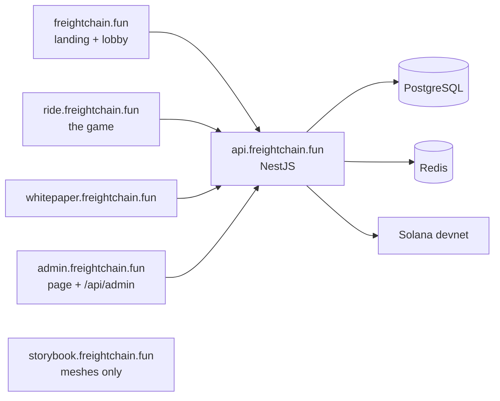
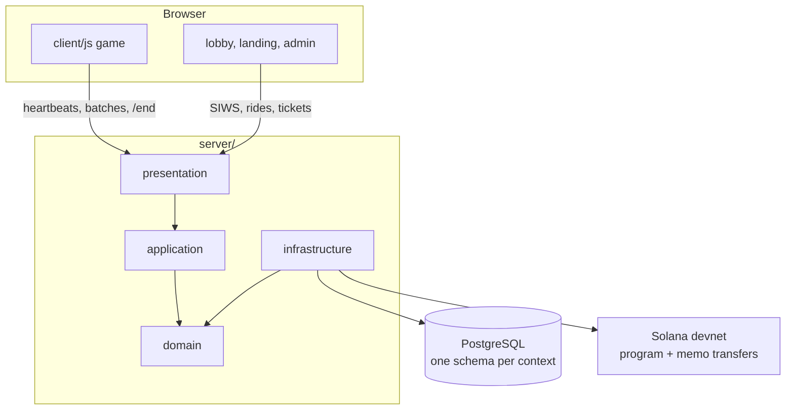
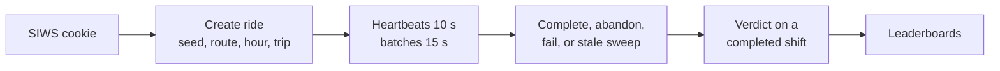
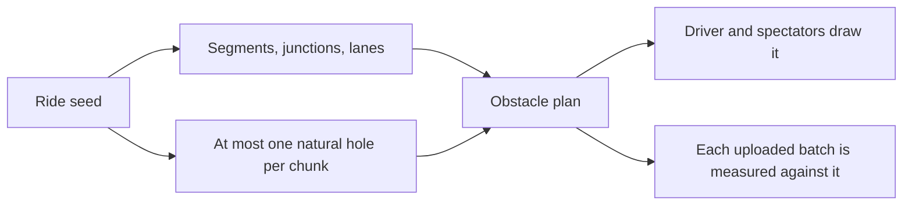
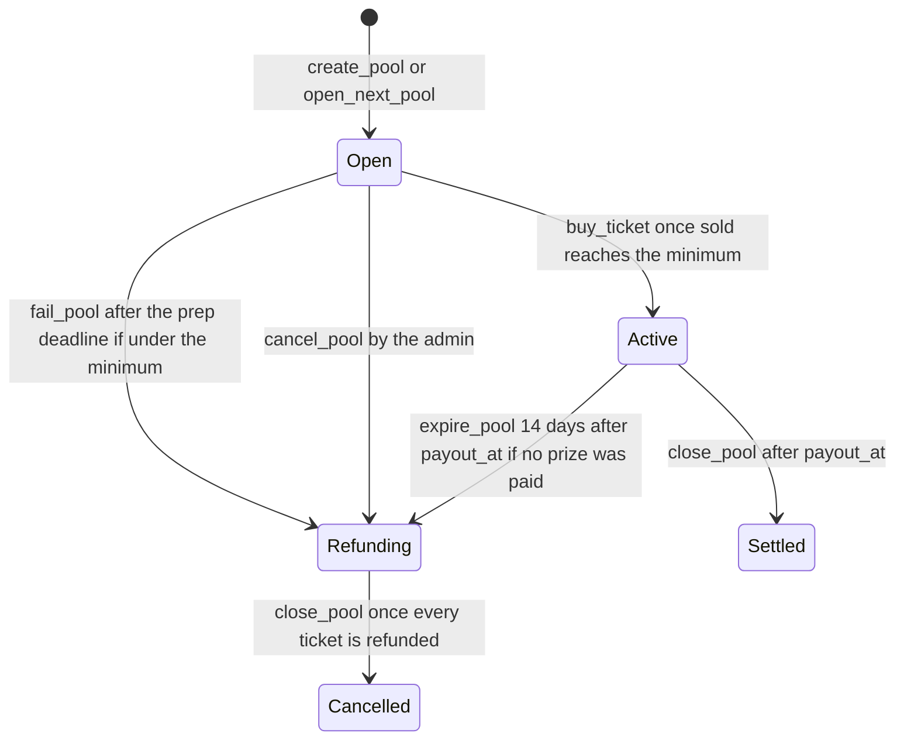
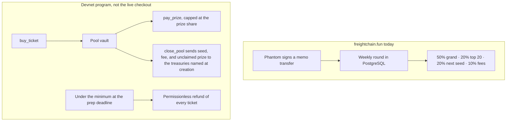
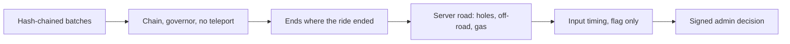
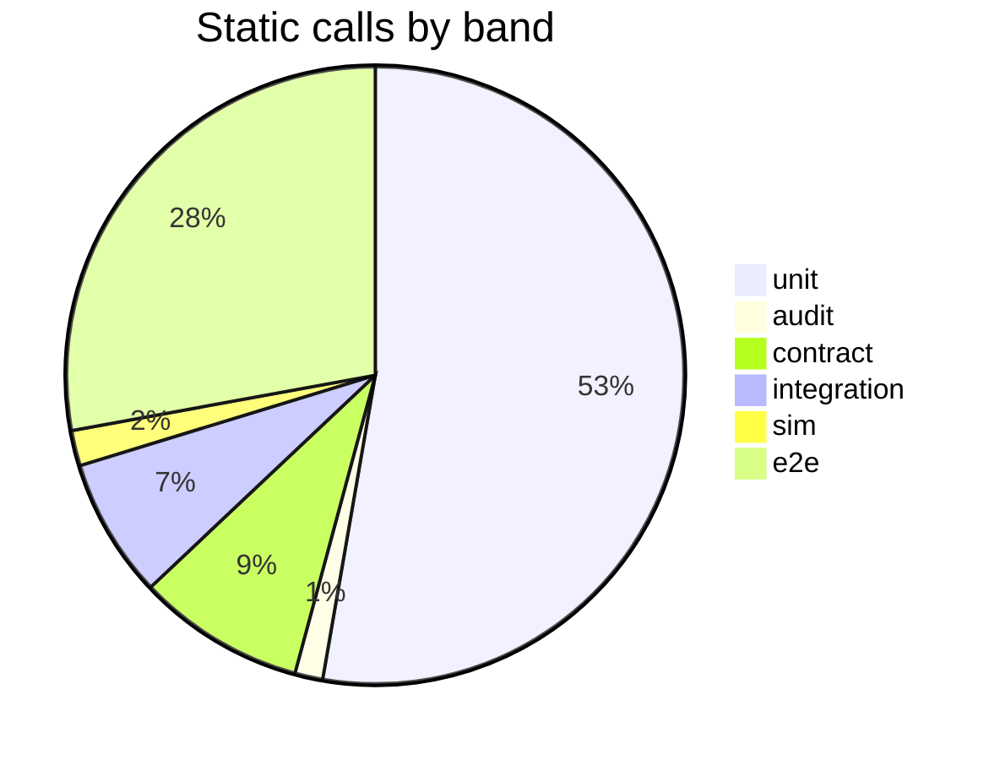
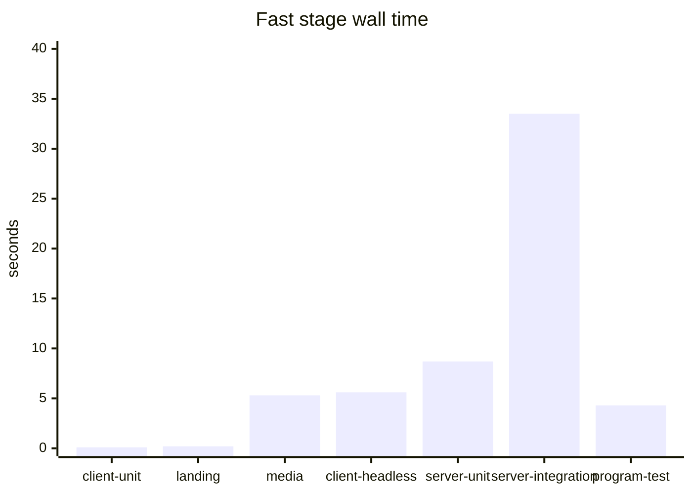
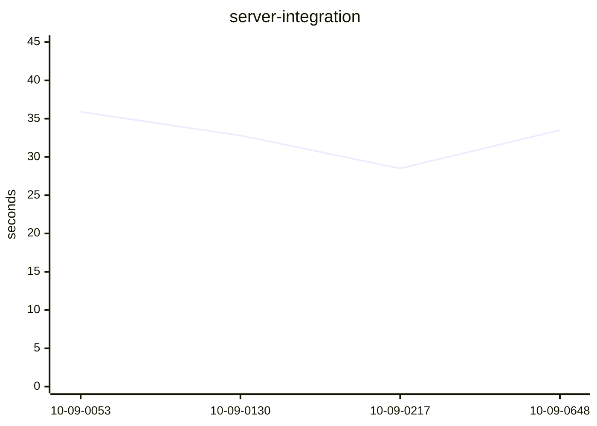

# Freight Chain

A browser truck game on an endless road. A shift costs real time. The server keeps the clock, records the drive, and judges the finish. Paid entries are devnet SOL. There is no token.

The live site is [freightchain.fun](https://freightchain.fun). The escrow program is on Solana devnet. The website still takes the legacy weekly transfer until after the Colosseum results. This file is the map. Coding agents also read [`AGENTS.md`](AGENTS.md).

- **Hackathon.** [Colosseum Crypto World's Fair](https://colosseum.com/worldsfair), Solana track. Close 11:59pm PT, 12 Oct 2026. Worksheet: [`docs/hackathon-plan-v2.md`](docs/hackathon-plan-v2.md) (dated 7 Oct; the status in this README is newer).
- **Chain.** Solana devnet. Program [`9e7phdJzKMNJX8ZnqR8SdxNzafNJjYXeZNsjQze3BSvx`](https://explorer.solana.com/address/9e7phdJzKMNJX8ZnqR8SdxNzafNJjYXeZNsjQze3BSvx?cluster=devnet). Config account [`E1cppxjPPy3QzxQW5Whnf6UQ4u4PJ1VYNQf1UEYovs5g`](https://explorer.solana.com/address/E1cppxjPPy3QzxQW5Whnf6UQ4u4PJ1VYNQf1UEYovs5g?cluster=devnet) (113 bytes, the initialized account). Confirmed on the public devnet RPC on 10 Oct 2026.
- **Stack.** Vanilla ES modules and three.js r160 in the browser. NestJS 12, Prisma, PostgreSQL. Anchor 1.2 program. No bundler on the game. No React.
- **Local.** `npm run db:up && npm run db:migrate && npm run server:dev` → [http://localhost:3000](http://localhost:3000)

## Contents

- [For Colosseum and Solana track judges](#for-colosseum-and-solana-track-judges)
- [Sites and apps](#sites-and-apps)
- [Architecture](#architecture)
- [Features](#features)
- [Core algorithms](#core-algorithms)
- [On-chain escrow](#on-chain-escrow)
- [Economy](#economy)
- [Security](#security)
- [Anti-cheat](#anti-cheat)
- [Live streams](#live-streams)
- [Repository](#repository)
- [Skills](#skills)
- [Run it](#run-it)
- [Tests](#tests)
- [Limits](#limits)

## For Colosseum and Solana track judges

Start on the public site. The form, the two videos, and the founder bio live in [`docs/hackathon-plan-v2.md`](docs/hackathon-plan-v2.md). This section is the product, the chain, and the claims that match the code.

### Open these

| Surface | URL | What you get |
| --- | --- | --- |
| Landing + lobby | [freightchain.fun](https://freightchain.fun) | The pitch, the live boards, sign-in, the lobby |
| Whitepaper | [whitepaper.freightchain.fun](https://whitepaper.freightchain.fun) | Rules, escrow chapter, validation, streams, risks |
| Game | [ride.freightchain.fun](https://ride.freightchain.fun) | The truck. A ride id comes from the lobby |
| Model viewer | [storybook.freightchain.fun](https://storybook.freightchain.fun) | Vehicles, props, furniture, landmarks |
| API | [api.freightchain.fun/api/health](https://api.freightchain.fun/api/health) | JSON only. Other paths on that host 404 |
| Admin | [admin.freightchain.fun](https://admin.freightchain.fun) | HTTP basic auth, then a second wallet sign-in |
| Program | [Explorer · devnet](https://explorer.solana.com/address/9e7phdJzKMNJX8ZnqR8SdxNzafNJjYXeZNsjQze3BSvx?cluster=devnet) | Upgradeable program. Initialized. |
| Social | [X](https://x.com/FreightChainSol) · [YouTube](https://www.youtube.com/@FreightChainGame) · [GitHub](https://github.com/recferret-bit/freightchain) | |

The landing has six chapters: [RIDE](https://freightchain.fun/#ride), [LOOP](https://freightchain.fun/#loop), [ECONOMY](https://freightchain.fun/#economy), [ROADMAP](https://freightchain.fun/#roadmap), [GO TO MARKET](https://freightchain.fun/#market), [ABOUT](https://freightchain.fun/#about). The whitepaper chapters that match a review are [05 on-chain](https://whitepaper.freightchain.fun/#onchain), [06 validation](https://whitepaper.freightchain.fun/#verify), [07 streaming](https://whitepaper.freightchain.fun/#stream), and [08 limits](https://whitepaper.freightchain.fun/#risks).

### Ten minutes

1. Open the [landing](https://freightchain.fun). Read the hero, then ECONOMY. The footer says devnet, and that nothing there is real money.
2. Open the [whitepaper](https://whitepaper.freightchain.fun). The status pills are dated 8 Oct. The escrow pill still says the program is not deployed, and the garage is grouped with planned work. The program account is on devnet, and the garage is a lobby tab. The rest of that page is the public rules.
3. Connect a devnet wallet (Phantom or Solflare). Sign-in is a message, not a transaction. The page sends you to the lobby.
4. Start the free ride. It is one minute, on a straight road, and it ends itself at 420 m. The cab can show a tutorial and an assist mode. Both are free-tier only.
5. Watch someone from LIVE, or open REPLAYS. The watch page draws the truck from the recording, about 25 seconds behind, on a road rebuilt from the ride seed.
6. Open the [program on the explorer](https://explorer.solana.com/address/9e7phdJzKMNJX8ZnqR8SdxNzafNJjYXeZNsjQze3BSvx?cluster=devnet) and the [contract spec](docs/pool-program/index.html). A buy on freightchain.fun today is the legacy memo transfer into the weekly round. Tickets into this program are the other path, in [Economy](#economy).
7. If you build the repo: `npm run test:localnet` runs the real program on a local validator and checks every lamport. Walkthrough: [`docs/localnet-e2e/index.html`](docs/localnet-e2e/index.html).

A wallet listed in `DEMO_WALLETS` drives a paid shift `DEMO_SCALE` times shorter (default 60). The cab, the lobby, and the watch page badge that ride `DEMO ×60`. The speed governor stays 28 m/s. Say the demo clock out loud if a one-hour shift finishes in a minute.

### Status

| Piece | In this repository | On the public site |
| --- | --- | --- |
| Driving game, five routes, free rides, trips | Yes | Live |
| Server-timed shifts, hash-chained recordings, verdicts | Yes, rules version 3 | Live, shadow mode. Boards still rank without the verdict |
| Server-rebuilt road and hole checks | Yes | The whitepaper still says "next deploy" |
| Live watch, replays, CB chat, devnet tips to the driver | Yes | Live. Effects run on free rides only |
| Garage, promo codes | Yes | Lobby tabs. Cosmetics are colours |
| Escrow program | v1 on devnet, initialized. v2 (one pool a day, a payout key, a review window) on branch `pool-series`: 17 instructions, 14 events, 25 errors | v2 is not deployed; it needs a fresh program id. The website is still `PAYMENT_MODE=transfer` |
| Prize payouts from a pool vault | v2: the server's payout job pays the verified top 20 after the 48 h review, once every ride of the pool is decided; an admin can HOLD it | After the results, on an explicit switch |
| Token, mainnet, captcha, NFT badges | No | No |

Production stays on the transfer path until the Colosseum results, the devnet exit list, and an explicit deploy. That rule is [`docs/escrow-open-items.md`](docs/escrow-open-items.md) (Q-K, Q-L). The top of that file still says "nothing deployed"; Phase 1 below it records the 8 Oct deploy. The explorer is the check.

### What a Solana judge can check

- **Sign-in.** Sign-In With Solana. The server stores one challenge, consumes it on the first attempt, and sets an httpOnly cookie. The statement says the signature does not send a transaction. [`server/src/domain/auth/sign-in.ts`](server/src/domain/auth/sign-in.ts)
- **A program-owned vault.** Each pool has a zero-data PDA. Only the program can sign for it. Price, minimum, deadlines, and the prize / seed / fee split are fixed at `create_pool`. [`programs/freightchain-pools/README.md`](programs/freightchain-pools/README.md)
- **A missed pool refunds without the operator.** `fail_pool`, `refund`, `expire_pool`, and the grace `close_pool` are permissionless. After 14 days an unpaid active pool can only be expired and refunded, so an absent admin cannot sweep the players' money to the seed treasury.
- **Prizes are capped on chain.** `pay_prize` refuses once `prizes_paid` would pass the prize share. The 25 / 15 / 10 ranking is server policy inside that cap. The program does not hard-code the ranks.
- **Integer lamports.** One shared table pins the server and the program. [`server/src/domain/economy/vault-split.ts`](server/src/domain/economy/vault-split.ts) · [`server/test/fixtures/chain/vault-split-cases.json`](server/test/fixtures/chain/vault-split-cases.json)
- **The buyer pays the fee.** `buy_ticket` has a separate fee-payer account. The server sets it to the buyer. There is no gas-sponsor key on the server. A leftover `FEE_PAYER_SECRET` is ignored.
- **The crank key is not the admin.** `CRANK_SECRET` sends only `open_next_pool` (v2), `fail_pool`, `expire_pool`, `refund`, and `close_pool`. It never sends `pay_prize`.
- **The payout key can only pay (v2).** `set_payout_authority` names a key that may sign `pay_prize` (capped) and `close_pool`, and only after the pool's review window `payout_at`. Not even the admin pays earlier. The server holds it as `PAYOUT_SECRET` and pays only verified rides, once every ride of the pool is decided.
- **Verifiable build.** `npm run program:verify` rebuilds in the Solana Foundation image and compares the hash to [`programs/freightchain-pools/verifiable-build.hash`](programs/freightchain-pools/verifiable-build.hash). The explorer "verified" badge needs a public repo and a signed PDA. That step is still open.
- **Not audited.** Devnet only. `deploy` refuses an RPC whose genesis is not devnet.

### Disclosure

The truck, the five routes, the cockpit, traffic, and climate in `client/js` were built before this hackathon. The window added the server, the lobby, the landing, the whitepaper, the deploy, verified play, live streams, the admin page, the garage, promo codes, and the escrow program.

The Oct 7 worksheet still says verified play, replays, and the admin page were not built. They are built. Read the status table above, not that checklist.

### Where to read next

| Question | Open |
| --- | --- |
| How a player drives, and what a finish means | [Whitepaper 02–03](https://whitepaper.freightchain.fun/#drive) |
| Where the money sits | [Whitepaper 05](https://whitepaper.freightchain.fun/#onchain) · [contract spec](docs/pool-program/index.html) |
| What the server checks | [Anti-cheat, one page](docs/anti-cheat/index.html) · [player version](docs/verified-play/index.html) |
| What a spectator sees | [Replays and donations](docs/replay-and-donations/index.html) |
| Whether the money tests pass | [Localnet walkthrough](docs/localnet-e2e/index.html) |
| What is still open on the escrow | [escrow-open-items.md](docs/escrow-open-items.md) |
| How the server is put together | [backend-architecture.md](docs/backend-architecture.md) |

## Sites and apps

Six names, one app. [`client/js/hosts.js`](client/js/hosts.js) picks the host. On localhost every base is empty and the pages share an origin.



- **Landing** — [`landing/`](landing/index.html). Vite. Wallet sign-in, live pool and boards, dash cards drawn by the game's cockpit code. The hero video loads after the page, and never on a phone. [Read the page](https://freightchain.fun).
- **Lobby** — [`client/lobby.html`](client/lobby.html). Tabs: New ride, Live, Replays, Leaderboard, Garage, Promo, Profile. Server text goes in with `textContent`.
- **Game** — [`client/play.html`](client/play.html). `?ride=` is an online shift. `?watch=` is a spectator. `?offline=1` is a counted anonymous free run. Bare `play.html` is the offline prototype. `file://` cannot load the modules.
- **Whitepaper** — [`landing/whitepaper.html`](landing/whitepaper.html). A long read. Its only request is web vitals to the API. Its numbers are asserted against the code by [`landing/test/whitepaper.test.js`](landing/test/whitepaper.test.js).
- **Model viewer** — [`client/viewer.html`](client/viewer.html). Same builders as the game. No API on that host.
- **Admin** — [`client/admin.html`](client/admin.html). Nginx basic auth, then an admin wallet session (`ADMIN_WALLETS`, 2 hours). Every change is a wallet signature over that exact action, and the row is kept. The player cookie grants nothing there. On a split deploy the API answers `/api/admin` only when `Host` is `admin.<apex>`.
- **API** — NestJS. Controllers dispatch to a command or query bus. Errors are problem+json. [`docs/backend-architecture.md`](docs/backend-architecture.md)

## Architecture



Layers point inward. Domain code does not read the clock or the environment. Time comes from `ClockPort`. Env comes from `EnvService`. A Prisma change ships with a SQL migration.

Anything a wallet does to its rides, tickets, or payments takes the player row lock first, then the pool row, then ticket rows. [`docs/backend-architecture.md`](docs/backend-architecture.md)

A ride, as the server sees it:



The route and the start hour come from the seed. The player does not pick them. [`server/src/domain/rides/ride-rules.ts`](server/src/domain/rides/ride-rules.ts)

## Features

Each block is the short version. The link is the long one.

### The drive

Five routes, one truck, a manual gearbox, clutch, stall, parking brake, cold engine, battery, heater, wipers, and a cab radio. Speed is governed at 28 m/s. The road does not end. A phone on the dash (N, or a click) opens a phone-style map: the truck, the route to the finish, the other road of a fork, junctions with their lights, the next step and the time to go.

| id | Route | Bend |
| --- | --- | --- |
| `route66` | Route 66, USA | gentle |
| `stuart` | Stuart Highway, Australia | almost straight |
| `siberia` | Trans-Siberian, Russia | medium, snow |
| `brenner` | Brenner Pass | tight |
| `panamerican` | Pan-American, Atacama | long sweepers |

Read: [`client/js/themes/index.js`](client/js/themes/index.js) · [model viewer](https://storybook.freightchain.fun)

### Shifts and trips

| Tier | Length | Price | On sale | Road |
| --- | --- | --- | --- | --- |
| Free · EASY | 60 s, finish at 420 m | 0 | Yes | Four lanes, no junctions, straight start, calm traffic, ends itself |
| Free · CROSSROADS | 180 s, finish at 1512 m | 0 | Yes | Depot turn, junctions, a fork, holes ×1.5 |
| Free · HARD | 600 s, finish at 6720 m | 0 | Yes, no assist | Full network, forks, bends ×1.3, traffic ×1.4, holes ×2 |
| 1 hour | 3600 s | $5 in SOL | Yes, pool minimum 20 | Depot, STOP line, right turn |
| 4 hour | 4 h | $15 planned | When a pool is registered | Bends ×1.2, traffic ×1.4 |
| 8 hour | 8 h | $50 planned | When a pool is registered | Bends ×1.4, traffic ×1.8 |

A new wallet starts with 10 free rides. The daily refill adds one at 00:00 UTC and stops at 5. A promo can sit above that cap. `play.html?offline=1` allows 3 runs per browser fingerprint and 10 per IP, with no account.

The free ride is picked at a level in the lobby (`POST /api/rides` `level` 1–3). Each level has its own leaderboard (HARD by default) and its own achievement: Learner's Permit, Crossroads, Long Haul. Tutorial and assist exist only on a free ride; HARD refuses assist. Assist halves hull damage and battery drain. The achievement On My Own is a completed free ride without assist. While the verdict is enforced, a rejected recording earns no badge. `node .claude/skills/level-check/check.mjs` checks every level is what it promises and passable by a human-paced driver.

Read: [`client/js/trips.js`](client/js/trips.js) · [`server/src/domain/rides/ride-tier.ts`](server/src/domain/rides/ride-tier.ts) · [`server/src/domain/settings/game-settings.ts`](server/src/domain/settings/game-settings.ts)

### Verified play

Online rides upload every key and dash-button event, plus a 10 Hz sample of the truck, in SHA-256 hash-chained batches. A completed shift is marked `verified`, `flagged`, or `rejected`. The server does not re-simulate the physics. Paid boards rank verified shifts when `VERDICT_ENFORCE` is on. Production runs shadow mode: the verdict is stored and shown, and the boards ignore it.

Read: [Anti-cheat](#anti-cheat) · [`docs/anti-cheat/index.html`](docs/anti-cheat/index.html)

### Live board

The landing and the lobby show who is online and which rides have a heartbeat inside 150 seconds. A silent ride is ended by the sweeper. Closing the game tab beacons `/end` at once. Closing the landing, the lobby, or a watch page sends `leave=1`.

Read: [`docs/replay-and-donations/index.html`](docs/replay-and-donations/index.html) · `GET /api/live` · `GET /api/replays`

### Statistics

Running totals per rider and for the whole game: rides, time, kilometres, crashes, donations. Every started ride that ended counts. Free and paid are counted apart. Reads are cached for 15 seconds. Production Redis has a password and no published port.

Read: [`docs/statistics.md`](docs/statistics.md)

### Garage and promo codes

The garage is five colour slots: wheel, truck paint, shifter, dice, needles. Nothing there changes the handling. A promo code does one thing: extra free rides, tickets of a tier, or one cosmetic. Redeeming takes the player lock and refuses before it spends a redemption. Admins create and disable codes with a signed, audited request.

Read: [`docs/garage.md`](docs/garage.md) · [`docs/promocodes.md`](docs/promocodes.md)

### Product analytics

The browser posts an allowlist to `POST /api/telemetry`. The server emits its own events after the database commit. The project token stays on the server. Ingest is `https://eu.i.posthog.com`, project 297915. Local `server/.env` pins `POSTHOG_ENABLED=0`. Production sends when `POSTHOG_ENABLED` is `1` or `true`. Nine funnels are listed in the explainer.

Read: [`docs/analytics/index.html`](docs/analytics/index.html)

### Sound and the promo clip

The intro is real gameplay, 14.8 seconds, with an 8-bit soundtrack: [`media/out/video/intro/intro.mp4`](media/out/video/intro/intro.mp4). The same synth builds the in-game effects in [`client/audio/sfx/`](client/audio/sfx/).

Read: [`media/specs/intro.json`](media/specs/intro.json) · [Skills](#skills) `gameplay-video` and `game-audio`

## Core algorithms

### Endless road

The drivable world is one centre-line. Distance along it is `s`. Offset across it is `d`. Lanes, junctions, and side roads are features of that line.

- A ride seed feeds `mulberry32`. Segments and junctions are appended in one RNG order, so the layout is a pure function of the seed and the ride's trip (the free levels have their own patterns: `dual` = four lanes, `fork`).
- Curvature integrates into Float64 tables, one metre a step. The tables grow as the truck approaches. There is no finish line in the geometry.
- The start is a depot access road, then a 90° right turn onto the main road. The free trip skips that turn and runs straight on.
- Patterns are `country`, `highway`, `arterial`, and `town`. Each sets lanes (1–3 each way), length, and bend scale. A lane change is a 120 m taper. The spine is straight through a junction.
- The player cannot turn into a side road. On CROSSROADS and HARD the road FORKS: it splits into two roads that meet again 1200 m on. They are mirror images about the chord, the same length with the same lanes and holes, so in `s` and `d` they are one road and the server never needs to know which one was taken. The driver commits 205 m after the split; sample column 15 records which road.



Read: [`client/js/net/network.js`](client/js/net/network.js) · [`client/js/net/patterns.js`](client/js/net/patterns.js) · [`client/js/road.js`](client/js/road.js)

### Obstacle plan

`rollHole(chunk)` places at most one natural hole. The only natural type is the sinkhole. Pothole, deep, cluster, and trench are the holes a spectator can pay for, and they sit beside the chunk's own hole. They are not judged.

The EASY run's first natural hole is 1200 m into the main road, so it never reaches one (CROSSROADS: 400 m). That distance, the pattern weights and the hole chance are the trip knobs the server shares (`road-rules.ts` `TRIP_HOLE_FIRST`, `TRIP_ROADS`). An online ride installs the server plan from `GET /api/watch/:id/road`. The local roll is the offline fallback.

Read: [`client/js/net/obstacles.js`](client/js/net/obstacles.js) · [`server/src/domain/road/road-plan.ts`](server/src/domain/road/road-plan.ts)

### Truck model

`update(dt)` in [`client/js/sim/physics.js`](client/js/sim/physics.js) steps the clutch, gears, stall, steering, and the end conditions. Thrust follows a torque curve and the gear ratio. The engine stalls in gear with the clutch out and rpm under 450. Speed clamps at 28 m/s forward and 6 m/s in reverse.

The frame `dt` is clamped to 0.05 s. The step uses floats. A watch replay does not run this function. The verdict does not run it either. A deterministic fixed-point replay is described in [`technical_design_document.html`](technical_design_document.html) and is not this build.

### Shift completion

A shift is complete when driven time has reached the minimum and distance has reached `k × 28 m/s × minimum`. Paid tiers use `k = 0.5`. The free levels use `k = 0.25` / `0.3` / `0.4`. Idling does not bank distance, because the governor caps speed. After a paid shift is complete the road continues until the driver ends it. The free run ends itself at the line.

The client default of 300 seconds is a test value. An online ride overwrites both numbers with the server ride.

### One road on both sides

[`server/test/unit/domain/road/road-drift.spec.ts`](server/test/unit/domain/road/road-drift.spec.ts) runs the game's own modules beside the server port: 40 seeds, segments, junctions, and every natural hole out to 60 km. If the two roads disagreed, an honest driver would be judged against holes that were not on their screen. Curvature is not in that compare. The judge works in `s` and `d`.

## On-chain escrow

Anchor program `freightchain_pools`. One program, many pools. Each pool is its own vault.

| Account | Seeds | Role |
| --- | --- | --- |
| Config | `["config"]` | Admin, platform treasury, fee bps, pool count, pause |
| Pool | `["pool", id]` | Immutable rules and counters. 192 bytes in v2 (`payout_at` added) |
| Series (v2) | `["series", tier]` | One schedule per tier. Anyone opens the next pool from it |
| Ticket | `["ticket", pool, buyer]` | One buyer per pool. A refund closes it |
| Vault | `["vault", id]` | Zero-data PDA. The escrow |

Status bytes: Open, Active, Refunding, Settled, Cancelled.



- `buy_ticket` and `sponsor` are refused from the prep deadline on – in v2 for an Active pool too. That is the sale window. The status byte of an Open pool stays Open until someone fails or cancels it.
- `config.authority` (and in v2 the payout key) may `close_pool` any time after `payout_at` (v1: the play deadline). Anyone else, after the 14-day grace, may close an active pool only if a prize was already paid. Otherwise the instruction returns `MustExpire`.
- Pausing blocks create, buy, and sponsor. It does not block refunds, prizes, or the crank.
- Authority rotation is two steps: `propose_authority`, then `accept_authority` by the new key.
- The server mirrors accounts. The chain wins on a disagreement. Tickets are credited from program events: the confirm path, the log watcher, and `POST /api/chain/webhook`.

Instructions, accounts, the money maths, and the errors: [`programs/freightchain-pools/README.md`](programs/freightchain-pools/README.md). The same spec as a page: [`docs/pool-program/index.html`](docs/pool-program/index.html).

[`docs/escrow-open-items.md`](docs/escrow-open-items.md) records the 8 Oct deploy: `initialize` with a platform fee of 0, deployed bytes matching the pin, and the rehearsal pools closed. The public RPC on 10 Oct 2026 still returns the program account and the 113-byte Config. Phase 2, a Phantom buy against a server pointed at devnet, is still open.

## Economy

Two accountants. They are not the same split.



**Live site.** `PAYMENT_MODE=transfer`. A paid ride is a row in a UTC-week round. [`prize-split.ts`](server/src/domain/economy/prize-split.ts) floors 50% grand, 20% top 20, and 20% next seed. The remainder is fees, so the parts sum. Settlement of that round is accounted. It is not an on-chain payout.

**Program.** The pot is `price × tickets sold + sponsorship`. Prize and seed are floored from the pool's own basis points. The fee is the remainder. The default the operator scripts pass is 7000 / 2000 / 1000. Inside the prize share, [`pool-payouts.ts`](server/src/domain/economy/pool-payouts.ts) pays the top 3 as 25 / 15 / 10 parts and splits 20 parts across ranks 1–20. Floors only. Unpaid lamports stay in the vault and go to the seed treasury at close. A full 20-ticket hour at $5 is the example in [`ride-tier.ts`](server/src/domain/rides/ride-tier.ts): 1st $26, 2nd $16, 3rd $11, places 4–20 $1.

The landing's ECONOMY chapter describes the program split, 70 / 20 / 10. The live transfer round is still the 50 / 20 / 20 / 10 function above.

Prices are quoted in USD and charged in devnet SOL at the server's rate. The 4 hour and 8 hour shifts are not offered until a pool of that tier is registered.

## Security

- **Devnet only.** The deploy check asks the RPC for its genesis hash and refuses anything else.
- **No token.** None is issued by this program.
- **The server does not hold the pool admin key.** `initialize` is signed by the upgrade authority and names the admin. `create_pool`, `pay_prize`, and an early `close_pool` need that admin signature.
- **The buyer pays the network fee** on a server-built buy. The message is stored on the order and checked when the signature comes back.
- **The crank key pays permissionless steps only.**
- **Admin changes are signed twice.** Nginx basic auth, then an admin session cookie, then a wallet signature over the exact text of that accept, reject, re-judge, promo edit, or free-ride grant. The player session is a different cookie and a different audience.
- **Lock order** is player, then pool, then tickets.
- **Recordings are budgeted.** Game seconds, batch count, and bytes are capped by wall time. A batch the server refuses stops the chain.
- **Not audited.** After the play deadline the admin may close a pool without paying prizes. The prize share then goes to the seed treasury. The 14-day grace protects players from a lost admin key. It does not protect them from a dishonest admin. `pay_prize` pays the address the admin signs, up to the prize cap.
- **Session keys are not built.**

Read: [`docs/backend-architecture.md`](docs/backend-architecture.md) · [`docs/program-deploy.md`](docs/program-deploy.md) · [`server/src/infrastructure/http/guards/admin.guard.ts`](server/src/infrastructure/http/guards/admin.guard.ts)

## Anti-cheat

Nine layers. The page with every code and threshold is [`docs/anti-cheat/index.html`](docs/anti-cheat/index.html). Rules version in code is 3 ([`verdict-rules.ts`](server/src/domain/verdict/verdict-rules.ts)). The player explainer still prints v4.



- **Server-timed shift.** Heartbeats carry the clock. Distance may grow at most 28 m/s × 1.2 between beats. No heartbeat for 150 seconds ends the ride.
- **A checkable recording.** The server recomputes every SHA-256 on arrival. A wrong hash rejects. An unhashed batch, where the browser digest failed, only flags.
- **Physics bounds.** Over the governor, a step the truck cannot make, or a sample out of order: reject.
- **Agreement with the ride.** The recording ends near the reported distance, covers the driven time, and shows gas if the truck moved.
- **The server's road.** A wheel deep in a planned pit at speed must lose hull. Two ignored holes reject. Long off-road rejects. Speed gained with the gas up rejects.
- **Budgets.** Bytes, batches, and game seconds are capped by wall time.
- **How human the hands look.** Hold lengths, repeated gaps, and instant releases. Flag only, and only with at least 8 presses. A coarse browser clock skips the two checks it would break.
- **Challenge channel.** The heartbeat can name a prompt with a 20 second window. `CHALLENGE_KINDS` is empty, so nothing is issued. The scoring for a future kind is already tested.
- **A person decides.** Every completed paid ride is UNDER REVIEW until the checks verify it (ACCEPTED) or an admin decides (ACCEPTED / REJECTED). Flagged, machine-rejected and unjudged paid rides wait on the admin queue, pool by pool; `pool:attention` adds flag marks for what looks strange across one pool. A late upload does not overturn a signed decision. Bulk re-judge keeps admin decisions.

What this does not do: it does not re-simulate the drive. A careful bot that plays the real game, with human-like timing, passes the automatic checks. A modified game that drives through the holes and writes the matching hull loss looks like a hit. Traffic is recorded for replays and is not judged. Paid spectator holes are not judged. Thresholds are first guesses. A captcha before a paid start and before a prize claim is booked and not built.

Recordings are kept 90 days. Flagged ones are kept. Audit any stored ride from the database with the `ride-audit` skill.

Read: [`docs/verified-play/index.html`](docs/verified-play/index.html) · [`server/src/domain/verdict/`](server/src/domain/verdict)

## Live streams

`play.html?watch=<rideId>` replays the recording into the same renderer. There are no WebSockets. A live view sits about 25 seconds behind, because the stream is the same 15 second batches the verdict uses. A finished ride plays at 1×, 4×, and 16× while the recording is kept.

- The road and its holes come from the server plan. An ignored hole is drawn with a red ring and marked on the timeline.
- Inputs are shown as flashing yellow borders. Spectators get a per-sample bitmask, not the raw key times.
- Traffic is a 2 Hz track beside the batch, outside the hash. A bad track is dropped. It is never a reason to refuse the batch.
- Chat is a CB panel in the cab. The driver can mute a wallet and fold the panel.
- Donations on production are a devnet SOL transfer from the spectator to the driver. The platform does not hold that money. If the effect can no longer happen, the transfer still lands as a tip that says why.
- Effects are night, day, or a hole about 1 km ahead. Production allows them on free rides only. One game effect per ride per 20 seconds. The driver's game stamps where the hole went, and every replay uses that stamp.

| Flag | Production |
| --- | --- |
| `LIVE_CHAT` | all |
| `LIVE_DONATIONS` | on |
| `LIVE_FREE_DONATIONS` | off, so a donation is a real transfer |
| `LIVE_EFFECTS` | free rides only |

Read: [`docs/replay-and-donations/index.html`](docs/replay-and-donations/index.html) · [`client/js/watch.js`](client/js/watch.js)

## Repository

Every directory at the repo root. `.git` is the only one left out.

- [`.claude/`](.claude) — project skills. One folder per skill. The index is [Skills](#skills).
- [`client/`](client) — the game, the lobby, the admin page, and the model viewer.
- [`deploy/`](deploy/README.md) — Docker, host nginx, certbot. `npm run deploy` ships `git archive HEAD`.
- [`design/`](design) — icon candidates and the YouTube banners. The shipped icon is generated into `client/`.
- [`docs/`](docs) — plans and explainers. The public escrow chapter is the whitepaper, not a file in this folder.
- [`landing/`](landing) — the `/` page and the whitepaper. Its own Vite project.
- [`media/`](media) — promo clips and the chiptune synth, including the game's own sound effects.
- [`programs/`](programs/freightchain-pools) — the Anchor escrow.
- [`server/`](server) — the NestJS API.

Also at the root: `package.json`, `docker-compose.yml` (local PostgreSQL on `127.0.0.1:15433`), [`AGENTS.md`](AGENTS.md), [`CLAUDE.md`](CLAUDE.md), and [`technical_design_document.html`](technical_design_document.html) (the production-target spec; this build does not meet it).

## Skills

Skills live in `.claude/skills/<name>/`. A coding agent reads that folder's `SKILL.md` before the work. The same command is what you run yourself. The read-only skills never deploy and never write to production.

| Skill | What it is for | Run |
| --- | --- | --- |
| `game-audio` | 8-bit music, sound effects, the engine bed, the reusable sound store, or sound on a clip | `npm run media:store` · `npm run media:game-sfx` · `npm run media -- media/specs/<name>.json --remux` |
| `gameplay-balance` | Tune how the truck drives: gearbox and torque, launch and stall, steering and weight, brakes, engine heat, cold-engine wear, battery, strain, road holes, traffic, off-road, the speed governor, and how long a shift takes to complete | `cd client && npm run check` · `cd client && node tools/e2e-chrome.mjs` |
| `gameplay-video` | A promo mp4 (≤ 15 s) and gif (≤ 20 MB) from real gameplay, with landing-styled captions | `npm run media -- media/specs/<name>.json` |
| `live-board-test` | Who is online, which rides are on the road, a closed tab leaving at once, and the replay history | `bash .claude/skills/live-board-test/run.sh` |
| `localnet-e2e` | Real ticket buys, refunds, payouts, and the pool crank on a local Solana validator; ten riders paid by the program; a 100 % program coverage gate | `npm run test:localnet` |
| `analytics-review` | Three passes over the landing, whitepaper, lobby, and the online ride: new controls get events, removed ones lose them, and the explainer stays in step. Each pass writes `docs/analytics/updates/<n>.html`. Does not call PostHog | `node .claude/skills/analytics-review/inventory.mjs` |
| `posthog-prod` | Product analytics on production: the boot line, one public probe, the flush log. Read-only | `bash .claude/skills/posthog-prod/check.sh` |
| `posthog-test` | Local analytics smoke: the relay, and one batch accepted by the EU ingest | `bash .claude/skills/posthog-test/smoke.sh` |
| `posthog-map` | Landing, whitepaper, lobby, and game checks, then a visual map of every event | `bash .claude/skills/posthog-map/run.sh` |
| `posthog-audit` | Compare the EU insights to the spec and list the fixes. Does not write unless you say to apply | `node .claude/skills/posthog-audit/audit.mjs` |
| `prod-db` | Production PostgreSQL, read-only: players, rides, verdicts, payments, the review queue | `npm run ops -- query list` · `npm run ops -- query wallet <address>` · `npm run ops -- sql "SELECT …"` |
| `prod-logs` | Production logs, read-only: the app, Postgres, and nginx | `npm run ops -- logs --since 30m` · `npm run ops -- logs --errors` |
| `program-check` | The escrow program: reproducible build against the pinned hash, tests on that `.so`, clippy, audit | `npm run program:verify` |
| `replay-test` | Live watch page, replays, and the `LIVE_*` flags, with a driver and a spectator in Chrome | `bash .claude/skills/replay-test/run.sh` |
| `ride-audit` | Is this stream honest? A ride loaded from the database (local or production, read-only): the road and its holes rebuilt from the seed, every batch re-hashed, every sample and input measured again, judged afresh and compared with the verdict on record | `bash .claude/skills/ride-audit/run.sh <ride id>` · `… <ride id> --prod` · `… --latest 20 --prod` |
| `ride-investigate` | One player or one ride on production: the database rows and the matching log lines | `npm run ops -- query ride <id>` (or `query wallet <address>`), then the logs named in the skill |
| `ride-review` | Which paid rides need an admin's eyes before prizes are paid: every ride UNDER REVIEW per pool, with its rank, distance and verdict reasons (incl. the pool-* marks and the ones `pool:attention` would add), each audited by `ride-audit`; local or production read-only, never changes a verdict | `bash .claude/skills/ride-review/run.sh` · `… --pool N` · `… --pool N --prod` |
| `run-tests` | The whole local suite: lint and unit tests, PostgreSQL, then real-Chrome end-to-end. There is no CI | `npm run check`, then `npm run server:integration`, then `bash .claude/skills/run-tests/e2e.sh` |
| `stats-reconcile` | Check and repair the statistics (rides, time, km, crashes, stream donations – per rider and global) by recomputing them from the rides; production read-only | `bash .claude/skills/stats-reconcile/run.sh [--fix]` · `--prod` |
| `test-census` | Count the tests by pyramid layer, grade test coverage per feature, user flow, controller and route (static attribution, line + branch coverage, the routes each browser suite hits), name gaps, and rewrite the Tests block below and docs/test-coverage.md | `npm run test:census` · `npm run test:census -- features` · `npm run test:census -- coverage` · `npm run test:census -- run` · `npm run test:census -- readme` |
| `level-check` | Each free level (EASY / CROSSROADS / HARD) is what it promises and passable by a human: the road each level's shift covers (junctions, forks, lanes, bends, sinkhole traps), then a human-paced driver on the real truck with ASSIST off on many seeds × all routes – finish rate, hull, vehicles hit, against the level's limits | `node .claude/skills/level-check/check.mjs` |
| `trip-design` | The road per ride tier – the free run and the 1 h / 4 h / 8 h shifts: bends, traffic, roadside, whether it ends by itself at the line, its length and finish distance – measured with the real game modules and looked at in Chrome | `node .claude/skills/trip-design/measure.mjs` · `node .claude/skills/trip-design/shots.mjs` |
| `verified-play-test` | The anti-bot / anti-cheat end to end, positive and negative: a person and a bot in Chrome (dispatch prompts answered / ignored), API-level bots with hand-built recordings (every verdict code), the upload protocol, the admin's signed decisions, the profile in Chrome, retention + the CLI's bulk re-judge | `bash .claude/skills/verified-play-test/run.sh` |
| `storybook-models` | Review and fix a mesh in the model viewer (`client/viewer.html`), or add or update a 3D object the game draws | `node .claude/skills/storybook-models/shot.mjs` · `node .claude/skills/storybook-models/shot.mjs <id>` |

A new, renamed, or removed skill updates this table in the same change. The rule is [`AGENTS.md`](AGENTS.md) → "Maps stay current".

## Run it

```sh
npm run db:up && npm run db:migrate && npm run server:dev   # API + pages on :3000
npm run landing:dev                                         # Vite on :5173, proxies /api to :3000
npm run client:serve                                        # the game alone
npm run check                                               # client, landing, server unit tests, media
npm run server:integration                                  # PostgreSQL, its own freightchain_test database
npm run program:test                                        # LiteSVM, no network
npm run program:verify                                      # reproducible build vs the pinned hash
npm run test:localnet                                       # real money on a local validator
```

`npm run check` needs `npm run install:landing` and `npm run install:media` once. The program tools need the Solana toolchain on `PATH` (the line is in [`programs/freightchain-pools/README.md`](programs/freightchain-pools/README.md)). Deploy steps: [`deploy/README.md`](deploy/README.md). Env keys: [`docs/configuration.md`](docs/configuration.md).

## Tests

There is no CI. The pyramid below is written by `npm run test:census -- readme`. Leave the markers alone. The charts inside the block are part of that generated section.

<!-- test-census:start -->

Counted 2026-10-09 23:44 UTC by `test-census`. Static cases are `it` / `test` / `#[test]` call sites. A recorded run is what that command executed.

### Charts

Static calls by band. A slice is `it` / `test` / `#[test]` plus `check()`. The table below is the same count.



Newest wall time for each fast stage, in seconds. Each bar is that stage's own clock.



`server-integration` wall time across the kept runs, oldest first.



### Pyramid

| Band | Layer | Files | Cases | `check()` | Runs in |
| --- | --- | ---: | ---: | ---: | --- |
| unit | Server domain | 39 | 261 | 0 | `npm run server:test` |
| unit | Server CQRS handlers | 81 | 284 | 0 | `npm run server:test` |
| unit | Server services | 16 | 73 | 0 | `npm run server:test` |
| unit | Server controllers | 16 | 44 | 0 | `npm run server:test` |
| unit | Server infrastructure | 47 | 201 | 0 | `npm run server:test` |
| unit | Server app, cli, support | 4 | 15 | 0 | `npm run server:test` |
| unit | Client unit | 6 | 35 | 0 | `cd client && npm run test:unit` |
| unit | Landing | 8 | 93 | 0 | `npm run landing:test` |
| unit | Media | 2 | 25 | 0 | `npm run media:check` |
| unit | Escrow program (host tests) | 8 | 51 | 0 | `npm run program:test` |
| audit | Architecture and migration SQL | 6 | 30 | 0 | `npm run server:test` |
| contract | HTTP scenarios (source) | 16 | 170 | 0 | `server:test and server:integration` |
| contract | HTTP specs, in-memory | 4 | 10 | 0 | `npm run server:test` |
| integration | Repositories on PostgreSQL | 28 | 112 | 0 | `npm run server:integration` |
| integration | Concurrency | 1 | 36 | 0 | `npm run server:integration` |
| integration | Migration drift | 1 | 2 | 0 | `npm run server:integration` |
| integration | Same HTTP scenarios on PostgreSQL | 1 | 0 | 0 | `npm run server:integration` |
| sim | Headless game playthrough | 1 | 0 | 38 | `cd client && npm run test:headless` |
| e2e | Browser and API harnesses | 19 | 0 | 572 | `bash .claude/skills/run-tests/e2e.sh` |
| | **Total** | **304** | **1442** | **610** | |

HTTP scenario cases are written once under `server/test/scenarios` and executed twice: in-memory (`npm run server:test`) and PostgreSQL (`npm run server:integration`). The PostgreSQL runner row counts the runner file. Its cases are the scenario row. `it.each` is one static call and one executed test per row.

### Browser harnesses

| Script | `check()` | Runner |
| --- | ---: | --- |
| `client/tools/e2e-chrome.mjs` | 0 | `npm --prefix client run test:e2e` |
| `client/tools/e2e-viewer.mjs` | 0 | `npm --prefix client run test:viewer` |
| `landing/tools/e2e-wallet.mjs` | 25 | `e2e.sh` |
| `server/scripts/e2e-admin.mjs` | 35 | `e2e.sh` |
| `server/scripts/e2e-browser.mjs` | 13 | `e2e.sh` |
| `server/scripts/e2e-close.mjs` | 13 | `e2e.sh` |
| `server/scripts/e2e-live-board.mjs` | 21 | `e2e.sh` |
| `server/scripts/e2e-live-flags.mjs` | 13 | `e2e.sh` |
| `server/scripts/e2e-lobby.mjs` | 77 | `e2e.sh` |
| `server/scripts/e2e-localnet-payout.mjs` | 55 | `localnet-e2e` |
| `server/scripts/e2e-localnet.mjs` | 72 | `localnet-e2e` |
| `server/scripts/e2e-promo.mjs` | 47 | `e2e.sh` |
| `server/scripts/e2e-replay.mjs` | 32 | `e2e.sh` |
| `server/scripts/e2e-road-check.mjs` | 17 | `e2e.sh` |
| `server/scripts/e2e-stats.mjs` | 38 | `e2e.sh` |
| `server/scripts/e2e-tickets-stub.mjs` | 18 | `npm --prefix server run test:tickets-stub` |
| `server/scripts/e2e-verified-deep.mjs` | 45 | `e2e.sh` |
| `server/scripts/e2e-verified-play.mjs` | 19 | `e2e.sh` |
| `server/scripts/e2e-watch.mjs` | 32 | `e2e.sh` |

### Test skills

Purpose of every skill, including these, is the [Skills](#skills) table. This list is which of them run tests, and whether this log has timed that run.

| Skill | Census stage | Newest recorded run |
| --- | --- | --- |
| `live-board-test` | `live-board` | no run recorded |
| `localnet-e2e` | `localnet` | no run recorded |
| `posthog-test` | `posthog` | no run recorded |
| `program-check` | `program-check` | no run recorded |
| `replay-test` | `replay` | no run recorded |
| `run-tests` | `e2e` | fail · 2026-10-09 12:29 UTC · 26m 54s |
| `verified-play-test` | `verified` | no run recorded |

Census skill: `test-census`. Production read-only skills: `posthog-prod`, `prod-db`, `prod-logs`, `ride-audit`, `ride-investigate`. Other skills: `analytics-review`, `game-audio`, `gameplay-balance`, `gameplay-video`, `stats-reconcile`, `storybook-models`, `trip-design`.

### Gaps

- No recorded run: `live-board`, `replay`, `verified`, `localnet`, `posthog`, `program-check`.

### Coverage by feature

Which tests reach each product feature. The map (source paths, routes, harnesses per feature, steps per flow) is `.claude/skills/test-census/features.mjs`. Routes, files and cases are counted, not judged. Every route, file and flow step: [`docs/test-coverage.md`](docs/test-coverage.md).

Static: imports, requested routes, `check()` messages · browser runs: `admin` 2026-10-09, `board` 2026-10-09, `browser` 2026-10-09, `close-split` 2026-10-09, `close` 2026-10-09, `flags` 2026-10-09, `lobby` 2026-10-09, `promo` 2026-10-09, `replay` 2026-10-09, `verified` 2026-10-09, `wallet-split` 2026-10-09, `wallet` 2026-10-09, `watch` 2026-10-09 · lines: server unit + HTTP + PostgreSQL, the headless playthrough, client / landing / media node:test at 2026-10-09 12:57 UTC.

`strong` = nothing below is missing. `fair` = one thing is. `thin` = two or more, or fewer than a quarter of its files have a test of their own and no headless check stands in. `untested` = no test reaches it.
Checked: half or more of its source files are the subject of a test of their own (waived when the headless playthrough has 5+ checks for it, or for the Rust program, whose tests are black-box);
every API route it owns is requested by at least one HTTP scenario; a browser / API harness or a test skill drives it end to end;
when browser runs are recorded and one of its harnesses is an `e2e.sh` suite, every route it owns was hit by one (localnet and the tickets stub are not recorded); when line coverage is recorded, at least 70 % of its lines and 60 % of its branches ran (over the files a test loaded).

| Feature | Grade | Files with own test | Unit cases | Routes in scenarios | Scenario cases | Race tests | Sim checks | Harnesses | Routes in recorded e2e.sh runs | Lines · branches | Missing |
| --- | --- | ---: | ---: | ---: | ---: | ---: | ---: | --- | ---: | ---: | --- |
| Sign-in + session | **fair** | 14/20 | 47 | 4/4 | 36 | 1 | — | e2e-wallet, e2e-browser, e2e-lobby, e2e-close | 3/4 | 78.8 % · 77 % (19/20 files loaded) | 1 of 4 routes never hit in a recorded browser run |
| Player account: free rides + daily refill | **strong** | 3/3 | 16 | — | — | 5 | — | e2e-lobby | — | 100 % · 83.3 % | — |
| Verified play (recording, verdict, prompts) | **strong** | 14/22 | 76 | 1/1 | 26 | 5 | 1 | e2e-verified-play, e2e-verified-deep, e2e-browser | 1/1 | 89.3 % · 87.6 % (19/22 files loaded) | — |
| The server's road (obstacle plan, road checks, ride audit) | **fair** | 5/6 | 20 | 1/1 | 4 | — | — | e2e-road-check | 0/1 | — | 1 of 1 routes never hit in a recorded browser run |
| Pay-per-ride (legacy weekly round) | **fair** | 14/18 | 70 | 4/4 | 35 | 5 | — | e2e-lobby | 1/4 | 98.7 % · 87.2 % | 3 of 4 routes never hit in a recorded browser run |
| Ride lifecycle (order, start, heartbeat, end, stale sweep) | **strong** | 15/20 | 112 | 6/6 | 68 | 5 | — | e2e-browser, e2e-close, e2e-lobby | 6/6 | 88.4 % · 87.9 % (19/20 files loaded) | — |
| Escrow: pools on sale + ticket purchase | **thin** | 28/33 | 164 | 7/8 | 8 | 4 | — | e2e-lobby, e2e-tickets-stub, e2e-localnet | 1/8 | 85.7 % · 89.5 % (32/33 files loaded) | 1 of 8 routes in no scenario; 7 of 8 routes never hit in a recorded browser run (e2e-tickets-stub, e2e-localnet not recorded) |
| Escrow: settlement (events, watcher, webhook) | **strong** | 10/13 | 47 | 2/2 | 6 | 2 | — | e2e-localnet | — | 98.6 % · 92.2 % | — |
| Escrow: refunds, payouts, crank | **strong** | 7/7 | 26 | 2/2 | 1 | — | — | e2e-localnet, e2e-tickets-stub | — | 99.4 % · 84.3 % | — |
| Escrow program (on-chain, Rust) | **strong** | 0/14 | 51 | — | — | — | — | e2e-localnet | — | — | — |
| Promo codes (admin creates, players redeem) | **strong** | 12/14 | 72 | 7/7 | 38 | 3 | — | e2e-promo, e2e-lobby, e2e-wallet | 7/7 | 74.1 % · 92.9 % | — |
| Garage + cosmetics | **fair** | 6/9 | 30 | 4/4 | 11 | — | 6 | e2e-lobby, e2e-promo, e2e-watch | 3/4 | 87.2 % · 91 % (8/9 files loaded) | 1 of 4 routes never hit in a recorded browser run |
| Statistics (rides, time, km, crashes, donations – per rider + global, cached) | **fair** | 8/9 | 37 | 2/2 | 10 | 2 | 2 | e2e-stats | 0/2 | — | 2 of 2 routes never hit in a recorded browser run |
| Live board (online, on the road, history) | **strong** | 3/5 | 11 | 2/2 | 10 | — | — | e2e-live-board, e2e-close | 2/2 | 71.6 % · 91.1 % (4/5 files loaded) | — |
| Live streams: watch + replay | **thin** | 2/5 | 14 | 1/1 | 14 | 1 | — | e2e-watch, e2e-replay | 1/1 | 17.1 % · 87.5 % | 3 of 5 files have no test of their own; 17.1 % of lines ran |
| Live streams: chat, mutes, donations, effects | **fair** | 13/16 | 40 | 7/7 | 8 | 3 | — | e2e-watch, e2e-live-flags, e2e-replay | 7/7 | 65.4 % · 91.1 % | 65.4 % of lines ran |
| Lobby: tiers, pool, leaderboard, profile | **strong** | 7/11 | 31 | 4/4 | 35 | — | — | e2e-lobby | 4/4 | 94.5 % · 91.4 % (10/11 files loaded) | — |
| Admin page (sign-in, review queue, audit) | **strong** | 18/20 | 49 | 12/12 | 13 | — | — | e2e-admin, e2e-promo, e2e-verified-play, e2e-verified-deep | 12/12 | 100 % · 85 % (19/20 files loaded) | — |
| Product analytics relay | **fair** | 5/9 | 23 | 1/1 | 5 | — | — | /posthog-test | — | 59 % · 91.6 % | 59 % of lines ran |
| Platform: HTTP contract, health, rate limits, config, logs, CLI | **strong** | 28/56 | 107 | 2/2 | 7 | — | — | e2e-browser | — | 85.7 % · 79.3 % | — |
| Game: driving sim (drivetrain, brakes, battery, climate) | **fair** | 2/10 | 5 | — | — | — | 20 | e2e-chrome, e2e-browser | — | 69.2 % · 77.6 % | 69.2 % of lines ran |
| Game: endless road, junctions, traffic | **strong** | 1/12 | 7 | — | — | — | 9 | e2e-chrome | — | 72.3 % · 93.6 % (11/12 files loaded) | — |
| Game: cockpit, scenery, routes, 3D models | **thin** | 0/71 | 0 | — | — | — | — | e2e-chrome, e2e-viewer | — | 62.5 % · 90.2 % (64/71 files loaded) | 71 of 71 files have no test of their own; 62.5 % of lines ran |
| Landing page | **strong** | 2/4 | 49 | — | — | — | — | e2e-wallet, e2e-replay, e2e-live-board | — | 100 % · 100 % (2/4 files loaded) | — |
| Whitepaper | **fair** | 2/2 | 21 | — | — | — | — | — | — | 100 % · 99 % (1/2 files loaded) | no end-to-end harness |
| Promo clips + sound | **thin** | 2/19 | 25 | — | — | — | — | /gameplay-video, /game-audio | — | 93.4 % · 90.8 % (15/19 files loaded) | 17 of 19 files have no test of their own |

### Coverage by user flow

A flow is the API steps one user journey takes. A step counts when a scenario case requests it, and (once browser runs are recorded) when the server logged it during a browser suite.

| Flow | Route steps | In scenarios | In browser runs | Reached by no test |
| --- | ---: | ---: | ---: | --- |
| First visit → sign in → lobby | 7 | 7/7 | 7/7 | — |
| Free ride, start to leaderboard | 7 | 7/7 | 7/7 | — |
| Closing the game / a page mid-ride | 2 | 2/2 | 2/2 | — |
| Buy tickets → ride a paid tier | 8 | 7/8 | 2/8 | `POST /api/tickets/orders/:id/submit` |
| A pool misses its goal → refund | 3 | 3/3 | 0/3 | — |
| A live pool pays its winners | 2 | 2/2 | 0/2 | — |
| Pay-per-ride (PAYMENT_MODE=transfer) | 6 | 6/6 | 3/6 | — |
| Watch a live ride, chat, donate | 9 | 9/9 | 9/9 | — |
| Replay a finished ride | 2 | 2/2 | 2/2 | — |
| Redeem a promo code → wear it | 6 | 6/6 | 5/6 | — |
| Admin reviews a flagged ride | 11 | 11/11 | 11/11 | — |
| Admin creates / disables a promo code | 5 | 5/5 | 5/5 | — |
| Analytics relay | 1 | 1/1 | 1/1 | — |

### Coverage by controller

The controller spec only checks dispatch to the bus. Behaviour is the handler spec and the scenarios.

| Controller | Routes | Spec cases | Routes the spec dispatches | Handlers with a spec | Routes in scenarios | Routes in browser runs | Lines |
| --- | ---: | ---: | ---: | ---: | ---: | ---: | ---: |
| `admin-promos` | 5 | 5 | 5/5 | 5/5 | 5/5 | 5/5 | 100 % |
| `admin` | 12 | 5 | 12/12 | 12/12 | 12/12 | 12/12 | 100 % |
| `auth` | 4 | 4 | 4/4 | 4/4 | 4/4 | 3/4 | 100 % |
| `chain-webhook` | 1 | 2 | 1/1 | 1/1 | 1/1 | 0/1 | 100 % |
| `chain` | 1 | 2 | 1/1 | 1/1 | 1/1 | 0/1 | 100 % |
| `economy` | 3 | 2 | 3/3 | 3/3 | 3/3 | 3/3 | 100 % |
| `garage` | 2 | 2 | 2/2 | 2/2 | 2/2 | 2/2 | 100 % |
| `pools` | 6 | 2 | 6/6 | 6/6 | 6/6 | 2/6 | 100 % |
| `promos` | 3 | 2 | 3/3 | 3/3 | 3/3 | 2/3 | 100 % |
| `tickets` | 6 | 2 | 6/6 | 6/6 | 5/6 | 0/6 | 100 % |
| `health` | 2 | 2 | 2/2 | 2/2 | 2/2 | 0/2 | 100 % |
| `live` | 9 | 1 | 9/9 | 9/9 | 9/9 | 8/9 | 100 % |
| `lobby` | 3 | 1 | 3/3 | 3/3 | 3/3 | 3/3 | 100 % |
| `rides` | 10 | 8 | 10/10 | 10/10 | 10/10 | 8/10 | 100 % |
| `stats` | 2 | 2 | 2/2 | 2/2 | 2/2 | 0/2 | — |
| `telemetry` | 1 | 2 | 1/1 | 1/1 | 1/1 | 1/1 | 100 % |

### Notes

- 3 `it.each` / `test.each` call sites. The case column counts the call. The run counts each row.
- `analyticsScenarios` is registered twice on the in-memory runner and twice on PostgreSQL, so those cases execute that many times per backend.
- `e2e-chrome.mjs`, `e2e-viewer.mjs` report failures through the shared `problems` list, so they have no `check()` calls.
- Wall time is each stage's own clock, including process startup, and is longer when other stages are using the machine. `server-unit` finishes before `server-integration` starts. `server-integration` includes `npm run db:up`.

### Recorded runs

Newest first. 30 runs kept in `.claude/skills/test-census/runs.json` (up to 12 per stage).

| When | Stage | Result | Passed | Failed | Skipped | Wall |
| --- | --- | --- | ---: | ---: | ---: | ---: |
| 2026-10-09 12:29 UTC | `e2e` | fail | 376 | 6 | 0 | 26m 54s |
| 2026-10-09 06:48 UTC | `server-integration` | pass | 295 | 0 | 0 | 33.5 s |
| 2026-10-09 06:47 UTC | `program-test` | pass | 50 | 0 | 0 | 4.3 s |
| 2026-10-09 06:47 UTC | `server-unit` | pass | 1058 | 0 | 0 | 8.7 s |
| 2026-10-09 06:47 UTC | `client-headless` | pass | 39 | 0 | 0 | 5.6 s |
| 2026-10-09 06:47 UTC | `media` | pass | 25 | 0 | 0 | 5.3 s |
| 2026-10-09 06:47 UTC | `landing` | pass | 91 | 0 | 0 | 168 ms |
| 2026-10-09 06:47 UTC | `client-unit` | pass | 14 | 0 | 0 | 121 ms |
| 2026-10-09 03:39 UTC | `landing` | pass | 91 | 0 | 0 | 2.3 s |
| 2026-10-09 02:17 UTC | `program-test` | pass | 50 | 0 | 0 | 1.8 s |
| 2026-10-09 02:17 UTC | `server-integration` | pass | 295 | 0 | 0 | 28.5 s |
| 2026-10-09 02:17 UTC | `server-unit` | pass | 1058 | 0 | 0 | 5.6 s |
| 2026-10-09 02:17 UTC | `client-headless` | pass | 39 | 0 | 0 | 2.0 s |
| 2026-10-09 02:17 UTC | `media` | pass | 25 | 0 | 0 | 2.4 s |
| 2026-10-09 02:17 UTC | `landing` | pass | 90 | 0 | 0 | 93 ms |
| 2026-10-09 02:17 UTC | `client-unit` | pass | 14 | 0 | 0 | 59 ms |
| 2026-10-09 01:31 UTC | `program-test` | pass | 50 | 0 | 0 | 2.3 s |
| 2026-10-09 01:30 UTC | `server-integration` | pass | 295 | 0 | 0 | 32.8 s |
| 2026-10-09 01:30 UTC | `server-unit` | pass | 1058 | 0 | 0 | 6.8 s |
| 2026-10-09 01:30 UTC | `client-headless` | pass | 39 | 0 | 0 | 2.3 s |
| 2026-10-09 01:30 UTC | `media` | pass | 25 | 0 | 0 | 2.5 s |
| 2026-10-09 01:30 UTC | `landing` | pass | 90 | 0 | 0 | 96 ms |
| 2026-10-09 01:30 UTC | `client-unit` | pass | 14 | 0 | 0 | 65 ms |
| 2026-10-09 00:54 UTC | `program-test` | pass | 50 | 0 | 0 | 8.2 s |

Showing 24 of 30.

Newest fast stages on record: 7 of 7, overlapped in 42.2 s. Slowest of those: `server-integration` at 33.5 s. Added up, the stage times are 57.7 s.
A run counts more than the static call sites when `it`, `test`, or `check()` sits in a loop or in `it.each`, and when a scenario function is registered more than once.
`server-unit` executed 1058. Static call sites for that stage: 1088.
`server-integration` executed 295. Static call sites for that stage: 320.
`client-headless` executed 39. Static call sites for that stage: 38.

Failures in the rows above:

- `e2e` 2026-10-09 12:29 UTC: fail. ✘ e2e: 2 suite(s) failed – server log: /tmp/fc-e2e-freightchain_e2e_6412.log

Refresh the numbers with `npm run test:census -- run`, then `npm run test:census -- readme`. Chrome, localnet, PostHog, and `program-check` are opt-in stage names and are not part of a plain `run`.

<!-- test-census:end -->

```sh
npm run check                              # client lint + bundle + headless game · landing · server build, typecheck, unit tests + architecture audits
npm run server:integration                 # PostgreSQL in Docker, its own freightchain_test database
bash .claude/skills/run-tests/e2e.sh       # real Chrome: game, lobby, admin, live stream, replay, flags, live board – throwaway database
bash .claude/skills/replay-test/run.sh     # live stream, replay, and LIVE_* flags
bash .claude/skills/live-board-test/run.sh # online, on the road, replay history
bash .claude/skills/verified-play-test/run.sh
bash .claude/skills/posthog-test/smoke.sh  # local analytics smoke
bash .claude/skills/posthog-prod/check.sh  # production ingest, read-only
```

The full coverage map is [`docs/test-coverage.md`](docs/test-coverage.md).

## Limits

- The physics are floats and a variable frame step. The server checks the recording. It does not re-play the drive.
- Verdict thresholds are first guesses. Production is in shadow mode until they are tuned on real rides.
- The challenge table is empty. No dispatch prompt is issued.
- A captcha before a paid shift and before a prize claim is not built.
- The live site sells paid rides as memo transfers. The escrow program is on devnet and is not what freightchain.fun charges today.
- The buyer pays the network fee. Gasless buys were removed.
- There is no admin button for `pay_prize`. Weekly pools are created by hand. The seed is not rolled into the next pool by a job.
- `close_ticket` after a settlement is in the program. The crank does not send it yet, so a settled ticket's rent stays in that account until someone closes it.
- The program is not audited. Mainnet is not this build.
- The design document's fixed-tick replay, input ratchet, and proof-of-render are not this build.
- Float32 road vertices start to jitter past about 100 km.
