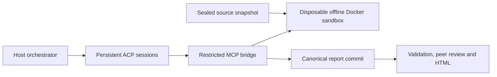

# How the source security review works

The normal `audit run` workflow is `source_security_review_v1`: an authorized review of supplied source, configuration, dependency metadata and tests already present in that source. It produces evidence-backed findings and remediation guidance. It excludes exploit/PoC generation, arbitrary commands, new test programs, deployed-service probes and transaction construction.

## Source and sandbox

The parent captures a sealed source manifest and an inventory of existing test entry points. Secrets, authentication stores, dependencies and build outputs are omitted from the snapshot. The report records omissions rather than claiming complete coverage.

`sandbox.sh --review-only` creates one disposable container as uid 10001, with capabilities dropped and privilege escalation disabled. Trusted static scanners and the lead harness inspect source and dependency metadata. Preparation does not run target builds, dependency installation, lifecycle hooks, target tests or active service scans. Scanner availability and failures remain explicit coverage limits.

Before publishing `ready.json`, the parent removes the proxy and verifies that the sandbox has no network attachment. Failed verification prevents reviewer handoff. Container preparation has a bounded budget; the subsequent held review has no elapsed-time deadline. Completion or cancellation releases the container, and cleanup removes owned resources. Docker daemon availability is necessary to verify removal.

## Sessions and tool boundary

Claude and Codex use lockfile-pinned ACP adapters in `audit/runtime/`; Grok uses native ACP with isolated MCP-only configuration; AGY uses a compatibility adapter around its saved native conversation. Official host CLIs remain trusted host processes using their normal authentication. Host filesystem, shell, app and web tools are disabled or denied by the respective profile, permission handler and AGY hook. No credentials are copied into the sandbox.

Every assignment binds its workflow, source digest, model, role and assignment digest. The parent saves session state and records a heartbeat every 30 seconds without imposing a reasoning deadline. One unexpected transport loss may reload the exact session when supported. Provider policy refusals, quota failures and authentication failures do not trigger automatic retries or model changes.

Providers run concurrently, each with one active assignment and a queue of its remaining surfaces. A faster provider advances its own queue without waiting for peers. All surface reviews settle before peer cross-checks start together; all active sessions settle before sandbox cleanup, including after cancellation or failure.

`--resume-from` requires matching workflow, source, models, reviewers and assignments before starting Docker. Older adversarial sessions and the old AGY finalization path are rejected. Preserve saved session directories when resuming.

## Reviewer tools

| Tool | Purpose |
|---|---|
| `get_audit_context` | Scope, assignment and scanner coverage |
| `get_review_plan` | Source inspection checklist and cited leads |
| `list_files`, `read_file`, `search_code` | Bounded source and report inspection |
| `list_existing_tests` | Source-bound test IDs and descriptions |
| `run_existing_tests` | Run one fixed test entry point by ID |
| `submit_audit_report` | Commit a validated surface report |
| `submit_crosscheck_report` | Commit a verdict for every assigned peer claim |

The bridge rejects removed execution/PoC tools even if a caller invokes them directly. `run_existing_tests` accepts only `test_id`; callers cannot supply commands, arguments, code, paths or environment settings. Each invocation verifies network disconnection and the captured entry-point manifest hash.

Supported fixed entry points are `npm --offline --ignore-scripts run test`, `cargo test --locked --offline`, and `bash --noprofile --norc ./test.sh`. The npm test itself runs; npm pre/post hooks are suppressed. Existing tests are still untrusted target code and run only inside Docker. Each invocation has a 90-second process-group limit, distinct from unlimited reviewer reasoning. Dependencies must already be available; missing dependencies and unsuccessful tests are coverage gaps. Tests are not rewritten or installed as a workaround.

An atomic directory lock under the report's harness serializes test execution across MCP bridge processes sharing that sandbox. Source inspection and reasoning remain parallel. The bridge waits up to five minutes to acquire the lock, then verifies offline containment and starts the bounded test. Normal completion or failure releases the lock. A bridge crash leaves the lock in place rather than allowing a possibly running Docker test to overlap; recovery requires a new review or resume into a new output directory and sandbox.

## Evidence and completeness

New findings require source `analysis`, `validation` (including limits), citations, impact and a fix. Control assertions require `evidence`. Historical report compatibility stores empty `attack`/`poc` fields and mirrors control evidence into the legacy field. This does not enable those activities.

A validated `submissions/<job>.json` MCP commit is authoritative. Derived JSON, Markdown and HTML must match it. Identical repeated submissions are idempotent; conflicting commits fail. Terminal prose is never treated as a report. `report_json` supports providers with unreliable nested argument serialization.

Peer reviewers inspect the same snapshot and return complete claim-level verdicts. Validation checks submissions, actual process exits and required peer coverage before adjudication. Missing/failed/invalid output stays `INCOMPLETE`, including a process that submits and later exits unsuccessfully. Zero findings alone is not a clean audit. Scores express model agreement and review status, not independent proof.

`check-agents --live` uses a separate inert fixture to qualify MCP access, saved-session recovery and submission. It is transport evidence, not security coverage or provider-policy clearance. The selected-file relay and historical standalone utilities are separate from this workflow; see [the suite guide](../README.md) and [live-model integration](live-model.md).
