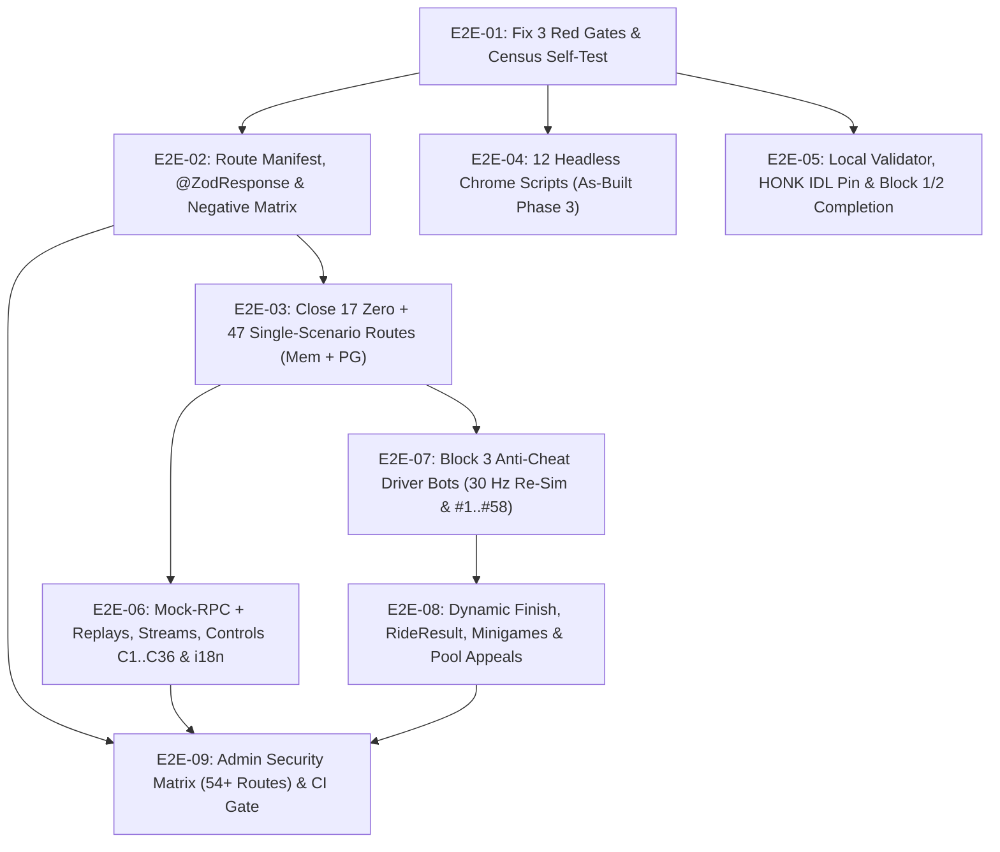

# Plan 1 — Full Set of E2E Headless Tests

> **Purpose:** Deliver 100% automated headless end-to-end verification across every product surface, API route, on-chain program instruction, anti-cheat rule, replay/stream control, and privileged security guard defined in `docs/spec/*.md` and `docs/testing/COVERAGE_CONTRACT.md`.
>
> **Status Board & Issue Tracker:** [`docs/plan/e2e-headless/STATUS.md`](./e2e-headless/STATUS.md) · **Issues Directory:** [`docs/plan/e2e-headless/issues/`](./e2e-headless/issues/)
>
> **Companion Plan:** [`docs/plan/SPEC_COMPLIANCE_PLAN.md`](./SPEC_COMPLIANCE_PLAN.md) (Plan 2 — Make All Code Follow Specs)

---

## 1. Architecture & Two-Layer Execution Model

Per [`docs/spec/PROCESS.md`](../spec/PROCESS.md) and [`docs/spec/DECISIONS.md`](../spec/DECISIONS.md) (Decisions 67 & 68), Freight Chain separates **As-Built** verification from **Target Spec** verification so the test suite stays green on `main` at every commit:

1. **Track A — As-Built Coverage (`docs/spec/PRODUCT.md` & `docs/testing/COVERAGE_CONTRACT.md`):**
   - Locks 100% of the currently shipped product across all 151 HTTP routes, 28 database tables, 12 HTML pages, 19 Anchor instructions (`freightchain_pools` + `freightchain_honk`), and 15 background workers.
   - Executed immediately against current code (`E2E-01` through `E2E-05`).
   - No target spec test may delete or weaken an As-Built test until the corresponding code change in [Plan 2](./SPEC_COMPLIANCE_PLAN.md) lands.
2. **Track B — Target Spec Compliance (`docs/spec/*.md` `*-T-*` & `AC-*` Catalogs):**
   - Implements the full test matrices defined across all 14 specification documents (`RID-T-*`, `ACH-T-*`/`AC-*`, `MGM-T-*`, `POOL-T-*`, `REF-T-*`, `PRM-T-*`, `TEN-T-*`, `SOL-T-*`, `PLT-T-*`, `RPL-T-*`, `ADM-T-*`, `API-T-*`, `LEG-T-*`, `E2E-T-*`).
   - Organized in `E2E-06` through `E2E-09` (plus target extensions in `E2E-02` and `E2E-05`), co-merged in lockstep with their corresponding `SPC-*` implementation tasks in [Plan 2](./SPEC_COMPLIANCE_PLAN.md).

### What "Headless E2E" Covers (Decision 68)

Per Decision 68 and `docs/testing/COVERAGE_CONTRACT.md` §3, "Headless E2E" is a **multi-tier headless harness** (never happy-dom alone):

| Tier | Runtime / Harness | Scope | Command / Entry |
|---|---|---|---|
| **T1 — HTTP Contract & Scenario Matrix** | NestJS + Fastify + Supertest (In-Memory **and** real PostgreSQL `freightchain_test`) | All 151+ routes (`@ZodResponse` validation, ≥1 positive + ≥2 negative scenarios per route, `expectDbDelta`, Matrix A auth/guard/validation, Matrix B foreign-resource `404`, property fuzzing) | `npm run server:unit` + `npm run server:integration` |
| **T2 — Code-Level Headless Node & Bot Suites** | Node.js + `happy-dom` + `Three.js` stub + deterministic physics/driver bots (`engine: game` & `engine: kernel`) | Block 1 Off-Chain (`tests/e2e/block1-offchain`), Block 2 Chain (`tests/e2e/block2-chain`), Block 3 Anti-Cheat Bots (`tests/e2e/block3-anticheat` covering `AC-P*`, `AC-T*`, `AC-W*`, `AC-F*`, `AC-R*`, `AC-M*`, Cheat Catalog `#1..#58`) | `npm run test:e2e:block1`, `npm run test:e2e:block2`, `npm run test:e2e:block3` |
| **T3 — Real Headless Chrome E2E** | Headless Chromium (`puppeteer`/`playwright` + WebGL + real wallet extension / injected provider) against live NestJS + PostgreSQL + Redis | All 12 HTML pages (`play.html`, `index.html`, `r.html`, `blink.html`, `admin.html`, `editor.html`, `viewer.html`, `whitepaper.html`, landing), zero `pageerror`/`console.error`, real canvas pixels, replay controls `C1..C36`, EN/RU i18n | `bash .claude/skills/run-tests/e2e.sh` |
| **T4 — Headless Chain & Mock-RPC E2E** | Local `solana-test-validator` + Anchor + LiteSVM + deterministic `mock-rpc` (`e2e/mockchain/rpc.mjs`) | Full `freightchain_pools` (12 instructions) & `freightchain_honk` (7 instructions) lifecycles, Merkle claims, sponsor refunds, and deterministic SOL tip/order confirmation (`E1M`) | `npm run test:localnet`, `bash .claude/skills/honk-suite/run.sh`, `npm run test:e2e:mockchain` |

---

## 2. Epic & Issue Breakdown

All tasks are tracked in [`docs/plan/e2e-headless/STATUS.md`](./e2e-headless/STATUS.md) and split into 9 domain issue files under [`docs/plan/e2e-headless/issues/`](./e2e-headless/issues/):

| Epic ID | Issue File | Track | Summary | Tasks | Spec Test IDs Covered |
|---|---|---|---|---|---|
| **E2E-01** | [`E2E-01-gates-and-census.md`](./e2e-headless/issues/E2E-01-gates-and-census.md) | Track A (As-Built) | Fix 3 red gates (`test:parity`, `test:tickets-stub`, `census.mjs --self-test`) & wire automated coverage census | `E2E-01.1` – `E2E-01.4` | `COVERAGE_CONTRACT` §2.5, Phase 1 |
| **E2E-02** | [`E2E-02-http-contract-and-zod-schemas.md`](./e2e-headless/issues/E2E-02-http-contract-and-zod-schemas.md) | Track A + B | Route manifest (`151+` routes), `@ZodResponse` strict validation, `expectDbDelta`, Matrix A/B negative generator, OpenAPI & `fast-check` fuzzing | `E2E-02.1` – `E2E-02.6` | `API-T-01` .. `API-T-13` |
| **E2E-03** | [`E2E-03-http-zero-and-single-scenario-routes.md`](./e2e-headless/issues/E2E-03-http-zero-and-single-scenario-routes.md) | Track A (As-Built) | Close all 17 zero-scenario routes and 47 single-scenario routes in both `flows.spec.ts` (memory) and `flows.integration.spec.ts` (PostgreSQL) | `E2E-03.1` – `E2E-03.7` | `COVERAGE_CONTRACT` §2.1, Phase 2 |
| **E2E-04** | [`E2E-04-headless-chrome-as-built.md`](./e2e-headless/issues/E2E-04-headless-chrome-as-built.md) | Track A (As-Built) | 12 Headless Chrome scripts covering guest/training 409s, weekly 1h grant, tickets reconcile, Solana Pay, live negative, referral qualify, prize board, whitepaper, landing empty pool, editor logout, achievements, admin negative | `E2E-04.1` – `E2E-04.12` | `COVERAGE_CONTRACT` §2.3, Phase 3 |
| **E2E-05** | [`E2E-05-local-validator-and-chain-e2e.md`](./e2e-headless/issues/E2E-05-local-validator-and-chain-e2e.md) | Track A + B | `freightchain_honk` IDL drift pin, `test:localnet` SOL + pledge settle/refund, `honk-suite` negatives, Block 1/2 pending items (`B1-REF-04`, `B2-*`), `SOL-T-*`, `TEN-T-*`, `PRM-T-*`, `REF-T-*` | `E2E-05.1` – `E2E-05.8` | `SOL-T-01..16`, `TEN-T-01..15`, `PRM-T-01..14`, `REF-T-01..22`, `E2E-T-02..07` |
| **E2E-06** | [`E2E-06-mockchain-and-replays-streams-e2e.md`](./e2e-headless/issues/E2E-06-mockchain-and-replays-streams-e2e.md) | Track B (Target) | Deterministic `mock-rpc` service (`E1M`), `e2e/harness/wallet.mjs`, Replay & Stream lifecycle (`RPL-T-01..102`), Replay Controls `C1..C36`, EN/RU i18n (`RPL-T-16..29`, `LEG-T-10`) | `E2E-06.1` – `E2E-06.8` | `RPL-T-01..102`, `M-RPL-01..06`, `LEG-T-01..11` |
| **E2E-07** | [`E2E-07-anticheat-bots-and-resim-e2e.md`](./e2e-headless/issues/E2E-07-anticheat-bots-and-resim-e2e.md) | Track B (Target) | Block 3 Headless Driver Bots (`engine: game` & `engine: kernel`), 30 Hz re-sim parity, Telemetry v2.1 HMAC/deflate, Cheat Catalog `#1..#58`, `AC-P*`, `AC-T*`, `AC-W*`, `AC-H*`, `AC-F*`, `AC-R*` | `E2E-07.1` – `E2E-07.8` | `ACH-T-01..04`, `AC-P1..12`, `AC-T1..16`, `AC-H1..3`, `AC-W1..18`, `AC-F1..11`, `AC-R1..8`, `#1..#58` |
| **E2E-08** | [`E2E-08-minigames-and-rides-ranking-e2e.md`](./e2e-headless/issues/E2E-08-minigames-and-rides-ranking-e2e.md) | Track B (Target) | Dynamic 65 km/h finish (`RID-T-01..12`), `stats.RideResult` & pool ranking formula, Minigame schedule/Pocket/OCR/penalties (`MGM-T-01..09`, `AC-M1..20`), Pool schedule & appeals (`POOL-T-01..16`), Platform services (`PLT-T-01..14`) | `E2E-08.1` – `E2E-08.6` | `RID-T-01..12`, `MGM-T-01..09`, `AC-M1..20`, `POOL-T-01..16`, `PLT-T-01..14` |
| **E2E-09** | [`E2E-09-admin-security-matrix-and-ci.md`](./e2e-headless/issues/E2E-09-admin-security-matrix-and-ci.md) | Track B (Target) | Automated Privileged Route Matrix (`ADM-T-01..12` × 54+ routes), Security Findings regression (`ADM-T-20..44+`), CI fast-gate & nightly full-stack workflows | `E2E-09.1` – `E2E-09.5` | `ADM-T-01..12`, `ADM-T-20..44+`, `E2E-T-01..07` |

---

## 3. Universal Task Standards (DoR & DoD)

Every task in [`docs/plan/e2e-headless/issues/`](./e2e-headless/issues/) enforces both task-specific criteria and the following universal gates:

### Universal Definition of Ready (DoR)
1. **Spec & Contract Anchor:** Target route(s), table(s), or spec test IDs (`*-T-*` / `AC-*`) are explicitly listed and cross-referenced against `docs/spec/PRODUCT.md` (for Track A) or `docs/spec/<domain>.md` (for Track B).
2. **Track Prerequisite:** If the task is in Track B (tests target behavior that diverges from `PRODUCT.md`), the corresponding `SPC-*` implementation task in [Plan 2](./SPEC_COMPLIANCE_PLAN.md) is either completed or co-scheduled in the same PR.
3. **Deterministic Fixtures:** Required wallets, PRNG seeds (`mulberry32`), `ClockPort` timestamps, and DB/chain fixtures are identified with zero reliance on wall-clock `sleep` or external network calls.

### Universal Definition of Done (DoD)
1. **Dual-Backend Parity (for HTTP tests):** Passes on both In-Memory (`flows.spec.ts`) and real PostgreSQL (`flows.integration.spec.ts` against `freightchain_test`).
2. **Zero Console/Page Errors (for Chrome E2E):** Headless Chrome scripts assert `pageErrors.length === 0`, `consoleErrors.length === 0`, and non-zero canvas pixel variance where 3D rendering is active.
3. **Response Schema & DB Delta Verified:** Every HTTP call validates against `@ZodResponse` (`RESPONSE_SCHEMA_CHECK=strict`) and mutating calls assert row deltas via `expectDbDelta`.
4. **Scoreboard Updated:** Running `node .claude/skills/test-census/census.mjs --self-test` passes (`0` unmapped routes, `0` unmapped files), and the task status is marked `[x] Done` in [`docs/plan/e2e-headless/STATUS.md`](./e2e-headless/STATUS.md).

---

## 4. Execution Order & Dependency Graph

