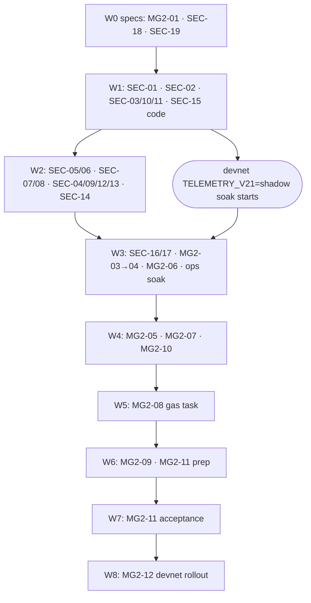

# Security fixes + Minigames v2: orchestration plan

**How to use:** point the lead agent at `docs/plan/SECURITY_MG2_ORCHESTRATOR.md` ("work on docs/plan/SECURITY_MG2_ORCHESTRATOR.md, wave N").

This file owns the **order, lanes, file ownership, gates and status** for two plans:
- [`SECURITY_AUDIT_2026-10-28_FIX_PLAN.md`](SECURITY_AUDIT_2026-10-28_FIX_PLAN.md): SEC-01 … SEC-19.
- [`MINIGAMES_V2_PLAN.md`](MINIGAMES_V2_PLAN.md): MG2-00 … MG2-12.

The analysis, steps, DoR and DoD of every item stay in those two files. A worker reads its item there, plus the common DoR/DoD (§5 of the security plan, §3 of the MG2 plan).

**Scope:** 19 SEC items + 12 open MG2 items in 9 waves (0–8), at most 4 parallel lanes. All owner decisions are made (security plan §4, MG2 plan §1–2); what remains for the owner are the gates in §4. **No wave deploys anything.** Production happens only on an explicit owner deploy request (§4, gate O6).

## 1. Rules for every agent

1. **Own worktree, own branch.** One item (or one lane's item chain) = one branch `sec/<id>` or `mg2/<id>`:
   `git worktree add /private/tmp/fc-<id> -b <branch> origin/main`.
   - Symlink `node_modules` from the main checkout (`.`, `backend/server`, `backend/mcp`, `frontend/landing`, `tests/e2e`).
   - **A lane that changes the Prisma schema** runs its own `npm ci` in `backend/server` instead of symlinking it (`prisma generate` would rewrite the shared client).
   - After SEC-17 (W3) lands, run a root `npm ci` in the main checkout so the symlinked root `node_modules` holds the pinned `eslint`/`esbuild`.
   - Never edit the shared main checkout: other sessions work in it.
   - Before W1, the coordinator reads [`READINESS_HANDOFF_2026-10-26.md`](READINESS_HANDOFF_2026-10-26.md). Its paused lanes may hold `:8899` or uncommitted edits to the same files (verdict, minigames); integrate or park them before claiming those paths.
   - Use `git -C` to look at other worktrees; never `cd` into them.
2. **The coordinator owns this file.** Workers never edit it. A worker finishes by reporting the branch, the head commit and its DoD evidence (commands + exit codes, screenshots read). The coordinator ticks the box after the merge.
3. **File ownership.** A lane edits only its owned paths (§3 lanes + §5 hot files). If it needs a file another lane owns in the same wave, it stops and asks the coordinator; it never edits around the rule.
4. **Migrations.** Only the wave's migration step generates a Prisma migration (forward-only, in the same commit as the schema). W1 and W3 start with a coordinator **migration pre-step** that lands every column the wave needs. Lanes then build on main.
5. **Slots (DB, ports).** Each lane uses its slot and nothing else.

   | slot | `TEST_DATABASE_URL` database | server `PORT` | Chrome `PORT=` (pass your own URL) |
   |---|---|---|---|
   | L1 | `freightchain_sec1_test` | 3201 | 8781 |
   | L2 | `freightchain_sec2_test` | 3202 | 8782 |
   | L3 | `freightchain_sec3_test` | 3203 | 8783 |
   | L4 | `freightchain_sec4_test` | 3204 | 8784 |

   - The role is `freight` on `127.0.0.1:15433` (`infra/docker-compose.yml`); a name ending in `_test` is created by the integration harness.
   - Never use `freightchain`, `freightchain_test` or the default Chrome port `:8765`.
6. **The validator (`:8899`) is one slot.** Suites that bind it (`test:e2e:block2`, `localnet-e2e`, `honk-suite`, `honk-localnet`, `normal-drive-localnet`, `test:ci:full`) run one at a time. A lane takes the **chain slot** from the coordinator and gives it back when the run ends.
7. **Repo hard rules apply** (AGENTS.md):
   - Shared road/physics/off-road changes ship with the server port in the same commit.
   - Recorded sample columns are append-only.
   - Runtime knobs are `GameSetting` rows; a new env key touches four places.
   - A new critical section gets a concurrency test.
   - A behaviour change updates `PRODUCT.md` + the topic spec.
8. **Maps.** `README.md`, `AGENTS.md` and `CLAUDE.md` are edited only by the wave's **map owner** (§3). Other lanes put the sentence they need into their handoff, and the coordinator applies it at merge.
9. **Safety.**
   - Secrets by key name only.
   - Solana: always an explicit `--url devnet`; never the global config or `~/.config/solana/id.json`; no program deploy and no pool creation.
   - No broad `docker stop`/`compose down`/`pkill`. Stop only your own processes.
10. **Commits.** One item per commit where possible. The message names the item id and the SolSwarm cluster ids (e.g. `fix(pool): SEC-01 rank all eligible wallets (cluster 10)`).

### Merge protocol (coordinator)

1. Work in the integration worktree `/private/tmp/fc-sec-integration` (branch `sec/integration`, reset to `origin/main` at each wave start).
2. For each finished lane, in the merge order the wave gives:
   - rebase the lane branch on `sec/integration`;
   - re-run the lane's verify command;
   - fast-forward merge.
3. When every lane of the wave is in, run the **barrier gate** on `sec/integration`.
4. On green: `git push origin sec/integration:main`, tick the boxes here and in the source plans' item headings, then fast-forward the main checkout only if it is clean.
5. A red barrier blocks the next wave. Fix it forward on a new branch, never by reverting another lane's work silently.

## 2. Wave board

| wave | name | lanes | items | status | barrier gate (on `sec/integration`) |
|---|---|---|---|---|---|
| **W0** | Specs and bookkeeping | 2 | MG2-01, SEC-18, SEC-19 | `[ ]` | `npm run check` + owner read of the spec diff |
| **W1** | Money, TEN4, admin auth, telemetry v2 | 4 + pre-step | SEC-01, 02, 03, 10, 11, 15 (code) | `[ ]` | `npm run check && npm run server:integration && npm run test:e2e:block1 && npm run test:e2e:block2 && bash .claude/skills/honk-suite/run.sh` |
| **W2** | Payout pipeline, client supply chain, privacy, minigame plumbing | 4 | SEC-05, 06, 07, 08 (report-only), 04, 09, 12, 13, 14 | `[ ]` | W1 gate + `bash .claude/skills/run-tests/e2e.sh` (31 suites, no CSP console errors) + `verified-play-test` |
| **W3** | Ops hardening + MG2 foundations | 4 + pre-step | MG2-02, SEC-16, 17, MG2-03, 04, 06; devnet soak | `[ ]` | `npm run check && npm run server:integration && npm run test:e2e:block3 && npm run test:production:local && npm run deploy -- --dry-run` + `trace:diff` reviewed + `level-check` + `program-check` |
| **W4** | MG2 client, fuel replay, stored counts | 3 + ops | MG2-05, 07, 10 | `[ ]` | `npm run check && npm run server:integration && npm run test:e2e:block3` + Chrome `controls` suite + `replay-test` |
| **W5** | Gas task | 1 + ops | MG2-08 | `[ ]` | W4 gate |
| **W6** | Admin review and acceptance prep | 2 | MG2-09, MG2-11 (harness prep) | `[ ]` | W4 gate + `admin-coverage` |
| **W7** | End-to-end acceptance | 1 (chain) | MG2-11 | `[ ]` | `npm run test:ci:full` + `e2e.sh normal-drive` + `normal-drive-localnet.mjs` |
| **W8** | Devnet rollout and as-built docs | ops | MG2-12 | `[ ]` | owner sign-offs O4, O5 recorded; docs as-built; "`npm run deploy` would ship it" |

The critical path is W1 SEC-15 → W2 SEC-14 → W3 MG2-04 → W4 MG2-07 → W5 MG2-08 → W7. The money items (SEC-01, 05, 06) finish in W2, before any paid payout.

## 3. Waves and lanes

### W0: Specs and bookkeeping (docs + read-only ops)
**Goal:** the MG2 target spec is merged before any MG2 code; the bookkeeping items are closed. No Prisma change.

- **L1 · MG2-01 spec (map owner)**
  - Owned paths: `docs/spec/minigames.md`, `anticheat.md`, `pool.md`, `DECISIONS.md`, `docs/agents/gameplay.md`, `world.md`.
  - Also record SEC-01's decisions in `pool.md` (POOL-M-13: formula v2 for pools opened after the release, no minigame time). SEC-01's DoR needs that text.
  - `PRODUCT.md` is **not** changed: target decisions only.
- **L2 · SEC-18, SEC-19, prechecks**
  - Owned paths: `backend/programs/audit.toml`, `docs/tech/escrow-open-items.md`, `docs/plan/OWNER_TASKS.md`.
  - SEC-18: dated cargo-audit exceptions; a `bincode` entry.
  - SEC-19: a read-only devnet/mainnet balance and authority check of the dev treasury **pubkey** (never print the secret). Write the SolSwarm exclusion rule as an owner task, and prepare the list of the 5 report files to scrub (gate O1).
  - Precheck for SEC-01: list the devnet pools that are open now, read-only with `--url devnet`. They keep formula v1.
  - Precheck for MG2-12: add an `MG_SECRET` row (devnet + production) to `OWNER_TASKS.md` (gate O4).
- **Merge order:** L2, L1.
- **Done when:** the spec diff is merged and the owner has read it. `npm run check` is green.

### W1: Money, TEN4, admin auth, telemetry v2
**Migration pre-step W1-P (coordinator, one commit):**
- `economy.Pool.scoreFormulaVersion Int @default(1)` (SEC-01);
- `HonkBurn.chainSignature String? @unique`, `@unique` on `HonkVisual.chainSignature` if it is missing, and a `HonkHold` table (wallet, item, amount, `expiresAt`, consumed signature) (SEC-02).
- Lanes do not add migrations in W1.

| lane | item(s) | owned paths (under `backend/server/src/` unless stated) |
|---|---|---|
| **L1** | SEC-01 | `domain/pool/pool-ranking.ts`, `application/use-cases/chain/pay-pools/pay-pools.handler.ts`, `application/use-cases/pools/get-payout-transactions/*`, `infrastructure/stats/prisma-ride-result.repository.ts`, `application/services/verdict.service.ts` (**`override`/`addAttention` only**), a new reconcile script under `backend/server/scripts/`, `docs/spec/pool.md` (as-built part), `docs/tech/escrow-open-items.md` |
| **L2** | SEC-02 | `application/use-cases/honk/*`, `honk-chain.ts`, `domain/honk/*`, the hold endpoint + sweeper, the honk repositories, `domain/settings/game-settings.ts` (`HONK_HOLD_TTL` key only), `frontend/client/site/honk-sign.js` and the garage balance readers, `docs/spec/ten4.md` |
| **L3** | SEC-03 → SEC-10 → SEC-11 (**map owner**) | `infrastructure/http/guards/privileged-surface.guard.ts`, `player-auth.guard.ts`, `application/services/admin-approval.service.ts`, the admin-proof service, `presentation/admin/admin-moderation.http.controller.ts`, `application/use-cases/admin/approve-proposal/*`, `request-admin-challenge/*`, `application/use-cases/auth/logout/*`, `phone-pair/*`, the Redis nonce/revocation adapters, `frontend/client/site/admin.js`, `docs/agents/admin-ops.md` |
| **L4** | SEC-15 code (steps 1, 3) | `domain/rides/ride.entity.ts`, `application/use-cases/telemetry/upload-batch/*`, `domain/verdict/human-checks.ts`, `infrastructure/config/env.schema.ts` + `backend/server/.env.example` + `infra/deploy/.env.example` + `infra/deploy/docker-compose.prod.yml` (if a key changes), `docs/spec/anticheat.md` |

- **Hot file `verdict.service.ts`:** L1 merges first. L4 rebases on it before its step 3 edit (flagged-only rides kept out of `honk.credit`).
- **Chain slot order:** L1 (`test:e2e:block2`, `localnet-e2e` payout), then L2 (`honk-suite`, `honk-localnet`).
- **Merge order:** L1, L4, L2, L3.
- **After the barrier:** start ops task **S1**. Run the local server against devnet with `TELEMETRY_V21=shadow` and collect human rides for the false-positive measurement (`ride-review`, `ride-audit`). It runs in the background through W2–W3.

### W2: Payout pipeline, client supply chain, privacy, minigame plumbing
No migration expected. If one turns out necessary, the lane asks the coordinator, who lands it as a pre-step.

| lane | item(s) | owned paths |
|---|---|---|
| **L1** | SEC-05 → SEC-06 | `pay-pools.handler.ts`, `domain/economy/pool-schedule.ts`, `ride-query.prisma.repository.ts` (`forRejudge`), `get-payout-transactions/*`, `presentation/economy/pools.http.controller.ts`, the new `/api/admin/pools/:id/payout` route, `frontend/client/site/admin-pools.js`, the operator `pool:payout` scripts, the public standings DTO (`final` flag), `docs/spec/pool.md`, `docs/agents/admin-ops.md` |
| **L2** | SEC-07 → SEC-08 (report-only) (**map owner**) | `frontend/client/vendor/` + `vendor/HASHES`, the import maps in `play.html`, `viewer.html`, lobby/admin/`r.html`/blink pages, `site/pay.js`, `site/honk-sign.js` (loader only), the hash check in `npm run check`, `infrastructure/http/static-cache.ts`, `app/configure-app.ts`, the nginx templates, `infra/deploy/scripts/remote/setup.sh`, `docs/agents/client.md`, `deploy.md`, `repo.md` |
| **L3** | SEC-04, SEC-09, SEC-12, SEC-13 | `presentation/rides/public-rides.http.controller.ts`, `get-public-ride/*`, `domain/rides/public-ride.dto.ts`, `presentation/common/response/wire.ts` (**`publicRideResponse` only**), `application/live/replay-access.service.ts`, `domain/live/replay-visibility.ts`, `presentation/economy/pledges.http.controller.ts`, `presentation/solana-pay/*`, `use-cases/solana-pay/*`, `problem-details.filter.ts`, `redeem-promo/*`, `domain/economy/promo-code.entity.ts`, `use-cases/lobby/get-live/*`, `domain/lobby/lobby.dto.ts`, the landing/lobby renderers of those fields, `docs/spec/replays_streams.md`, `promocodes.md`, `docs/agents/server.md` |
| **L4** | SEC-14 | `heartbeat-ride.handler.ts`, `application/services/minigame-session.service.ts`, `ride-minigame.prisma.repository.ts`, `domain/minigames/mac.ts`, `verdict.service.ts` (**`judgeTx` minigame rows only**), `application/rides/ride-result-of.ts`, `env.schema.ts` + the three env files (the `MINIGAMES` ⇒ `TELEMETRY_V21` pairing), `docs/spec/minigames.md` MGM-M-11 |

- **DoR checks:**
  - SEC-14 needs SEC-01 and SEC-15 merged (W1 barrier).
  - SEC-07 needs SEC-02's `honk-sign.js` changes merged (W1).
- **`wire.ts`:** L3 owns `publicRideResponse`; L1 may touch only the standings mapper. They merge in order L1 → L3.
- **Chain slot order:** L1 (`localnet-e2e` payout via the new admin route), then L2 (`localnet-e2e` lobby ticket buy, `honk-localnet`).
- **Merge order:** L4, L1, L3, L2.
- **Follow-up (in W3 L4):** after a week of report-only CSP with no violations, switch to enforce (gate O3).

### W3: Ops hardening and MG2 foundations
**Entry gate MG2-02:** SEC-01, 14 and 15 are merged, and S1 runs on devnet in `shadow` with no crash or upload errors.

**Migration pre-step W3-P (coordinator, one commit):**
- `Ride.mgWindows Json?`, `Ride.mgRulesVersion`, `Ride.worldRulesVersion`, `Ride.fuelRulesVersion` (MG2-03/04/06);
- `RideMiniGame`: `revealedDriveS`, `deadlineDriveS`, the `void`/`failed` statuses, the outcome, and the refuel amount (MG2-04/08).
- Old rows keep `cancelled`.

| lane | item(s) | owned paths |
|---|---|---|
| **L1** | SEC-16 → SEC-17 (**map owner**) | `infra/deploy/Dockerfile`, `Dockerfile.mcp`, `docker-compose.prod.yml` (images), the root `package.json` + new root `package-lock.json`, `frontend/client/package.json` (scripts), `backend/mcp/package.json`, `backend/programs/Anchor.toml`, the `program-check` skill, `docs/agents/deploy.md`, `verifying.md` |
| **L2** | MG2-03 → MG2-04 | `domain/settings/game-settings.ts` (`mg_*` keys), `domain/minigames/*` (`schedule.ts`, `close.ts`, `score.ts`, `verdict.ts`, `kinds.ts`), `minigame-session.service.ts`, the ride-end close-out in every ride-ending path + the stale-ride sweeper, `frontend/client/site/admin-settings.js`, the heartbeat DTO (`deadlineDriveS`) |
| **L3** | MG2-06 | `frontend/client/shared/fuel.js`, `shared/fuel-stops.js` (new), `shared/road-network.js` (`onRoad` → `onBay`), `backend/server/src/domain/road/road-layout.ts` (`onRoad` → `onBay`), `frontend/shared` exports, `frontend/client/js/state.js`, `js/config.js`, `shared/simulation-config.js`, `js/themes/_shared/landmarks/*`, `js/world/chunks.js`, the fuel gauge, `road-drift.spec.ts` |
| **L4** | ops: S1 measurement → gate O2 → devnet `TELEMETRY_V21=enforce`; CSP enforce after O3 | devnet local `.env` by key name only, `docs/testing/LOCAL_READINESS.md` (the numbers) |

- **L3 runs `trace:save` before its first edit**, and uses the `gameplay-balance`, `trip-design` and `level-check` skills.
- **Merge order:** L1 (tooling first, so later lanes use pinned tools), L2, L3.
- **Chain slot:** L1 (`program-check`), then L2 if it needs block2.

### W4: MG2 client, fuel replay, stored counts

| lane | item | owned paths |
|---|---|---|
| **L1** | MG2-05 | the heartbeat client in `frontend/client/js/` (`online.js`, `net/`), `js/phone/*` **except** `apps/gulp.js` and `gulp-state.js`, the cockpit countdown chip, the i18n files, `js/watch.js` / `ui/watch-panel.js`, the new sfx (`game-audio` skill) |
| **L2** | MG2-07 | `domain/verdict/fuel-replay.ts` (new), `world-checks.ts`, `replay-engine.ts` (output), the `out-of-fuel` ride-end reason, `backend/server/test/fixtures/simulation/*` (new fixtures), the `verified-play-test` no-refuel case |
| **L3** | MG2-10 | `application/rides/ride-result-of.ts`, `infrastructure/stats/*` (the counts) |
| **L4** | ops: S1/O2 continue | — |

- **Merge order:** L3, L2, L1.

### W5: Gas task
- **L1 · MG2-08:**
  - `domain/minigames/kinds.ts` + `frontend/client/shared/minigame-kinds.js` (kept equal);
  - gas arming/open in `minigame-session.service.ts`;
  - the pump SVG asset;
  - `frontend/client/js/phone/apps/gulp.js`, `js/phone/gulp-state.js`.
- **L4 · ops** continues.

### W6: Admin review and acceptance prep
- **L1 · MG2-09:**
  - the admin ride view (`frontend/client/site/admin*.js`), the signed override path, the `mg-failed` appeals;
  - the `ride-review` skill;
  - `docs/agents/admin-ops.md`.
- **L2 · MG2-11 prep (tests only):**
  - PIKE-style direct handlers for SMS + gas in `backend/server/scripts/normal-drive-localnet.mjs`;
  - the E2E-08 suite moved to `MGM-T2-*`;
  - the `verified-play-test` bot cases.
  - No source outside test/script paths.

### W7: End-to-end acceptance (single lane, holds the chain slot)
MG2-11: everything in its DoD, then `npm run test:ci:full`. The report says plainly what a human still has to drive: the buzz feel, timer pressure and fuel pacing.

### W8: Devnet rollout and as-built docs (ops + docs)
MG2-12, in order:
- O4: `MG_SECRET` exists.
- `MINIGAMES=shadow` on devnet, then measure.
- O5: the owner accepts the false-positive rate.
- `enforce` on devnet.
- The as-built docs: `minigames.md` Part 0 → as-built, `PRODUCT.md`, `anticheat.md`, `gameplay.md`, `world.md`, the maps, `LOCAL_READINESS.md`.
- Finish with "ready; `npm run deploy` would ship it".

## 4. Owner gates

| gate | when | what the owner does | blocks |
|---|---|---|---|
| **O1** | W0 | If the dev treasury pubkey ever held funds or authorities: approve rotation (`treasury-init.mjs`) and the sweep. Scrub or delete the 5 SolSwarm report files. Add the snapshot exclusion. | sharing the report |
| **O2** | W3–W4 | Accept the `TELEMETRY_V21` false-positive rate measured on devnet human rides | devnet `enforce`, MG2 W8 |
| **O3** | ≥ 1 week after W2 | Accept the CSP report-only log | CSP enforce |
| **O4** | before W8 | Generate `MG_SECRET` (≥ 32 bytes) for devnet and production, by key name only | `MINIGAMES` ≠ off |
| **O5** | W8 | Accept the `mg-failed` + `fuel-empty-running` false-positive rate per shift | devnet `enforce` for minigames |
| **O6** | any time | An explicit "deploy" request in the current message | every production change |
| **O7** | standing | `4h`/`8h` tiers stay `onSale: false` until MG v2 covers them | selling those tiers |

## 5. Hot files (shared across waves)

| file | owner per wave | rule |
|---|---|---|
| `application/services/verdict.service.ts` | W1 L1 → W1 L4 → W2 L4 → W3 L2 | one region per lane (override/attention · honk credit · judgeTx rows · mg close-out); rebase before editing |
| `application/rides/ride-result-of.ts` | W2 L4 → W4 L3 | MG2-10 builds on SEC-14's counts |
| `domain/settings/game-settings.ts` | W1 L2 (`HONK_HOLD_TTL`) → W3 L2 (`mg_*`) | append keys only |
| `infrastructure/config/env.schema.ts` + 3 env files | W1 L4 → W2 L4 | one lane per wave |
| `pay-pools.handler.ts`, `get-payout-transactions/*` | W1 L1 → W2 L1 | same lane, sequential |
| `frontend/client/site/honk-sign.js` | W1 L2 → W2 L2 | SEC-07 changes only the loader |
| `frontend/client/site/admin*.js` | W1 L3 → W2 L1 → W3 L2 → W6 L1 | one lane per wave |
| `presentation/common/response/wire.ts` | W2 L1 (standings) + W2 L3 (public ride) | merge L1 → L3 |
| `shared/road-network.js` + `domain/road/road-layout.ts` | W3 L3 only | one commit for both (the off-road rule is a port change) |
| `minigame-session.service.ts` | W2 L4 → W3 L2 → W5 L1 | sequential by wave |
| `prisma/**` | W1-P, W3-P (coordinator) | no lane migrations |
| `README.md`, `AGENTS.md`, `CLAUDE.md` | the wave's map owner | others hand over the sentence |

## 6. Status

Update this file and the item heading in the source plan (e.g. `## SEC-01 … ✅`) together.

**W0**
- [ ] MG2-01 spec first (+ SEC-01 decisions in `pool.md`)
- [ ] SEC-18 RustSec exceptions + bincode entry
- [ ] SEC-19 pubkey check, exclusion rule, scrub list (O1)
- [ ] Prechecks: open devnet pools listed; `MG_SECRET` in `OWNER_TASKS.md`

**W1**
- [ ] W1-P migration pre-step
- [ ] SEC-01 pool ranking + formula v2
- [ ] SEC-02 TEN4 signature reuse + hold
- [ ] SEC-03 approver signs, Redis nonce, fail closed
- [ ] SEC-10 player `jti` revocation, fail open + alert
- [ ] SEC-11 random nonce decoy
- [ ] SEC-15 code: protocol 2 required on paid rides
- [ ] S1 devnet `shadow` soak started

**W2**
- [ ] SEC-05 gate order before the plan
- [ ] SEC-06 payout builder on the admin plane
- [ ] SEC-07 vendored three.js + web3.js with hashes
- [ ] SEC-08 security headers (report-only)
- [ ] SEC-04 public ride behind the replay gate
- [ ] SEC-09 uniform Solana Pay `not_found`
- [ ] SEC-12 uniform promo refusal
- [ ] SEC-13 short wallets on `/api/live`
- [ ] SEC-14 minigame plumbing

**W3**
- [ ] MG2-02 entry gate passed
- [ ] W3-P migration pre-step
- [ ] SEC-16 container hardening
- [ ] SEC-17 pinned build tools
- [ ] MG2-03 window settings + stamping
- [ ] MG2-04 mandatory rule, timer from the buzz
- [ ] MG2-06 shared fuel + functional bays
- [ ] O2 telemetry false-positive rate accepted → devnet `enforce`
- [ ] O3 CSP enforce

**W4–W8**
- [ ] MG2-05 client buzz + countdown
- [ ] MG2-07 server fuel replay
- [ ] MG2-10 stored counts
- [ ] MG2-08 gas task
- [ ] MG2-09 admin review + appeals
- [ ] MG2-11 acceptance (`test:ci:full` green)
- [ ] O4 `MG_SECRET` generated
- [ ] MG2-12 devnet shadow → O5 → enforce; docs as-built

## 7. Worker prompt (template)

> You are lane L<n> of wave W<k> in `docs/plan/SECURITY_MG2_ORCHESTRATOR.md`. Your item(s): <ids>. Read §1 and your lane row there, then your item(s) in `<source plan>`, its common DoR/DoD, and the topic docs it names.
> Work in `/private/tmp/fc-<id>` on branch `<branch>` from `origin/main`, using slot L<n>. Edit only your owned paths. Ask the coordinator for the chain slot before a validator suite.
> Do not edit the orchestrator file, do not deploy, and do not push.
> Finish with: branch, head commit, every DoD command with its exit code, screenshots read, and what is still unverified.
