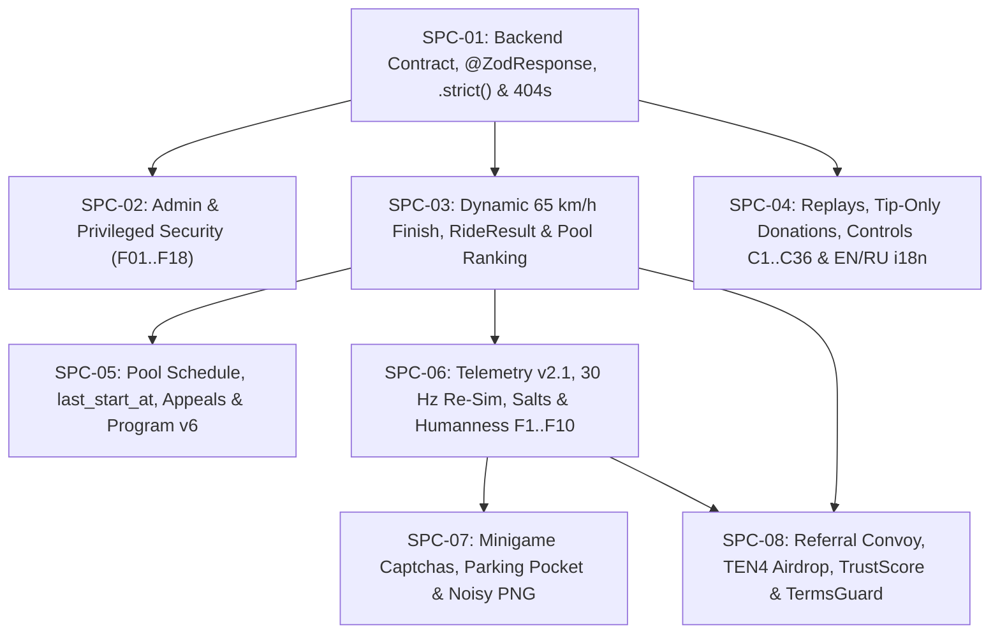

# Plan 2 — Make All Code Follow Specs (`/docs/spec`)

> **Purpose:** Close every implementation gap between the currently shipped product ([`docs/spec/PRODUCT.md`](../spec/PRODUCT.md)) and the target specification rules (`211` `*-M-*` MUST rules across [`docs/spec/*.md`](../spec/README.md), Decisions `1–68` and `B1–B10` in [`docs/spec/DECISIONS.md`](../spec/DECISIONS.md), Findings `F01–F18` in [`docs/spec/admin_security.md`](../spec/admin_security.md), and Bugs `1–8` in [`docs/testing/E2E_PLAN.md`](../testing/E2E_PLAN.md)).
>
> **Status Board & Issue Tracker:** [`docs/plan/spec-compliance/STATUS.md`](./spec-compliance/STATUS.md) · **Issues Directory:** [`docs/plan/spec-compliance/issues/`](./spec-compliance/issues/)
>
> **Companion Plan:** [`docs/plan/E2E_HEADLESS_PLAN.md`](./E2E_HEADLESS_PLAN.md) (Plan 1 — Full Set of E2E Headless Tests)

---

## 1. Governance & Spec-First Change Rules (`docs/spec/PROCESS.md`)

Every task in this plan obeys the hard rules in [`AGENTS.md`](../../AGENTS.md) and [`docs/spec/PROCESS.md`](../spec/PROCESS.md):

1. **Atomic Spec + Code + Test Update:** When a task changes product behavior to match a target `*-M-*` rule, the same commit/PR MUST update:
   - The implementation in `frontend/`, `backend/`, or `infra/`.
   - The as-built ledger in [`docs/spec/PRODUCT.md`](../spec/PRODUCT.md) (moving the item from "Target / Planned" to "Shipped").
   - The corresponding Track B test task in [`docs/plan/E2E_HEADLESS_PLAN.md`](./E2E_HEADLESS_PLAN.md).
2. **Clean Architecture & Invariants (`backend/server`):**
   - `domain` pure, `application` = ports + CQRS handlers, `infrastructure` = adapters, `presentation` thin (`≤ 500` lines per file).
   - Time only via `ClockPort`; env only via `EnvService` (new env keys updated in all 4 places: `env.schema.ts`, `backend/server/.env.example`, `infra/deploy/.env.example`, `infra/deploy/docker-compose.prod.yml`).
   - All wallet mutations run under `findByWalletForUpdate` with lock ordering `player → pool → tickets / pledges`.
   - Prisma schema changes include a forward-only migration in `backend/server/prisma/migrations/`.
3. **Owner Conflict Gates (`PRODUCT.md` Conflicts Table):**
   - Where two spec documents have an explicit conflict documented in [`docs/spec/PRODUCT.md`](../spec/PRODUCT.md) (e.g., `POOL-M-12` / `B8` Admin HTTP `set_pool_rules` vs `ADM-M-07` / Decision 60 Squads multisig-only), the task's **Definition of Ready (DoR)** includes an explicit **Owner Decision Gate** so code is never changed on an unresolved conflict.

---

## 2. Epic & Issue Breakdown

All tasks are tracked in [`docs/plan/spec-compliance/STATUS.md`](./spec-compliance/STATUS.md) and split into 8 domain issue files under [`docs/plan/spec-compliance/issues/`](./spec-compliance/issues/):

| Epic ID | Issue File | Spec Document(s) | Summary | Tasks | Spec Rules Covered |
|---|---|---|---|---|---|
| **SPC-01** | [`SPC-01-backend-contract-and-validation.md`](./spec-compliance/issues/SPC-01-backend-contract-and-validation.md) | `backend_contract.md`, `legal.md` | `@ZodResponse` decorator & interceptor, OpenAPI generator, `.strict()` DTOs, `404` foreign resources, fail-closed geo without `CF-IPCountry`, `paintHero` null-pool fix | `SPC-01.1` – `SPC-01.6` | `API-M-01..13`, `LEG-M-04..06` |
| **SPC-02** | [`SPC-02-admin-and-privileged-security.md`](./spec-compliance/issues/SPC-02-admin-and-privileged-security.md) | `admin_security.md` | `PrivilegedSurfaceGuard` default-deny, 3 roles (`admin`, `moderator`, `editor`), separate JWT secrets, strict startup check, 60m TTL + Redis `jti` revoke, auth throttle + dummy nonce, IP allowlist + `/24` masking, DB append-only `AdminAction`, Telegram `AlertOutbox`, dual-admin approval | `SPC-02.1` – `SPC-02.9` | `ADM-M-01..21`, Findings `F01..F18` |
| **SPC-03** | [`SPC-03-rides-dynamic-finish-and-ride-result.md`](./spec-compliance/issues/SPC-03-rides-dynamic-finish-and-ride-result.md) | `rides.md` | Remove 4h/8h creation, server `finishFor(roadSeed, trip, FINISH_RULES_VERSION)` at `65 km/h` with `(RX, RZ, RT)` curvature & `snapSafe`, 1h finish line (`finish: true`), 90m `T_cap`, damage by source, server red-light counting, `stats.RideResult` migration & worker, versioned pool ranking formula & `GET /api/pools/:id/results` | `SPC-03.1` – `SPC-03.6` | `RID-M-01..21` |
| **SPC-04** | [`SPC-04-replays-streams-donations-and-i18n.md`](./spec-compliance/issues/SPC-04-replays-streams-donations-and-i18n.md) | `replays_streams.md`, `legal.md` | Disable live watch of running rides, hide training rides, gate pool replays until `payout_at`, strip `SAMPLE_INPUT_COL`, remove gameplay donation/HONK effects, replay-only SOL tips (`0.01/0.05/0.1`, min/max, 15m expiry, ≤3 orders, 0% referral share, `GET /api/me/donations`), disable pledges (`403 pledges_disabled`), replay controls `C3/C6/C7/C8/C15..19/C36` & remove `C9/C26/C27/C32`, replay chat (`replayT`, filter, `P01/P02`, 90d retention), EN/RU `i18n.js` | `SPC-04.1` – `SPC-04.9` | `RPL-M-01..34`, `LEG-M-01..11` |
| **SPC-05** | [`SPC-05-pool-schedule-appeals-and-program-v6.md`](./spec-compliance/issues/SPC-05-pool-schedule-appeals-and-program-v6.md) | `pool.md` | Configurable weekly pool schedule (`opens_at`, `sales_close_at`, `last_start_at = close - 1h15m`, `play_close_at`, `validation_until`), `409 pool_schedule_mismatch`, `409 pool_last_start_passed`, ticket burn UI warning + checkbox, appeals window workflow, `Config.min_finish_secs <= 7200` + v6 fields, `set_pool_rules` resolution | `SPC-05.1` – `SPC-05.6` | `POOL-M-01..14` |
| **SPC-06** | [`SPC-06-anticheat-v2-and-30hz-resim.md`](./spec-compliance/issues/SPC-06-anticheat-v2-and-30hz-resim.md) | `anticheat.md` | Telemetry v2.1 (`sessionKey` HMAC, deflate streams `inp`/`clk`/`chk`/`mg`/`env`, `worldDigest32`), 30 Hz deterministic fixed-step server re-sim + incremental per-batch state, pause/slow-mo limits (`≤3`, `≤5m`), shared `roadSeed` + `trafficSalt`/`holeSalt` commit–reveal, mechanical features `F1–F10` (`humannessScore` + 5 reject rules + `isTrusted`), 90d input trace retention & top-20 clustering | `SPC-06.1` – `SPC-06.6` | `ACH-M-01..16` |
| **SPC-07** | [`SPC-07-minigames-framework-and-catalog.md`](./spec-compliance/issues/SPC-07-minigames-framework-and-catalog.md) | `minigames.md` Part 1 | Port the `phone-minigames` branch: `phone-sms` only, SVG slips, `+20` s after 3 wrong tries, no parking pocket and no noisy PNG | `SPC-07.1` – `SPC-07.5` | `MGM-M-01..12` |
| **SPC-08** | [`SPC-08-referral-convoy-ten4-airdrop-and-trust.md`](./spec-compliance/issues/SPC-08-referral-convoy-ten4-airdrop-and-trust.md) | `referral.md`, `ten4.md`, `promocodes.md`, `web3_solana.md`, `platform_services.md` | Convoy state machine (`pending` 72h delete → `active` 60d on MEDIUM/HARD + 1h promo gift with 3/d, 10/wk, 500/wk caps → `qualified` M1=100 TEN4 @ 2w & M2=50 TEN4 @ 5w), dynamic slots `min(100, 5 + 2*A)`, 25-row Convoy leaderboard + `convoyHidden`, Pre-Season Airdrop tasks (`twitterapi.io`, Telegram, Turnstile), Anti-Sybil `TrustScore` (48h hold, `<50` gate), `TermsGuard` & legal copy scrub | `SPC-08.1` – `SPC-08.6` | `REF-M-01..15`, `TEN-M-01..11`, `PRM-M-01..10`, `SOL-M-01..12`, `PLT-M-01..12`, `LEG-M-01..11` |

---

## 3. Execution Order & Dependency Graph

