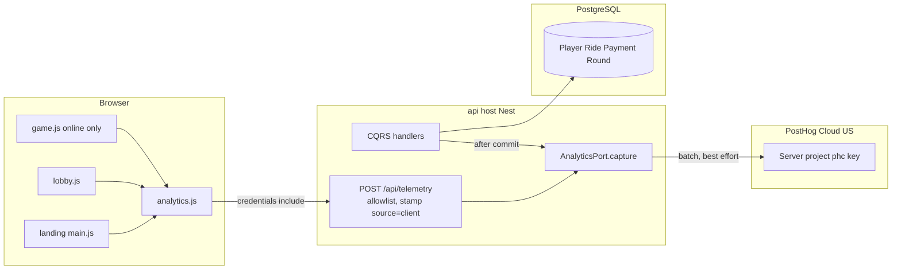
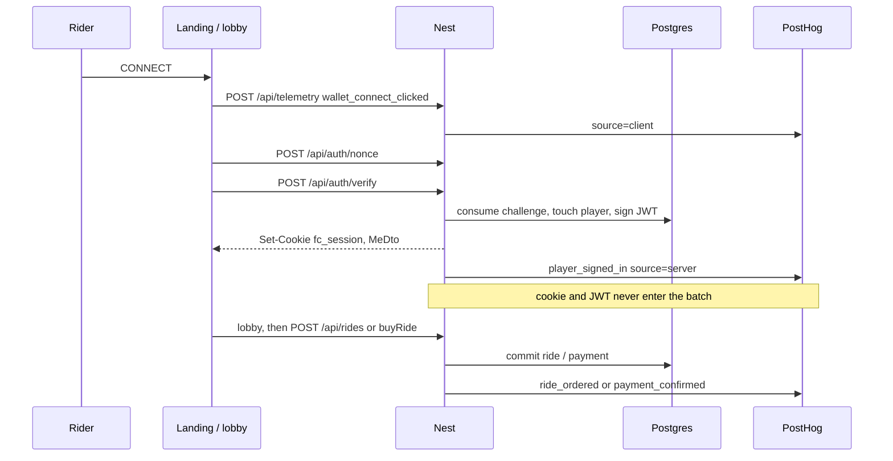

# Freight Chain PostHog Integration

| | |
|---|---|
| Author | TBD (Freight Chain) |
| Date | 2026-10-07 |
| Status | Draft |
| Deadline | Colosseum submission, Sunday 12 Oct 2026, noon PT (official close 23:59 PT) |
| Scope | Plan only. No code in this change. |
| Source tree | Handlers pinned at `main` @ `8700d55`. Review re-checked `main` @ `7ff5a8e` (one docs commit ahead; handlers, landing tests, and deploy scripts unchanged). |
| Companion plan | `docs/hackathon-plan-v2.md` (the schedule this must not displace) |
| Server rules | `docs/backend-architecture.md` |

## Overview

Freight Chain has a live loop and no instrumented one. A judge can open `https://freightchain.fun`, connect a Solana wallet, start a free ride or pay a devnet memo transfer, and drive a server-timed shift, but the only numbers we can defend today are SQL counts and `GET /api/pool`. Production on 7 Oct 2026 is 4 throwaway sign-ins, 0 rides, 0 payments (`docs/hackathon-plan-v2.md`). PostHog is how the Saturday video and the written form show that loop without inventing a waitlist.

The design is two planes on one PostHog Cloud (US) project. The browser records only what the server cannot see: chapter views, button presses, wallet-prompt outcomes, tab changes. The server records identity, orders, payments, and ride verdicts, and it is the only source the Colosseum dashboard is allowed to quote for money and completion. The analytics object is built and emitted only after the database commit (`transactions.run`, `withVersionRetry`, or `rides.save`) has resolved, both inside try/catch, never inside the player-row lock. A throw there cannot roll back a payment or a ride. The project API key stays on the server. The browser posts an allowlisted batch to `POST /api/telemetry`; it never talks to `posthog.com` and it cannot mint `ride_completed` or `payment_confirmed`. Session replay and ride replay are the telemetry task, not this plan.

This is winnable beside the existing week. Wednesday’s real devnet payment, Thursday’s prize-split change, the two videos, and the form stay on the critical path. Analytics ships dark (no key, no events) and turns on with one env var. If the week slips, analytics is what gets cut, not the payment.

## Background & Motivation

### What is already true

The product in code, not in the pitch:

- **Landing** (`landing/src/main.js`, `landing/index.html`). Seven sections, not four: `ride`, `loop`, `garage`, `economy`, `roadmap`, `market`, `about`. Public data only: `api('pool')`, `api('live')`, `api('leaderboard?board=round')`, `api('tiers')`, polled on 10 s / 30 s timers. Sign-in is `signIn()` from `client/site/wallet.js`, then `location.href = ${SITE_BASE}/lobby.html`. A returning session is `api('me').then(paintSession)` and does not redirect. The hero video is `data-src=""` and is loaded only after `load` + idle. There is no Content-Security-Policy header anywhere in the repo. `landing/test/page.test.js` forbids inline scripts, `innerHTML` in `src/main.js` and `src/dash-live.js`, and the text `fetch(` / `XMLHttpRequest` in those two files. The sign-in `catch` is matched byte-for-byte by that test.
- **Landing budget, measured 7 Oct 2026** from `landing/dist` with the compressor CI actually runs: `gzipSync` from `node:zlib` (`landing/test/budget.test.js`, `KB = 1024`, cap `40 * KB` = 40960). 8 JS files, **26,827 bytes** gzipped. Largest raw file **14,651** bytes against a 30 KiB per-file cap. Headroom **14,133 bytes** (about 13.8 KiB). Python `gzip.compress` on the same tree is 26,678 and is not the CI number; do not quote it. Re-measure with `gzipSync` in the client PR. `posthog-js` is not in the repo; the published library plus its session-recorder chunk is tens of KiB gzipped each and would fail both caps if Vite emitted it into `dist/assets`. A relay client of about 2 KiB raw (≈ 1–1.5 KiB gzipped, call sites included) fits in the 14,133-byte headroom.
- **SIWS** (`client/site/wallet.js` `signIn`, `server/src/presentation/auth/auth.http.controller.ts`). `provider()` is `window.phantom?.solana ?? window.solana ?? window.solflare`. Then `connect()`, `POST /api/auth/nonce` (`RequestChallengeHandler`), `signMessage`, `POST /api/auth/verify` (`VerifySignInHandler`). The challenge is single-use (`DELETE … RETURNING`). Failures throw `UnauthorizedError` (`no valid challenge` / `bad signature`) before a session exists. Success returns `MeDto` and `SetSessionCookieInterceptor` stores httpOnly `fc_session`. `POST /api/auth/logout` (`LogoutHandler`) clears the cookie and does not know the wallet. Landing never sees the token.
- **Lobby** (`client/site/lobby.js`). If `api('me')` throws, `location.href = '/'`. Tabs via `go()`: `new`, `live`, `board`, `profile`. Free-ride chip uses `freeRides`, `freeRidesMax`, `nextFreeRideAt` (next 00:00 UTC, null at the cap). Tier click sets `S.sel`. `start()` posts `rides` for `free`, or `buyRide()` for `1h` / `4h` / `8h`. `checkPending()` once per load calls `GET /api/rides/pending` and, if the order is not `created`, `POST /api/rides/:id/reconcile`. Live poll is 5 s. Pool refresh is 15 s. Leaderboard boards are `round` / `all` / `free`. Profile renders stats and the achievement catalogue.
- **Pay** (`client/site/pay.js` `buyRide`). Loads web3.js from jsDelivr only when a paid tier is bought. `POST /api/rides` → `GET /api/rides/:id/payment` (unsigned transaction, base64) → `signAndSendTransaction` → up to 60 `POST /api/rides/:id/confirm` calls, 1.5 s apart. Non-OK throws once (no retry). `pending` retries. After 90 s the client throws a message that **contains the transaction signature**. That string must never be copied into PostHog.
- **Game** (`client/js/online.js`, `client/js/ui/game.js`, `client/js/main.js`). Online mode is `play.html?ride=<id>` only. `initOnline` GETs the ride and copies `minSeconds` / `completeDist` into `CFG`. `startRide` → `beginOnline` → `POST /api/rides/:id/start`, then `setInterval(..., 10_000)` heartbeats. `endRide` → `endOnline` → `POST /api/rides/:id/end`. Without `?ride`, nothing in `online.js` runs; headless, e2e, the viewer, and `file://` depend on that. Heartbeat body is `{ s, t, hull, paused, route, night }` (`online.extra` in `game.js` is `env.theme.id` and `dn.night`).
- **Verdict** (`Ride.finish` / `Ride.applyReport` in `server/src/domain/rides/ride.entity.ts`). The client does not decide completion. `outcome: 'shift'` becomes `completed` / reason `shift complete` only when `driveSeconds >= minSeconds` and `lastS >= completeDist`; otherwise `abandoned` / `shift abandoned before it was complete`. The client’s abandon sentence is ignored on that path. `outcome: 'failed'` stores the client reason, sliced to `REASON_MAX_LENGTH` (200). A report can also fail the ride as `heartbeat lost` or `implausible progress (N m in X.X s)`. A running ride with no beat for `hbTimeoutMs` (150_000) is failed the next time `CreateRideHandler` or `StartRideHandler` touches the wallet (`failHeartbeatLost`).
- **Money.** `PaymentSettlementService.settle` (`server/src/application/services/payment-settlement.service.ts`; `settleOnce` is private) inserts one `Payment` (signature PK, unique `rideId`) under the player row lock and the open round lock, then `Ride.markPaid`. `ConfirmPaymentHandler` lines 30–31 return `{ status: 'paid' }` when `findByRide` shows **this** signature already paid, and emit nothing. Line 32 throws `ConflictError('this ride is already paid')` when the stored signature is a different one. Reconcile of an already-ready paid ride returns `paid` without inserting. The race loser inside `settle` (lines 47–50) also returns paid when `findBySignature` shows this signature already paid; today’s return type is `RideDto` only, so the caller cannot tell that short-circuit from an insert. This plan changes the return to `{ ride, inserted, paidAt }` (below). `verifyPayment` (`server/src/domain/economy/payment-verification.ts`) returns one of five human reasons, or null. Quote TTL is 10 minutes (`QUOTE_TTL_MS`); a matching payment is still honoured after expiry. Tiers (`ride-tier.ts`): `free` (env `FREE_RIDE_SECONDS`, production example 180), `1h` $5 / 3600 s, `4h` $15 / 14400 s, `8h` $50 / 28800 s. `DEMO_WALLETS` shortens **paid** shifts only, by `DEMO_SCALE` (default 60). The founder’s Phantom is the demo payer (`docs/hackathon-plan-v2.md`). Free rides of that wallet are not scaled. After the retry budget, `settle` throws `ServiceUnavailableError('the weekly round is turning over – try again')`. That path is neither a confirm nor a reject.
- **Pool.** `GetPoolHandler`: `entries` is a **count**; `split.entries` is the **lamport sum** of `economy.Payment` for the round (`RoundRepository.entriesOf`); `split.grand` adds `carry`. `settled` is hard-coded `false`. No draw, no payout, no admin panel. Thursday’s planned split change (top 3 = 25/15/10 inside the old 50% bucket) must not be encoded in event names.
- **Free rides.** 5 at `Player.register`. Midnight `GrantDailyFreeRidesHandler` runs one idempotent `UPDATE … WHERE freeDay < today` and returns a count, not wallets. `PlayerSessionService.touch` is the lazy fallback on verify, `GET /api/me`, profile, and create-ride. Cap `freeRidesMax` (default 5).
- **Achievements** (`server/src/domain/achievements/achievements.ts`). Evaluated in `EndRideHandler` after the verdict is saved, and again on `GetProfileHandler`. Ids with rules: `first-mile`, `shift-complete`, `night-owl`, `century`, `clean-run`, `cold-start`. `top-20` has `rule: null` (“awarded at round close”) and nothing awards it. Unlock failure is logged and does not 500 the verdict.
- **Rounds.** `RoundService.ensureRound` inserts the week’s round and closes the previous one. That is accounting, not settlement. `Round.close()` does not pay anyone.
- **Hosts** (`client/js/hosts.js`). Production: apex = landing + lobby, `ride.` = game, `api.` = API, `storybook.` = `viewer.html`. `API_BASE` is `https://api.<apex>` on a real domain, `''` otherwise. Cookies are `SameSite=Lax` on the apex; sibling subdomains are the same site, which is why credentialed POSTs to `api.` already work.
- **nginx** (`deploy/nginx/site.conf.template`). `api.` proxies only `location /api/` to the container and `return 404` for everything else. The file is written **once** by `npm run deploy:setup`; a normal `npm run deploy` does not reload it. There is no CSP.

### Pain

Judges and the form need five counts. The DB can produce them after the fact; it cannot show the drop from “CONNECT” to “wallet refused”, and a modified `play.html` can already show SHIFT COMPLETE locally (`endRide` paints that before the server answers). Heartbeats every 10 s are the wrong grain: one 8 h shift is 2,880 of them, and 100 concurrent half-hour rides would be ~18,000 events/hour if each beat were captured. Crypto browsers run uBlock and Brave. A third-party `posthog.com` script will be empty on the machines we most need.

### What this week is not allowed to lose

From `docs/hackathon-plan-v2.md`: one real devnet payment, the Thursday economy change, two videos, the form. Verified-play, ride replay, admin payouts, and mainnet are a separate telemetry task. This plan does not specify them. Analytics is extra scope. It is not on the published cut order (line 72: wordmark, then the hero gameplay loop, `/r/:id`, the filmed manual payout, the weekly update). The economy change, the real devnet payment, both videos, and the form are not cut. If the week slips, drop analytics **before** that list is touched. The video then quotes `GET /api/pool` and a SQL count and says so.

## Goals & Non-Goals

### Goals

- A named event for every real step of landing → wallet → lobby → pay or free ride → server-timed start → milestone → server verdict, including the failure branches that exist in code.
- Judge-facing metrics whose formulas use **server** events only for: wallets signed in, paid confirms, rides started, rides completed, completion rate, and lamports in.
- `is_demo` on every server event so the founder’s `DEMO_WALLETS` Phantom (the Wednesday payment, `time_scale` 60) is labelled and filterable, not mixed into “real riders” and not hidden.
- A capture path that obeys Clean Architecture, the test pyramid, the 40 KiB landing budget, and the race-safety table.
- A kill switch that needs no feature-flag product: `POSTHOG_DISABLED=1`.
- A dashboard a person can click together in PostHog before Saturday, plus the five sentences the video is allowed to say.

### Non-goals

- Implementing any of this in the repo as part of the plan.
- Emitting an event per heartbeat, per live poll (5 s), per pool poll (10–15 s), or per leaderboard poll (30 s).
- PostHog session replay, `posthog-js`, a second PostHog project, and an nginx `/ingest/` proxy. Ride replay and session recording belong to the telemetry task. This document does not add them.
- Feature flags, surveys, and the PostHog error-tracking SDK. The kill switch is an env var. `api_request_failed` covers a broken loop.
- A client `ride_completed` / `payment_confirmed`, or any metric that counts one.
- Backfill of the 4 smoke-test players or the 0 historical rides. Forward only.
- Payout, settlement, draw, or `top-20` achievement events. Those code paths do not exist. Future names are listed so nobody invents them under a real name.
- Instrumenting `client/viewer.html` (`storybook.<apex>`). It is a model viewer: no wallet, no ride id, no payment. Footer curiosity is a P2 click on the landing link, not a fourth SDK.
- Instrumenting offline `play.html` (no `?ride`). That path is the prototype, the headless trace, e2e, and “offline practice”. Events there would pollute funnels and risk the trace.
- Putting PostHog on the readiness check. An ingest outage must not fail `/api/health` or roll a deploy back.
- Recomputing Thursday’s prize split inside PostHog. Money is lamports on `payment_confirmed`. The site remains the display of `split.grand`.
- A new product flag system, NATS, Redis, or an outbox table.

## Key Decisions

1. **PostHog Cloud, US, one new project, not self-hosted.** Operating PostHog is not a five-day hackathon task. EU only if a later legal reason appears. The capture key is the project token (`phc_…`). A personal key (`phx_…`) is not stored in the app, the repo, or `deploy/.env`. Dashboards are clicked in the UI. A pasted `phx_` (or any other non-`phc_` string) does **not** refuse boot. `EnvService` logs once and treats the key as unset, so confirm and payments stay up. The key is never required. Empty `POSTHOG_KEY=` is unset, via the existing `optional()` preprocess. See the env table and the risk row.

2. **Two planes, disjoint event names.** Client plane = UX. Server plane = identity, money, lifecycle, grants. Judge tiles filter `source = server`. The sets of names are disjoint and a unit test fails if they are not. Where both sides see one moment they use different verbs (`wallet_connect_clicked` vs `player_signed_in`, `payment_submitted` vs `payment_confirmed`). There is no “both” event that must be deduped across planes.

3. **The project key never ships to the browser.** A public project key lets any modified client POST `ride_completed` straight to PostHog, and a property filter on `source` does not help once the sender can set `source`. This plan has no `posthog-js` and no second project. The browser POSTs to our API; the adapter adds the key, forces `source: "client"`, and drops server event names. Server handlers call the same adapter with `source: "server"`. Session replay is not deferred here. It is out of scope, owned by the telemetry task.

4. **Identity.** Anonymous `distinct_id` is `anon_<uuid v4>`, generated once per apex origin with `crypto.randomUUID` and stored with the existing `store()` helper (`client/js/util.js`, localStorage, never throws). Key `freightchain.anon`. The relay regex requires the version nibble `4` and the RFC variant nibble (`8`, `9`, `a`, or `b`); a wider hex pattern is not “v4”. Landing and lobby share the id (same origin). `ride.` does not, and does not need to: the game page is only a funnel step after the cookie exists. **One merge call site.** The telemetry handler, on `session_restored` only, when the cookie wallet is present and the batch `anon_id` matches that regex and the event carries `request_alias: true`, emits `$create_alias` with `distinct_id` = the anon id and `properties.alias` = the session wallet (the anon person is merged into the wallet). It does not emit `$identify` for the merge. `$identify` on the capture API updates person properties; it does not connect an anonymous id to a wallet. Person updates stay `$set` / `$set_once` on server events, which already do that. `VerifySignInHandler` does not alias: the verify command has no anon id. Failed verifies do **not** create a person for the claimed wallet. The client sets `request_alias` only when `store()` key `freightchain.aliased` is not already this wallet, and writes that key only when the telemetry response has `enabled: true`. A disabled 200 must not consume the flag, or the alias never fires after the key is turned on. A reload then does not send it again. `anon_id` is a batch field, not a `session_restored` property. A signed-in caller can still present any string that matches the regex; `$create_alias` then merges that anon person into **their** wallet. That is funnel poisoning, not a hole in the five judge numbers (those are server events on the wallet). Do not alias from any other event. `distinct_id` of server events is the base58 wallet from the command, never from the JSON body. **No `$groups` in P0.** `round_id` is an ordinary integer property (null on free rides and on unpaid orders; `markPaid` is the only setter). A `$groups` key that was never `$groupidentify`’d does not create a PostHog group, and the fair does not need group insights. Do not send `$groupidentify`. Person `$set` / `$set_once`: `is_demo`, `free_rides`, `free_rides_max` (already on `MeDto`), `$set_once` `first_seen_at` = `player.createdAt` epoch ms, `$set_once` `first_route` the first time a server event has a whitelisted `route_id`. Never send signature bytes, SIWS message, nonce, JWT, cookie, treasury secret, `SOLANA_RPC`, ride `seed`, or the base64 payment transaction. The acquisition funnel stays unpublished until one real `$create_alias` has been checked in the PostHog UI.

5. **No per-heartbeat event.** Client interval is 10 s (`beginOnline` in `client/js/online.js`). Server drops beats closer than `HB_MIN_INTERVAL_MS` (default 1_000) and fails a ride after `hbTimeoutMs` 150_000. We emit `ride_progressed` only when `min(driveSeconds/minSeconds, distance/completeDist)` first crosses 0.25, 0.50, or 0.75, from `HeartbeatRideHandler` and from `EndRideHandler` (the last report can jump a band). We do **not** emit milestone 100. A shift can sit at ratio ≥ 1 while `status` is still `running`; the road never ends until `finish()`. `ride_completed` is the only “done”.

6. **Landing does not bundle `posthog-js`.** P0 is `client/js/analytics.js`, a side-effect-free ESM module, statically imported. Expected cost ≈ 1–1.5 KiB gzipped on top of 26,827 bytes, under the 40,960-byte cap, and the entry file stays under 30 KiB raw. `fetch(` lives in `analytics.js`, not in `landing/src/main.js` or `landing/src/dash-live.js`, so `page.test.js` stays green. The sign-in `catch` in `main.js` stays byte-identical; classification lives in `client/site/wallet.js` `signIn`. Autocapture is not loaded. `play.html` does not record a session and does not sample FPS. Session recording is the telemetry task.

7. **First-party ingest.** P0 does not add an nginx `location`. `POST /api/telemetry` is already under `location /api/` on `api.<apex>`, inherits exact-origin CORS and the session cookie, and is invisible to filters that block `posthog.com`. The server then calls `POSTHOG_HOST` (default `https://us.i.posthog.com`) `/batch/`. Local dev with the key set calls PostHog directly from the adapter; with the key unset it no-ops. This plan adds no nginx location.

8. **Autocapture off. Pageviews are ours.** Custom events only. One `landing_viewed` and one `lobby_viewed` per document load. No pageview on `play.html` frames. One `ride_page_viewed` when `initOnline` actually got a `created` ride. Game canvas and cockpit buttons are not autocaptured because there is no autocapture.

9. **No flag SDK, one kill switch.** `POSTHOG_DISABLED` of `1` or `true`, an empty `POSTHOG_KEY`, or a key that is not `phc_…` makes `capture()` return without queueing. Checked only in `EnvService` / the adapter. A bad key does not stop the process. Nothing in `client/js/sim/*` or the frame loop reads a flag. Flags, experiments, surveys, and error tracking are out of this plan.

10. **Hackathon narrative quotes server events and the site, and does not fake traction.** The five numbers are defined below as PostHog formulas **and** as the SQL/API check they must match. `is_demo = true` is the Wednesday devnet payment until a non-demo wallet pays. If that count is 1, the video says 1. Demo-wallet events stay in the data; the Colosseum board shows them on a tile labelled DEMO and the non-demo tile beside it, even when the second tile is 0.

11. **After commit, not an outbox.** The callback returns the command result and a plain facts snapshot. The `AnalyticsEvent` is built only after that await resolves, inside the same try/catch as `emitAnalytics`. Justified under Proposed Design. The DB remains the audit. PostHog is the board. If they disagree, quote the DB. Money correctness is `settle().inserted`, not a PostHog dedupe key.

12. **This document is the deliverable.** Implementation is the PR list at the end. None of those PRs block Wednesday’s `npm run deploy` for `DEMO_WALLETS` and the RPC.

## Proposed Design

### Planes





### Where capture sits

`AnalyticsPort` is an abstract class in `server/src/application/ports/analytics/analytics.port.ts`. `InfrastructureModule` binds it (the audit in `api-contract-audit.spec.ts` requires every `export abstract class` port to appear as `provide:`). The adapter is `@Injectable()` `PostHogAnalyticsAdapter` in `server/src/infrastructure/analytics/posthog-analytics.adapter.ts`. The pyramid’s Postgres detector is a raw-text regex `/PrismaService/` on any file under `infrastructure/` (`test-pyramid.spec.ts`). The adapter file must not contain that identifier at all, including in a comment, and it must not import the Prisma client. It then needs a unit spec only (`test/unit/infrastructure/analytics/posthog-analytics.adapter.spec.ts`), not an integration spec.

```ts
export interface AnalyticsEvent {
  event: string;
  distinctId: string;
  /** UUID v5 of dedupeKey, or null so PostHog assigns one. Never a semantic string. */
  uuid: string | null;
  /** Operator key, sent only as property dedupe_key. Not the capture uuid. */
  dedupeKey: string | null;
  /** Row time when the row has one; else the ClockPort instant the caller already holds. */
  timestamp: Date;
  set?: Record<string, string | number | boolean | null>;
  setOnce?: Record<string, string | number | boolean | null>;
  properties: Record<string, string | number | boolean | null>;
}

export abstract class AnalyticsPort {
  /** Enqueue. Never throws. Never returns a promise to the caller. */
  abstract capture(event: AnalyticsEvent): void;
}

/** Call only after the commit await. The factory and capture share one try/catch. */
export function emitAnalytics(port: AnalyticsPort, build: () => AnalyticsEvent): void {
  try { port.capture(build()); } catch { /* the command result is already decided */ }
}
```

`emitAnalytics` lives in `server/src/application/services/analytics-emit.ts` (no `@Injectable`, so the pyramid does not demand a spec; the adapter and the handlers cover it). A throw inside `build` is the same as a throw inside `capture`: swallowed, and too late to roll a transaction back **only because the caller already awaited the commit**.

**Call timing.** Do not construct an `AnalyticsEvent`, call `failCode`, or push onto an array inside `transactions.run`, inside `withVersionRetry`, or before `rides.save` resolves. Do not declare that array outside a retried callback either: the callback runs again on a version conflict and would duplicate or, if it throws, 500 a verdict `rides.save` already committed (`EndRideHandler` saves inside `withVersionRetry`, then `.catch`es achievements so a later failure cannot 500 the verdict).

The transaction callback returns the command result plus a plain `CommittedFacts` snapshot: ids, statuses, reason strings, and the `Date`s already on the aggregates (`createdAt`, `startedAt`, `endedAt`, `Payment.at`). `RideDto` drops those timestamps (`ride.dto.ts`), so the snapshot has to carry them. No property bag, no `failCode()`. Copying fields that are already on the entity is the whole snapshot. Early returns (the in-hand ride) come back as `inserted: false`.

After `transactions.run`, `withVersionRetry`, or `rides.save` resolves, the handler calls `emitAnalytics(port, () => event)`. Both the build and the emit sit in that helper’s try/catch. A unit test builds a confirm path where the factory throws and the handler still returns `{ status: 'paid', ride }`. Never `await` PostHog. Never call `capture` on the `TransactionHandle`.

`PaymentSettlementService` does not take the port. `settle()` returns `{ ride: RideDto, inserted: boolean, paidAt: Date | null }`. `inserted` is true only on the path that inserted the `Payment` in this call. `paidAt` is the `ClockPort` instant stored on `Payment.at`, and it is null when `inserted` is false. The race loser (lines 47–50, `findBySignature` already has this signature) returns `inserted: false`. Confirm lines 30–31 return `paid` without calling `settle` and emit nothing. Line 32 throws and is not a verification failure. `ConfirmPaymentHandler` and `ReconcilePaymentHandler` emit `payment_confirmed` only when `inserted` is true, with `timestamp: paidAt` and `via` set by whichever handler inserted. The other caller emits nothing, so a confirm/reconcile race does not double-count. The crash window (insert committed, process dies before emit) stays accepted; emitting again on `inserted: false` would double-count the winner. Do not close that window in P0.

`HeartbeatRideHandler` has no transaction. It calls `applyReport` (the boolean is ignored today) and then `rides.save`. After that save resolves, if `saved.status` is `failed`, emit `ride_failed` (`ended_by: "heartbeat"`). `applyReport` returning false does not advance distance and emits no milestone. Otherwise emit `ride_progressed` for bands crossed. Ignored beats (`canAcceptHeartbeat` false) return before `save` and emit nothing.

`CreateRideHandler` (`transactions.run` at line 47), `StartRideHandler` (line 29), and `settleOnce` (lines 61–75, `findByWalletForUpdate`) are the player-row lock. A throw while building an event inside those callbacks aborts the callback before commit. That is the bug this rule exists to prevent, including a `BigInt` lamport or a null `roundId` after Solana has already accepted the memo.

The adapter queues and flushes with `setTimeout` (1 s or 20 events). `onApplicationShutdown` flushes with a 500 ms budget, then drops. Flush failure logs the event name and HTTP status, not the body, and does not throw. `POSTHOG_DISABLED`, a missing key, or a key `EnvService` refused (including `phx_`): `capture` is a no-op. The process still listens.

**Wire body.** One event:

- `event`, `distinct_id`, `timestamp` = `event.timestamp.toISOString()`.
- `uuid` only when it is a UUID. Omit the field when `uuid` is null so PostHog assigns one.
- Do not send `$insert_id`. PostHog dedupes on the tuple `(uuid, event, timestamp, distinct_id)`, eventually, in ClickHouse. `$insert_id` is not that key. A `sent_at` query parameter shifts the stored timestamp, so do not send `sent_at` either.
- Do not send `$groups`. `round_id` stays a normal property.
- `properties` always include `source: "server" | "client"`, `$lib: "freightchain-server" | "freightchain-web"`, and `dedupe_key` when `dedupeKey` is set.
- `$set` / `$set_once` go out as person properties on that event. That is the person update. It is not the anonymous merge.

**UUID v5.** Namespace is the RFC 4122 URL namespace `6ba7b811-9dad-11d1-80b4-00c04fd430c8`. Name is `https://freightchain.fun/analytics/` plus the `dedupe_key`. Same key always yields the same uuid. A semantic string such as `payment:<signature>` in the `uuid` field is an invalid UUID: PostHog drops it (“Refused to process event with invalid UUID”), and one bad event can 400 the whole batch. `player_signed_in` has no dedupe key (`uuid` null): each successful verify is a new session. Its `timestamp` is the `now` already passed into `touch`, not a second read at flush.

### Why not an outbox

The race-safety table holds `SELECT … FOR UPDATE` on the player for the whole money transaction, and the round row while a payment lands. PostHog is 50–300 ms on a good day and unbounded on a bad one. Doing that HTTP inside the lock stalls every other request for that wallet (create, start, confirm) and turns a PostHog timeout into a rollback of a payment that Solana already settled. Building the event object inside the same callback has the same rollback, with no HTTP at all. An outbox table fixes the crash window (process dies after commit, before flush) but adds a migration, a worker, a lock story, and pyramid tests. The crash window is milliseconds and the lost event is recoverable from `economy.Payment` / `ride.Ride`, which is what Friday’s form is supposed to quote anyway (`docs/hackathon-plan-v2.md` P3: count from the DB). Best-effort after commit is the right trade for this week. A later manual resend can use the same UUID v5 and the same row timestamp; P0 does not build that resend. `inserted` is what keeps the live money tile at one event per payment.

### Relay

`POST /api/telemetry` is anonymous-ok (landing has no session) and cookie-aware (lobby and game send `credentials: 'include'`). There is no global auth guard and no `@Public()`. `PlayerAuthGuard` throws `UnauthorizedError('not signed in')` / `session expired`. Copying it onto this route 401s the anonymous landing, which is the point of the route. Do not use it here.

Wiring that passes the audits:

- Controller `server/src/presentation/telemetry/telemetry.http.controller.ts`, registered in the `controllers` array of `server/src/presentation/presentation.module.ts`. Zod body via `@ZodBody`. Return type is the non-empty DTO `TelemetryAckDto`. The method calls `commandBus.execute` and nothing else. No `@Req`, `@Request`, `@Body`, `@Res` (`api-contract-audit.spec.ts` forbids them). No `HttpException`.
- `OptionalSessionGuard` in `server/src/infrastructure/http/guards/optional-session.guard.ts` (`@Injectable`, `@UseGuards` on this route only). It calls `sessionWallet` (`server/src/infrastructure/http/session-cookie.ts`) and stores `string | null` on the request. A missing cookie and a failed verify are both `null`. It always returns `true`. It never throws `not signed in`. `createParamDecorator` cannot take `TokenSignerPort`, so the guard is the call site and the decorator only reads the field. Register the class in `InfrastructureModule` `providers` and `exports`, in the same two arrays as `PlayerAuthGuard` (`server/src/infrastructure/infrastructure.module.ts` lines 61–62). `ApplicationModule` already re-exports that module, which is why a presentation `@UseGuards` can inject `TokenSignerPort`. Do not add it to `APP_GUARD` (`server/src/app/app.module.ts` line 37 is only `ThrottlerGuard`). A unit spec that does `new OptionalSessionGuard` does not prove DI. The no-cookie HTTP scenario is that check: 200, not an unresolved-dependency 500 and not 401. The guard is a Nest class, so the pyramid also wants `server/test/unit/infrastructure/http/guards/optional-session.guard.spec.ts` (basename `optional-session.guard.spec.ts`).
- `OptionalSession` in `server/src/infrastructure/http/decorators/optional-session.ts` reads that field and passes `string | null` into `RecordTelemetryCommand`. Presentation may import `infrastructure/http`. The handler must not: application imports are `@nestjs/common`, `@nestjs/cqrs`, `domain`, and `application` (`layer-architecture.spec.ts`). Importing `session-cookie.ts` from `RecordTelemetryHandler` fails that audit.
- `RecordTelemetryHandler` is added to the explicit `handlers` array in `server/src/application/application.module.ts`. The contract audit fails the build when a new `*.handler.ts` class is missing from that array.
- A new file under `test/scenarios/` is not auto-loaded. Export `telemetryScenarios` from `server/test/scenarios/telemetry.scenarios.ts` and import it in **both** `server/test/http/flows.spec.ts` and `server/test/integration/flows.integration.spec.ts` (they import `flow.scenarios.js`, `http-contract.scenarios.js`, `lobby.scenarios.js`, `payments.scenarios.js` by name today).

Behaviour:

- Body `{ anon_id?, events }`. `events` length 0 through 10. An empty array is valid and returns `{ enabled, accepted: 0, dropped: 0 }` with HTTP 200 (or `enabled: false` when analytics is off). Properties are strings ≤ 200 chars, integers, booleans, or null; at most 20 keys. Zod strips unknown keys. Floats fail that event (dropped, not a 400 for the batch) so money cannot arrive as a JSON float from the client.
- `anon_id`, when present, must match `^anon_[0-9a-f]{8}-[0-9a-f]{4}-4[0-9a-f]{3}-[89ab][0-9a-f]{3}-[0-9a-f]{12}$` (UUID v4: version nibble `4`, variant `8|9|a|b`). Otherwise it is ignored. It is not also a property on `session_restored`.
- `distinct_id` is the session wallet when the guard stored one, else the batch `anon_id`. The body cannot name another wallet. Client `insert_id` / `uuid` is ignored and not forwarded. PostHog assigns the client event’s uuid. A non-UUID from the browser must not be able to 400 the batch.
- Event name must be in `CLIENT_EVENTS` (`server/src/domain/analytics/client-events.ts`). Anything else, including every server event name, is dropped (`dropped++`), HTTP 200. A 400 would let a telemetry typo surface in the UI if a caller forgot to catch; the client catches anyway, but 200 keeps the contract boring.
- Allowlist per event deletes every property not on that event’s list. Hard-deleted even if allowlisted by mistake in a review: `signature`, `transaction`, `seed`, `nonce`, `message`, `token`, `cookie`, `authorization`, `detail`, `secret`, `anon_id`.
- `source` is forced to `"client"`. `$create_alias` is the one exception, and only on the rule in Key Decision 4 (`distinct_id` = the anon id, `alias` = the session wallet). The handler does not open a DB transaction and does not take the player lock.
- When analytics is disabled the handler returns `{ enabled: false, accepted: 0, dropped: 0 }` and does not queue. The client remembers `enabled === false` in a module variable for the document lifetime (not localStorage), so a landing view with no key costs one request, not one per chapter.
- Default throttle (`THROTTLE_LIMIT`, 600/min per wallet or per IP) applies. That is enough spam control for a hackathon. Telemetry is not on the stricter auth limiter.

`GET` config is intentionally absent. The POST response is the switch. One route, one handler, one controller spec, one scenario imported by both runners. PR 3 runs `npm run server:test`, `npm run server:integration`, and, against a live server, `server/scripts/e2e-browser.mjs` and `server/scripts/e2e-lobby.mjs`, plus the landing tests and client `npm run check`. The relay edits `pay.js`, `wallet.js`, `lobby.js`, and the game boot; landing tests alone do not cover that.

### Client module

`client/js/analytics.js` exports `track(event, properties)`, `anonId()`, `flushSoon()`. No work at import time: no `fetch`, no `localStorage`, no `Math.random`. `anonId()` uses `crypto.randomUUID` when called, persisted via `store()`. `track` no-ops when `enabled` is false, when `location` is missing (headless), or when the protocol is `file:`.

Transport: `fetch(${API_BASE}/api/telemetry, { credentials: 'include', keepalive: true, method: 'POST', headers: { 'content-type': 'application/json' }, body })`. `API_BASE` comes from `client/js/hosts.js`. Failures are swallowed. A micro-batch of 10 or 300 ms, so a chapter observer does not send 7 connections.

`client/site/wallet.js` `api(path, body)` uses a truthy second argument as the JSON body and as the POST switch (`method: body ? 'POST' : 'GET'`). `GET /api/me` is `@Get('me')` and is called with no second argument. The report flag is a **third** argument, never serialized and never the method switch:

```js
export async function api(path, body, opts) {
  const report = opts?.report !== false;   // omitted opts still reports
  const r = await fetch(`${API_BASE}/api/${path}`, { credentials: 'include', method: body ? 'POST' : 'GET', headers: body ? { 'content-type': 'application/json' } : {}, body: body ? JSON.stringify(body) : undefined });
  // on !r.ok: if (report) track('api_request_failed', …); then throw the same Error
}
```

`{ report: false }` as the second argument is a bug: it turns `GET /api/me` into `POST /api/me` and would replace `buyRide`’s `{ tier }`. A missing body stays GET. `{}` stays POST (`auth/logout`, reconcile).

Landing wiring (all in `landing/src/main.js`, no `fetch(` text, no `innerHTML`):

- After the existing boot, `track('landing_viewed', { surface: 'landing' })`, then `api('me', undefined, { report: false }).then(paintSession)` emits `session_restored` with `surface: "landing"` and `request_alias: true` only when `freightchain.aliased` is not this wallet. Do not wait for `/api/pool` to send the pageview (bounces would vanish). The anonymous 401 stays a GET and is not `api_request_failed`. Landing polls (`pool`, `live`, `leaderboard`, `tiers`) pass the same third argument so a refresh blip is not an event.
- The existing section `IntersectionObserver` (`so`) gains a `Set` and emits `landing_chapter_viewed` once per `section[id]` per load. Ids in the page: `ride`, `loop`, `garage`, `economy`, `roadmap`, `market`, `about`.
- `#connect` has two assignments in `landing/src/main.js`. The initial `btn.onclick` (around line 170) runs `signIn`. `paintSession` (line 165) replaces it with `toLobby` once `S.me` is set. The P0 click wraps **both**: the signed-out handler emits `wallet_connect_clicked` before `signIn()`, and the `paintSession` assignment emits `lobby_open_clicked` then calls `toLobby`. Do not put `track` inside the `catch`. That `catch` stays the exact string `page.test.js` matches. `signIn()` itself emits `wallet_signature_requested` and `sign_in_failed`, and rethrows.
- `#play-top` is P1 `play_top_clicked` (`signed_in` bool). “P0 uses the connect button” means this control is not a P0 event. `lobby_open_clicked` is P0; it is the `#connect` button after `paintSession`, not `#play-top`.

Lobby: `track('lobby_viewed')` once after `S.me` is set; `lobby_tab_viewed` at the top of `go()` (every hash enter, not every 1 s tick); `tier_selected` inside the tier button `onclick` (not the automatic default selection in `paintTiers`); `ride_buy_clicked` at the start of `start()`; `session_restored` (`surface: "lobby"`, same `request_alias` rule) on the boot `api('me')` success (`lobby.js` line 260). That call stays `api('me')` — a GET, reporting on — and it is the one that redirects to `/`. The later `api('me')` calls (`renderNew` line 61, `tickFree` line 250) and `api('profile')` (line 220) are `api('me', undefined, { report: false })` and `api('profile', undefined, { report: false })`. A path allowlist cannot tell boot `me` from those refreshes. Polls (`pool`, `live`, `leaderboard`, `tiers`, `rides/pending`) pass `{ report: false }` the same way. Free `api('rides', { tier: 'free' })` in `start()` and `api(\`rides/${id}/reconcile\`, {})` omit `opts`, so they report.

Game: `main.js` after `initOnline()`, if `online.ride`, `track('ride_page_viewed', { ride_id, tier, is_free, time_scale })`. `startRide` in `game.js` tracks `ride_start_clicked` only when `online.ride` is set, and `ride_start_failed` in the existing `catch`. No call when `online.ride` is null, so offline play, the headless driver, and e2e stay quiet. Do not import `analytics.js` from `sim/*` or from the frame function.

`analytics.js` must not import `ui/game.js`, `online.js`, or anything under `world/` or `sim/`. Allowed imports: `hosts.js`, `util.js`. That keeps the module graph acyclic.

### Milestone and fail-code helpers

Pure, in `server/src/domain/rides/`, unit-tested, no Nest.

```ts
export function progressMilestones(before: number, after: number): Array<25 | 50 | 75> {
  const out: Array<25 | 50 | 75> = [];
  for (const band of [0.25, 0.5, 0.75]) {
    if (before < band && after >= band) out.push((band * 100) as 25 | 50 | 75);
  }
  return out;
}
```

Ratio is `Math.min(driveSeconds / minSeconds, distance / completeDist)` using entity fields snapshotted around `applyReport`. If `applyReport` returns false, emit no milestone. Milestone 100 is not in the list.

`failCode(reason: string | null)` maps the strings the server actually stores:

| `reason` (prefix / equality) | `fail_code` | Written by |
|---|---|---|
| `heartbeat lost` | `heartbeat_lost` | `Ride.applyReport`, `Ride.failHeartbeatLost` |
| `implausible progress (` | `implausible_progress` | `Ride.applyReport` |
| contains `brakes` | `brakes` | client `physics.js`: “The drivetrain gave out – you drove against the brakes for too long.” |
| contains `blew` or `max revs` | `engine_blown` | “The engine blew – it was held at max revs for too long.” |
| contains `cold` | `cold_engine` | “The engine gave out – you pushed it hard while it was still cold.” |
| contains `hull` | `hull` | “Your truck was wrecked – the hull gave out.” |
| contains `off the road` | `off_road` | “You spent too long off the road – the truck is stuck in the sand.” |
| contains `collision`, `crashed into`, `drove into`, or `ran into` | `crash` | `traffic.js` `contact` / `alignedContact`. The stored sentences end with a period (quoted under `ride_failed`). Vehicle names: car, truck, bus, freighter, police car, ambulance, fire engine. Do not parse the noun into a property. `contains` still matches. |
| anything else non-null on a failed ride | `other` | forward-compat for a new client string, still sliced at 200 |
| `shift complete` / `shift abandoned…` / `replaced by a paid ride` / null | not a `fail_code` | those are other events |

`ended_by` on `ride_failed`: `end` (`EndRideHandler`, including a final report that fails inside `applyReport`), `heartbeat` (`HeartbeatRideHandler`), `stale_on_create` (`CreateRideHandler`), `stale_on_start` (`StartRideHandler`).

### Server event emission map

| Event | Emit after | Do not emit when |
|---|---|---|
| `player_signed_in` | `VerifySignInHandler` has a session and `touch` has returned | verify throws; `GET /api/me`; `touch()` on other routes |
| `ride_ordered` | `CreateRideHandler` inserted a row (`CommittedFacts.inserted`) | existing open ride: the same free ride, the same paid ready ride, or the same still-quoted order (create-ride lines 60 and 66). That path is P1 `ride_resumed`. |
| `payment_confirmed` | `settle()` returned `inserted: true` (confirm or reconcile) | lines 30–31 (this signature already paid); line 32 (different signature, throws); `{ status: 'pending' }`; `inserted: false`; reconcile `not_found` |
| `payment_rejected` | `verifyPayment` returned one of the five reasons and confirm is about to throw `BadRequestError` | the three `ConflictError`s (`already_paid`, `signature_reused`, `bad_status`); `pending`; reconcile (it skips a failed `verifyPayment` and emits no `payment_rejected`); `ServiceUnavailableError` when the round is turning over |
| `ride_started` | `StartRideHandler` committed `ride.start` | 409 |
| `ride_progressed` | a 25/50/75 crossing after `rides.save` resolved and `applyReport` returned true | ignored beat (`canAcceptHeartbeat` false, return before save); `applyReport` returned false |
| `ride_completed` / `ride_abandoned` | `EndRideHandler` after `withVersionRetry` resolved and `finish()` set that status | report already failed the ride (that is `ride_failed`) |
| `ride_failed` | any path whose save resolved with `RideStatus.Failed`, including heartbeat after `rides.save` | |

`is_new_player` is not a timestamp comparison. `PlayerSessionService.touch` calls `insertIfAbsent` (returns `void` today) and then `findByWallet` (`player-session.service.ts` lines 18–28). `createdAt` is a Prisma `DateTime`; a re-read that misses the same millisecond would mark every signup as returning, and a later `withVersionRetry` attempt would see the row the first attempt just inserted. Change `PlayerRepositoryPort.insertIfAbsent` to return `boolean`: Prisma `createMany({ skipDuplicates: true })` `count === 1`, and the in-memory repo the same. `touch` ORs that boolean across retry attempts (a later attempt returns false) and, **after** `withVersionRetry` resolves, sets a non-persisted `player.isNewPlayer`. It is not in `snapshot()` and not a column, so a later `save` cannot write it. `player_signed_in` copies that flag. A concurrent second verify gets `false`.

The round-turning `ServiceUnavailableError` is invisible on the server plane on purpose. It is neither `payment_confirmed` nor `payment_rejected`. The client’s `payment_failed` with `http_status` 503 is the signal. Do not invent a server reason for it in P0.

`is_demo` is `isDemoWallet(rules, wallet)` (`server/src/application/services/demo.ts`), **not** `timeScale > 1`. A demo wallet’s free ride has `time_scale: 1` and `is_demo: true`. `time_scale` is still a property on ride events so the ×60 clock is visible.

`quote_expired` on `payment_confirmed` is `!ride.quoteIsLive(now)` at settle time. Late money still counts.

Integer money only. `lamports` as a JS integer (the domain already stores it as `number`; the mapper converts from BigInt). `price_usd` is the tier integer 0 / 5 / 15 / 50. `sol_usd_cents` is `Math.round(solUsd * 100)` when a quote exists, else null. No SOL float. Dashboards divide lamports by `1_000_000_000`.

`drive_ms` = `Math.round(driveSeconds * 1000)`, `min_ms` = `Math.round(minSeconds * 1000)`, `distance_m` and `complete_dist_m` = `Math.round`. The wire DTO’s tenth-second float is not copied.

### Phased products

| Product | When | Why |
|---|---|---|
| Relay + server capture + P0 events | Before Sunday if the payment and videos are safe | The judge board |
| P1 server events (grants, achievements, round open/close, expire/cancel) | Fri if P0 is merged, else the week after | Real code, not the pitch |
| Feature flags / experiments | Not in this plan | No SDK in the frame loop; the kill switch is env |
| Surveys | Not in this plan | A survey on a 3-minute demo is a distraction |
| Error tracking SDK | Not in this plan | `api_request_failed` covers the broken loop. A global `onerror` on the game records stub noise and WebGL warnings. |

### Volume we refused to emit

Assumptions: tens to low hundreds of people (judges, five playtesters, the founder), not a launch.

| If we had emitted it | Math | P0 instead |
|---|---|---|
| Heartbeat | 10 s interval. Free ride 180 s ≈ 18 beats. Demo 1 h at ×60 = 60 s ≈ 6 beats. Real 1 h = 360. Real 8 h = 2,880. 100 overlapping 30 min rides ≈ 18,000/hour | ≤ 3 `ride_progressed` per ride |
| Confirm poll | 60 × 1.5 s while `pending` | 0 server events until `paid` or a hard reject; client emits one `payment_submitted` and at most one `payment_confirm_gave_up` |
| Landing refresh | pool+live every 10 s, board every 30 s | 1 `landing_viewed` + ≤ 7 chapter events per load |
| Lobby live | every 5 s | 1 `lobby_viewed` + 1 per tab enter |

P0 ceiling for 200 people, ~5 rides each, generous clicks: well under 20,000 events for the whole fair. PostHog’s free cloud tier is 1,000,000 events/month. Cost is not the constraint. Blockers, honesty, and the landing budget are.

### Offline play and the model viewer

**Offline `play.html` (no `?ride`): excluded.** `initOnline` returns immediately when the query param is absent (`client/js/online.js`). The mock wallet in `client/js/wallet.js` is localStorage FRT, not Solana. Headless (`tools/headless-test.mjs`), e2e Chrome, and the standalone file all use this path. A pageview there would be counted as a ride. The landing demo dialog and the lobby footer link to it on purpose (“Try the game offline” / “offline practice”). P2 may count the **click** (`offline_practice_clicked`) on the apex. The game module must not `track()` unless `online.ride` is set.

**`client/viewer.html`: out of scope.** nginx on `storybook.` maps `/` to `viewer.html` and returns 404 for `/api/` (`deploy/nginx/storybook.conf.template`). No session, no economy. Adding a SDK there is a fourth host and a second nginx story for zero judge value. P2: `storybook_link_clicked` on `#storybook-link` in `landing/src/main.js` only.

## Event taxonomy

Convention: `snake_case`, past tense, `object_verb`, no `fc_` prefix (the PostHog project is the prefix). One grammar everywhere so a funnel step is the event name. Chosen over `Category:object_action` because the brief asked for `ride_started` and because the objects are already few (`ride`, `payment`, `player`, `landing`, `lobby`, `wallet`).

Properties below are the whole allowlist. Integers are integers. `ride_id` is the server uuid. `tier_id` is `free | 1h | 4h | 8h`. `route_id` is one of `route66 | stuart | siberia | brenner | panamerican` or null (whitelist is `ROUTE_IDS` in `ride-rules.ts`).

### P0 server (9)

Server dedupe, for every row below and for the P1 server table: `dedupe_key` is a property. Capture `uuid` is UUID v5 of that key (see Where capture sits), or null when the row says no dedupe. `timestamp` is the column named on the row. Do not put the semantic key in `uuid`. Do not send `$insert_id` or `sent_at`. Do not send `$groups`; `round_id` is a property and is null when `markPaid` has not set it (free rides, unpaid orders).

#### `player_signed_in` · server · P0

- **When:** `VerifySignInHandler.execute` has verified the signature and `touch` has returned. Build and emit after that await, in `emitAnalytics`.
- **Source:** `server/src/application/use-cases/auth/verify-signin/verify-signin.handler.ts`.
- **Not when:** `RequestChallengeHandler` (the SIWS message contains the nonce; no server event on nonce), `GetMeHandler`, logout. This handler does not emit `$create_alias`.
- **Identity:** wallet from the verified command. No `$groups`.
- **Dedupe:** none. `uuid` null. Each successful verify is a new session (`SESSION_TTL_DAYS` default 7; signing in again is a real event). `timestamp` is the `now` already passed into `touch`.
- **Properties:** `is_new_player` (bool, `player.isNewPlayer` from `insertIfAbsent`, not a `createdAt` equality), `is_demo` (bool), `free_rides` (int, after lazy grant), `free_rides_max` (int), `demo_scale` (int, the env scale, even if this ride won’t use it).
- **Person:** `$set` `{ is_demo, free_rides, free_rides_max }`, `$set_once` `{ first_seen_at: createdAt epoch ms }`.

#### `ride_ordered` · server · P0

- **When:** `CreateRideHandler` inserts a new `Ride` (`createFree` → status `created`, or `createPaidOrder` → `awaiting_payment`).
- **Source:** `server/src/application/use-cases/rides/create-ride/create-ride.handler.ts`. The callback returns `CommittedFacts` with `inserted`. `emitAnalytics` runs only after `transactions.run` resolves.
- **Not when:** the handler returns an existing open ride (same free ride, same paid ready ride, or the same still-quoted order — lines 60 and 66). That path is P1 `ride_resumed`.
- **Identity:** wallet. `round_id` null until payment. No `$groups`.
- **Dedupe:** `dedupe_key` `ride:<rideId>:ordered`. `timestamp` = the inserted ride’s `createdAt`.
- **Properties:** `ride_id`, `tier_id`, `is_free`, `is_demo`, `time_scale` (int), `price_usd` (int), `lamports` (int, 0 if free), `sol_usd_cents` (int or null), `min_ms`, `complete_dist_m`, `quote_expires_at` (epoch ms or null), `free_rides_left` (int, balance **after** `spendFreeRide` for a free insert, else the current balance).

Side effects committed in the same transaction (stale fail, expire, cancel-and-refund) are ids and statuses on that same `CommittedFacts` snapshot. Their `AnalyticsEvent`s are built in the post-commit `emitAnalytics` try/catch, not inside the callback.

#### `payment_confirmed` · server · P0

- **When:** `settle()` returned `inserted: true` for this call.
- **Source:** emit from `ConfirmPaymentHandler` (`via: "confirm"`) and `ReconcilePaymentHandler` (`via: "reconcile"`) after `settle()` resolves, inside `emitAnalytics`. Not from `PaymentSettlementService`, so the money service stays free of the port. `settleOnce` stays private.
- **Not when:** confirm lines 30–31 (this signature already paid, `settle` not called); line 32 (different signature, throws `ConflictError`); `{ status: "pending" }`; `inserted: false` (race loser, lines 47–50); reconcile `not_found` or an already-ready ride; `verifyPayment` fails; the round-turning `ServiceUnavailableError`.
- **Identity:** wallet. Property `round_id` from `markPaid`. No `$groups`.
- **Dedupe:** `dedupe_key` `payment:<signature>`. `timestamp` = `paidAt` (`Payment.at`). The signature is the chain transaction id, already public, and the payments PK. It is a server property (`payment_id`) only. The relay strips `signature` if a client sends it. The live count does not depend on PostHog merging this key: the losing caller does not emit.
- **Properties:** `payment_id` (same signature string), `ride_id`, `round_id` (int), `tier_id`, `is_demo`, `time_scale`, `price_usd`, `lamports`, `sol_usd_cents`, `via` (`confirm` | `reconcile`), `quote_expired` (bool).

This is the SOL-in event. Sum of `lamports` grouped by `round_id` must equal `GET /api/pool` → `split.entries` (lamport sum, not `entries` count, not `split.grand`, which includes carry and will change shape on Thursday).

#### `payment_rejected` · server · P0

- **When:** `verifyPayment` returned a reason and confirm is about to throw `BadRequestError`. Emit inside try/catch, then rethrow. A throw in the factory must not replace the `BadRequestError`.
- **Source:** `ConfirmPaymentHandler` only. Reconcile skips a failed `verifyPayment` and does not emit this event. Do not add it there.
- **Mapping, these five and no others:**
  - `no transfer of the ordered amount from your wallet to the treasury` → `amount`
  - `the memo does not match this ride` → `memo`
  - `not signed by your wallet` → `signer`
  - `transaction failed on chain` → `chain_failed`
  - `transaction has no metadata` → `no_metadata`
- **Not when:** `{ status: "pending" }` (tx not on chain yet; the hot poll). Not the `ConflictError`s: `this ride is already paid` (`already_paid`, line 32 — lines 30–31 return `paid` and emit nothing), `this transaction already paid for a ride` (`signature_reused`), `ride is <status>` (`bad_status`). Those are not verification failures. A Trends bar of `payment_rejected` must not count a second confirm of a paid ride. They are P1 `payment_conflict` or omitted in P0; PR 2 omits them. Not the round-turning `ServiceUnavailableError` (invisible on purpose).
- **Identity:** wallet (the session wallet, already authenticated).
- **Dedupe:** `dedupe_key` `payment:<signature>:rejected:<reason_code>`. `timestamp` is the `ClockPort` instant the handler already read for this request, not flush time. There is no `Payment` row.
- **Properties:** `ride_id`, `reason_code`, `is_demo`, `tier_id`, `lamports` (the amount ordered, not the amount observed). No raw `why` string; `reason_code` is the breakdown. Do not attach the RPC URL.

#### `ride_started` · server · P0

- **When:** `StartRideHandler` commits `ride.start(now)`.
- **Source:** `server/src/application/use-cases/rides/start-ride/start-ride.handler.ts`, `emitAnalytics` after `transactions.run` resolves.
- **Not when:** 409 `ride is <status>` or `another ride is in progress`.
- **Identity:** wallet. `round_id` null on a free start. No `$groups`.
- **Dedupe:** `dedupe_key` `ride:<rideId>:started`. `timestamp` = `startedAt`. A second start is a 409 and emits nothing.
- **Properties:** `ride_id`, `tier_id`, `is_free`, `is_demo`, `time_scale`, `round_id` (int or null), `lamports`, `price_usd`, `min_ms`, `complete_dist_m`. Route is not known yet: `StartRideCommand` has no route. The first heartbeat that carries a whitelisted route fills `route_id` on `ride_progressed` and `$set_once first_route`.

If this start first failed a stale sibling via `failHeartbeatLost`, the snapshot names that ride id. After `transactions.run` resolves, also emit `ride_failed` for it (`ended_by: "stale_on_start"`). Not from inside the callback.

#### `ride_progressed` · server · P0

- **When:** successful `applyReport` moves the ratio across 0.25, 0.50, or 0.75, and the following `rides.save` or `withVersionRetry` has resolved. One event per band crossed (a 150 s gap on a 60 s demo shift can cross all three at once).
- **Source:** `HeartbeatRideHandler` (after `rides.save`) and `EndRideHandler` (after `withVersionRetry`), using `progressMilestones` inside the post-commit `emitAnalytics` factory.
- **Not when:** `canAcceptHeartbeat` is false (silent ignore, return before save); `applyReport` returns false (that save is `ride_failed`, and distance did not advance); ratio already past the band.
- **Identity:** wallet. `round_id` property or null. No `$groups`.
- **Dedupe:** `dedupe_key` `ride:<rideId>:progress:<milestone>`. `timestamp` = the `now` already passed into `applyReport` (the beat’s `lastHbAt`), not flush time. There is no milestone 100.
- **Properties:** `ride_id`, `milestone` (25 | 50 | 75), `tier_id`, `is_free`, `is_demo`, `time_scale`, `round_id`, `drive_ms`, `min_ms`, `distance_m`, `complete_dist_m`, `route_id`, `paused` (bool), `hull` (int 0–100 or null).

#### `ride_completed` · server · P0

- **When:** `Ride.finish('shift')` takes the branch `driveSeconds >= minSeconds && lastS >= completeDist` and the save commits. Reason stored on the row is exactly `shift complete`.
- **Source:** `EndRideHandler` after `withVersionRetry` returns and only if `saved.status === completed`. Build the event in the post-commit try/catch, before the achievements `.catch`. Do not build it inside the retried function.
- **Identity:** wallet. `round_id` or null. No `$groups`. This is the north-star event. Do not filter it on `round_id` (that drops every free completion).
- **Dedupe:** `dedupe_key` `ride:<rideId>:completed`. `timestamp` = `endedAt`.
- **Properties:** `ride_id`, `tier_id`, `is_free`, `is_demo`, `time_scale`, `round_id`, `lamports`, `price_usd`, `drive_ms`, `min_ms`, `distance_m`, `complete_dist_m`, `route_id`, `hull`, `night_s` (int seconds, `Math.round(nightSeconds)` — the column exists for the night-owl achievement; it is client-reported and the plan already says night achievements trust the client, so it is a property, not a judge metric).

There is no payout property. `CFG.REWARD` on the client is a 0 placeholder and is not sent.

#### `ride_abandoned` · server · P0

- **When:** `finish('shift')` takes the else branch. Row reason is exactly `shift abandoned before it was complete`. The client string (`Shift abandoned before it was complete (mm:ss and X km).` from `endShift` in `game.js`) is not the stored reason.
- **Source:** `EndRideHandler`, after `withVersionRetry`, same try/catch as the completion.
- **Dedupe:** `dedupe_key` `ride:<rideId>:abandoned`. `timestamp` = `endedAt`.
- **Properties:** same shape as `ride_completed` plus `reason_code: "abandoned"` (constant). `drive_ms` and `distance_m` are whatever the server had credited, so “abandoned at 10% vs 90%” is a histogram on `drive_ms / min_ms`, not a new event.

#### `ride_failed` · server · P0

- **When:** a save that has already resolved set `RideStatus.Failed`.
- **Sources:** `EndRideHandler` (`ended_by: "end"`, client reason or a final `applyReport` failure); `HeartbeatRideHandler` after `rides.save` (`ended_by: "heartbeat"`, including when `applyReport` returned false); `CreateRideHandler` (`ended_by: "stale_on_create"`); `StartRideHandler` (`ended_by: "stale_on_start"`).
- **Dedupe:** `dedupe_key` `ride:<rideId>:failed`. `timestamp` = `endedAt`. A ride fails once.
- **Properties:** `ride_id`, `tier_id`, `is_free`, `is_demo`, `time_scale`, `round_id`, `lamports`, `fail_code`, `ended_by`, `reason` (the stored string, ≤ 200, for the log line a human reads; breakdowns use `fail_code`), `drive_ms`, `distance_m`, `route_id`, `hull`.

Client reasons that produce `fail_code`, quoted so the mapping stays testable:

- `The drivetrain gave out – you drove against the brakes for too long.`
- `The engine blew – it was held at max revs for too long.`
- `The engine gave out – you pushed it hard while it was still cold.`
- `Your truck was wrecked – the hull gave out.`
- `You spent too long off the road – the truck is stuck in the sand.`
- `A ${name} crashed into your truck.` or `A ${name} crashed into your truck at the crossroads.`
- `You drove into a ${name} on the main road.` or `You drove into a ${name} at the crossroads.`
- `Head-on collision with a ${name}.`
- `You ran into the back of a ${name}.`

`name` is the `VEHICLES` `name` field in `client/js/world/vehicles.js`.

### P0 client (19)

The relay stamps `source: "client"` and the session wallet when the cookie verifies. Properties listed are what the page may send.

#### `landing_viewed` · client · P0

- **When:** once per document load, from `landing/src/main.js` boot, not on the 10 s `refresh()`.
- **Identity:** anon, then merged when identify runs. `authenticated` is false at send time; `session_restored` carries the truth a moment later.
- **Properties:** `surface: "landing"`.

#### `landing_chapter_viewed` · client · P0

- **When:** first intersection of a `section[id]` in the existing `IntersectionObserver` (root margin `-40% 0px -55% 0px`). Once per id per load. Not on nav click separately, not on scroll ticks.
- **Properties:** `chapter` = `ride | loop | garage | economy | roadmap | market | about`.

#### `wallet_connect_clicked` · client · P0

- **When:** `#connect` click in `landing/src/main.js` while `S.me` is null, before `signIn()`.
- **Properties:** `surface: "landing"`, `wallet_name` from the same `provider()` `signIn` uses (`window.phantom?.solana ?? window.solana ?? window.solflare`). `none` when that returns null; `phantom` when the chosen object has `isPhantom`; `solflare` when it is Solflare (`isSolflare` or it is `window.solflare`); otherwise `injected`. Do not test `window.solflare` before `provider()`. If both `window.solana` and `window.solflare` exist, `signIn` uses `window.solana` and so does `wallet_name`. Computed in `wallet.js`.

#### `lobby_open_clicked` · client · P0

- **When:** `#connect` click while `S.me` is already set (the button text is `OPEN THE LOBBY →` and the handler is `toLobby()`).
- **Properties:** `surface: "landing"`.

#### `wallet_signature_requested` · client · P0

- **When:** `signIn()` has `connect()` resolved, `POST /api/auth/nonce` has returned, and is about to call `signMessage`.
- **Source:** `client/site/wallet.js` `signIn`.
- **Properties:** `wallet_name`. No message, no nonce, no pubkey required (the server learns the pubkey on verify). Sending the pubkey here is acceptable (it is public) but useless before success; omit it to keep failed Phantom popups from writing arbitrary pubkeys onto the anon person. The distinct id stays anon.

#### `sign_in_failed` · client · P0

- **When:** `signIn()` throws.
- **Source:** `client/site/wallet.js`, classified, then rethrown so the landing `catch` can stay unchanged.
- **Properties:** `stage`, `http_status` (int or null), `code` (problem+json `code` or null), `wallet_name`.
- **`stage`:** `no_provider` (message starts `No Solana wallet found`), `connect_rejected` (`connect()` threw; Phantom code 4001 or message matching `/reject|cancel|closed/i`), `nonce_failed` (throw from `api('auth/nonce')`), `sign_rejected` (`signMessage` threw, same reject heuristic), `verify_failed` (`api('auth/verify')` threw, typically 401 `unauthorized`), `unknown`.
- **Never:** `e.message` raw (verify `detail` is safe today, payment messages are not, one helper must not grow a hole), signature, nonce.

This is the signature-rejection funnel. The server does not emit it, on purpose: a bad verify’s wallet field is not yet authenticated.

#### `session_restored` · client · P0

- **When:** the initial `api('me')` succeeds on the landing (`paintSession`) or the lobby boot, and this document did not just return from `signIn()` (landing: the `signIn` success path navigates away, so the `.then(paintSession)` on load is exactly “cookie already there”). Lobby: the boot `await api('me')` is always a restore; a fresh sign-in arrives as a navigation that then restores, which is what we want (the server event is `player_signed_in`, the client event is “this page saw a session”).
- **Properties:** `surface: "landing" | "lobby"`, `request_alias` (bool). `is_demo` if `me.demo` is true. Do not send `anon_id` on the event; the batch field is the only copy, and the relay reads that. Do not send `free_rides` from the client; the server sets it on `player_signed_in`. The relay allowlist omits it.
- **Alias:** the handler emits `$create_alias` only for this event, and only when the cookie wallet is present, the batch `anon_id` matches the v4 regex, and `request_alias` is true. `distinct_id` of the alias event is the anon id. `properties.alias` is the session wallet. No `$identify` for the merge. Other client events do not alias. `VerifySignInHandler` does not alias.

#### `lobby_viewed` · client · P0

- **When:** once, after lobby boot has `S.me`, before `go()`.
- **Source:** `client/site/lobby.js`.
- **Properties:** `is_demo` (from `me.demo`), `round_id` if `S.pool` is already loaded, else omit (pool is fetched in parallel; do not delay the pageview). A missing `round_id` is fine.

#### `lobby_tab_viewed` · client · P0

- **When:** `go()` actually switches. Hash is `#new`, `#live`, `#board`, `#profile` (`TABS` in `lobby.js`). Fires on first paint and on `hashchange`. Does not fire from `tick()` or `pollLive`.
- **Properties:** `tab`.

#### `tier_selected` · client · P0

- **When:** the tier button `onclick` in `paintTiers`, not the automatic `S.sel = first enabled` assignment.
- **Properties:** `tier_id`, `is_free`, `price_usd` (int), `lamports` (int or null when the quote failed — the card shows `price unavailable`).

#### `ride_buy_clicked` · client · P0

- **When:** `start()` begins, before `api('rides')` or `buyRide`.
- **Source:** `client/site/lobby.js` `start`.
- **Properties:** `tier_id`, `is_free`, `price_usd`, `is_demo`.

#### `payment_submitted` · client · P0

- **When:** `signAndSendTransaction` resolved inside `buyRide`.
- **Source:** `client/site/pay.js`.
- **Properties:** `ride_id`, `tier_id`. No signature, even though `res.signature` is in scope.

#### `payment_failed` · client · P0

- **When:** `buyRide` throws, other than the 90 s give-up (that is its own event).
- **Source:** `client/site/pay.js`. The confirm loop is a raw `fetch` (lines 28–31), not `wallet.js` `api()`. That `fetch` throws `Object.assign(new Error(...), { status, code })` using `r.status` and `j.code`, then `buyRide` emits `payment_failed` and rethrows so the lobby still rejects. Do not copy `message` (the give-up string embeds the signature; confirm `detail` can be long).
- **Properties:** `stage`, `ride_id` if the order exists, `tier_id`, `http_status`, `code`.
- **`stage`:** `no_provider`, `web3_load_failed` (`could not load web3.js`), `order_failed` (`api('rides')` threw), `instructions_failed` (GET payment threw), `wallet_rejected` (`signAndSendTransaction` threw), `confirm_rejected` (confirm returned non-OK — covers amount / memo / signer as an opaque client failure; the server’s `payment_rejected` has the `reason_code`), `unexpected_status`.
- **Not also** `api_request_failed`. `buyRide` keeps its real bodies and opts out beside them: `api('rides', { tier }, { report: false })` and `api(\`rides/${id}/payment\`, undefined, { report: false })` (the payment call is a GET). One throw, one event. Do not put `report` on the JSON body.

#### `payment_confirm_gave_up` · client · P0

- **When:** the `for` loop in `buyRide` hits 60 iterations.
- **Properties:** `ride_id`, `tier_id`, `attempts: 60`. No signature. The lobby’s later `reconcile` is the recovery; the server records it as `payment_confirmed` `via: "reconcile"` if the tx lands.

#### `api_request_failed` · client · P0

- **When:** `api(path, body, opts)` in `client/site/wallet.js` throws and `opts?.report !== false` (omitted `opts` reports). The third argument is not the body and does not change `method: body ? 'POST' : 'GET'`. Calls that report, with their real bodies left in the second argument: `api('auth/logout', {})`, lobby boot `api('me')` (line 260, the GET that redirects to `/`), free-ride `api('rides', { tier: 'free' })` from `start()`, `api(\`rides/${id}/reconcile\`, {})`.
- **Not when:** a dedicated event already covers the throw, or the call is a refresh. `signIn` is `api('auth/nonce', { wallet }, { report: false })` and `api('auth/verify', { wallet, signature }, { report: false })` and emits `sign_in_failed`. `buyRide` opts out as above and emits `payment_failed`. Confirm is not this function (raw `fetch` in `pay.js`). Start and GET ride are the other `api` in `client/js/online.js` and emit `ride_start_failed` / `ride_load_failed` only. `endOnline` swallows its error and returns `{ status: 'unknown', reason }` (`online.js` lines 38–41); `endRide` never sees a throw, so `rides/:id/end` is not a failure event. Heartbeat’s `.catch` stays empty. Not on `pool`, `live`, `leaderboard`, `tiers`, or `rides/pending` (those call sites pass `{ report: false }`). Not on the later lobby `api('me')` refreshes (`renderNew` line 61, `tickFree` line 250) or `api('profile')` (line 220); those are also `{ report: false }` as the third argument. A path of `me` is not the switch — boot reports, the refreshes do not.
- **Properties:** `route` (the template, not the id), `http_status`, `code`, `surface`. No `detail`, no `message`.
- **Rethrow:** `api()` emits, then throws the same `Error` object `wallet.js` already builds (`status` and `code` attached). `signIn`’s catch text in `landing/src/main.js` stays byte-identical. `buyRide` still rejects.

Landing’s anonymous 401 is by design (`docs/hackathon-plan-v2.md` known gaps). That call is `api('me', undefined, { report: false })`, still a GET. Do not emit `api_request_failed` for it. Do not put `fetch(` into `landing/src/main.js` or `landing/src/dash-live.js`.

#### `ride_page_viewed` · client · P0

- **When:** `initOnline` set `online.ride` (status was `created`).
- **Source:** `client/js/main.js` immediately after `await initOnline()`.
- **Properties:** `ride_id`, `tier_id`, `is_free` (`tier === 'free'`), `time_scale`, `min_ms`, `complete_dist_m`. The ride DTO has no wallet; the relay fills `distinct_id` from the cookie.
- **Not when:** `online.error` is set. That is `ride_start_failed`’s cousin below, named `ride_load_failed` and included here as the same priority because a judge with a bad link otherwise vanishes.

#### `ride_load_failed` · client · P0

- **When:** `initOnline` caught and set `online.error`.
- **Properties:** `stage: "not_signed_in" | "bad_status" | "http" | "unknown"`, `http_status` (int or null), `code` (or null). `online.js` `api` today does `throw new Error(j.detail || …)` and drops `status` (line 13). A problem+json `detail` replaces `server error N`, so a message-prefix map stays `unknown` for most HTTP failures. Attach `{ status, code }` the way `wallet.js` does, and rethrow. Stage: message starts with the stable `not signed in` string → `not_signed_in`; starts with `this ride is` → `bad_status`; else if `status` is a number → `http`; else `unknown`. Do not put `e.message` on the event. This throw is `ride_load_failed` only, not also `api_request_failed`.

Counted in the P0 client total.

#### `ride_start_clicked` · client · P0

- **When:** `startRide` in `client/js/ui/game.js` is about to `await beginOnline()`, and `online.ride` is set.
- **Not when:** offline `Wallet.charge` path.
- **Properties:** `ride_id`, `route_id` (`env.theme.id` at click, one of the five theme ids), `phase` (`dn.phase`: `day | dusk | night | dawn`). Route and phase are chosen in the menu (`bindRoutes` → `selectTheme`, `bindTime` → `setPhase`) before the server knows them.

#### `ride_start_failed` · client · P0

- **When:** `beginOnline` throws and `startRide` sets `online.error` and shows `RIDE REFUSED`.
- **Properties:** `ride_id`, `http_status`, `code`, from the `status` / `code` `online.js` now attaches. Typical server causes: 409 `ride is running`, 409 `another ride is in progress`, 401. Not also `api_request_failed`. `endOnline` is unchanged and still swallows.

**P0 count: 9 server + 19 client = 28.** (`ride_load_failed` is the 19th client event.)

### P1

Real code, not required for the five judge numbers. The Dedupe key column is the `dedupe_key` property, not the capture `uuid`. UUID v5 and the row timestamp follow the server rule above. `uuid` is null when the cell says none. Same post-commit rule as P0: build and emit only after the save resolves.

| Event | Plane | When / source | Dedupe key | Notes |
|---|---|---|---|---|
| `ride_resumed` | server | `CreateRideHandler` returned an existing open ride instead of inserting | none (one per request) | Properties: `ride_id`, `tier_id`, `status`, `is_free`, `is_demo`. Stops the activation funnel from looking like a drop when the rider clicks START on a ride they already hold. |
| `ride_expired` | server | `open.expire(now)` inside create, quote no longer live or tier changed | `ride:<id>:expired` | Status `expired`, reason null. A later matching payment can still `markPaid`. |
| `ride_cancelled` | server | `cancelReplaced` on an unstarted free ride when a paid tier is ordered | `ride:<id>:cancelled` | Reason on the row: `replaced by a paid ride`. Property `reason_code: "replaced_by_paid"`. Credit refund happens in the same transaction. |
| `payment_reconcile_missed` | server | `ReconcilePaymentHandler` returns `{ status: "not_found" }` | `ride:<id>:reconcile-miss:<utcDay>` | Once per ride per day so lobby reloads do not stack. History window is `HISTORY_LIMIT` 25 signatures. Still no `payment_rejected` on reconcile. |
| `payment_conflict` | server | `ConfirmPaymentHandler` is about to throw `ConflictError`, after the decision and inside try/catch, then rethrows | `payment:<signature>:conflict:<reason_code>` | `reason_code`: `already_paid` (line 32, a different signature), `signature_reused`, `bad_status`. Not in the `payment_rejected` rate. Lines 30–31 emit nothing. Omit the whole row rather than folding it into `payment_rejected`. PR 2 omits it; PR 5 may add it. |
| `free_rides_granted` | server | `GrantDailyFreeRidesHandler` returned `players > 0` | `free-grant:<day>` | Properties: `day` (`utcDay` string), `players` (int, rows touched). Not per wallet; the SQL does not return wallets. |
| `free_ride_granted` | server | `Player.applyDailyGrant` returned true inside `touch`, after that save | `free-grant:<wallet>:<day>` | The lazy path. Once per wallet per UTC day. Do not emit when the midnight job already moved `freeDay` (apply returns false). Not on the P0 hot path; add only if the emit stays outside any player lock and is sync. |
| `achievement_unlocked` | server | `AchievementService.evaluate` returned a new id, from `EndRideHandler`’s best-effort call or from `GetProfileHandler` catch-up | `ach:<wallet>:<achievementId>` | Properties: `achievement_id`, `ride_id` (null on profile catch-up). Ids that exist: `first-mile`, `shift-complete`, `night-owl`, `century`, `clean-run`, `cold-start`. Never `top-20` until something awards it. |
| `round_opened` | server | `RoundService.ensureRound` inserted a round (not the race-loser read) | `round-open:<startsAt epoch ms>` | Properties: `round_id`, `starts_at`, `ends_at`, `carry_lamports`. Emit after the opening transaction, from the service, only when `insert` returned the row. The loser of `RoundRaceLost` emits nothing. |
| `round_closed` | server | the previous round’s `close()` saved in that same transaction | `round-close:<roundId>` | Properties: `round_id`, `carry_lamports` (what was passed forward). **Not a payout.** |
| `hero_video_started` | client | `#hero-video` `playing` listener in `loadHeroVideo` | once per load | Only if `data-src` is non-empty. Today it is empty, so this does not fire until the Thursday/Saturday mp4 lands. |
| `hero_video_failed` | client | the `error` listener | once per load | Same gate. |
| `demo_dialog_opened` | client | `#demo-btn` click | — | Property `has_video` (bool, `DEMO_VIDEO != null`). |
| `play_top_clicked` | client | `#play-top` | — | `signed_in` bool. |
| `leaderboard_filtered` | client | `renderBoard` succeeded | — | `board: round \| all \| free`. Tab enter is already `lobby_tab_viewed`. |
| `pending_ride_shown` | client | `paintPending` rendered a waiting ride | once per ride per load | `ride_id`, `tier_id`. |
| `pending_ride_start_clicked` | client | the START IT button in `paintPending` | — | `ride_id`. |
| `route_selected` | client | `bindRoutes` click, only if `online.ride` | — | `route_id`. Fires before start. Server still learns the route on the heartbeat. |
| `phase_selected` | client | `bindTime` / `setPhase`, only if `online.ride` | — | `phase`. Low value; include so the menu is not a hole. P1. |
| `ride_paused` / `ride_resumed` | client | `setPaused` transitions in `game.js`, only if `online.ride` | — | `source: "key" \| "visibility"` (`visibilitychange` auto-pauses). Not per frame. |
| `ride_end_requested` | client | `endRide` when `online.ride` is set, **before** `endOnline` | — | `outcome: shift \| failed`, `client_complete` (bool, `st.complete`), `fail_code` using the same mapper on the client reason. **Never a completion metric.** Useful only to see “client painted COMPLETE, server said abandoned”. |
| `player_signed_out` | client | `#out` click in `lobby.js`, before `signOut()` | — | Server `LogoutHandler` has no wallet and no guard. P0 does not change auth to learn it. |

### P2

| Event | Plane | Notes |
|---|---|---|
| `offline_practice_clicked` | client | Click on a link whose destination is `play.html` without `ride`. Landing demo fallback and footer, lobby footer. |
| `storybook_link_clicked` | client | `#storybook-link`. Does not load analytics on `viewer.html`. |
| `social_clicked` | client | `data-net` on a link `SOCIALS` actually rendered. Today all three are null, so the nodes do not exist. |

### Not built — do not emit, do not put on the board

Marked future so a later PR does not reuse a P0 name.

| Name | Why it does not exist |
|---|---|
| `round_settled` | `GetPoolHandler` sets `settled: false`. No settlement use-case. |
| `payout_signed` / `payout_recorded` | No admin panel, no treasury secret on the server, no payout table. Saturday’s filmed transfer is a manual Phantom send and an explorer URL, not an event. |
| `prize_awarded` | No code ranks top 3 or pays the 20% top-20 pool. |
| `achievement_unlocked` for `top-20` | `rule: null`. Comment in `achievements.ts`: awarded at round close, settlement not built. |
| `ride_verified` / `ride_flagged` / `ride_rejected` | Verified-play is design-only this week (`docs/hackathon-plan-v2.md`). Emitting them would be the overclaim the ground rules forbid. |

## Metrics

Insight types are the PostHog UI names. Every judge and money metric filters `source = server` (or, equivalently, uses only the server event names, which the client cannot write). Default date range for the fair: 8 Oct 2026 through 12 Oct 2026, timezone UTC, plus a breakdown or filter on `round_id` when the event has one. Person filters: `is_demo` is a **property on the event**, not only a person property, so a ride is demo even if `$set` was missed.

**North star.** `completed_shifts` — server completions since the key was turned on, free and paid, split by `is_demo`. Plain language: server-timed shifts that met both the clock and the distance and were ended by the driver. This is the scarce thing the pitch sells (a finished drive), not a pageview and not a payment. A payment that never finishes is demand; a finish is the product. Formula: Trends → `ride_completed` → count, filter `source = server`, breakdown `is_free` and `is_demo`. There is no denominator and no `round_id` filter. Free rides never get `roundId` (`markPaid` is the only setter). A `round_id = <open round>` filter keeps paid finishes only and drops every free completion, which is the finish a playtester can reach before Sunday (`completeDist = 0.5 * 28 * 180 = 2520` m). Use that filter only on a tile explicitly captioned “paid finishes this round”. The lamports tile is the one that filters `round_id`, and it sums `payment_confirmed.lamports` to match `split.entries`, not `entries` and not `split.grand`.

### The five submission numbers (plus the pool)

| # | Name | Definition | Formula | Numerator | Denominator | Filters | For | Priority |
|---|---|---|---|---|---|---|---|---|
| 1 | Wallets connected | Distinct wallets that completed SIWS | Trends, `player_signed_in`, unique users | unique `distinct_id` | — | `source=server`. Tile A: `is_demo=false`. Tile B: `is_demo=true`. Do not add them in the sentence without saying so. | judges | P0 |
| 2 | Paid rides confirmed | On-chain memo payments the server accepted | Trends, `payment_confirmed`, count | one event per inserted `Payment` (`settle().inserted`; `$insert_id` does not dedupe) | — | same `is_demo` split. Property sum of `lamports` is the money, not the count. | judges | P0 |
| 3 | Rides started | Server clock started | Trends, `ride_started`, count | events | — | breakdown `is_free`, `is_demo` | judges | P0 |
| 4 | Rides completed | Server verdict `shift complete` | Trends, `ride_completed`, count | events | — | same | judges | P0 |
| 5 | Completion rate | Started shifts that the server completed | Formula: `ride_completed` count / `ride_started` count, or a funnel of those two steps with a 7-day window | `ride_completed` | `ride_started` | same `is_demo` / `is_free` on **both** steps. A free start and a paid complete are not paired across tiers unless you also filter `tier_id`. Publish the all-tier rate and the `is_free=false` rate separately. | judges | P0 |
| + | Lamports in | Integer lamports settled this round | Trends, `payment_confirmed`, sum of `lamports` | sum | — | `round_id = <open round>`, `source=server` | judges | P0 |

Cross-check before anyone says the number out loud: `SELECT count(*), sum(lamports) FROM economy."Payment" WHERE "roundId" = $1` equals metrics 2 and +. `split.entries` on `GET /api/pool` equals the sum. `entries` on that payload is the count. `split.grand` is **not** the sum (it is `floor(entries * 0.5) + carry` until Thursday’s patch, and carry may be `INITIAL_SEED_SOL`). The hero SOL figure is the site’s job. If PostHog and SQL disagree, quote SQL and treat PostHog as behind.

**Guardrail, stated twice because it will get violated in a dashboard edit:** a Trends insight on a client event named `ride_completed` is not a metric we have, and the relay drops that name. Do not add a client event with that name “for the funnel”. Completion rate uses `ride_started` → `ride_completed`, both server.

### Acquisition

| Name | Definition | Formula | Num / den | Filters | For | Pri |
|---|---|---|---|---|---|---|
| Landing visitors | Loads of `/` | Trends, `landing_viewed`, unique users | unique anon or identified | none | product | P0 |
| Connect intent | Connect clicks | Trends, `wallet_connect_clicked`, count | events | `surface=landing` | product | P0 |
| Connect rate | Visitors who click connect | Funnel `landing_viewed` → `wallet_connect_clicked` | click / view | 1 day window | product | P0 |
| Sign-in rate | Clicks that become a server session | Funnel `wallet_connect_clicked` → `player_signed_in` | sign-in / click | 1 hour window. Breakdown `sign_in_failed.stage` is a separate funnel, not this one. | product, judges | P0 |
| Lobby reach | Signed-in people who loaded the lobby | Funnel `player_signed_in` → `lobby_viewed` | lobby / sign-in | 1 day | product | P0 |

`player_signed_in` is server and `wallet_connect_clicked` is client. They join only because `$create_alias` on `session_restored` merges the batch `anon_id` into the session wallet. `$identify` does not do that merge. Until one real alias has been checked in the PostHog UI, the funnel is unpublished: the server event sits on the wallet person and the click sits on the anon person, and the rate under-counts. Quote sign-ins from `player_signed_in` alone until that check is done. The alias call is P0 for that reason, not cosmetic.

### Activation

| Name | Definition | Formula | Filters | For | Pri |
|---|---|---|---|---|---|
| Order rate | Lobby new-ride viewers who got a server order | Funnel `lobby_tab_viewed` (`tab=new`) → `ride_ordered` | 1 day, breakdown `is_free` | product | P0 |
| Start rate | Orders that start | `ride_ordered` → `ride_started`, same `ride_id` is not native in a PostHog funnel (funnels are person-scoped). Person-scoped is correct here: one rider, one ride in hand. Window 7 days (an 8 h tier plus a quote that was paid late). | `is_demo`, `is_free` | product | P0 |
| Finish rate | Starts that complete | `ride_started` → `ride_completed` | 7 days. Demo ×60 finishes in minutes; an unpaid 8 h shift will not finish before Sunday. Say the window in the caption. | judges | P0 |
| Time to complete | How long the server credited vs the minimum | Trends on `ride_completed`, median `drive_ms`, formula `drive_ms / min_ms` | A completed ride should be ≥ 1. Median well above 1 means people kept driving after the shift was complete (the road does not end). Median below 1 is a bug. | ops | P0 |
| Abandon rate | Starts that the driver ended early | `ride_abandoned` / `ride_started` | breakdown `is_free` | product | P0 |
| Fail rate | Starts that failed | `ride_failed` / `ride_started` | breakdown `fail_code`, `ended_by` | ops | P0 |

### Money

| Name | Definition | Formula | For | Pri |
|---|---|---|---|---|
| SOL in | Lamports settled | sum `payment_confirmed.lamports` | judges | P0 |
| SOL display | The same in SOL | sum / 1e9, shown to 3 decimals in the tile caption, computed in the UI not stored | judges | P0 |
| Paid ride count | Rows | count `payment_confirmed` | judges | P0 |
| Free ride count | Free orders | count `ride_ordered` where `is_free=true` | product | P0 |
| Average entry | Mean ordered price of paid confirms | average `lamports` on `payment_confirmed` (integer math in SQL insight if needed: `sum/count`) | product | P0 |
| Demo vs real | The Wednesday payment vs anyone else | two tiles, `is_demo` true/false | judges | P0 |
| Reject rate | Verification failures / (those failures + confirmed) | `payment_rejected` / (`payment_rejected` + `payment_confirmed`). Numerator is only the five `verifyPayment` reason codes. Conflicts and the round-turning 503 are not in it. | ops | P0 |
| Give-up | Wallet sent, server never confirmed in-session | The funnel already defined: `payment_confirm_gave_up` → `payment_confirmed` where `via=reconcile`, window 7 days. Not a Trends “count minus ride_ids” formula. A single tile, if someone still wants one, is HogQL over those two events, captioned as HogQL. | ops | P1 |

`price_usd` average is a check (5, 15 or 50), not the money. Money is lamports.

### Quality

| Name | Definition | Formula | For | Pri |
|---|---|---|---|---|
| Completion rate | see submission #5 | server only | judges | P0 |
| Abandon rate | see above | server | product | P0 |
| Fail rate by reason | share of `ride_failed` | Trends breakdown `fail_code` | ops | P0 |
| Stale tabs | fails caused by the 150 s rule | `ride_failed` where `fail_code=heartbeat_lost`, breakdown `ended_by` | ops | P0 |
| Speed liars | clients outside the bound | `fail_code=implausible_progress` | ops | P0 |
| Client/server gap | browser painted complete, server did not | P1 only: persons with `ride_end_requested` `client_complete=true` and no `ride_completed`. Not a P0 tile. | ops | P1 |
| Median duration | server credited drive time | median `drive_ms` on `ride_completed`, `ride_abandoned`, `ride_failed` separately | product | P0 |

FPS is not a metric. Do not sample the frame loop.

### Retention

The natural loops are the daily free ride (00:00 UTC, cap 5) and the weekly round (UTC Monday–Monday, `weekBounds`).

| Name | Definition | Formula | For | Pri |
|---|---|---|---|---|
| D1 return | Signed in and came back the next UTC day | Retention, cohort `player_signed_in`, returning event `lobby_viewed` or `ride_started`, period day | product | P1 |
| Second ride | Two server starts | Trends `ride_started` unique users with count ≥ 2, or a retention of `ride_started` → `ride_started` | product | P1 |
| Free refill return | Rode free, then rode free on a later UTC day | SQL insight: two `ride_ordered` with `is_free=true` for the same person whose timestamps fall on different UTC dates | product | P1 |
| Same-round return | Finished and started another ride before the round ended | Funnel `ride_completed` → `ride_started`, window 7 days, filter same `round_id` on the paid path. Free rides have null `round_id`; for free, use the 7-day window only. | product | P1 |

D1 will be almost empty by Sunday (the fair is five days and playtests are Friday). Define it, do not feature it in the video unless the number is real.

### Economy health

| Name | Definition | Formula | For | Pri |
|---|---|---|---|---|
| Pool accrued | Lamports in the open round | sum `payment_confirmed.lamports` for `round_id` | judges | P0 |
| Paid finishers | Distinct wallets with a paid completion | unique users, `ride_completed` where `is_free=false` | judges | P0 |
| Finish share of entries | Paid rides that finished | `ride_completed` (`is_free=false`) / `payment_confirmed`, same `round_id`, 7-day window | judges | P0 |
| Entries vs finishes | The honest gap | both counts, side by side, not a vanity ratio if the denominator is 0 or 1 | judges | P0 |

No metric divides by a draw, a top-3 rank, or a payout. Those are not built.

### Guardrails

| Name | Definition | Formula | For | Pri |
|---|---|---|---|---|
| Forged completion | Client tried to write a server event | `dropped` on the relay is not in PostHog. Adapter log line is the signal. A PostHog trend of `ride_completed` with `source=client` must be **zero** because the relay will not forward it. Check once after the first deploy. | ops | P0 |
| Delivery failure | PostHog HTTP failed | count of adapter warn logs `analytics flush failed` | ops | P0 |
| Kill switch | Capture off | `GET` is not provided. `POST /api/telemetry` returns `enabled: false` when the key is empty, the key is not a `phc_` token, or `POSTHOG_DISABLED` is `1` or `true`. | ops | P0 |
| FPS | not collected | — | — | — |

## Funnels

Person-scoped, PostHog Funnels insight. Conversion window and exclusion are part of the definition. A drop means the step event did not happen for that person inside the window, which is not always a product bug (idempotent re-entry, demo length, judge who only watched the pool).

### 1. Judge / acquisition

Steps, in order:

1. `landing_viewed`
2. `wallet_connect_clicked`
3. `player_signed_in` (`source=server`)
4. `lobby_viewed`

- **Window:** 1 hour for the “judge sitting down” tile. A second insight at 24 hours for people who read the page and connect later. Do not use 7 days or a refreshed landing from yesterday will convert into today’s click.
- **Filters:** none on steps 1–2. Step 3 is server-only by name.
- **Breakdown:** `wallet_name` on step 2 (property filter “first touch” / breakdown by event property if the UI allows, else a separate `sign_in_failed` breakdown). `is_demo` on step 3.
- **Exclusion:** none.
- **What a drop means:** 1→2 the page did not convince or the button was off-screen (chapter `ride` is the hero; if `landing_chapter_viewed` never hits `economy` that is a different question). 2→3 wallet missing, user rejected the prompt, nonce 4xx/5xx, or bad signature. Read `sign_in_failed.stage`, do not guess. 3→4 redirect to `${SITE_BASE}/lobby.html` failed or they closed the tab on “opening the lobby…”. `$create_alias` must have been checked once in the UI or 2→3 under-counts; until then this funnel is unpublished.

### 2. Activation

1. `lobby_tab_viewed` where `tab = new`
2. `tier_selected` (client) — optional strict step; a rider who accepts the default selection never fires it. **The published activation funnel omits this step** and uses the buy click. Keep a second, looser funnel without it.
3. `ride_buy_clicked`
4. `ride_ordered` (server)
5. `payment_confirmed` (server) **or**, for free, skip: build two funnels rather than a broken OR. PostHog funnels do not OR steps cleanly.
6. `ride_started`
7. `ride_completed`

**Free funnel:** 1 → 3 (`ride_buy_clicked` with `is_free=true`) → `ride_ordered` (`is_free=true`) → `ride_started` → `ride_completed`. Window **7 days** so a 180 s free ride and a slow judge both fit. A 3-minute demo fits in an hour; the 7-day window is so we do not maintain two clocks.

**Paid funnel:** 1 → 3 (`is_free=false`) → `ride_ordered` (`is_free=false`) → `payment_confirmed` → `ride_started` → `ride_completed`. Window **7 days** because quote TTL is 10 minutes but reconcile can happen on a later visit, and a non-demo 1 h / 4 h / 8 h shift is longer than a sitting. Caption: demo wallets finish the paid step in about a minute of driving (`DEMO_SCALE` 60); everyone else cannot finish an 8 h tier before the deadline.

- **Breakdown:** `tier_id`, `is_demo`.
- **Exclusion:** `ride_failed` with `fail_code=implausible_progress` excluded from the “honest finish” variant only. The main funnel does not exclude fails; they show up as a drop at the last step, and the fail-rate metric explains them.
- **Drop means:** 3→4 create 409 (ride already running — the lobby copy about 2½ minutes), 503 price or treasury, or `ride_resumed` (P1) because they already held the order. 4→`payment_confirmed`: wallet reject, wrong amount, memo mismatch, RPC not showing the tx, or give-up. 5→6 they paid and did not press START RIDE (the pending banner exists for this). 6→7 abandon, fail, or still on the road.

### 3. Payment reliability

1. `ride_buy_clicked` with `is_free=false`
2. `payment_submitted`
3. `payment_confirmed`

- **Window:** 30 minutes for the in-session path (quote TTL is 10 minutes, poll budget is 90 s, wallet prompts run long).
- **Second insight, reconcile branch:** `payment_confirm_gave_up` → `payment_confirmed` where `via=reconcile`, window **7 days**.
- **Breakdown:** `reason_code` of `payment_rejected` as a **drop-off breakdown** (PostHog “conversion steps” plus a separate Trends of `payment_rejected`). Also breakdown `payment_failed.stage` for the gap between step 1 and step 2 (never submitted).
- **Exclusion:** exclude `is_demo=true` on a “real payer” copy of this funnel; keep a demo copy that is the Wednesday path.
- **Drop means:** 1→2 no order, web3.js CDN blocked, or the wallet prompt was rejected (`payment_failed.stage`). 2→3 tx not confirmed in 60 polls, rejected by `verifyPayment`, or PostHog lost the server event (check SQL before blaming the chain).

### 4. Free vs paid

The activation funnel twice is wrong; one paid funnel and one free funnel (above), same window, breakdown not required beyond the filter `is_free`. A combined funnel with breakdown `is_free` on `ride_started` → `ride_completed` is the comparison tile. Free completion should be reachable in one sitting (180 s and `completeDist = 0.5 * 28 * 180 = 2520` m). Paid non-demo completion is not, except the demo wallet.

### 5. Real devnet vs demo

Not a different shape. Every funnel above gets a filter `is_demo=false` for the “playtesters” board and `is_demo=true` for the “demo clock ×60” board. The submission video uses the demo board and says the words “demo clock ×60” because that is the ground rule. It must not use the unfiltered funnel.

### 6. Weekly return

1. `ride_completed`
2. `lobby_viewed`
3. `ride_started`

- **Window:** 7 days (one UTC round).
- **Filters:** optional `is_free=true` to see the daily-free loop specifically. Paid same-round return will be ~0 this week.
- **Breakdown:** `is_demo`.
- **Exclusion:** none.
- **Drop means:** they finished and did not come back. With Friday playtests and a Sunday deadline this funnel is a definition, not a slide, unless someone actually returns.

### 7. Signature rejection

1. `wallet_connect_clicked`
2. `wallet_signature_requested`
3. `player_signed_in`

- **Window:** 15 minutes.
- **Exclusion on a parallel insight:** persons who reached `player_signed_in`, so the remaining conversion into `sign_in_failed` is the failure view. Practical setup: a funnel `wallet_connect_clicked` → `sign_in_failed` with exclusion `player_signed_in` within the window, breakdown `stage`.
- **Drop means:** 1→2 `connect()` rejected or no provider (`stage=no_provider` or `connect_rejected`) before a nonce existed. 2→3 user rejected the SIWS message, verify 401, or nonce expired (5 minutes, `NONCE_TTL_MS`).

### 8. Session restore

PostHog funnels do not OR steps. Two funnels, both made of P0 events. `lobby_open_clicked` is P0 (the `#connect` button after `paintSession` replaces `onclick` with `toLobby`). It is not the P1 `#play-top` control.

**8a. Landing restore**

1. `landing_viewed`
2. `session_restored` with `surface=landing`
3. `lobby_open_clicked`

**8b. Lobby restore**

1. `session_restored` with `surface=lobby`
2. `lobby_viewed`

- **Window:** 1 hour on each.
- **What it is:** judges who already have `fc_session` and should not be shoved through SIWS again. The landing deliberately does not auto-redirect (`api('me').then(paintSession)`). Someone who opens the lobby URL directly never hits 8a step 3; they hit 8b.
- **Drop means:** cookie missing or expired (`SESSION_TTL_DAYS`), or they looked at the pool and left, which is a success for the “public board” pitch and not a bug. The click wrapper has to cover both `#connect` assignments or 8a step 3 stays at zero while the button still works.

### Click-together recipe (works for all of the above)

Funnels → Add step → event name → set property filters on the step → conversion window as written → breakdown one of `is_demo`, `is_free`, `tier_id`, `stage`, `fail_code` → save onto the dashboard named below. Do not turn on “strict order” beyond the listed order (it is already ordered). Do not enable “exclude events between steps” except where an exclusion is written.

## Dashboards

Two dashboards. Shared with the founder’s PostHog user. Not embedded in the public site.

### Colosseum (read-only share, if a share exists at all)

Tiles, top to bottom:

1. Four numbers, `is_demo=false`: wallets, paid confirms, starts, completes. Caption the completion rate under them.
2. The same four with `is_demo=true`, title `DEMO WALLET (×60 clock)`.
3. Lamports sum, `payment_confirmed`, this `round_id`, next to a text tile: “Site hero is `split.grand`, not this sum.”
4. Acquisition funnel (1 hour).
5. Paid activation funnel and free activation funnel.
6. Payment reliability funnel (30 minutes) plus a Trends bar of `payment_rejected` by `reason_code`.
7. `ride_failed` by `fail_code`.
8. Text tile, fixed copy: “Server events only. No heartbeat stream. No payout event exists. Demo wallet is labelled. If this board disagrees with the database, the database wins.”

No table of persons. No raw wallet column. Unique-user counts only.

### Loop health (internal)

1. Relay: not in PostHog. A note pointing at the log query `analytics flush failed`.
2. `api_request_failed` by `route` and `http_status`.
3. `sign_in_failed` by `stage`.
4. `payment_failed` by `stage` and `payment_confirm_gave_up` count.
5. `ride_load_failed` and `ride_start_failed`.
6. Median `drive_ms` vs `min_ms` on completed / abandoned / failed.
7. `ride_progressed` counts by `milestone` (a missing 50 with a present 75 means the end report jumped, which is allowed).
8. `session_restored` vs `player_signed_in` (cookie return vs fresh SIWS).
9. Chapter breakdown of `landing_chapter_viewed` (did anyone reach `economy` / `market`).
10. P1, when those events exist: `free_rides_granted.players`, `achievement_unlocked` by id, `round_opened`.

## API / Interface Changes

### New HTTP

`POST /api/telemetry`

Request:

```json
{
  "anon_id": "anon_00000000-0000-4000-8000-000000000000",
  "events": [
    {
      "event": "landing_chapter_viewed",
      "properties": { "chapter": "economy" }
    }
  ]
}
```

`anon_id` is only on the batch. A client `insert_id` is ignored if sent. An empty `events` array is valid.

Response `200`:

```json
{ "enabled": true, "accepted": 1, "dropped": 0 }
```

Empty batch, analytics on:

```json
{ "enabled": true, "accepted": 0, "dropped": 0 }
```

Disabled (empty key, bad key, or `POSTHOG_DISABLED`):

```json
{ "enabled": false, "accepted": 0, "dropped": 0 }
```

Errors: malformed JSON or a body that fails the top-level Zod schema → the existing problem+json filter (400). A bad event inside a valid batch is `dropped`, not an error. No new error type.

No other new route. Existing ride, auth, pool, and lobby responses do not grow analytics fields. The client does not need a key in the payload.

### Env (`EnvService` only)

Added to `server/src/infrastructure/config/env.schema.ts` and read only through `EnvService`:

| Variable | Rule | Default |
|---|---|---|
| `POSTHOG_KEY` | `optional(z.string())`. `optional()` maps `''` to `undefined` before the schema, so a commented `POSTHOG_KEY=` boots. Unset means off. A set value is a project token only if it matches `^phc_[A-Za-z0-9]+$`. Anything else, including `phx_`, does **not** fail `validateEnv`. | unset |
| `POSTHOG_HOST` | `optional` https URL | `https://us.i.posthog.com` |
| `POSTHOG_DISABLED` | `optional(z.enum(['1','true','0','false']))`. Not `z.coerce.boolean()`: `Boolean("false")` is `true`, and the kill switch would stick on. | unset, treated as off |

`EnvService` is the gate, not the schema. `posthogKey()` returns the string only when it matches `^phc_[A-Za-z0-9]+$`. Otherwise it returns null and logs once: `analytics disabled: POSTHOG_KEY is not a project token`. The log does not print the value. `posthogDisabled()` is true only for `1` and `true`. The adapter no-ops when the key getter is null or the flag is true. `validateEnv` still throws on a bad `JWT_SECRET` or a bad `COOKIE_DOMAIN`; it does not throw on these three. The API, including confirm, keeps listening. The key is not required in production. A deploy with no analytics block boots exactly as today. `process.env` stays inside `infrastructure/config/`. Domain and application do not read the values.

`deploy/.env.example` gains the three keys with blanks and a comment: project token only, dummy empty, empty is off, a bad token is ignored and logged, never a personal key, never a real `phc_` committed. The real token lives in `deploy/.env` (gitignored), same as `SOLANA_RPC`. Fixing a bad key is a `deploy/.env` edit and a container recreate when you want analytics back. It is not how you bring payments back, because payments never went down.

### Client

No new global. `window.__game` does not gain a PostHog handle (the headless console object stays a game debugger). Optional later: `__game.analytics` is a bad idea because it invites experiments from the console that hit the relay; leave it off.

## Data Model Changes

None. No Prisma schema change, no migration. Analytics is not a bounded context in PostgreSQL. Friday’s official counts stay:

- payments: `economy.Payment`
- rides: `ride.Ride.status`
- players: `player.Player`
- pool: `RoundRepository.entriesOf` as already returned by `GET /api/pool`

If a later outbox is proposed, it needs a migration in the same change and a row in the race-safety table. P0 forbids it.

Person and group state lives in PostHog only. Losing PostHog loses the board, not the product.

## Alternatives Considered

### A. PostHog vs a hand-rolled `analytics.Event` table plus the public boards

The public boards already show the pool, the live feed, and the top 10. A Postgres event table would keep judge numbers next to the payments, in the same transaction, with no vendor and no key. Funnels would be SQL we write and a page we don’t have time to design.

Rejected for P0 because the drop we cannot see is client-side (no wallet, rejected signature, chapter depth), and building a funnel UI this week competes with the videos. PostHog’s funnel editor is the product we would otherwise write. The hand-rolled table wins on auditability, which we keep anyway by treating SQL as the source for the five numbers and PostHog as the view. A hybrid (write server events to Postgres and forward to PostHog) is the outbox, already rejected on lock duration and migration cost. Revisit after the fair if we want an internal board that does not depend on a vendor.

### B. `posthog-js` everywhere vs a tiny relay plus a server batch

`posthog-js` gives autocapture and flags in one script. It fails the landing budget if bundled (`gzipSync` headroom 14,133 bytes; the library does not fit, and `budget.test.js` counts lazy chunks). Loaded from a CDN it misses the budget test but is blocked by uBlock, puts the project key in the page, and lets a modified client post `ride_completed`. Autocapture on `play.html` would record cockpit buttons and canvas noise at frame rate.

The tiny module plus server batch is more code (one port, one route, an allowlist). It keeps the key off the client, keeps the landing under 40 KiB, no-ops in the headless trace, and makes the server the only writer of money events. Session recording is the telemetry task, not a reason to add `posthog-js` here. That is the recommendation.

### C. Self-host vs cloud

Self-hosting PostHog means ClickHouse, Kafka or Redis, a reverse proxy, backups, and an upgrade track on a box that is already running the game, Postgres, and nginx for a hackathon that ends in five days. Cloud US is free at this volume (tens of thousands of events against a one-million monthly allowance). The cost of cloud is a vendor and a public-cloud region. The cost of self-host is the week. Cloud wins. The ingest host is configurable (`POSTHOG_HOST`) so a later move does not require a code change.

**Recommendation:** alternative B on PostHog Cloud US (which is also decision 1 and 3). Not A, not C, and not `posthog-js`.

## Security & Privacy Considerations

**Threat: modified client mints a completion or a payment.** Mitigated by never distributing the project key, dropping server event names in the relay, and building judge insights on server event names. A client can still inflate `wallet_connect_clicked`. Those are not the five numbers. This plan does not add `posthog-js`.

**Threat: relay impersonates another wallet.** `distinct_id` is taken from the verified session cookie, not the body. Anonymous ids must match the v4 regex. `$create_alias` runs only for the batch `anon_id` on `session_restored` with `request_alias: true`. A signed-in caller can still name any anon id that matches the regex; that merges that anon person into their wallet and cannot merge another wallet. Failed verify does not alias the claimed pubkey.

**Threat: failed verify poisons a victim’s person.** No server `sign_in_failed`. The claimed pubkey is not a `distinct_id`.

**Threat: secrets in properties.** Allowlist plus a hard denylist (`signature` bytes are allowed only on the server payment events, where the value is the public tx id). SIWS message, nonce, JWT, cookie, `SOLANA_RPC`, treasury secret, ride seed, and base64 transaction are never properties. `buyRide`’s give-up `Error` message contains the signature; `payment_confirm_gave_up` does not copy `message`. Adapter logs omit the body.

**Threat: wallet pubkeys on a shared dashboard.** Pubkeys are public on-chain and already rendered on the landing boards (`short(wallet)` plus a full string in the landing chip `title`). A PostHog person view is a worse leak because it joins the pubkey to behaviour (chapters, failures, ride ids). Mitigated by the Colosseum dashboard containing counts only, and by the open question on whether a link is even shared. Session recording is outside this plan.

**Threat: analytics fails a payment.** `emitAnalytics` swallows both the factory and `capture`, and it is called only after `transactions.run` / `withVersionRetry` / `rides.save` / `settle()` has resolved. A throw while building properties cannot abort the callback, because the object is not built inside it. The adapter does not throw out of `capture`. The confirm unit test has two fakes: a port that throws, and a factory that throws. Both still return `{ status: 'paid', ride }`. The domain error from a real `verifyPayment` failure is still thrown after the swallowed analytics attempt.

**Threat: analytics lengthens the lock.** Nothing analytics-shaped runs under `findByWalletForUpdate`. The callback returns the command result and a `CommittedFacts` snapshot of fields already on the aggregates. No `AnalyticsEvent`, no `failCode()`, no property records, no array declared outside a retried callback. PostHog is not awaited.

**Threat: spam.** 10 events per request, 600/min throttle, allowlist, integers only. A bored client can fill the client plane. It cannot write `payment_confirmed`.

**Threat: PII beyond the pubkey.** We do not have emails, IPs in events, or legal names. Do not add `req.ip` to properties. PostHog will see the server’s egress IP on the batch call, not the rider’s, which is what we want.

**CSP.** There is no CSP today. `page.test.js` is “strict-CSP friendly” (no inline scripts, no inline handlers) but no header is set. P0 adds no script tag and no third-party origin, so a future CSP needs `connect-src` to `api.<apex>` only, which the API already requires. Do not add a CSP in the analytics PRs.

**Cookies.** No new cookie. The anon id is localStorage on the apex, not a cookie, so it does not change `SameSite` or `COOKIE_DOMAIN`. The session cookie is unchanged.

## Observability

- **Logs.** `PostHogAnalyticsAdapter` uses Nest `Logger`. Info is off for individual events (volume, and wallets in the message). Warn once per failed flush: `analytics flush failed status=<n> events=<count>`. No properties, no distinct ids, no response body (PostHog errors can echo the payload).
- **Disabled.** One info line at boot: `analytics disabled` (unset key, bad key, or `POSTHOG_DISABLED`) or `analytics enabled host=<host>`. A bad key adds `POSTHOG_KEY is not a project token` and does not print the value. The process still listens.
- **Health.** `/api/health` readiness does not call PostHog. A down ingest must not flip the deploy smoke test.
- **Request id.** The relay does not need to put `X-Request-Id` on the PostHog event. If a correlation is needed during the one real-payment debug, add `request_id` as an optional server-only property later. Not P0.
- **Metrics.** No Prometheus in this stack. The warn line is the alert. If flushes fail around the Wednesday payment, set `POSTHOG_DISABLED=1` and restart. The payment path does not read the response.
- **Dashboard guard.** After the first real event, confirm a `source=client` filter on `ride_completed` is empty and `payment_confirmed` count equals `economy.Payment` count since the key was turned on.

## Rollout Plan

Analytics is off until `POSTHOG_KEY` is set. Merging the code is safe on any day. Turning it on is a `deploy/.env` edit and a redeploy, and it is not Wednesday’s goal.

1. **Wed 8 Oct — do not block.** Register, deploy `DEMO_WALLETS` + QuickNode, first SIWS, first devnet payment. The only analytics ride-along is PR 1, and only if it is green and dark (no key, no handler edits, no client hooks). PR 2–4 do not ride along. If PR 1 is not green, nothing analytics rides along.
2. **Thu 9 Oct — economy change and the prize-split copy land first.** PR 2 waits until that devnet payment is known-good and its tests are green. It edits the payment handlers. PR 3 waits until Thursday’s copy commit has landed, then rebases. It edits `landing/src/main.js`, `lobby.js`, `pay.js`, and `wallet.js`, the same files as that copy. It does not merge in parallel with the copy, and it does not merge while a payment test is red.
3. **Key.** Create the US project (open question 1). Put `phc_…` in `deploy/.env` only. Leave `POSTHOG_DISABLED` unset. Redeploy when the payment path is already known-good.
4. **Smoke.** One founder sign-in. Expect one `player_signed_in` with `is_demo=true`. Start and abandon a free ride if time. Expect `ride_ordered`, `ride_started`, `ride_abandoned`. No heartbeat spam (at most three `ride_progressed` if the ride was long enough; a 180 s free ride crosses bands slowly — 25% is ~45 s and ~630 m, so a short abandon may have **zero** milestones, which is correct).
5. **Fri 10 Oct — playtests.** Dashboards exist before testers arrive so the five numbers are not assembled in a panic on Saturday. The form’s demand sentence still comes from the DB, excluding smoke wallets, as the hackathon plan already says.
6. **Kill.** `POSTHOG_DISABLED=1` in `deploy/.env` and recreate the app container. In-flight queue drops. No migration to roll back. Alternatively unset `POSTHOG_KEY`.
7. **Rollback of code.** Revert the analytics PRs. No schema. Ride and payment behaviour is unchanged because capture cannot affect return values (tested).
8. **Cut.** If Thursday night is on fire, stop at PR 1 or at nothing. Drop analytics before the published cut order (wordmark first). The video uses the live pool. None of PR 1–4 merge on a red payment test. Target PR 1–3 by Friday only if Wednesday’s payment is done.

### What the Saturday video and the form may say

Five lines, and no sixth:

1. “The pool on freightchain.fun is accrued devnet lamports from memo payments the server verified. It is not a PostHog estimate.”
2. “Wallets signed in, paid confirms, rides started, rides completed, and the completion rate are server events. The browser cannot write them.”
3. “The demo wallet is labelled `is_demo`, and its paid shift is the ×60 clock. Playtesters are the other tile. We will say both numbers, including zero.”
4. “A completed shift means the server credited the minimum time and the minimum distance. Heartbeats are not analytics events.”
5. “If the board and the database disagree, we quote the database. There is no payout event because payouts are not built.”

Do not say “verified human”, “replayable”, “users love it”, or a waitlist. Do not show a person-level table of pubkeys on camera if the open question is unresolved; show the count tiles.

## Risks

| Risk | Sev | Mitigation |
|---|---|---|
| Analytics work slips the devnet payment or the videos | High | Wednesday ride-along is PR 1 only. PR 2 after the payment is known-good. PR 3 after Thursday’s copy. Drop analytics before the published cut order, not as an item inside it. |
| Judge quotes a client event or `split.grand` as revenue | High | Colosseum dashboard caption. Video lines above. SQL cross-check. |
| Demo wallet inflates “real users” | High | `is_demo` on every server event, two tiles, video says ×60. |
| Building or calling PostHog inside the player lock rolls back a payment | High | Facts snapshot only inside the callback. `emitAnalytics` (factory and capture) runs after the commit await. Unit test: factory throws, confirm still returns `paid`. |
| Project key in the client lets anyone mint `ride_completed` | High | Key stays on the server. Relay drops server names. This plan does not ship `posthog-js`. |
| Landing budget fails CI | Medium | No `posthog-js` import. Re-measure with `gzipSync` (the test’s compressor) in the client PR. Headroom on this tree is 14,133 bytes. Expected +1–1.5 KiB. |
| `page.test.js` exact `catch` or `fetch(` ban | Medium | Classify inside `signIn()`. `fetch` only in `analytics.js`. |
| Headless trace changes | Medium | No import-time side effects. `track` only when `online.ride` is set. Trace diff on the game PR. |
| Alias not wired, acquisition funnel lies | Medium | One `$create_alias` on `session_restored`. The funnel stays unpublished until one real alias is checked in the UI. Until then quote `player_signed_in`. |
| Flush loses the last events on a crash or a fast restart | Low | Accept. SQL is canonical. UUID v5 plus the row timestamp can collapse a later manual resend. P0 does not build it. `inserted: false` does not re-emit. |
| `via` wrong when confirm and reconcile race | Low | Only the call with `inserted: true` emits, so the count is one and `via` is that caller. |
| A bad `POSTHOG_KEY` (`phx_` or other) takes the API down | Medium | It does not. Log once, treat as unset, keep listening. `POSTHOG_DISABLED` is an enum, so the string `false` does not stick the kill switch on. The key is never required. Empty string is unset via `optional()`. |
| Throttle 600/min hides a bug by 429ing telemetry | Low | Telemetry 429 is swallowed by the client. Ride routes have their own budget. Do not share a single global counter that lets telemetry starve confirm; `@nestjs/throttler` in this repo is per route (`docs/backend-architecture.md`). Confirm stays on its own bucket. |
| Thursday split change makes a hardcoded 50% tile wrong | Medium | Tiles sum lamports. They do not recompute `prize-split.ts`. |
| Night / route properties treated as verified | Medium | They are client-reported, already disclosed as such. Not in the five numbers. |
| Smoke-test wallets appear if they sign in again | Low | No backfill. Forward-only. Thursday’s “stop polluting production” task still stands. `is_demo` does not mark them unless they are in `DEMO_WALLETS`. |

## Open Questions

Only decisions a human has to make. The architecture above does not wait on them. The share link affects the video, not the code. Session replay is not a question here: the telemetry task owns it.

1. **Do we already have a PostHog org and project, or do we create one?**
   - **Recommend:** create a new PostHog Cloud **US** project named `freightchain`. Generate a project key (`phc_`). Do not create a personal key for the app. Put the project key in `deploy/.env` only.
   - **If we already have an org:** use a **new project** inside it anyway, so an old experiment and this fair do not share a distinct-id space. Same key rules.
   - **If we refuse PostHog entirely:** stop at this document. Friday’s form uses SQL and `GET /api/pool`. No code PR merges.

2. **Is a shared dashboard link allowed in the public Colosseum submission?** It can expose wallet pubkeys joined to behaviour, even though the pubkeys are already on the public leaderboard.
   - **Recommend:** do **not** put a live PostHog link in the written form or on the website. Show the five count tiles in the Saturday video (and a screenshot in the deck). The dashboard stays on the founder’s PostHog login. Unique counts only; no person table on the Colosseum dashboard even privately, so a screen recording cannot pan into a wallet.
   - **If a link is required:** share the Colosseum dashboard read-only, after deleting every tile that lists `distinct_id` or has a “persons” drill-through. Accept that a determined viewer may still open a person if the share type allows it. Prefer a screenshot over finding out the hard way.
   - **Code does not change either way.** Server events still use the full pubkey as `distinct_id`, because that is the join key. The control is the share dialog, not the capture schema.

## References

- `docs/hackathon-plan-v2.md` — schedule, economy slide, ground rules, cut order, production facts (4 smoke players, 0 payments, demo pubkey, devnet only).
- `docs/backend-architecture.md` — layers, Zod, problem+json, `ClockPort`, `EnvService`, player-row lock, test pyramid, split-host CORS.
- `landing/src/main.js`, `landing/index.html`, `landing/test/page.test.js`, `landing/test/budget.test.js` — chapters, sign-in, budget, `fetch(` ban.
- `client/site/wallet.js`, `client/site/lobby.js`, `client/site/pay.js` — SIWS, tabs, buy loop.
- `client/js/online.js`, `client/js/ui/game.js`, `client/js/sim/physics.js`, `client/js/sim/traffic.js` — 10 s heartbeat, end reasons.
- `client/js/hosts.js` — `API_BASE` / `GAME_BASE` / `SITE_BASE` / `STORYBOOK_BASE`.
- `server/src/domain/rides/ride.entity.ts`, `ride-status.ts`, `ride-tier.ts`, `ride-rules.ts` — verdict, tiers, 150 s timeout, route whitelist.
- `server/src/domain/economy/payment-verification.ts`, `prize-split.ts` — the five verify strings, integer split.
- `server/src/application/services/payment-settlement.service.ts` — `settle` (public) and `settleOnce` (private), player-row lock, race loser at lines 47–50. Not under `domain/economy/`.
- `server/src/domain/achievements/achievements.ts` — catalogue, `top-20` unwired.
- `server/src/application/services/round.service.ts`, `player-session.service.ts`, `demo.ts`.
- `deploy/nginx/site.conf.template`, `deploy/nginx/storybook.conf.template`, `deploy/.env.example`.
- PostHog capture (docs checked 2026-10-07): `POST /batch/` dedupes on `(uuid, event, timestamp, distinct_id)`. `$insert_id` is not that key. Do not send `sent_at`. `$create_alias` merges (`distinct_id` into `properties.alias`). `$identify` / `$set` updates person properties and does not merge. `$groups` is an object and does nothing useful without `$groupidentify`; P0 sends neither.

## PR Plan

Each PR is reviewable alone, stays dark until `POSTHOG_KEY` is set, and leaves payments working when PostHog is down or the key is bad. P0 is PR 1–PR 4. None of PR 1–4 merge while a payment test is red. Wednesday ride-along is PR 1 only. PR 2 waits until the devnet payment is known-good. PR 3 waits until Thursday’s copy commit has landed, then rebases. Target: PR 1–PR 3 merged by Friday 10 Oct only if Wednesday’s payment is done; otherwise they slip past Sunday and the video uses SQL. If Thursday night is on fire, stop at PR 1 or at nothing. Analytics is dropped before the published cut order, not as an item inside it.

### PR 0 — Docs: PostHog integration plan

- **Title:** `docs: PostHog integration plan for the Colosseum board`
- **Files:** `docs/posthog-integration.md` (this document, copied). No code. Do not edit `docs/hackathon-plan-v2.md` except, if the author wants a pointer, one line under “What not to do this week” is the wrong place; a single link under Remaining schedule is optional and easy to drop.
- **Depends on:** nothing.
- **Changes:** land the plan so the implementation PRs can point at it. No events fire.

### PR 1 — Server port, adapter, env, kill switch (dark)

- **Title:** `feat(server): dark PostHog analytics port`
- **Files:** `server/src/application/ports/analytics/analytics.port.ts`; `server/src/application/services/analytics-emit.ts`; `server/src/domain/analytics/client-events.ts`; `server/src/domain/analytics/server-events.ts`; `server/src/domain/rides/fail-code.ts`; `server/src/domain/rides/ride-progress.ts`; `server/src/infrastructure/analytics/posthog-analytics.adapter.ts`; `server/src/infrastructure/analytics/noop-or` the same adapter no-ops when disabled (one class, not two, so the pyramid has one spec); `server/src/infrastructure/config/env.schema.ts`; `server/src/infrastructure/config/env.service.ts`; `server/src/infrastructure/infrastructure.module.ts`; `server/test/unit/infrastructure/analytics/posthog-analytics.adapter.spec.ts`; `server/test/unit/infrastructure/config/env.schema.spec.ts` (or the existing env spec); `server/test/unit/domain/rides/fail-code.spec.ts`; `server/test/unit/domain/rides/ride-progress.spec.ts`; a one-file unit test that `CLIENT_EVENTS` and `SERVER_EVENTS` are disjoint.
- **Depends on:** PR 0 for the names, not for the build.
- **Changes:** `capture()` queues and flushes via fakeable `fetch`. No handler calls it yet. No client hooks. Unset key and `POSTHOG_DISABLED=1` enqueue nothing. A `phx_` value does not throw at boot; the getter returns null and logs once. The adapter file does not contain the identifier `PrismaService`, does not import the Prisma client, and does not call `Date.now` or `new Date()`. Spec covers: disabled, empty key, bad key still constructs `EnvService`, `POSTHOG_DISABLED=false` is off and `true` is on, flush body has `uuid` (a real UUID) and `dedupe_key` and `source`, and has neither `$insert_id` nor `sent_at` nor `$groups`, flush HTTP 500 swallowed, throwing `fetch` swallowed. `npm run server:test` green. No deploy env change yet. This is the only PR that may ride along on Wednesday, and only if that test is green.

### PR 2 — P0 server events on the existing handlers

- **Title:** `feat(server): emit ride and payment lifecycle to analytics`
- **Files:** `verify-signin.handler.ts`, `create-ride.handler.ts`, `confirm-payment.handler.ts`, `reconcile-payment.handler.ts`, `start-ride.handler.ts`, `heartbeat-ride.handler.ts`, `end-ride.handler.ts`, `payment-settlement.service.ts` (return type only: `{ ride, inserted, paidAt }`; the port stays off this service), `player.repository.port.ts`, `player.prisma.repository.ts`, the in-memory player repo, `player-session.service.ts` (`isNewPlayer` from `insertIfAbsent`), and their unit specs under `server/test/unit/application/use-cases/**` plus the player-session and settlement specs. Specs construct handlers with `new` (`start-ride.handler.spec.ts` is the pattern); each constructor gains the port as the last argument and the spec passes a recording fake. `unit-context.ts` does not grow the port unless a spec constructs settlement with it — confirm and reconcile emit after `settle()`.
- **Depends on:** PR 1. Do not merge until the devnet payment is known-good and payment tests are green. Not a Wednesday ride-along.
- **Changes:** the nine server events. `emitAnalytics` only after the commit await. `payment_confirmed` only when `inserted` is true, `timestamp` = `paidAt`, `dedupe_key` `payment:<signature>`, uuid v5. `payment_rejected` only for the five `verifyPayment` reasons. Conflicts are not rejects. Round-turning 503 emits nothing. `is_new_player` from the insert boolean. `is_demo`, integer lamports, milestones 25/50/75, `fail_code`, `ended_by`. Heartbeat emits `ride_failed` after `save` when status is `failed`. Tests: existing ride returned (free, paid-ready, and live quote) → no `ride_ordered`; insert → one `ride_ordered`; confirm pending → no payment event; lines 30–31 → no event; line 32 still throws and does not emit `payment_rejected`; confirm reject `amount` → `payment_rejected` and still throws; `inserted: true` → one `payment_confirmed`; `inserted: false` → none; factory throws and confirm still returns `paid`; heartbeat inside `hbMinIntervalMs` emits nothing; `applyReport` false emits `ride_failed` and no milestone; crossing 0.25 emits one `ride_progressed`; `finish('shift')` complete vs abandoned; `failHeartbeatLost` on start emits `ride_failed` for the sibling id. No client changes. Still dark in production.

### PR 3 — Relay and P0 client events

- **Title:** `feat: first-party analytics relay and landing/lobby/ride events`
- **Files:** `server/src/presentation/telemetry/telemetry.http.controller.ts`; `server/src/presentation/telemetry/dto/telemetry.dto.ts`; `server/src/application/use-cases/telemetry/record-telemetry/*`; `server/src/application/application.module.ts` (add `RecordTelemetryHandler` to the `handlers` array); `server/src/presentation/presentation.module.ts`; `server/src/infrastructure/infrastructure.module.ts` (add `OptionalSessionGuard` to `providers` and `exports`, beside `PlayerAuthGuard`; not `APP_GUARD`); `server/src/infrastructure/http/guards/optional-session.guard.ts` and `server/test/unit/infrastructure/http/guards/optional-session.guard.spec.ts`; `server/src/infrastructure/http/decorators/optional-session.ts`; `server/test/unit/presentation/telemetry.http.controller.spec.ts`; `server/test/unit/application/use-cases/telemetry/record-telemetry.handler.spec.ts`; `server/test/scenarios/telemetry.scenarios.ts` imported by both `server/test/http/flows.spec.ts` and `server/test/integration/flows.integration.spec.ts`; `client/js/analytics.js`; `client/site/wallet.js` (`signIn` classifies and rethrows; `api` reports only when not opted out); `client/site/lobby.js`; `client/site/pay.js` (confirm `fetch` attaches `status` and `code`, emits `payment_failed`, never copies `message`); `client/js/online.js` (attach `status` on the throw; `endOnline` still swallows); `client/js/main.js`; `client/js/ui/game.js`; `landing/src/main.js` (both `#connect` assignments).
- **Depends on:** PR 1 for the event-name lists. Rebase onto Thursday’s landing and lobby copy after that commit exists. Do not merge in parallel with that copy. Do not merge on a red payment test. Server event names the relay drops already live in `server-events.ts` from PR 1, so this PR does not need PR 2’s handler edits to compile.
- **Changes:** `POST /api/telemetry` as specified. Optional session, no `PlayerAuthGuard`, no `@Req` / `@Body`, handler does not import infrastructure. Client module, landing chapter observer, lobby tabs, pay stages, game only when `online.ride` is set. One throw, one client event (no `api_request_failed` beside `sign_in_failed`, `payment_failed`, `ride_load_failed`, or `ride_start_failed`). `$create_alias` only from this handler on `session_restored`. Landing `catch` text unchanged. No `fetch(` added to `landing/src/main.js` or `landing/src/dash-live.js`. Run `npm run server:test`, `npm run server:integration`, and against a live server `server/scripts/e2e-browser.mjs` and `server/scripts/e2e-lobby.mjs`. Run `npm run landing:build` and the landing tests; the `gzipSync` budget must pass. Run client `npm run check` and a headless trace diff if `game.js` changed behaviour (it should not). `wallet.js` `api(path, body, opts)`: `opts` is the third argument, `GET` stays a null body, and `{ report: false }` is never the JSON body. HTTP scenario: batch containing `ride_completed` returns `dropped >= 1` and `accepted` only for a real client name; anonymous call with analytics disabled returns `enabled: false`; empty `events` returns `{ enabled, accepted: 0, dropped: 0 }`; missing cookie is 200, not 401 and not an unresolved-dependency 500 (that scenario is the DI check for `OptionalSessionGuard`). No live PostHog.

### PR 4 — Deploy placeholders

- **Title:** `chore(deploy): document empty PostHog env`
- **Files:** `deploy/.env.example`; a short paragraph in `deploy/README.md` only if that file already documents env keys (it does — follow its voice). No real key. No nginx change.
- **Depends on:** PR 1 (names of the variables).
- **Changes:** commented `POSTHOG_KEY=`, `POSTHOG_HOST=https://us.i.posthog.com`, `POSTHOG_DISABLED=`. Comment says empty is off, a project token is `phc_`, a bad value including `phx_` is logged and ignored and does not refuse boot, do not commit a real token. `deploy/scripts/validate-env.mjs` must tolerate the new keys if it allowlists unknown names; if it ignores unknown keys, no change. Do not make the key required. No nginx change.

### PR 5 — P1 server events (after the fair, or Friday if P0 is bored and green)

- **Title:** `feat(server): analytics for grants, achievements, and round open/close`
- **Files:** `grant-daily-free-rides.handler.ts`, `player-session.service.ts` (lazy grant only, after save), `achievement` call sites in `end-ride.handler.ts` and `get-profile.handler.ts`, `round.service.ts`, the create-ride expire/cancel/resume paths if not already in PR 2, `reconcile-payment.handler.ts` for `payment_reconcile_missed`, `confirm-payment.handler.ts` only if `payment_conflict` is included, matching unit specs.
- **Depends on:** PR 2.
- **Changes:** the P1 server rows in the taxonomy. Still no payout event. `top-20` still not emitted. `dedupe_key` plus UUID v5 and the row timestamp, as specified. `payment_conflict` is allowed here and must not be emitted as `payment_rejected`. `round.service.ts` emits only when this process inserted the round, not when it lost the race. Emit after the opening transaction resolves.

### PR 6 — P1 client polish

- **Title:** `feat(client): analytics for pause, route, pending ride, hero video`
- **Files:** `client/js/ui/game.js`, `client/js/ui/routes.js`, `client/site/lobby.js`, `landing/src/main.js`.
- **Depends on:** PR 3.
- **Changes:** the P1 client rows. Hero events no-op while `data-src` is empty. `ride_end_requested` is not added to any judge dashboard. No new funnel step that ORs `lobby_open_clicked` with `lobby_viewed`; 8a and 8b already split them, and both events are P0. No session-replay SDK, no second PostHog project, and no nginx `/ingest/` location. Ride replay stays in the telemetry task.
