# Remediation Proposals & Fixes — October 2026 Penetration Review

This document provides concrete remediation proposals, code patches, architectural recommendations, and impact assessments for all findings identified during the October 2026 Quorum Penetration Review.

---

## 1. High-Severity Remediation & Patches

### H1 · Zero-Sample Recording Judged VERIFIED (Anti-Cheat Bypass)
- **Affects**: `server/src/domain/verdict/recording-checks.ts`, `server/src/domain/verdict/verdict-rules.ts`, `server/src/domain/verdict/verdict.ts`
- **Blast Radius**: Financial. Anyone can submit a completely empty recording (only `t0`/`t1` and 1 gas press) and be marked `VERIFIED`. Because `PayPoolsHandler` ranks verified rides regardless of `VERDICT_ENFORCE`, an automated bot can drain prize pools and community pledges without driving.
- **Root Cause**:
  1. `recording-checks.ts:80` calculates coverage using claimed `declaredSeconds` (`t1 - t0`) instead of actual sample density.
  2. `recording-checks.ts:85` checks `last === null` and skips the finish-distance check when 0 samples are present.
  3. `human-checks.ts` returns neutral (`hasOpinion = false`) when `< 8` key events exist.
  4. With 0 samples, `world-checks.ts` has zero axle passes, so sinkholes are ignored without penalty.
- **Proposed Fix**:
  1. Enforce minimum sample count: `require(sampleCount >= Math.floor(driveSeconds * SAMPLE_HZ * 0.8))` in `recording-checks.ts`.
  2. Reject with `recording_empty` if `samples.length === 0` and `distanceMoved > 0`.
  3. Calculate actual coverage strictly from the span of verified samples: `sampleCoverage = (lastSampleTime - firstSampleTime) / expectedTime`.
  4. Enforce that for a completed shift, `summary.samples` must reflect non-zero wheel travel across the obstacle plan.

```typescript
// server/src/domain/verdict/recording-checks.ts
export function checkSampleDensity(facts: BatchFacts, ride: Ride): VerdictReason | null {
  const expectedSamples = Math.floor(facts.driveSeconds * 10);
  if (ride.distance > 100 && facts.sampleCount < Math.max(10, expectedSamples * 0.5)) {
    return {
      code: 'sample_density_too_low',
      severity: 'reject',
      detail: `Received ${facts.sampleCount} samples; expected at least ${Math.floor(expectedSamples * 0.5)}`
    };
  }
  return null;
}
```

---

### H2 · Telemetry Replay & Sample Theft (Same-Pool Ride Spoofing)
- **Affects**: `client/js/telemetry.js`, `server/src/domain/telemetry/ride-batch.entity.ts`, `server/src/domain/verdict/recording-checks.ts`, `server/src/application/use-cases/rides/start-ride/start-ride.handler.ts`
- **Blast Radius**: Financial. An attacker can scrape published 10 Hz samples from honest drivers via `GET /api/watch/:id`, re-anchor batch 0 `prevHash` to their own `rideId`, re-hash the chain, and achieve `VERIFIED` with identical distance/holes avoidance in the same pool.
- **Root Cause**: Batch hashes cover `(seq, prevHash, t0, t1, samples, inputs)`. Neither the driver's wallet, a server-issued session nonce, nor a HMAC secret is included in the canonical payload.
- **Proposed Fix**:
  1. **Server Nonce / Ride Secret**: When `/start` is called, the server issues a cryptographically random 32-byte `telemetrySecret` (or `startNonce`). Batch 0 must hash: `prevHash = SHA-256(rideId || startNonce)`.
  2. **Canonical Telemetry Hash Input**: Include `rideId` and `wallet` in every batch canonical text string before computing SHA-256.
  3. **Pool-Level Duplicate Sample Detection**: Hash the first 50 samples of a ride (`SHA-256(samples_0..50)`). Reject or flag any ride in the same pool whose sample sequence matches an existing ride.
  4. **Withhold Watch Telemetry Columns**: Strip raw position/curvature coordinates from `GET /api/watch/:id` until the competition's `playDeadline` has expired.

---

### H3 · 1.9× Speed Governor Bypass via Cumulative Heartbeat & Teleport Slack
- **Affects**: `server/src/domain/rides/ride.entity.ts`, `server/src/domain/rides/ride-rules.ts`, `server/src/domain/verdict/recording-checks.ts`
- **Blast Radius**: Fair play & Leaderboard. Players can progress at ~53.6 m/s (1.9× legal 28 m/s governor) by taking full advantage of the per-beat `+20m` slack and per-sample `+2m` teleport slack, outranking honest drivers in distance-based pool standings (`SUM(lastS)`).
- **Proposed Fix**:
  1. Replace per-beat additive slack with a global, cumulative slack budget:
     $$\text{maxDist}(t) = \text{MAX\_SPEED} \times (t_{\text{now}} - t_{\text{start}}) \times 1.05 + 30\text{m}$$
  2. In `recording-checks.ts`, verify that `delta_s / delta_t` across consecutive samples closely correlates with the recorded speed column `v` ($|\Delta s / \Delta t - v| \le 3.0\text{ m/s}$).

---

### H4 · Pledges Disconnected From Ride Context
- **Affects**: `programs/freightchain-pools/programs/freightchain_pools/src/instructions/pledge.rs`, `server/src/application/services/attestation.service.ts`
- **Blast Radius**: Sponsor Lamport Theft. Pledges are PDA-keyed with `[b"pledge", ride_id, sponsor]`, but on-chain `Attestation` is keyed only by `[b"attestation", pool, driver]`. The server uploads the driver's *highest* verified km across all rides in the pool. A driver can stream a 0 km abort, collect sponsorships, and settle them using km from a different ride driven earlier.
- **Proposed Fix**:
  1. **Anchor Program**: Add `ride_id: [u8; 32]` to the `Attestation` PDA seeds and state:
     `seeds = [ATTESTATION_SEED, pool.key().as_ref(), driver.key().as_ref(), &attestation.ride_id]`
  2. In `settle_pledge`, assert: `require_keys_eq!(pledge.ride_id, attestation.ride_id, PoolError::RideMismatch);`
  3. **Server**: In `AttestationService.ensureAttestation`, derive and submit attestation per individual `ride.id`.

---

### H5 · Payout Key Monopoly on Prize & Attestation Gates
- **Affects**: `programs/freightchain-pools/programs/freightchain_pools/src/instructions/attestation.rs`, `settle.rs`, `state.rs`
- **Blast Radius**: Total Pool Drain. If `PAYOUT_SECRET` is compromised, an attacker can self-issue a `VERIFIED` attestation and call `pay_prize` to arbitrary addresses across all active pools, bypassing `paused` state.
- **Proposed Fix**:
  1. **Role Separation**: Split `payout_authority` into two distinct keys: `attestation_authority` (writes facts) and `settlement_authority` (transfers funds).
  2. **Respect Pause**: In `pay_prize`, `record_attestation`, and `close_pool`, enforce:
     `require!(!ctx.accounts.config.paused, PoolError::ProgramPaused);`
  3. **Merkle Winners Commitment**: Before `payout_at`, the admin commits a Merkle root of the winners list. `pay_prize` requires a valid Merkle proof for `(rank, driver, lamports)` and marks each leaf as claimed.

---

### H6 · Competition Play Deadline Not Enforced at Start or Payout
- **Affects**: `server/src/application/use-cases/rides/start-ride/start-ride.handler.ts`, `server/src/infrastructure/prisma/repositories/ride-query.prisma.repository.ts`, `server/src/application/services/attestation.service.ts`
- **Blast Radius**: Late entries win prizes. A player can order a ticket before `playDeadline`, wait days until the competition ends and road conditions/competition scores are known, start the ride, and claim rank 1.
- **Proposed Fix**:
  1. In `StartRideHandler`, load the pool and assert:
     `if (now > pool.playDeadline) throw new ConflictError('competition play window closed', 'play_deadline_passed');`
  2. In `RideQueryPrismaRepository.poolRanking`, add SQL predicate: `WHERE r.started_at <= p.play_deadline AND r.ended_at <= p.payout_at`.
  3. In `AttestationService`, filter eligible rides with `ride.startedAt <= pool.playDeadline`.

---

### H7 · Session Cookie Apex Scope & Login CSRF
- **Affects**: `server/src/infrastructure/http/interceptors/session-cookie.interceptor.ts`, `server/src/app/configure-app.ts`
- **Blast Radius**: Session Hijacking / Ride Manipulation. Because `fc_session` is scoped to `.freightchain.fun` without `__Host-`, an XSS on any static subdomain (`storybook`, `whitepaper`) can overwrite or read session cookies. Furthermore, `/api/auth/verify` accepts urlencoded cross-origin POSTs.
- **Proposed Fix**:
  1. Scope `fc_session` strictly without a broad `Domain=` apex attribute (or use `__Host-fc_session` over HTTPS).
  2. Reject `application/x-www-form-urlencoded` on all `/api/auth/*` and state-changing player routes; require `application/json`.
  3. Require standard CSRF custom headers (e.g., `X-Requested-With` or `X-FC-Client: 1`) on all state-changing endpoints.

---

## 2. Medium-Severity Remediation & Patches

| ID | Issue | Affected Component | Proposed Fix |
|---|---|---|---|
| **M1** | Blink Relay Blind Signing | `client/site/blink.js` | Enforce action domain allowlist; assert cluster is `devnet`; require explicit user modal before signing external action bytes. |
| **M2** | Non-Canonical SIWS Verification | `server/src/application/use-cases/auth/verify-signin/` | Strictly assert byte-for-byte identity between `challenge.messageFor(wallet)` and incoming signed text before Ed25519 verification. |
| **M3** | Production Logout Omits Secure Flag | `server/src/infrastructure/http/interceptors/session-cookie.interceptor.ts` | Pass `{ secure: env.isProduction, sameSite: 'lax', path: '/' }` to `clearCookie('fc_session')` and `fc_admin`. |
| **M4** | Sibling-Origin Credentialed CORS to Admin API | `server/src/app/configure-app.ts` | Restrict `/api/admin/*` CORS origin strictly to `https://admin.<apex>`; do not apply general browser allowlist. |
| **M5** | Sensitive Verdict Codes Leaked on Public Ride API | `server/src/presentation/rides/public-rides.http.controller.ts` | Strip `verdict.reasons` (especially `pool-shared-ip`) from public DTOs; keep granular flags owner/admin-only. |
| **M6** | Uncommitted Review Window & Attestation Rewrites | `programs/freightchain_pools/src/instructions/settle.rs` | Add `attestation.paid_lamports` tracking; prevent mutating an attestation once `paid_lamports > 0`. |
| **M7** | Rejection After Payout Attestation Still Pays | `server/src/application/use-cases/pools/pay-pools/` | Re-evaluate `poolUnreviewed` immediately before submitting on-chain payout transaction. |
| **M8** | Failed Pool Sponsorship Swept to Treasury | `programs/freightchain_pools/src/instructions/settle.rs` | Store `Sponsorship` PDAs per donor and refund them on `Refunding` pool state instead of sweeping to seed treasury. |
| **M9** | Rate Limiter Path Canonicalization Evasion | `server/src/infrastructure/http/throttling.ts` | Canonicalize path (`path.toLowerCase().replace(/\/+$/, '')`) before evaluating skip predicates in throttler. |
| **M10** | Out-of-Order Batches Suppress Obstacle Checks | `server/src/domain/telemetry/world-facts.ts` | Defer obstacle evaluation to adjudication time over sorted telemetry batches, or reject missing predecessor sequences. |
| **M11** | Missing Security Policy Headers (CSP, HSTS, XFO) | `deploy/nginx/*.conf.template` | Add `Content-Security-Policy: frame-ancestors 'self'`, `X-Frame-Options: SAMEORIGIN`, `X-Content-Type-Options: nosniff`. |
| **M12** | Missing Subresource Integrity (SRI) on CDN Scripts | `client/play.html`, `viewer.html` | Self-host three.js r160 and web3.js, or add `integrity="sha384-..."` attributes to import maps and script tags. |
| **M13** | Unhashed Batches Map to Identical Leaf in Merkle Tree | `server/src/domain/telemetry/telemetry-merkle.ts` | Compute leaf hash from server-computed canonical bytes even if client flagged unhashed. |

---

## 3. Implementation Plan & Work Phases

```mermaid
flowchart TD
    Phase1["Phase 1: Anti-Cheat & Payout Protection (Critical/High)"]
    Phase2["Phase 2: Escrow Program v4 Updates (On-Chain)"]
    Phase3["Phase 3: Web & Auth Hardening (Medium)"]
    Phase4["Phase 4: Infrastructure & Security Headers"]

    Phase1 --> FixH1["H1: Require sample density & coverage"]
    Phase1 --> FixH2["H2: Per-ride secret & duplicate detection"]
    Phase1 --> FixH3["H3: Cumulative distance bound & speed audit"]
    Phase1 --> FixH6["H6: Enforce playDeadline in StartRide & Ranking"]

    Phase2 --> FixH4["H4: Add ride_id to Attestation PDA"]
    Phase2 --> FixH5["H5: Split payout roles & respect paused"]
    Phase2 --> FixM6["M6: Freeze attestation upon prize payment"]
    Phase2 --> FixM8["M8: Sponsor refund on failed pools"]

    Phase3 --> FixH7["H7: Restrict cookie scope & block urlencoded POST"]
    Phase3 --> FixM2["M2: Exact-byte SIWS challenge match"]
    Phase3 --> FixM3["M3: Add Secure flag to clearCookie"]
    Phase3 --> FixM4["M4: Restrict admin CORS to admin origin"]
    Phase3 --> FixM5["M5: Strip pool-shared-ip from public DTO"]

    Phase4 --> FixM11["M11: Nginx CSP, frame-ancestors, HSTS"]
    Phase4 --> FixM12["M12: Vendor three.js or add SRI hashes"]
    Phase4 --> FixM9["M9: Canonicalize paths in rate limiters"]
```


