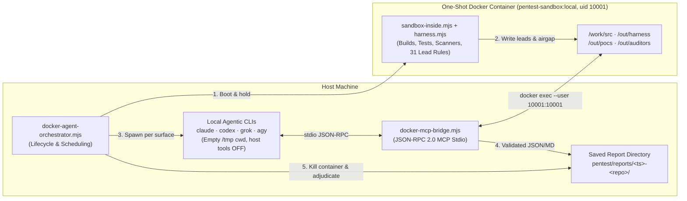

# How the Multi-Agent Pentest Suite Works

> **Visual HTML Explainer**: Open [`pentest/docs/index.html`](index.html) (`pentest/docs/style.css`) in any browser for interactive SVG architecture diagrams, lifecycle charts, CLI isolation cards, and scoring charts styled identically to `report.html`.

---

## 1. Overview & Design Goals

The pentest suite audits any local repository (`--repo <path>`) or remote GitHub repository (`--github <owner/repo>`) using four local agentic CLIs (**`claude`**, **`codex`**, **`grok`**, **`agy`**) while enforcing two strict invariants:

1. **All builds, tests, static scanners, lead harnesses, file reads, searches, and PoCs execute inside a single disposable one-shot Docker container (`pentest-sandbox:local`, running as `uid 10001:10001`).**
2. **The one-shot Docker container is airgapped before any AI agent connects, and is guaranteed to be killed and removed (`docker rm -f`) when the audit completes.**

---

## 2. End-to-End Architecture

---

## 3. The 5 Lifecycle Stages

### Stage 1: Target Resolution & Sealed Source Manifest
- `pentest/bin/pentest` and `pentest/scripts/resolve-target.sh` resolve `--repo <path>` (in-place directory) or `--github <url>` (shallow clone with git hooks disabled into `/tmp/pentest-targets`).
- `docker-agent-orchestrator.mjs` captures a SHA-256 manifest of all audited text files (`source-manifest.json`).

### Stage 2: One-Shot Docker Boot, In-Container Scanners & Network Airgap
- `docker-agent-orchestrator.mjs` starts `pentest/scripts/sandbox.sh` with `--hold-file <hold.lock>` and `--ready-file <ready.json>`.
- `sandbox-lib.mjs` copies a sanitized tree into the Docker volume at `/work/src`, stripping `.env`, keypairs (`id.json`, `*.pem`, `*.key`), `.ssh`, `.aws`, `.git`, `node_modules`, and `target`.
- Inside `pentest-sandbox:local` (running as `10001:10001` with `--cap-drop ALL` and `--security-opt no-new-privileges`), `sandbox-inside.mjs` runs:
  1. **`harness.mjs`**: generates `/out/harness-leads/{summary,solana,web,config,deps,tools}.md` (31 regex patterns covering Sealevel, Trail of Bits instruction introspection, Ackee vectors, escrow invariants, OWASP sinks, and CI/container risks, plus `gitleaks`, `semgrep`, `cargo-audit`, and `osv-scanner`).
  2. **Builds & tests**: `cargo build`, `cargo test --locked`, `anchor build`, `cargo-build-sbf` (when Solana version is pinned), `npm/pnpm/yarn audit`, and local OWASP ZAP.
- When `sandbox-inside.mjs` writes `/out/checks.done`:
  - `sandbox.sh` copies `/out/harness-leads/*.md` and `sandbox.md` to `<report-dir>/harness/` and `/out/harness/`.
  - **Airgapping**: `sandbox.sh` disconnects the container from the allowlist proxy network (`docker network disconnect`) and terminates the proxy container.
  - `sandbox.sh` writes `ready.json` with `{ container, hostRunDir }` and waits while `hold.lock` exists.

### Stage 3: Multi-Agent Surface Audit via MCP Stdio Bridge
- For each scheduled surface job (`<agent>-<s1..s6>-<slug>`), `docker-agent-orchestrator.mjs` creates an isolated, empty `0700` temp directory on the host and launches the agent CLI connected to `docker-mcp-bridge.mjs`:
  - **`claude`**: `--print --strict-mcp-config --mcp-config mcp.json --tools "" --permission-mode dontAsk --allowedTools mcp__pentest_docker__*`
  - **`codex`**: `codex exec --ephemeral --skip-git-repo-check --ignore-rules -s read-only -C <workDir> -c mcp_servers={pentest_docker={...}} -c model_reasoning_effort="high" -m <model> -`
  - **`grok`**: `grok -p <prompt> --cwd <workDir> --tools "" --always-approve --permission-mode bypassPermissions --no-subagents --disable-web-search -m <model>` (with `<workDir>/.grok/config.toml`)
  - **`agy`**: `agy --print --dangerously-skip-permissions --disable-slash-commands --model <model> -p <prompt>` (with `<workDir>/.agents/plugins/pentest-docker/{plugin.json,mcp_config.json,hooks.json}` blocking host tools via a `PreToolUse` hook)
- Every MCP tool carries `annotations: { readOnlyHint: true, destructiveHint: false, openWorldHint: false }` so non-interactive CLIs auto-approve calls to `pentest_docker`.

### Stage 4: Peer Cross-Check Pass & Guaranteed Teardown
- Once all surface auditors finish, `loadAuditorFindings()` collects every reported finding.
- Each agent is invoked a second time (`--role crosscheck`) with the claims reported by the **other** models (`<report-dir>/crosscheck/<agent>.json`).
- Reviewers inspect the cited `file:line` locations inside the container via `read_file` / `search_code` / `run_container_check` and call `submit_crosscheck_report` with `upheld`, `partial`, or `refuted` verdicts (`auditors/crosscheck-<agent>.json`).
- **Guaranteed Teardown**: In the orchestrator's `finally` block (and `SIGINT`/`SIGTERM` handlers), `session.stop()` deletes `hold.lock`, waits for `sandbox.sh`'s `trap finish EXIT` cleanup, and runs `docker rm -f <container>` so no container, volume, or network is ever left behind.

### Stage 5: Quorum Adjudication & HTML Report Generation
- `verify-and-adjudicate.mjs` validates all auditor JSON/Markdown outputs against `report-contract.mjs`, clusters findings with matching normalized titles and overlapping `file:line` citations, applies cross-check verdicts, and writes:
  - `findings-and-scores.json`
  - `verified-safe.json`
  - `report-health.json` (`validated_outputs` or `incomplete`)
- `generate-html-report.mjs` renders standalone, offline-ready `report.html` and `findings-by-model.html`.

---

## 4. MCP Bridge Tool Reference (`docker-mcp-bridge.mjs`)

| Tool | Role | Container Roots | Description |
|---|---|---|---|
| `get_audit_context` | `auditor`, `crosscheck` | `/out/harness`, `/out/crosscheck` | Returns container ID, assigned surface, `harness/summary.md`, `solana.md`, and assigned peer claims. |
| `list_files` | `auditor`, `crosscheck` | `/work/src`, `/out/*` | Lists files and sizes up to depth 6 inside the container. |
| `read_file` | `auditor`, `crosscheck` | `/work/src`, `/out/harness` | Reads up to 400 lines with 1-based line numbers (`1: ...`). |
| `search_code` | `auditor`, `crosscheck` | `/work/src`, `/out/harness` | Searches files inside the container by regex or literal string, returning `file:line: snippet`. |
| `run_container_check` | `auditor`, `crosscheck` | `/work/src` | Runs allowlisted commands (`cargo`, `anchor`, `rustc`, `osv-scanner`, `gitleaks`, `semgrep`, `node`, `npm`, `grep`, `find`, etc.) as `uid 10001`. |
| `write_poc` | `auditor`, `crosscheck` | `/out/pocs/<auditor>` | Saves a PoC file and optionally compiles/runs Rust `#[test]` PoCs via `cargo test --locked --test <name>`. |
| `submit_audit_report` | `auditor` | `/out/auditors/<auditor>.{json,md}` | Validates and writes the auditor's final `.json` and `.md` surface report. |
| `submit_crosscheck_report` | `crosscheck` | `/out/auditors/crosscheck-<agent>.json` | Validates and writes peer cross-check verdicts (`upheld`, `partial`, `refuted`) for all assigned claims. |

---

## 5. Scoring Formula

Each clustered finding receives a heuristic priority score (`0.0` – `10.0`):

$$\text{Score} = \text{SeverityWeight} \times \text{StatusMultiplier} \times \text{ConfidenceFactor}$$

- **Severity Weights**: `critical = 10.0`, `high = 8.5`, `medium = 5.5`, `low = 2.5`, `info = 1.0`
- **Status Multipliers**:
  - `MODEL_AGREEMENT` (2+ independent first-pass models cite overlapping `file:line`): `× 0.80`
  - `UPHELD_REVIEW` (single model, upheld by peer cross-check): `× 0.75`
  - `PARTIAL_REVIEW` (mixed/partial peer cross-check): `× 0.70`
  - `MODEL_ASSERTION` (unreviewed single model claim): `× 0.60`
  - `REFUTED_REVIEW` (all peer cross-checkers refuted): `× 0.00`
- **Confidence Factor**: `confirmed = × 1.00`, `probable = × 0.85`
